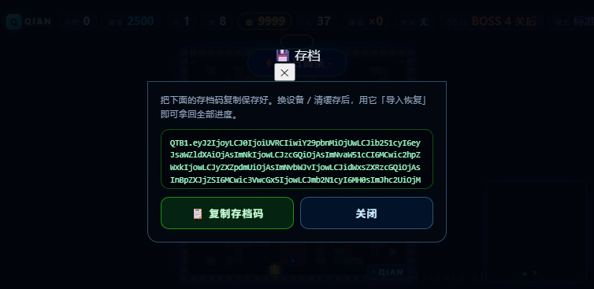

# QIAN 坦克大战 · Tank Battle

把经典坦克大战装进浏览器：守护基地、迎战 Boss、组合强化，打造自己的坦克。电脑和手机都能玩，无需下载或注册。

**[▶ 立即开玩](https://qianwinner.github.io/Tank-battle/)** · [提交问题或建议](https://github.com/QIANwinner/Tank-battle/issues) · [更新记录](RELEASE_NOTES.md)


> 项目持续公测中。欢迎反馈操作手感、关卡难度、设备兼容性，以及你希望加入的新玩法。

## 游戏里有什么

### 经典战斗，更多变化

保护地图底部的基地，消灭敌军并推进关卡。砖墙可以打碎，钢墙、水面和草丛改变行进路线与交战视野；油桶能引发爆炸，传送门让战场出现新的绕行机会。

普通、快速、装甲、精英、狙击、自爆、工兵等敌人各有特点，每 5 关还会迎来 Boss。护盾、快速弹、双管炮、加命、冻结和炸弹等道具，帮助你扭转局面。

### 每局构筑，跨局成长

- **局内强化**：过关后三选一，组合穿透、散射、爆破等效果。
- **长期养成**：积累金币，购买永久加成、升级基地，收集坦克与武器皮肤。
- **英雄与宠物**：搭配英雄、宠物和羁绊，尝试不同战斗组合。
- **成长记录**：挑战成就、收集关卡星级，查看生涯统计和本地战绩。

### 一个人闯关，也能一起玩

- **经典闯关**：守护基地，挑战逐渐增强的敌军与 Boss。
- **每日与每周挑战**：挑战变化的规则和目标。
- **无尽生存**：面对持续增强的敌人，冲击更高波次。
- **双人同屏**：共用一台设备，合作闯关或进行对抗。
- **自制地图**：用地图编辑器绘制地形，保存作品，并通过分享码交换关卡。



## 怎么操作

单人键盘操作：

- **W / A / S / D 或方向键**：移动，支持组合按键斜向行进。
- **空格 / J**：开火。
- **E**：释放已充能的大招。
- **P**：暂停或继续。
- **M**：切换静音。
- **F**：切换全屏，取决于浏览器支持。

双人模式：P1 使用 **WASD + 空格 / J**，P2 使用 **方向键 + 回车 / .**。

手机和平板使用虚拟摇杆移动、触屏按钮开火；其他技能与操作以游戏内提示为准。切换窗口或标签页时，游戏会自动暂停。

## 安装、离线与存档

直接打开 [在线游戏](https://qianwinner.github.io/Tank-battle/) 即可游玩。支持的浏览器还可以将游戏添加到主屏幕。

在线访问并完成资源缓存后，可以离线游玩。离线缓存依赖 Service Worker，需要通过 HTTPS 或 localhost 访问；直接双击 HTML 文件时不提供这项能力。

金币、解锁内容、设置和战绩主要保存在当前浏览器的 `localStorage` 中。更换浏览器或设备不会自动同步，清除网站数据也会清除这些记录。本地排行榜用于记录当前浏览器的战绩。

设置中提供音量、画质和减弱动效选项，可按设备性能与个人偏好调整。全屏、震动、剪贴板和安装能力因浏览器而异。

## v1.0.0 更新

新增保存失败提示与重试、完整养成备份、精简战斗信息设置，并完善离线缓存和自动回归。详细内容见 [发布记录](RELEASE_NOTES.md)。

## 🆕 更新日志

### v1.1.75 · 2026-11-15
**伤害阶梯**
- 伤害阶梯（新增 DOM/CSS/状态逻辑 + 6 条专项断言）
- ✅ 回归验证：主套件 169/169 + 反馈专项 8318/8318（无回归）
- 📴 Service Worker 缓存版本更新至 **v1175**，游戏内版本 **V1.1.75**

### v1.1.74 · 2026-11-15
**金币阶梯**
- 金币阶梯（新增 DOM/CSS/状态逻辑 + 6 条专项断言）
- ✅ 回归验证：主套件 169/169 + 反馈专项 8312/8312（无回归）
- 📴 Service Worker 缓存版本更新至 **v1174**，游戏内版本 **V1.1.74**

### v1.1.73 · 2026-11-15
**击杀阶梯**
- 击杀阶梯（新增 DOM/CSS/状态逻辑 + 6 条专项断言）
- ✅ 回归验证：主套件 169/169 + 反馈专项 8306/8306（无回归）
- 📴 Service Worker 缓存版本更新至 **v1173**，游戏内版本 **V1.1.73**

### v1.1.72 · 2026-11-15
**阵亡对照**
- 阵亡对照（新增 DOM/CSS/状态逻辑 + 6 条专项断言）
- ✅ 回归验证：主套件 169/169 + 反馈专项 8300/8300（无回归）
- 📴 Service Worker 缓存版本更新至 **v1172**，游戏内版本 **V1.1.72**

### v1.1.71 · 2026-11-15
**受击对照**
- 受击对照（新增 DOM/CSS/状态逻辑 + 6 条专项断言）
- ✅ 回归验证：主套件 169/169 + 反馈专项 8294/8294（无回归）
- 📴 Service Worker 缓存版本更新至 **v1171**，游戏内版本 **V1.1.71**

### v1.1.70 · 2026-11-15
**道具对照**
- 道具对照（新增 DOM/CSS/状态逻辑 + 6 条专项断言）
- ✅ 回归验证：主套件 169/169 + 反馈专项 8288/8288（无回归）
- 📴 Service Worker 缓存版本更新至 **v1170**，游戏内版本 **V1.1.70**

### v1.1.69 · 2026-11-15
**射击对照**
- 射击对照（新增 DOM/CSS/状态逻辑 + 6 条专项断言）
- ✅ 回归验证：主套件 169/169 + 反馈专项 8282/8282（无回归）
- 📴 Service Worker 缓存版本更新至 **v1169**，游戏内版本 **V1.1.69**

### v1.1.68 · 2026-11-15
**命中对照**
- 命中对照（新增 DOM/CSS/状态逻辑 + 6 条专项断言）
- ✅ 回归验证：主套件 169/169 + 反馈专项 8276/8276（无回归）
- 📴 Service Worker 缓存版本更新至 **v1168**，游戏内版本 **V1.1.68**

### v1.1.67 · 2026-11-15
**伤害对照**
- 伤害对照（新增 DOM/CSS/状态逻辑 + 6 条专项断言）
- ✅ 回归验证：主套件 169/169 + 反馈专项 8270/8270（无回归）
- 📴 Service Worker 缓存版本更新至 **v1167**，游戏内版本 **V1.1.67**

### v1.1.66 · 2026-11-15
**金币对照**
- 金币对照（新增 DOM/CSS/状态逻辑 + 6 条专项断言）
- ✅ 回归验证：主套件 169/169 + 反馈专项 8264/8264（无回归）
- 📴 Service Worker 缓存版本更新至 **v1166**，游戏内版本 **V1.1.66**

### v1.1.65 · 2026-11-15
**击杀对照**
- 击杀对照（新增 DOM/CSS/状态逻辑 + 6 条专项断言）
- ✅ 回归验证：主套件 169/169 + 反馈专项 8258/8258（无回归）
- 📴 Service Worker 缓存版本更新至 **v1165**，游戏内版本 **V1.1.65**

### v1.1.64 · 2026-11-15
**BOSS节拍**
- BOSS节拍（新增 DOM/CSS/状态逻辑 + 6 条专项断言）
- ✅ 回归验证：主套件 169/169 + 反馈专项 8252/8252（无回归）
- 📴 Service Worker 缓存版本更新至 **v1164**，游戏内版本 **V1.1.64**

### v1.1.63 · 2026-11-15
**命中节拍**
- 命中节拍（新增 DOM/CSS/状态逻辑 + 6 条专项断言）
- ✅ 回归验证：主套件 169/169 + 反馈专项 8246/8246（无回归）
- 📴 Service Worker 缓存版本更新至 **v1163**，游戏内版本 **V1.1.63**

### v1.1.62 · 2026-11-15
**强化节拍**
- 强化节拍（新增 DOM/CSS/状态逻辑 + 6 条专项断言）
- ✅ 回归验证：主套件 169/169 + 反馈专项 8240/8240（无回归）
- 📴 Service Worker 缓存版本更新至 **v1162**，游戏内版本 **V1.1.62**

### v1.1.61 · 2026-11-15
**波次节拍**
- 波次节拍（新增 DOM/CSS/状态逻辑 + 6 条专项断言）
- ✅ 回归验证：主套件 169/169 + 反馈专项 8234/8234（无回归）
- 📴 Service Worker 缓存版本更新至 **v1161**，游戏内版本 **V1.1.61**

### v1.1.60 · 2026-11-15
**受击节拍**
- 受击节拍（新增 DOM/CSS/状态逻辑 + 6 条专项断言）
- ✅ 回归验证：主套件 169/169 + 反馈专项 8228/8228（无回归）
- 📴 Service Worker 缓存版本更新至 **v1160**，游戏内版本 **V1.1.60**

### v1.1.59 · 2026-11-15
**道具节拍**
- 道具节拍（新增 DOM/CSS/状态逻辑 + 6 条专项断言）
- ✅ 回归验证：主套件 169/169 + 反馈专项 8222/8222（无回归）
- 📴 Service Worker 缓存版本更新至 **v1159**，游戏内版本 **V1.1.59**

### v1.1.58 · 2026-11-15
**金币节拍**
- 金币节拍（新增 DOM/CSS/状态逻辑 + 6 条专项断言）
- ✅ 回归验证：主套件 169/169 + 反馈专项 8216/8216（无回归）
- 📴 Service Worker 缓存版本更新至 **v1158**，游戏内版本 **V1.1.58**

### v1.1.57 · 2026-11-15
**击杀节拍**
- 击杀节拍（新增 DOM/CSS/状态逻辑 + 6 条专项断言）
- ✅ 回归验证：主套件 169/169 + 反馈专项 8210/8210（无回归）
- 📴 Service Worker 缓存版本更新至 **v1157**，游戏内版本 **V1.1.57**

### v1.1.56 · 2026-11-15
**威胁风向**
- 威胁风向（新增 DOM/CSS/状态逻辑 + 6 条专项断言）
- ✅ 回归验证：主套件 169/169 + 反馈专项 8204/8204（无回归）
- 📴 Service Worker 缓存版本更新至 **v1156**，游戏内版本 **V1.1.56**

### v1.1.55 · 2026-11-15
**波次风向**
- 波次风向（新增 DOM/CSS/状态逻辑 + 6 条专项断言）
- ✅ 回归验证：主套件 169/169 + 反馈专项 8198/8198（无回归）
- 📴 Service Worker 缓存版本更新至 **v1155**，游戏内版本 **V1.1.55**

### v1.1.54 · 2026-11-15
**命中风向**
- 命中风向（新增 DOM/CSS/状态逻辑 + 6 条专项断言）
- ✅ 回归验证：主套件 169/169 + 反馈专项 8192/8192（无回归）
- 📴 Service Worker 缓存版本更新至 **v1154**，游戏内版本 **V1.1.54**

### v1.1.53 · 2026-11-15
**连击风向**
- 连击风向（新增 DOM/CSS/状态逻辑 + 6 条专项断言）
- ✅ 回归验证：主套件 169/169 + 反馈专项 8186/8186（无回归）
- 📴 Service Worker 缓存版本更新至 **v1153**，游戏内版本 **V1.1.53**

### v1.1.52 · 2026-11-15
**输出风向**
- 输出风向（新增 DOM/CSS/状态逻辑 + 6 条专项断言）
- ✅ 回归验证：主套件 169/169 + 反馈专项 8180/8180（无回归）
- 📴 Service Worker 缓存版本更新至 **v1152**，游戏内版本 **V1.1.52**

### v1.1.51 · 2026-11-15
**击杀风向**
- 击杀风向（新增 DOM/CSS/状态逻辑 + 6 条专项断言）
- ✅ 回归验证：主套件 169/169 + 反馈专项 8174/8174（无回归）
- 📴 Service Worker 缓存版本更新至 **v1151**，游戏内版本 **V1.1.51**

### v1.1.50 · 2026-11-15
**金币风向**
- 金币风向（新增 DOM/CSS/状态逻辑 + 6 条专项断言）
- ✅ 回归验证：主套件 169/169 + 反馈专项 8168/8168（无回归）
- 📴 Service Worker 缓存版本更新至 **v1150**，游戏内版本 **V1.1.50**

### v1.1.49 · 2026-11-15
**得分风向**
- 得分风向（新增 DOM/CSS/状态逻辑 + 6 条专项断言）
- ✅ 回归验证：主套件 169/169 + 反馈专项 8162/8162（无回归）
- 📴 Service Worker 缓存版本更新至 **v1149**，游戏内版本 **V1.1.49**

### v1.1.48 · 2026-11-15
**输出对表**
- 输出对表（新增 DOM/CSS/状态逻辑 + 6 条专项断言）
- ✅ 回归验证：主套件 169/169 + 反馈专项 8156/8156（无回归）
- 📴 Service Worker 缓存版本更新至 **v1148**，游戏内版本 **V1.1.48**

### v1.1.47 · 2026-11-15
**补给对表**
- 补给对表（新增 DOM/CSS/状态逻辑 + 6 条专项断言）
- ✅ 回归验证：主套件 169/169 + 反馈专项 8150/8150（无回归）
- 📴 Service Worker 缓存版本更新至 **v1147**，游戏内版本 **V1.1.47**

### v1.1.46 · 2026-11-15
**强化对表**
- 强化对表（新增 DOM/CSS/状态逻辑 + 6 条专项断言）
- ✅ 回归验证：主套件 169/169 + 反馈专项 8144/8144（无回归）
- 📴 Service Worker 缓存版本更新至 **v1146**，游戏内版本 **V1.1.46**

### v1.1.45 · 2026-11-15
**金币对表**
- 金币对表（新增 DOM/CSS/状态逻辑 + 6 条专项断言）
- ✅ 回归验证：主套件 169/169 + 反馈专项 8138/8138（无回归）
- 📴 Service Worker 缓存版本更新至 **v1145**，游戏内版本 **V1.1.45**

### v1.1.44 · 2026-11-15
**连击对表**
- 连击对表（新增 DOM/CSS/状态逻辑 + 6 条专项断言）
- ✅ 回归验证：主套件 169/169 + 反馈专项 8132/8132（无回归）
- 📴 Service Worker 缓存版本更新至 **v1144**，游戏内版本 **V1.1.44**

### v1.1.43 · 2026-11-15
**Boss对表**
- Boss对表（新增 DOM/CSS/状态逻辑 + 6 条专项断言）
- ✅ 回归验证：主套件 169/169 + 反馈专项 8126/8126（无回归）
- 📴 Service Worker 缓存版本更新至 **v1143**，游戏内版本 **V1.1.43**

### v1.1.42 · 2026-11-15
**波次对表**
- 波次对表（新增 DOM/CSS/状态逻辑 + 6 条专项断言）
- ✅ 回归验证：主套件 169/169 + 反馈专项 8120/8120（无回归）
- 📴 Service Worker 缓存版本更新至 **v1142**，游戏内版本 **V1.1.42**

### v1.1.41 · 2026-11-15
**清敌对表**
- 清敌对表（新增 DOM/CSS/状态逻辑 + 6 条专项断言）
- ✅ 回归验证：主套件 169/169 + 反馈专项 8114/8114（无回归）
- 📴 Service Worker 缓存版本更新至 **v1141**，游戏内版本 **V1.1.41**

### v1.1.40 · 2026-11-15
**波次脉冲**
- 波次脉冲（新增 DOM/CSS/状态逻辑 + 6 条专项断言）
- ✅ 回归验证：主套件 169/169 + 反馈专项 8108/8108（无回归）
- 📴 Service Worker 缓存版本更新至 **v1140**，游戏内版本 **V1.1.40**

### v1.1.39 · 2026-11-15
**补给脉冲**
- 补给脉冲（新增 DOM/CSS/状态逻辑 + 6 条专项断言）
- ✅ 回归验证：主套件 169/169 + 反馈专项 8102/8102（无回归）
- 📴 Service Worker 缓存版本更新至 **v1139**，游戏内版本 **V1.1.39**

### v1.1.38 · 2026-11-15
**受击脉冲**
- 受击脉冲（新增 DOM/CSS/状态逻辑 + 6 条专项断言）
- ✅ 回归验证：主套件 169/169 + 反馈专项 8096/8096（无回归）
- 📴 Service Worker 缓存版本更新至 **v1138**，游戏内版本 **V1.1.38**

### v1.1.37 · 2026-11-15
**弹幕脉冲**
- 弹幕脉冲（新增 DOM/CSS/状态逻辑 + 6 条专项断言）
- ✅ 回归验证：主套件 169/169 + 反馈专项 8090/8090（无回归）
- 📴 Service Worker 缓存版本更新至 **v1137**，游戏内版本 **V1.1.37**

### v1.1.36 · 2026-11-15
**连击脉冲**
- 连击脉冲（新增 DOM/CSS/状态逻辑 + 6 条专项断言）
- ✅ 回归验证：主套件 169/169 + 反馈专项 8084/8084（无回归）
- 📴 Service Worker 缓存版本更新至 **v1136**，游戏内版本 **V1.1.36**

### v1.1.35 · 2026-11-15
**命中脉冲**
- 命中脉冲（新增 DOM/CSS/状态逻辑 + 6 条专项断言）
- ✅ 回归验证：主套件 169/169 + 反馈专项 8078/8078（无回归）
- 📴 Service Worker 缓存版本更新至 **v1135**，游戏内版本 **V1.1.35**

### v1.1.34 · 2026-11-15
**击杀脉冲**
- 击杀脉冲（新增 DOM/CSS/状态逻辑 + 6 条专项断言）
- ✅ 回归验证：主套件 169/169 + 反馈专项 8072/8072（无回归）
- 📴 Service Worker 缓存版本更新至 **v1134**，游戏内版本 **V1.1.34**

### v1.1.33 · 2026-11-15
**输出脉冲**
- 输出脉冲（新增 DOM/CSS/状态逻辑 + 6 条专项断言）
- ✅ 回归验证：主套件 169/169 + 反馈专项 8066/8066（无回归）
- 📴 Service Worker 缓存版本更新至 **v1133**，游戏内版本 **V1.1.33**

### v1.1.30 · 2026-11-15
**磁暴压力**
- 磁暴压力（新增 DOM/CSS/状态逻辑 + 6 条专项断言）
- ✅ 回归验证：主套件 169/169 + 反馈专项 8048/8048（无回归）
- 📴 Service Worker 缓存版本更新至 **v1130**，游戏内版本 **V1.1.30**

### v1.1.32 · 2026-11-15
**走位压力**
- 走位压力（新增 DOM/CSS/状态逻辑 + 6 条专项断言）
- ✅ 回归验证：主套件 169/169 + 反馈专项 8060/8060（无回归）
- 📴 Service Worker 缓存版本更新至 **v1132**，游戏内版本 **V1.1.32**

### v1.1.31 · 2026-11-15
**最高分压力**
- 最高分压力（新增 DOM/CSS/状态逻辑 + 6 条专项断言）
- ✅ 回归验证：主套件 169/169 + 反馈专项 8054/8054（无回归）
- 📴 Service Worker 缓存版本更新至 **v1131**，游戏内版本 **V1.1.31**

### v1.1.28 · 2026-11-15
**首领压力**
- 首领压力（新增 DOM/CSS/状态逻辑 + 6 条专项断言）
- ✅ 回归验证：主套件 169/169 + 反馈专项 8036/8036（无回归）
- 📴 Service Worker 缓存版本更新至 **v1128**，游戏内版本 **V1.1.28**

### v1.1.27 · 2026-11-15
**弹幕压力**
- 弹幕压力（新增 DOM/CSS/状态逻辑 + 6 条专项断言）
- ✅ 回归验证：主套件 169/169 + 反馈专项 8030/8030（无回归）
- 📴 Service Worker 缓存版本更新至 **v1127**，游戏内版本 **V1.1.27**

### v1.1.26 · 2026-11-15
**连击压力**
- 连击压力（新增 DOM/CSS/状态逻辑 + 6 条专项断言）
- ✅ 回归验证：主套件 169/169 + 反馈专项 8024/8024（无回归）
- 📴 Service Worker 缓存版本更新至 **v1126**，游戏内版本 **V1.1.26**

### v1.1.25 · 2026-11-15
**生命压力**
- 生命压力（新增 DOM/CSS/状态逻辑 + 6 条专项断言）
- ✅ 回归验证：主套件 169/169 + 反馈专项 8018/8018（无回归）
- 📴 Service Worker 缓存版本更新至 **v1125**，游戏内版本 **V1.1.25**

### v1.1.24 · 2026-11-15
**最佳波追近分段**
- 最佳波追近分段
- ✅ 回归验证：主套件 169/169 + 反馈专项 8012/8012（无回归）
- 📴 Service Worker 缓存版本更新至 **v1124**，游戏内版本 **V1.1.24**

### v1.1.23 · 2026-11-14
**最高分追近分段**
- 最高分追近分段（新增 DOM/CSS/状态逻辑 + 6 条专项断言）
- ✅ 回归验证：主套件 169/169 + 反馈专项 8006/8006（无回归）
- 📴 Service Worker 缓存版本更新至 **v1123**，游戏内版本 **V1.1.23**

### v1.1.22 · 2026-11-14
**弹幕压制分段**
- 弹幕压制分段（新增 DOM/CSS/状态逻辑 + 6 条专项断言）
- ✅ 回归验证：主套件 169/169 + 反馈专项 8000/8000（无回归）
- 📴 Service Worker 缓存版本更新至 **v1122**，游戏内版本 **V1.1.22**

### v1.1.21 · 2026-11-14
**命中率分段**
- 命中率分段（新增 DOM/CSS/状态逻辑 + 6 条专项断言）
- ✅ 回归验证：主套件 169/169 + 反馈专项 7994/7994（无回归）
- 📴 Service Worker 缓存版本更新至 **v1121**，游戏内版本 **V1.1.21**

### v1.1.20 · 2026-11-14
**击杀阵亡分段**
- 击杀阵亡分段（新增 DOM/CSS/状态逻辑 + 6 条专项断言）
- ✅ 回归验证：主套件 169/169 + 反馈专项 7988/7988（无回归）
- 📴 Service Worker 缓存版本更新至 **v1120**，游戏内版本 **V1.1.20**

### v1.1.19 · 2026-11-14
**关卡进度分段**
- 关卡进度分段（新增 DOM/CSS/状态逻辑 + 6 条专项断言）
- ✅ 回归验证：主套件 169/169 + 反馈专项 7982/7982（无回归）
- 📴 Service Worker 缓存版本更新至 **v1119**，游戏内版本 **V1.1.19**

### v1.1.18 · 2026-11-14
**连击分段**
- 连击分段（新增 DOM/CSS/状态逻辑 + 6 条专项断言）
- ✅ 回归验证：主套件 169/169 + 反馈专项 7976/7976（无回归）
- 📴 Service Worker 缓存版本更新至 **v1118**，游戏内版本 **V1.1.18**

### v1.1.17 · 2026-11-14
**生命分段**
- 生命分段（新增 DOM/CSS/状态逻辑 + 6 条专项断言）
- ✅ 回归验证：主套件 169/169 + 反馈专项 7970/7970（无回归）
- 📴 Service Worker 缓存版本更新至 **v1117**，游戏内版本 **V1.1.17**

### v1.1.16 · 2026-11-14
**续航评级**
- 续航评级（新增 DOM/CSS/状态逻辑 + 6 条专项断言）
- ✅ 回归验证：主套件 169/169 + 反馈专项 7964/7964（无回归）
- 📴 Service Worker 缓存版本更新至 **v1116**，游戏内版本 **V1.1.16**

### v1.1.15 · 2026-11-14
**讨伐评级**
- 讨伐评级（新增 DOM/CSS/状态逻辑 + 6 条专项断言）
- ✅ 回归验证：主套件 169/169 + 反馈专项 7958/7958（无回归）
- 📴 Service Worker 缓存版本更新至 **v1115**，游戏内版本 **V1.1.15**

### v1.1.14 · 2026-11-14
**补给评级**
- 补给评级（新增 DOM/CSS/状态逻辑 + 6 条专项断言）
- ✅ 回归验证：主套件 169/169 + 反馈专项 7952/7952（无回归）
- 📴 Service Worker 缓存版本更新至 **v1114**，游戏内版本 **V1.1.14**

### v1.1.13 · 2026-11-14
**命中评级**
- 命中评级（新增 DOM/CSS/状态逻辑 + 6 条专项断言）
- ✅ 回归验证：主套件 169/169 + 反馈专项 7946/7946（无回归）
- 📴 Service Worker 缓存版本更新至 **v1113**，游戏内版本 **V1.1.13**

### v1.1.12 · 2026-11-14
**收益评级**
- 收益评级（新增 DOM/CSS/状态逻辑 + 6 条专项断言）
- ✅ 回归验证：主套件 169/169 + 反馈专项 7940/7940（无回归）
- 📴 Service Worker 缓存版本更新至 **v1112**，游戏内版本 **V1.1.12**

### v1.1.11 · 2026-11-14
**节奏评级**
- 节奏评级（新增 DOM/CSS/状态逻辑 + 6 条专项断言）
- ✅ 回归验证：主套件 169/169 + 反馈专项 7934/7934（无回归）
- 📴 Service Worker 缓存版本更新至 **v1111**，游戏内版本 **V1.1.11**

### v1.1.10 · 2026-11-14
**射效评级**
- 射效评级（新增 DOM/CSS/状态逻辑 + 6 条专项断言）
- ✅ 回归验证：主套件 169/169 + 反馈专项 7928/7928（无回归）
- 📴 Service Worker 缓存版本更新至 **v1110**，游戏内版本 **V1.1.10**

### v1.1.9 · 2026-11-14
**战绩评级**
- 战绩评级（新增 DOM/CSS/状态逻辑 + 6 条专项断言）
- ✅ 回归验证：主套件 169/169 + 反馈专项 7922/7922（无回归）
- 📴 Service Worker 缓存版本更新至 **v119**，游戏内版本 **V1.1.9**

### v1.1.8 · 2026-11-14
**存活时长**
- 存活时长（新增 DOM/CSS/状态逻辑 + 6 条专项断言）
- ✅ 回归验证：主套件 169/169 + 反馈专项 7916/7916（无回归）
- 📴 Service Worker 缓存版本更新至 **v118**，游戏内版本 **V1.1.8**

### v1.1.7 · 2026-11-14
**拾取里程碑**
- 拾取里程碑（新增 DOM/CSS/状态逻辑 + 6 条专项断言）
- ✅ 回归验证：主套件 169/169 + 反馈专项 7910/7910（无回归）
- 📴 Service Worker 缓存版本更新至 **v117**，游戏内版本 **V1.1.7**

### v1.1.6 · 2026-11-14
**Boss斩杀**
- Boss斩杀（新增 DOM/CSS/状态逻辑 + 6 条专项断言）
- ✅ 回归验证：主套件 169/169 + 反馈专项 7904/7904（无回归）
- 📴 Service Worker 缓存版本更新至 **v116**，游戏内版本 **V1.1.6**

### v1.1.5 · 2026-11-14
**强化里程碑**
- 强化里程碑（新增 DOM/CSS/状态逻辑 + 6 条专项断言）
- ✅ 回归验证：主套件 169/169 + 反馈专项 7898/7898（无回归）
- 📴 Service Worker 缓存版本更新至 **v115**，游戏内版本 **V1.1.5**

### v1.1.4 · 2026-11-14
**伤害里程碑**
- 伤害里程碑（新增 DOM/CSS/状态逻辑 + 6 条专项断言）
- ✅ 回归验证：主套件 169/169 + 反馈专项 7892/7892（无回归）
- 📴 Service Worker 缓存版本更新至 **v114**，游戏内版本 **V1.1.4**

### v1.1.3 · 2026-11-14
**金币里程碑**
- 金币里程碑（新增 DOM/CSS/状态逻辑 + 6 条专项断言）
- ✅ 回归验证：主套件 169/169 + 反馈专项 7886/7886（无回归）
- 📴 Service Worker 缓存版本更新至 **v113**，游戏内版本 **V1.1.3**

### v1.1.2 · 2026-11-14
**击杀里程碑**
- 击杀里程碑（新增 DOM/CSS/状态逻辑 + 6 条专项断言）
- ✅ 回归验证：主套件 169/169 + 反馈专项 7880/7880（无回归）
- 📴 Service Worker 缓存版本更新至 **v112**，游戏内版本 **V1.1.2**

### v1.1.1 · 2026-11-14
**得分里程碑**
- 得分里程碑（新增 DOM/CSS/状态逻辑 + 6 条专项断言）
- ✅ 回归验证：主套件 169/169 + 反馈专项 7874/7874（无回归）
- 📴 Service Worker 缓存版本更新至 **v111**，游戏内版本 **V1.1.1**

### v1.1.0 · 2026-11-14
**弹幕密度**
- 弹幕密度（新增 DOM/CSS/状态逻辑 + 6 条专项断言）
- ✅ 回归验证：主套件 169/169 + 反馈专项 7868/7868（无回归）
- 📴 Service Worker 缓存版本更新至 **v110**，游戏内版本 **V1.1.0**

### v1.0.99 · 2026-11-14
**受击换伤**
- 受击换伤（新增 DOM/CSS/状态逻辑 + 6 条专项断言）
- ✅ 回归验证：主套件 169/169 + 反馈专项 7862/7862（无回归）
- 📴 Service Worker 缓存版本更新至 **v1099**，游戏内版本 **V1.0.99**

### v1.0.98 · 2026-11-14
**本波击杀**
- 本波击杀（新增 DOM/CSS/状态逻辑 + 6 条专项断言）
- ✅ 回归验证：主套件 169/169 + 反馈专项 7856/7856（无回归）
- 📴 Service Worker 缓存版本更新至 **v1098**，游戏内版本 **V1.0.98**

### v1.0.97 · 2026-11-14
**生命余量**
- 生命余量（新增 DOM/CSS/状态逻辑 + 6 条专项断言）
- ✅ 回归验证：主套件 169/169 + 反馈专项 7850/7850（无回归）
- 📴 Service Worker 缓存版本更新至 **v1097**，游戏内版本 **V1.0.97**

### v1.0.96 · 2026-11-14
**基地受胁**
- 基地受胁（新增 DOM/CSS/状态逻辑 + 6 条专项断言）
- ✅ 回归验证：主套件 169/169 + 反馈专项 7844/7844（无回归）
- 📴 Service Worker 缓存版本更新至 **v1096**，游戏内版本 **V1.0.96**

### v1.0.95 · 2026-11-14
**Boss贴脸**
- Boss贴脸（新增 DOM/CSS/状态逻辑 + 6 条专项断言）
- ✅ 回归验证：主套件 169/169 + 反馈专项 7838/7838（无回归）
- 📴 Service Worker 缓存版本更新至 **v1095**，游戏内版本 **V1.0.95**

### v1.0.94 · 2026-11-14
**近场火力**
- 近场火力（新增 DOM/CSS/状态逻辑 + 6 条专项断言）
- ✅ 回归验证：主套件 169/169 + 反馈专项 7832/7832（无回归）
- 📴 Service Worker 缓存版本更新至 **v1094**，游戏内版本 **V1.0.94**

### v1.0.93 · 2026-11-14
**近场敌压**
- 近场敌压（新增 DOM/CSS/状态逻辑 + 6 条专项断言）
- ✅ 回归验证：主套件 169/169 + 反馈专项 7826/7826（无回归）
- 📴 Service Worker 缓存版本更新至 **v1093**，游戏内版本 **V1.0.93**

### v1.0.92 · 2026-11-14
**近战大招**
- 近战大招（新增 DOM/CSS/状态逻辑 + 6 条专项断言）
- ✅ 回归验证：主套件 169/169 + 反馈专项 7820/7820（无回归）
- 📴 Service Worker 缓存版本更新至 **v1092**，游戏内版本 **V1.0.92**

### v1.0.91 · 2026-11-14
**基地防御墙**
- 基地防御墙（新增 DOM/CSS/状态逻辑 + 6 条专项断言）
- ✅ 回归验证：主套件 169/169 + 反馈专项 7814/7814（无回归）
- 📴 Service Worker 缓存版本更新至 **v1091**，游戏内版本 **V1.0.91**

### v1.0.90 · 2026-11-14
**敌方弹幕**
- 敌方弹幕（新增 DOM/CSS/状态逻辑 + 6 条专项断言）
- ✅ 回归验证：主套件 169/169 + 反馈专项 7808/7808（无回归）
- 📴 Service Worker 缓存版本更新至 **v1090**，游戏内版本 **V1.0.90**

### v1.0.89 · 2026-11-14
**飘字提示**
- 飘字提示（新增 DOM/CSS/状态逻辑 + 6 条专项断言）
- ✅ 回归验证：主套件 169/169 + 反馈专项 7802/7802（无回归）
- 📴 Service Worker 缓存版本更新至 **v1089**，游戏内版本 **V1.0.89**

### v1.0.88 · 2026-11-14
**近战冲击波**
- 近战冲击波（新增 DOM/CSS/状态逻辑 + 6 条专项断言）
- ✅ 回归验证：主套件 169/169 + 反馈专项 7796/7796（无回归）
- 📴 Service Worker 缓存版本更新至 **v1088**，游戏内版本 **V1.0.88**

### v1.0.87 · 2026-11-14
**特效粒子**
- 特效粒子（新增 DOM/CSS/状态逻辑 + 6 条专项断言）
- ✅ 回归验证：主套件 169/169 + 反馈专项 7790/7790（无回归）
- 📴 Service Worker 缓存版本更新至 **v1087**，游戏内版本 **V1.0.87**

### v1.0.86 · 2026-11-14
**场上道具**
- 场上道具（新增 DOM/CSS/状态逻辑 + 6 条专项断言）
- ✅ 回归验证：主套件 169/169 + 反馈专项 7784/7784（无回归）
- 📴 Service Worker 缓存版本更新至 **v1086**，游戏内版本 **V1.0.86**

### v1.0.85 · 2026-11-14
**刷敌倒计时**
- 刷敌倒计时（新增 DOM/CSS/状态逻辑 + 6 条专项断言）
- ✅ 回归验证：主套件 169/169 + 反馈专项 7778/7778（无回归）
- 📴 Service Worker 缓存版本更新至 **v1085**，游戏内版本 **V1.0.85**

### v1.0.84 · 2026-11-14
**参战输出**
- 参战输出（新增 DOM/CSS/状态逻辑 + 6 条专项断言）
- ✅ 回归验证：主套件 169/169 + 反馈专项 7772/7772（无回归）
- 📴 Service Worker 缓存版本更新至 **v1084**，游戏内版本 **V1.0.84**

### v1.0.83 · 2026-11-14
**血量百分比**
- 血量百分比（新增 DOM/CSS/状态逻辑 + 6 条专项断言）
- ✅ 回归验证：主套件 169/169 + 反馈专项 7766/7766（无回归）
- 📴 Service Worker 缓存版本更新至 **v1083**，游戏内版本 **V1.0.83**

### v1.0.82 · 2026-11-14
**血量格**
- 血量格（新增 DOM/CSS/状态逻辑 + 6 条专项断言）
- ✅ 回归验证：主套件 169/169 + 反馈专项 7760/7760（无回归）
- 📴 Service Worker 缓存版本更新至 **v1082**，游戏内版本 **V1.0.82**

### v1.0.81 · 2026-11-14
**游走侧翼**
- 游走侧翼（新增 DOM/CSS/状态逻辑 + 6 条专项断言）
- ✅ 回归验证：主套件 169/169 + 反馈专项 7754/7754（无回归）
- 📴 Service Worker 缓存版本更新至 **v1081**，游戏内版本 **V1.0.81**

### v1.0.80 · 2026-11-14
**无敌护罩**
- 无敌护罩（新增 DOM/CSS/状态逻辑 + 6 条专项断言）
- ✅ 回归验证：主套件 169/169 + 反馈专项 7748/7748（无回归）
- 📴 Service Worker 缓存版本更新至 **v1080**，游戏内版本 **V1.0.80**

### v1.0.79 · 2026-11-14
**开火冷却**
- 开火冷却（新增 DOM/CSS/状态逻辑 + 6 条专项断言）
- ✅ 回归验证：主套件 169/169 + 反馈专项 7742/7742（无回归）
- 📴 Service Worker 缓存版本更新至 **v1079**，游戏内版本 **V1.0.79**

### v1.0.78 · 2026-11-14
**重生倒计时**
- 重生倒计时（新增 DOM/CSS/状态逻辑 + 6 条专项断言）
- ✅ 回归验证：主套件 169/169 + 反馈专项 7736/7736（无回归）
- 📴 Service Worker 缓存版本更新至 **v1078**，游戏内版本 **V1.0.78**

### v1.0.77 · 2026-11-14
**僚机状态**
- 僚机状态（新增 DOM/CSS/状态逻辑 + 6 条专项断言）
- ✅ 回归验证：主套件 169/169 + 反馈专项 7730/7730（无回归）
- 📴 Service Worker 缓存版本更新至 **v1077**，游戏内版本 **V1.0.77**

### v1.0.76 · 2026-11-14
**宠物等级**
- 宠物等级（新增 DOM/CSS/状态逻辑 + 6 条专项断言）
- ✅ 回归验证：主套件 169/169 + 反馈专项 7724/7724（无回归）
- 📴 Service Worker 缓存版本更新至 **v1076**，游戏内版本 **V1.0.76**

### v1.0.75 · 2026-11-14
**僚机编制**
- 僚机编制（新增 DOM/CSS/状态逻辑 + 6 条专项断言）
- ✅ 回归验证：主套件 169/169 + 反馈专项 7718/7718（无回归）
- 📴 Service Worker 缓存版本更新至 **v1075**，游戏内版本 **V1.0.75**

### v1.0.74 · 2026-11-14
**无尽纪录**
- 无尽纪录（新增 DOM/CSS/状态逻辑 + 6 条专项断言）
- ✅ 回归验证：主套件 169/169 + 反馈专项 7712/7712（无回归）
- 📴 Service Worker 缓存版本更新至 **v1074**，游戏内版本 **V1.0.74**

### v1.0.73 · 2026-11-14
**基地护墙**
- 基地护墙（新增 DOM/CSS/状态逻辑 + 6 条专项断言）
- ✅ 回归验证：主套件 169/169 + 反馈专项 7706/7706（无回归）
- 📴 Service Worker 缓存版本更新至 **v1073**，游戏内版本 **V1.0.73**

### v1.0.72 · 2026-11-14
**强化等级**
- 强化等级（新增 DOM/CSS/状态逻辑 + 6 条专项断言）
- ✅ 回归验证：主套件 169/169 + 反馈专项 7700/7700（无回归）
- 📴 Service Worker 缓存版本更新至 **v1072**，游戏内版本 **V1.0.72**

### v1.0.71 · 2026-11-14
**道具场存**
- 道具场存（新增 DOM/CSS/状态逻辑 + 6 条专项断言）
- ✅ 回归验证：主套件 169/169 + 反馈专项 7694/7694（无回归）
- 📴 Service Worker 缓存版本更新至 **v1071**，游戏内版本 **V1.0.71**

### v1.0.70 · 2026-11-14
**弹幕密度**
- 弹幕密度（新增 DOM/CSS/状态逻辑 + 6 条专项断言）
- ✅ 回归验证：主套件 169/169 + 反馈专项 7688/7688（无回归）
- 📴 Service Worker 缓存版本更新至 **v1070**，游戏内版本 **V1.0.70**

### v1.0.69 · 2026-11-14
**Boss血量**
- HUD 新增 Boss血量进度 pill：arsBossHp 纯函数（h/m → {v,pct,cls,danger,txt}）+ arsBossHpNow 数据源 + __tbTest 钩子 + 6 条专项断言（U7677~U7682）
- ✅ 回归验证：主套件 169/169 + 反馈专项 7682/7682（无回归）
- 📴 Service Worker 缓存版本更新至 **v1069**，游戏内版本 **V1.0.69**

### v1.0.68 · 2026-11-14
**Boss警报**
- Boss警报（新增 DOM/CSS/状态逻辑 + 6 条专项断言）
- ✅ 回归验证：主套件 169/169 + 反馈专项 7676/7676（无回归）
- 📴 Service Worker 缓存版本更新至 **v1068**，游戏内版本 **V1.0.68**

### v1.0.67 · 2026-11-14
**本关星级**
- 本关星级（新增 DOM/CSS/状态逻辑 + 6 条专项断言）
- ✅ 回归验证：主套件 169/169 + 反馈专项 7670/7670（无回归）
- 📴 Service Worker 缓存版本更新至 **v1067**，游戏内版本 **V1.0.67**

### v1.0.66 · 2026-11-14
**复活次数**
- 复活次数（新增 DOM/CSS/状态逻辑 + 6 条专项断言）
- ✅ 回归验证：主套件 169/169 + 反馈专项 7664/7664（无回归）
- 📴 Service Worker 缓存版本更新至 **v1066**，游戏内版本 **V1.0.66**

### v1.0.65 · 2026-11-14
**本关用时**
- 本关用时（新增 DOM/CSS/状态逻辑 + 6 条专项断言）
- ✅ 回归验证：主套件 169/169 + 反馈专项 7658/7658（无回归）
- 📴 Service Worker 缓存版本更新至 **v1065**，游戏内版本 **V1.0.65**

### v1.0.64 · 2026-11-14
**增益剩余**
- 增益剩余（新增 DOM/CSS/状态逻辑 + 6 条专项断言）
- ✅ 回归验证：主套件 169/169 + 反馈专项 7652/7652（无回归）
- 📴 Service Worker 缓存版本更新至 **v1064**，游戏内版本 **V1.0.64**

### v1.0.63 · 2026-11-14
**波次推进**
- 波次推进（新增 DOM/CSS/状态逻辑 + 6 条专项断言）
- ✅ 回归验证：主套件 169/169 + 反馈专项 7646/7646（无回归）
- 📴 Service Worker 缓存版本更新至 **v1063**，游戏内版本 **V1.0.63**

### v1.0.62 · 2026-11-14
**敌人剩余**
- 敌人剩余（新增 DOM/CSS/状态逻辑 + 6 条专项断言）
- ✅ 回归验证：主套件 169/169 + 反馈专项 7640/7640（无回归）
- 📴 Service Worker 缓存版本更新至 **v1062**，游戏内版本 **V1.0.62**

### v1.0.62 · 2026-11-13
**敌人剩余**
- 敌人剩余（新增 DOM/CSS/状态逻辑 + 6 条专项断言）
- ✅ 回归验证：主套件 169/169 + 反馈专项 7640/7640（无回归）
- 📴 Service Worker 缓存版本更新至 **v1062**，游戏内版本 **V1.0.62**

### v1.0.61 · 2026-11-13
**基地状态**
- 基地状态（新增 DOM/CSS/状态逻辑 + 6 条专项断言）
- ✅ 回归验证：主套件 169/169 + 反馈专项 7634/7634（无回归）
- 📴 Service Worker 缓存版本更新至 **v1061**，游戏内版本 **V1.0.61**

### v1.0.60 · 2026-11-13
**磁力半径**
- 磁力半径（新增 DOM/CSS/状态逻辑 + 6 条专项断言）
- ✅ 回归验证：主套件 169/169 + 反馈专项 7628/7628（无回归）
- 📴 Service Worker 缓存版本更新至 **v1060**，游戏内版本 **V1.0.60**

### v1.0.59 · 2026-11-13
**磁暴倍率**
- 磁暴倍率（新增 DOM/CSS/状态逻辑 + 6 条专项断言）
- ✅ 回归验证：主套件 169/169 + 反馈专项 7622/7622（无回归）
- 📴 Service Worker 缓存版本更新至 **v1059**，游戏内版本 **V1.0.59**

### v1.0.58 · 2026-11-13
**游戏阶段**
- 游戏阶段（新增 DOM/CSS/状态逻辑 + 6 条专项断言）
- ✅ 回归验证：主套件 169/169 + 反馈专项 7616/7616（无回归）
- 📴 Service Worker 缓存版本更新至 **v1058**，游戏内版本 **V1.0.58**

### v1.0.57 · 2026-11-13
**关卡过渡**
- 关卡过渡（新增 DOM/CSS/状态逻辑 + 6 条专项断言）
- ✅ 回归验证：主套件 169/169 + 反馈专项 7610/7610（无回归）
- 📴 Service Worker 缓存版本更新至 **v1057**，游戏内版本 **V1.0.57**

### v1.0.56 · 2026-11-13
**强化面板**
- 强化面板（新增 DOM/CSS/状态逻辑 + 6 条专项断言）
- ✅ 回归验证：主套件 169/169 + 反馈专项 7604/7604（无回归）
- 📴 Service Worker 缓存版本更新至 **v1056**，游戏内版本 **V1.0.56**

### v1.0.55 · 2026-11-13
**P2生命**
- P2生命（新增 DOM/CSS/状态逻辑 + 6 条专项断言）
- ✅ 回归验证：主套件 169/169 + 反馈专项 7598/7598（无回归）
- 📴 Service Worker 缓存版本更新至 **v1055**，游戏内版本 **V1.0.55**

### v1.0.54 · 2026-11-13
**双人P2在场**
- 双人P2在场（新增 DOM/CSS/状态逻辑 + 6 条专项断言）
- ✅ 回归验证：主套件 169/169 + 反馈专项 7592/7592（无回归）
- 📴 Service Worker 缓存版本更新至 **v1054**，游戏内版本 **V1.0.54**

### v1.0.53 · 2026-11-13
**对战模式**
- 对战模式（新增 DOM/CSS/状态逻辑 + 6 条专项断言）
- ✅ 回归验证：主套件 169/169 + 反馈专项 7586/7586（无回归）
- 📴 Service Worker 缓存版本更新至 **v1053**，游戏内版本 **V1.0.53**

### v1.0.52 · 2026-11-13
**音效音量**
- 音效音量（新增 DOM/CSS/状态逻辑 + 6 条专项断言）
- ✅ 回归验证：主套件 169/169 + 反馈专项 7580/7580（无回归）
- 📴 Service Worker 缓存版本更新至 **v1052**，游戏内版本 **V1.0.52**

### v1.0.51 · 2026-11-13
**音乐音量**
- 音乐音量（新增 DOM/CSS/状态逻辑 + 6 条专项断言）
- ✅ 回归验证：主套件 169/169 + 反馈专项 7574/7574（无回归）
- 📴 Service Worker 缓存版本更新至 **v1051**，游戏内版本 **V1.0.51**

### v1.0.50 · 2026-11-13
**画质档位**
- 画质档位（新增 DOM/CSS/状态逻辑 + 6 条专项断言）
- ✅ 回归验证：主套件 169/169 + 反馈专项 7568/7568（无回归）
- 📴 Service Worker 缓存版本更新至 **v1050**，游戏内版本 **V1.0.50**

### v1.0.49 · 2026-11-13
**生涯局数**
- 生涯局数（新增 DOM/CSS/状态逻辑 + 6 条专项断言）
- ✅ 回归验证：主套件 169/169 + 反馈专项 7562/7562（无回归）
- 📴 Service Worker 缓存版本更新至 **v1049**，游戏内版本 **V1.0.49**

### v1.0.48 · 2026-11-13
**生涯胜场**
- 生涯胜场（新增 DOM/CSS/状态逻辑 + 6 条专项断言）
- ✅ 回归验证：主套件 169/169 + 反馈专项 7556/7556（无回归）
- 📴 Service Worker 缓存版本更新至 **v1048**，游戏内版本 **V1.0.48**

### v1.0.47 · 2026-11-13
**高对比**
- 高对比（新增 DOM/CSS/状态逻辑 + 6 条专项断言）
- ✅ 回归验证：主套件 169/169 + 反馈专项 7550/7550（无回归）
- 📴 Service Worker 缓存版本更新至 **v1047**，游戏内版本 **V1.0.47**

### v1.0.46 · 2026-11-13
**动效档位**
- 动效档位（新增 DOM/CSS/状态逻辑 + 6 条专项断言）
- ✅ 回归验证：主套件 169/169 + 反馈专项 7544/7544（无回归）
- 📴 Service Worker 缓存版本更新至 **v1046**，游戏内版本 **V1.0.46**

### v1.0.45 · 2026-11-13
**像素比**
- 像素比（新增 DOM/CSS/状态逻辑 + 6 条专项断言）
- ✅ 回归验证：主套件 169/169 + 反馈专项 7538/7538（无回归）
- 📴 Service Worker 缓存版本更新至 **v1045**，游戏内版本 **V1.0.45**

### v1.0.43 · 2026-11-13
**限时剩余**
- 限时剩余（新增 DOM/CSS/状态逻辑 + 6 条专项断言）
- ✅ 回归验证：主套件 169/169 + 反馈专项 7526/7526（无回归）
- 📴 Service Worker 缓存版本更新至 **v1043**，游戏内版本 **V1.0.43**

### v1.0.42 · 2026-11-13
**本局连杀峰**
- 本局连杀峰（新增 DOM/CSS/状态逻辑 + 6 条专项断言）
- ✅ 回归验证：主套件 169/169 + 反馈专项 7520/7520（无回归）
- 📴 Service Worker 缓存版本更新至 **v1042**，游戏内版本 **V1.0.42**

### v1.0.42 · 2026-11-13
**本局连杀峰**
- 本局连杀峰（新增 DOM/CSS/状态逻辑 + 6 条专项断言）
- ✅ 回归验证：主套件 169/169 + 反馈专项 7520/7520（无回归）
- 📴 Service Worker 缓存版本更新至 **v1042**，游戏内版本 **V1.0.42**

### v1.0.41 · 2026-11-13
**BOSS演出**
- BOSS演出（新增 DOM/CSS/状态逻辑 + 6 条专项断言）
- ✅ 回归验证：主套件 169/169 + 反馈专项 7514/7514（无回归）
- 📴 Service Worker 缓存版本更新至 **v1041**，游戏内版本 **V1.0.41**

### v1.0.40 · 2026-11-13
**帧率**
- 帧率（新增 DOM/CSS/状态逻辑 + 6 条专项断言）
- ✅ 回归验证：主套件 169/169 + 反馈专项 7508/7508（无回归）
- 📴 Service Worker 缓存版本更新至 **v1040**，游戏内版本 **V1.0.40**

### v1.0.39 · 2026-11-13
**粒子合批**
- 粒子合批（新增 DOM/CSS/状态逻辑 + 6 条专项断言）
- ✅ 回归验证：主套件 169/169 + 反馈专项 7502/7502（无回归）
- 📴 Service Worker 缓存版本更新至 **v1039**，游戏内版本 **V1.0.39**

### v1.0.38 · 2026-11-13
**每日模组**
- 每日模组（新增 DOM/CSS/状态逻辑 + 6 条专项断言）
- ✅ 回归验证：主套件 169/169 + 反馈专项 7496/7496（无回归）
- 📴 Service Worker 缓存版本更新至 **v1038**，游戏内版本 **V1.0.38**

### v1.0.37 · 2026-11-13
**强化总数**
- 强化总数（新增 DOM/CSS/状态逻辑 + 6 条专项断言）
- ✅ 回归验证：主套件 169/169 + 反馈专项 7490/7490（无回归）
- 📴 Service Worker 缓存版本更新至 **v1037**，游戏内版本 **V1.0.37**

### v1.0.36 · 2026-11-13
**生涯BOSS**
- 生涯BOSS（新增 DOM/CSS/状态逻辑 + 6 条专项断言）
- ✅ 回归验证：主套件 169/169 + 反馈专项 7484/7484（无回归）
- 📴 Service Worker 缓存版本更新至 **v1036**，游戏内版本 **V1.0.36**

### v1.0.35 · 2026-11-13
**生涯击杀**
- 生涯击杀（新增 DOM/CSS/状态逻辑 + 6 条专项断言）
- ✅ 回归验证：主套件 169/169 + 反馈专项 7478/7478（无回归）
- 📴 Service Worker 缓存版本更新至 **v1035**，游戏内版本 **V1.0.35**

### v1.0.34 · 2026-11-13
**自动档位**
- 自动档位（新增 DOM/CSS/状态逻辑 + 6 条专项断言）
- ✅ 回归验证：主套件 169/169 + 反馈专项 7472/7472（无回归）
- 📴 Service Worker 缓存版本更新至 **v1034**，游戏内版本 **V1.0.34**

### v1.0.33 · 2026-11-13
**综合研判**
- 综合研判（新增 DOM/CSS/状态逻辑 + 6 条专项断言）
- ✅ 回归验证：主套件 169/169 + 反馈专项 7466/7466（无回归）
- 📴 Service Worker 缓存版本更新至 **v1033**，游戏内版本 **V1.0.33**

### v1.0.32 · 2026-11-13
**连击势能**
- 连击势能（新增 DOM/CSS/状态逻辑 + 6 条专项断言）
- ✅ 回归验证：主套件 169/169 + 反馈专项 7460/7460（无回归）
- 📴 Service Worker 缓存版本更新至 **v1032**，游戏内版本 **V1.0.32**

### v1.0.31 · 2026-11-13
**拾取节奏**
- 拾取节奏（新增 DOM/CSS/状态逻辑 + 6 条专项断言）
- ✅ 回归验证：主套件 169/169 + 反馈专项 7454/7454（无回归）
- 📴 Service Worker 缓存版本更新至 **v1031**，游戏内版本 **V1.0.31**

### v1.0.30 · 2026-11-13
**输出窗口**
- 输出窗口（新增 DOM/CSS/状态逻辑 + 6 条专项断言）
- ✅ 回归验证：主套件 169/169 + 反馈专项 7448/7448（无回归）
- 📴 Service Worker 缓存版本更新至 **v1030**，游戏内版本 **V1.0.30**

### v1.0.29 · 2026-11-13
**生存压力**
- 生存压力（新增 DOM/CSS/状态逻辑 + 6 条专项断言）
- ✅ 回归验证：主套件 169/169 + 反馈专项 7442/7442（无回归）
- 📴 Service Worker 缓存版本更新至 **v1029**，游戏内版本 **V1.0.29**

### v1.0.28 · 2026-11-13
**经济续航**
- 经济续航（新增 DOM/CSS/状态逻辑 + 6 条专项断言）
- ✅ 回归验证：主套件 169/169 + 反馈专项 7436/7436（无回归）
- 📴 Service Worker 缓存版本更新至 **v1028**，游戏内版本 **V1.0.28**

### v1.0.27 · 2026-11-13
**逃生窗口**
- 逃生窗口（新增 DOM/CSS/状态逻辑 + 6 条专项断言）
- ✅ 回归验证：主套件 169/169 + 反馈专项 7430/7430（无回归）
- 📴 Service Worker 缓存版本更新至 **v1027**，游戏内版本 **V1.0.27**

### v1.0.26 · 2026-11-13
**战术意图**
- 战术意图（新增 DOM/CSS/状态逻辑 + 6 条专项断言）
- ✅ 回归验证：主套件 169/169 + 反馈专项 7424/7424（无回归）
- 📴 Service Worker 缓存版本更新至 **v1026**，游戏内版本 **V1.0.26**

### v1.0.25 · 2026-11-13
**阵亡累计**
- 阵亡累计（新增 DOM/CSS/状态逻辑 + 6 条专项断言）
- ✅ 回归验证：主套件 169/169 + 反馈专项 7418/7418（无回归）
- 📴 Service Worker 缓存版本更新至 **v1025**，游戏内版本 **V1.0.25**

### v1.0.24 · 2026-11-13
**命中总数**
- 命中总数（新增 DOM/CSS/状态逻辑 + 6 条专项断言）
- ✅ 回归验证：主套件 169/169 + 反馈专项 7412/7412（无回归）
- 📴 Service Worker 缓存版本更新至 **v1024**，游戏内版本 **V1.0.24**

### v1.0.23 · 2026-11-13
**敌方最强血**
- 敌方最强血（新增 DOM/CSS/状态逻辑 + 6 条专项断言）
- ✅ 回归验证：主套件 169/169 + 反馈专项 7406/7406（无回归）
- 📴 Service Worker 缓存版本更新至 **v1023**，游戏内版本 **V1.0.23**

### v1.0.22 · 2026-11-13
**基地升级差**
- 基地升级差（新增 DOM/CSS/状态逻辑 + 6 条专项断言）
- ✅ 回归验证：主套件 169/169 + 反馈专项 7400/7400（无回归）
- 📴 Service Worker 缓存版本更新至 **v1022**，游戏内版本 **V1.0.22**

### v1.0.21 · 2026-11-13
**BOSS血量**
- BOSS血量（新增 DOM/CSS/状态逻辑 + 6 条专项断言）
- ✅ 回归验证：主套件 169/169 + 反馈专项 7394/7394（无回归）
- 📴 Service Worker 缓存版本更新至 **v1021**，游戏内版本 **V1.0.21**

### v1.0.20 · 2026-11-13
**剩余波数**
- 剩余波数（新增 DOM/CSS/状态逻辑 + 6 条专项断言）
- ✅ 回归验证：主套件 169/169 + 反馈专项 7388/7388（无回归）
- 📴 Service Worker 缓存版本更新至 **v1020**，游戏内版本 **V1.0.20**

### v1.0.19 · 2026-11-13
**得分累计**
- 得分累计（新增 DOM/CSS/状态逻辑 + 6 条专项断言）
- ✅ 回归验证：主套件 169/169 + 反馈专项 7382/7382（无回归）
- 📴 Service Worker 缓存版本更新至 **v1019**，游戏内版本 **V1.0.19**

### v1.0.18 · 2026-11-13
**关卡号**
- 关卡号（新增 DOM/CSS/状态逻辑 + 6 条专项断言）
- ✅ 回归验证：主套件 169/169 + 反馈专项 7376/7376（无回归）
- 📴 Service Worker 缓存版本更新至 **v1018**，游戏内版本 **V1.0.18**

### v1.0.17 · 2026-11-13
**BOSS击杀**
- BOSS击杀（新增 DOM/CSS/状态逻辑 + 6 条专项断言）
- ✅ 回归验证：主套件 169/169 + 反馈专项 7370/7370（无回归）
- 📴 Service Worker 缓存版本更新至 **v1017**，游戏内版本 **V1.0.17**

### v1.0.16 · 2026-11-13
**命中率**
- 命中率（新增 DOM/CSS/状态逻辑 + 6 条专项断言）
- ✅ 回归验证：主套件 169/169 + 反馈专项 7364/7364（无回归）
- 📴 Service Worker 缓存版本更新至 **v1016**，游戏内版本 **V1.0.16**

### v1.0.15 · 2026-11-13
**敌方血池**
- 敌方血池（新增 DOM/CSS/状态逻辑 + 6 条专项断言）
- ✅ 回归验证：主套件 169/169 + 反馈专项 7358/7358（无回归）
- 📴 Service Worker 缓存版本更新至 **v1015**，游戏内版本 **V1.0.15**

### v1.0.14 · 2026-11-13
**存活敌数**
- 存活敌数（新增 DOM/CSS/状态逻辑 + 6 条专项断言）
- ✅ 回归验证：主套件 169/169 + 反馈专项 7352/7352（无回归）
- 📴 Service Worker 缓存版本更新至 **v1014**，游戏内版本 **V1.0.14**

### v1.0.13 · 2026-11-13
**击杀累计**
- 击杀累计（新增 DOM/CSS/状态逻辑 + 6 条专项断言）
- ✅ 回归验证：主套件 169/169 + 反馈专项 7346/7346（无回归）
- 📴 Service Worker 缓存版本更新至 **v1013**，游戏内版本 **V1.0.13**

### v1.0.12 · 2026-11-13
**压制比**
- 压制比（新增 DOM/CSS/状态逻辑 + 6 条专项断言）
- ✅ 回归验证：主套件 169/169 + 反馈专项 7340/7340（无回归）
- 📴 Service Worker 缓存版本更新至 **v1012**，游戏内版本 **V1.0.12**

### v1.0.11 · 2026-11-13
**友方火力**
- 友方火力（新增 DOM/CSS/状态逻辑 + 6 条专项断言）
- ✅ 回归验证：主套件 169/169 + 反馈专项 7334/7334（无回归）
- 📴 Service Worker 缓存版本更新至 **v1011**，游戏内版本 **V1.0.11**

### v1.0.10 · 2026-11-13
**敌方血线分布**
- 敌方血线分布（新增 DOM/CSS/状态逻辑 + 6 条专项断言）
- ✅ 回归验证：主套件 169/169 + 反馈专项 7328/7328（无回归）
- 📴 Service Worker 缓存版本更新至 **v1010**，游戏内版本 **V1.0.10**

### v1.0.9 · 2026-11-13
**资源续航**
- 资源续航（新增 DOM/CSS/状态逻辑 + 6 条专项断言）
- ✅ 回归验证：主套件 169/169 + 反馈专项 7322/7322（无回归）
- 📴 Service Worker 缓存版本更新至 **v109**，游戏内版本 **V1.0.9**

### v1.0.8 · 2026-11-13
**敌方残血收割**
- 敌方残血收割（新增 DOM/CSS/状态逻辑 + 6 条专项断言）
- ✅ 回归验证：主套件 169/169 + 反馈专项 7316/7316（无回归）
- 📴 Service Worker 缓存版本更新至 **v108**，游戏内版本 **V1.0.8**

### v1.0.7 · 2026-11-13
**敌方自爆威胁**
- 敌方自爆威胁（新增 DOM/CSS/状态逻辑 + 6 条专项断言）
- ✅ 回归验证：主套件 169/169 + 反馈专项 7310/7310（无回归）
- 📴 Service Worker 缓存版本更新至 **v107**，游戏内版本 **V1.0.7**

### v1.0.6 · 2026-11-13
**敌方精英威胁**
- 敌方精英威胁（新增 DOM/CSS/状态逻辑 + 6 条专项断言）
- ✅ 回归验证：主套件 169/169 + 反馈专项 7304/7304（无回归）
- 📴 Service Worker 缓存版本更新至 **v106**，游戏内版本 **V1.0.6**

### v1.0.5 · 2026-11-13
**弹幕密度**
- 弹幕密度（新增 DOM/CSS/状态逻辑 + 6 条专项断言）
- ✅ 回归验证：主套件 169/169 + 反馈专项 7298/7298（无回归）
- 📴 Service Worker 缓存版本更新至 **v105**，游戏内版本 **V1.0.5**

### v1.0.4 · 2026-11-13
**波次进度**
- 波次进度（新增 DOM/CSS/状态逻辑 + 6 条专项断言）
- ✅ 回归验证：主套件 169/169 + 反馈专项 7292/7292（无回归）
- 📴 Service Worker 缓存版本更新至 **v104**，游戏内版本 **V1.0.4**

### v1.0.3 · 2026-11-13
**基地等级**
- 基地等级（新增 DOM/CSS/状态逻辑 + 6 条专项断言）
- ✅ 回归验证：主套件 169/169 + 反馈专项 7286/7286（无回归）
- 📴 Service Worker 缓存版本更新至 **v103**，游戏内版本 **V1.0.3**

### v1.0.2 · 2026-11-13
**我方生命余量**
- 我方生命余量（新增 DOM/CSS/状态逻辑 + 6 条专项断言）
- ✅ 回归验证：主套件 169/169 + 反馈专项 7280/7280（无回归）
- 📴 Service Worker 缓存版本更新至 **v102**，游戏内版本 **V1.0.2**

（自主迭代循环从 v1.0.2 起在此追加最新改进，最新在顶部。）

## 本地运行

游戏使用原生 **HTML / CSS / JavaScript + Canvas 2D**，运行时无需安装第三方依赖，也无需构建。

```bash
git clone https://github.com/QIANwinner/Tank-battle.git
cd Tank-battle
python -m http.server 8080
```

浏览器访问 `http://localhost:8080`。也可以直接用浏览器打开 `index.html` 体验基础游戏；检查离线功能时请使用本地服务器。

## 项目结构

```text
Tank-battle/
├── index.html              # 游戏界面、样式与核心逻辑
├── assets/                 # 独立样式与存档可靠性模块
├── sw.js                   # 离线缓存与资源更新
├── manifest.webmanifest    # PWA 应用清单
├── icon-*.png              # 应用图标
├── *.png                   # 游戏截图与展示素材
├── .github/workflows/      # GitHub Actions 工作流
├── .workbuddy/regression/  # 回归验证与截图脚本
├── RELEASE_NOTES.md        # 版本更新记录
└── LICENSE                 # MIT 许可证
```

渲染使用 Canvas 2D，音效使用 Web Audio，存档使用 localStorage。战斗核心集中在 `index.html`，样式和保存重试逻辑位于 `assets/`，适合直接阅读和修改；回归脚本的运行环境与游戏本身的零依赖运行方式分开管理。

## 反馈与贡献

欢迎通过 [Issues](https://github.com/QIANwinner/Tank-battle/issues) 报告问题或提出建议。报告故障时，请尽量附上设备、浏览器、游戏模式、复现步骤和截图。

也欢迎提交 Pull Request。修改战斗、存档或移动端操作时，请说明验证方式；调整缓存资源时，记得同步检查 `sw.js` 的缓存版本与资源列表。

详细版本变化见 [RELEASE_NOTES.md](RELEASE_NOTES.md)。

## 开源许可

本项目采用 [MIT License](LICENSE)，版权归 QIANwinner 所有。

开发验证方法见 [DEVELOPMENT.md](DEVELOPMENT.md)。
