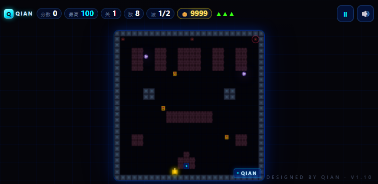

# QIAN科幻风坦克大战 · Tank Battle

一个纯 HTML / CSS / JavaScript 实现的经典「坦克大战」游戏，单文件、零依赖，双击即可游玩。

### ▶️ 在线直接玩（手机上也能玩）

**https://qianwinner.github.io/Tank-battle/**

手机浏览器打开就能玩，微信里点开同样可以，直接转发给朋友即可 —— 不用下载、不用登录。

<p align="center">
  
</p>

 

## ✨ 特性

- 🕹️ 经典玩法：守护基地、消灭敌方坦克
- 🧱 可破坏砖墙、不可破坏钢墙、水面、草丛四种地形
- 🗺️ 5 张手写预设关卡地图循环 + 独立 Boss 场地
- 👾 4 种敌人类型：普通 / 快速 / 装甲（2 血）/ 精英（3 血）
- 📈 难度曲线：敌人速度、射速、类型比例随关卡提升
- 🎁 6 种掉落道具：护盾 / 快速弹 / 双管炮 / 加命 / 冻结 / 炸弹
- 🔥 连击评分：5 秒内连续击杀叠加 10% 加成
- 👑 Boss 战：每 5 关出现大型 Boss（2×2 格、多段血条、三连散弹）
- 🤖 敌方 AI：追踪玩家 / 基地、卡墙自动脱困、自动射击，精英与装甲更狡猾
- 📊 局内统计：击杀数、命中率、最长连击、Boss 击破数全程记录
- 🖼 战绩图：结算页一键生成霓虹风战报卡，长按保存发朋友圈
- 🏅 成就徽章：8 枚隐藏成就（Boss 猎手 / 无伤战神 / 连击狂人…），本地解锁记录
- 🎬 关卡过渡：每关开场霓虹大字扫屏，节奏感拉满
- 📤 分享成绩：结算页一键发起好友挑战，对方点开链接就能看到你的分数
- 📅 每日挑战：同一天全世界同一张图、同一波敌人（日期种子驱动）
- ⚡ 打击感：击杀定格（hit-stop）、受击红闪、Boss 出场全屏警报
- 📳 触觉反馈：击杀、受击、Boss 登场时手机震动（安卓支持，iOS 自动忽略）
- 📲 PWA：支持「添加到主屏幕」，应用名「QIAN 坦克大战」，带专属图标
- 📴 离线可玩：Service Worker 缓存，地铁/高铁没网照样打
- 🏆 最高分本地记录（localStorage），静音偏好同样保存
- 🎵 Web Audio 全合成音效：白噪声爆破、扫频飞弹、低通受击闷响 + 8-bit 循环 BGM（平静/战斗两首，可关）
- 💥 粒子爆炸、屏幕震动与击杀飘分特效
- 📱 全屏自适应布局：画布随屏幕缩放，手机竖屏 / 横屏都满屏可玩
- 📱 触屏设备左下角虚拟摇杆走位（八方向，斜向可走）、右下角按钮开火，点击画面也能开火
- ⏱️ 基于 deltaTime 的时间驱动，高刷新率屏幕下速度一致
- 🔗 单文件零依赖，一个链接发出去，微信里点开即玩

<p align="center">
  
</p>

## 🎮 操作 - 所有按键及功能都在网页里标了哦

| 按键 | 功能 |
| --- | --- |
| `W` `A` `S` `D` / `方向键` | 移动坦克（组合按键可斜向走） |
| `空格` / `J` | 开火 |
| `P` | 暂停 / 继续 |
| `M` | 静音 / 取消静音 |

> 触屏设备左下角是虚拟摇杆（朝哪拖就往哪开，八个方位含斜向都能走），右下角是开火键（点画面任意位置也能开火），切换窗口或标签页时游戏会自动暂停。

## 🚀 快速开始

方式一：直接打开 <https://qianwinner.github.io/Tank-battle/>

方式二：保存源码后用浏览器打开 `index.html`，无需安装任何依赖。

## 🗺️ 玩法说明

- 保护地图底部中央的 **基地（鹰徽）**，基地被摧毁即游戏结束
- 消灭全部敌方坦克即可进入下一关，过关奖励 `1000 + 关卡 × 200` 分
- 共 3 条生命，重生后短暂无敌（闪烁期间子弹无法伤害你）
- 坦克无法通过砖墙、钢墙和水面；子弹可以越过水面

### 敌人类型

| 类型 | 速度 | 血量 | 得分 | 出现关卡 |
| --- | --- | --- | --- | --- |
| 普通 | 1.15 | 1 | 100 | 全程 |
| 快速 | 1.70 | 1 | 150 | 第 3 关起 |
| 装甲 | 0.90 | 2 | 200 | 第 5 关起 |
| 精英 | 1.30 | 3 | 300 | 第 7 关起 |

敌人速度还会随关卡整体提升（每关 +6%，封顶 1.6 倍）。

### 掉落道具

击毁敌人有 15% 概率掉落道具（Boss 必掉 3 个），走过去即可拾取：

| 道具 | 效果 |
| --- | --- |
| 🛡 护盾 | 3 秒无敌 |
| ⚡ 快速弹 | 8 秒射速翻倍 |
| ⚔ 双管炮 | 10 秒双发 |
| ❤ 加命 | 生命 +1（上限 5） |
| ❄ 冻结 | 全场敌人定身 5 秒 |
| 💣 炸弹 | 清屏（Boss 受 4 点伤害） |

### 连击与 Boss

- **连击**：5 秒内连续击杀，每层 +10% 得分；HUD 连击达 3 层变品红高亮
- **Boss**：每 5 关（第 5、10、15… 关）出现，血量 `10 + 关卡`，发射三连散弹，顶部血条显示剩余血量

## 📂 项目结构

```
Tank-battle/
├── index.html              # 游戏全部代码（HTML + CSS + JS）
├── sw.js                   # Service Worker（离线缓存）
├── manifest.webmanifest    # PWA 清单
└── icon-*.png              # 应用图标
```

## 🆕 更新日志

### v0.1.8 · 2026-10-30
- 🕹 摇杆升级八方向：斜推摇杆走 45° 对角线，不再被掰直；键盘 W+D 等组合键同样支持斜向
- ⚔ 敌人 / Boss 同步八方向：会斜着包抄、贴墙斜向滑动，AI 脱困按 8 向择优
- 🔫 双管炮、Boss 散弹斜向时正确垂直展开；斜向子弹打墙两轴补刀
- 🛞 坦克车身按 45° 旋转指向行进方向；斜向速度与直行一致（无斜向加速）
- 📴 Service Worker 缓存版本更新至 v018

### v0.1.7 · 2026-10-30
- 📊 局内统计全面升级：击杀 / 命中率 / 最长连击 / Boss 击破 / 阵亡全程记录
- 🖼 新增「生成战绩图」：霓虹风战报卡（大字分数 + 六宫格统计 + 成就徽章），微信长按保存或系统分享
- 🏅 新增 8 枚成就徽章：初战告捷 / 连击狂人 / Boss 猎手 / 无伤战神 / 每日挑战者 / 五千分大关 / 深入敌后 / 精准射手，结算页展示本次解锁
- 🎬 新增关卡过渡动画：「第 N 关」霓虹大字扫屏 + 短暂冻结，节奏感更强
- 🎵 音效全面重做：白噪声爆破、扫频飞弹、低通受击闷响、过关琶音
- 🎶 新增程序化 8-bit 循环 BGM（平静 / 战斗两首随状态切换），静音键可关
- 📴 新增 Service Worker 离线缓存，断网也能玩
- 🖼 更新 title.png / shot.png 为 v0.1.7 真机效果图
- 📤 分享文案升级：附带击杀、连击、命中率战绩

### v0.1.6 · 2026-10-30

**分享挑战 + 每日挑战 + 打击感 + PWA + 触觉，五连更**

**📤 分享成绩 / 好友挑战**

- 结算页新增「📤 分享成绩 · 发起挑战」按钮：微信等环境走系统分享面板，其余自动复制挑战链接
- 挑战链接带 `?ch=分数-关卡` 参数，朋友点开标题页直接显示「好友向你发起挑战：对方拿了 X 分 · 打到第 Y 关」
- 分数超越对方时结算页会挂出「🏅 挑战成功！」

**📅 每日挑战**

- 标题页新增「📅 每日挑战」入口，`?daily=1` 链接直达
- 日期做随机种子：同一天所有人拿到同一张地图（含水平镜像变体）、同一波敌人组成、同一份掉落——纯拼技术
- 10 张地图变体全部通过连通性校验（可走格全部可达，与敌人出生点同区）

**⚡ 打击感**

- 击杀瞬间 30ms 画面定格（hit-stop），Boss 击破 160ms——「打在肉上」的停顿感
- 受击 / 基地被毁时全屏红色 vignette 渐隐
- Boss 出场：红色扫描条 + 闪烁 WARNING 大字警报 1.8 秒

**📳 触觉反馈**

- 击杀敌人轻震、掉命双段震动、Boss 登场节奏震动、拾取道具微震
- 调用 `navigator.vibrate`，iOS 不支持时自动忽略

**📲 PWA**

- 新增 `manifest.webmanifest` + 192/512 图标 + maskable 图标（Klein blue 坦克 + QIAN）
- 安卓浏览器「添加到主屏幕」后以全屏独立应用运行，桌面图标带 QIAN 品牌坦克

**🤖 敌人 AI 增强**

- 精英 / 装甲坦克锁定玩家与基地的频率提高（精英 9% 概率持续盯人）
- 撞墙脱困时按兵种概率优先朝目标方向走（精英 90% / 装甲 65% / 其他 45%），不再纯随机打转
- 快速坦克保留游走风格，负责骚扰

### v0.1.5 · 2026-10-30

**把 QIAN 署名做成手机上也看得见**

- 手机端之前唯一署名 `DESIGNED BY QIAN` 被 `html.touch` 直接隐藏，等于别人打开完全不知道谁做的
- 顶部 HUD 最左新增品牌徽章：青蓝发光「Q」方块 + `QIAN`，整局游戏常驻，手机横竖屏都在
- 画布右下角新增 `◆ QIAN` 水印胶囊，跟着画布缩放，任何屏幕尺寸都落在视野内
- 开始页署名升级为 `—— QIAN 出品 ——`，加霓虹装饰线与发光，第一眼就是作者信息
- 窄屏（≤340px）自动退化为只留「Q」方块，保证 HUD 不换行不溢出
- 手机端让出「最高」分 pill 给品牌标识（结算面板仍显示最高分），HUD 从 390px 到 844px 实测无溢出
- 桌面端保留右下角 `DESIGNED BY QIAN · V1.5` 版本号

### v0.1.4 · 2026-10-30

**手机操作改为虚拟摇杆**

- 左下角四个方向键换成圆盘摇杆：朝哪拖就往哪开，手指不松可随时换向
- 旋钮跟随手指在盘内移动，中心留死区防误触，松手自动回中
- 摇杆外圈额外 16px 透明触摸区，拇指落在圆边外也能控制
- 开火键不变（右下角大按钮），点击画面任意位置同样能开火
- 横屏时摇杆与开火键自动浮到战场两侧，不遮挡画面

**修复**

- **第 3 关被水域切成三段**：原「水网双桥」用两条横贯全图的水带加钢门封路，玩家被困在中间条带，上下半张地图都去不了。改为 4 组对称小水塘，中间留宽通道，水只作掩体不再当墙
- 六张关卡全部通过连通性校验：可走格全部可达，且与顶端敌人出生点同区

### v0.1.3 · 2026-10-30

**重做为「点开即玩」的单文件网页**

- 全屏自适应布局：画布按屏幕尺寸实时缩放，HUD 悬浮顶部，手机竖屏 / 横屏都满屏
- 底部触屏方向键 + 大号开火键，横屏时自动移到画面两侧空白处，不遮挡战场
- 新增开始 / 暂停 / 结算遮罩层：大号「开始游戏」按钮，微信里点开即可开打
- 点击画面任意位置也能开火，切后台 / 切标签页自动暂停
- 微信内置浏览器适配：禁用双击缩放与长按菜单，首次进入提示「点右上角 ··· 转发」
- Web Audio 在微信 / iOS 首次手势时自动解锁，音效不再静音
- 页面标题、描述与 og 信息补齐，转发到微信有标题和封面
- 部署到 GitHub Pages，一个链接即可分享

**修复**

- **基地此前无法被摧毁**：基地格是钢墙，子弹被地形判定拦下，「基地被毁」的失败条件从未触发过。现在基地格改为可被子弹命中，砖墙仍是唯一屏障
- **出生点堵在基地正下方**：出生时朝上会被基地挡住、开枪也打不出去。现在出生在基地左侧一格，可立即移动与射击
- 暂停 / 静音按钮改为 HUD 上的图标按钮，不再占用面板空间

### v0.1.2 · 2026-10-30

**新增**

- **4 种敌人类型**：普通 / 快速 / 装甲（2 血）/ 精英（3 血），按关卡解锁并混编
- **6 种道具系统**：护盾、快速弹、双管炮、加命、冻结、炸弹，击毁敌人概率掉落
- **连击评分**：5 秒连杀链，每层 +10% 得分，HUD 实时显示
- **过关奖励**：`1000 + 关卡 × 200` 分
- **5 张预设关卡地图** + 独立 Boss 场地，按关卡轮换
- **Boss 战**：每 5 关出现大型 Boss（44px、`10+关卡` 血、三连散弹、顶部血条）
- 难度曲线：敌人速度、射速、类型比例随关卡提升
- 道具效果状态条（左下角显示剩余秒数）

**优化**

- 改用 deltaTime 时间驱动，修复高刷新率屏幕（120/144Hz）下游戏速度翻倍的问题
- Web Audio 在首次交互时自动解锁，避免静音或无声音
- 多血敌人头顶血点显示，Boss 使用顶部血条

### v1.1 · 2026-10-26

**修复**

- 出生保护无敌时间此前并不生效，现在无敌期间子弹无法伤害玩家
- 基地被摧毁时结算画面曾误显示「胜利」
- 点击「开始」后按空格射击会误触按钮导致整局重开（按钮点击后自动移除焦点）
- 地图生成时出生点清理逻辑会打穿底边外墙，坦克也可驶过基地格
- 死亡与过关发生在同一帧时可能被误判为游戏结束
- 切换窗口后按键状态卡死、坦克不受控移动（现在自动清空按键并暂停）

**新增 / 优化**

- 最高分本地记录，结算画面显示本局得分与历史最高分
- 静音开关（`M` 键或按钮），偏好本地保存
- 移动端虚拟方向键与开火按钮
- HiDPI 高分屏清晰渲染，小屏自适应缩放
- 敌方 AI 卡墙时优先选择可行方向脱困，并更倾向进攻基地
- 击毁敌人时飘出得分动画
- DOM 引用缓存与生命值按需刷新，HUD 每帧更新更轻量

- By QIAN

## 📄 许可证

[MIT](LICENSE)
