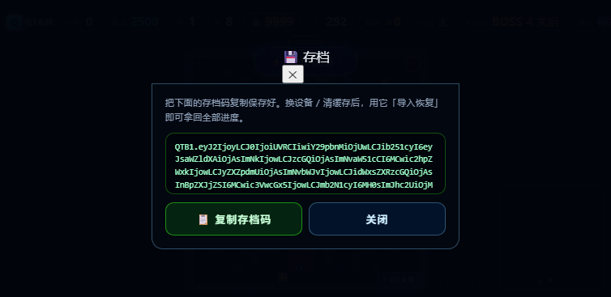
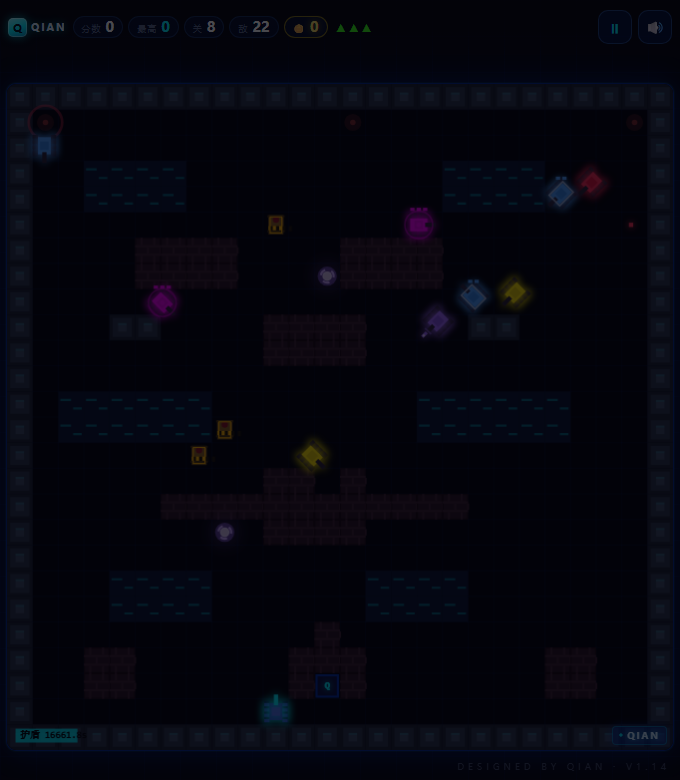
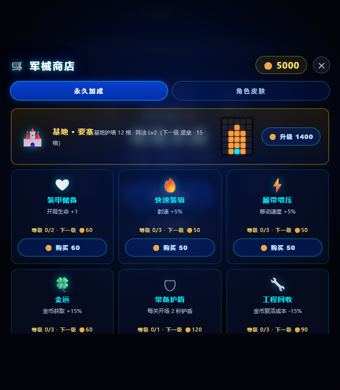
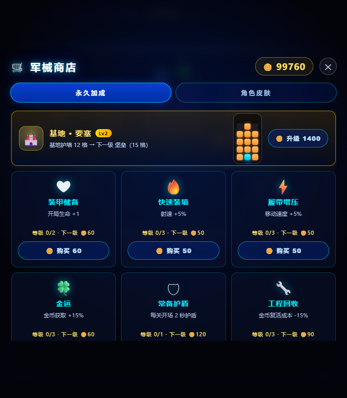

# QIAN科幻风坦克大战 · Tank Battle

一个纯 HTML / CSS / JavaScript 实现的经典「坦克大战」游戏，单文件、零依赖，双击即可游玩。

### ▶️ 在线直接玩（手机上也能玩）

**https://qianwinner.github.io/Tank-battle/**

手机浏览器打开就能玩，微信里点开同样可以，直接转发给朋友即可 —— 不用下载、不用登录。

<p align="center">
  
</p>

 

## ✨ 特性

- 🕹️ 经典玩法：守护基地、消灭敌方坦克
- 🧱 可破坏砖墙、不可破坏钢墙、水面、草丛四种地形
- 🗺️ 5 张手写预设关卡地图循环 + 独立 Boss 场地
- 👾 4 种敌人类型：普通 / 快速 / 装甲（2 血）/ 精英（3 血）
- 📈 难度曲线：敌人速度、射速、类型比例随关卡提升
- 🎁 6 种掉落道具：护盾 / 快速弹 / 双管炮 / 加命 / 冻结 / 炸弹
- 🔥 连击评分：5 秒内连续击杀叠加 10% 加成
- 👑 Boss 战：每 5 关出现大型 Boss（2×2 格、多段血条、三连散弹）
- 🤖 敌方 AI：追踪玩家 / 基地、卡墙自动脱困、自动射击，精英与装甲更狡猾
- 📊 局内统计：击杀数、命中率、最长连击、Boss 击破数全程记录
- 🖼 战绩图：结算页一键生成霓虹风战报卡，长按保存发朋友圈
- 🏅 成就徽章：8 枚隐藏成就（Boss 猎手 / 无伤战神 / 连击狂人…），本地解锁记录
- 🎬 关卡过渡：每关开场霓虹大字扫屏，节奏感拉满
- 📤 分享成绩：结算页一键发起好友挑战，对方点开链接就能看到你的分数
- 📅 每日挑战：同一天全世界同一张图、同一波敌人（日期种子驱动）
- ⚡ 打击感：击杀定格（hit-stop）、受击红闪、Boss 出场全屏警报
- 📳 触觉反馈：击杀、受击、Boss 登场时手机震动（安卓支持，iOS 自动忽略）
- 📲 PWA：支持「添加到主屏幕」，应用名「QIAN 坦克大战」，带专属图标
- 📴 离线可玩：Service Worker 缓存，地铁/高铁没网照样打
- 🏆 最高分本地记录（localStorage），静音偏好同样保存
- 🎵 Web Audio 全合成音效：白噪声爆破、扫频飞弹、低通受击闷响 + 8-bit 循环 BGM（平静/战斗两首，可关）
- 💥 粒子爆炸、屏幕震动与击杀飘分特效
- 📱 全屏自适应布局：画布随屏幕缩放，手机竖屏 / 横屏都满屏可玩
- 📱 触屏设备左下角虚拟摇杆走位（八方向，斜向可走）、右下角按钮开火，点击画面也能开火
- ⏱️ 基于 deltaTime 的时间驱动，高刷新率屏幕下速度一致
- 🌊 波次系统：每关分波刷兵，波次越深敌人越凶（关卡 + 波次双难度）
- 🧬 3 新兵种 + AI 分层：狙击（远程慢弹）/ 自爆（高速冲撞）/ 工兵（修墙迂回），精英装甲更狡猾
- ⬆️ 过关强化三选一：每关清场从 8 种强化中抽 3 选 1，可叠加滚雪球（Roguelite）
- 📅 每日挑战词条：每天 2~3 条 modifier（疾风骤雨 / 猛兽出笼 / 丰饶战场 / 后勤休假 / 钢铁防线 / 狙击天团 / 敌军增援），全服同一天同图同词条
- 🛢 可爆炸油桶：子弹命中即引爆，范围伤害 + 连锁
- 🌀 传送门：成对出现，进入即瞬移到另一端（带冷却）
- 🎨 兵种独立造型：狙击长炮管、自爆警示灯、工兵履带装甲
- 🎰 强化池 8 → 14：穿透弹头 / 三向散射 / 爆破弹头 / 巨弹头 / 吸血装甲 / 金运 六连增
- 🪙 金币经济：击杀、过关、每日通关掉金币，localStorage 持久化跨局累积，HUD 顶部计数
- 🛒 金币商店：永久加成（开局生命 / 射速 / 移速 / 金币获取 / 常备护盾 / 工程回收 / 连击大师 / 弹道学，可升级买断）+ 角色皮肤（11 款，分**稀有/史诗/传奇/限定**四档，含 3 款花哨动态特效：极光棱镜 / 圣龙之鳞 / 霓虹脉冲）+ **基地升级**（4 级护墙阵法）三 Tab
- 🎨 玩家坦克按已装备皮肤四层取色，鎏金皮带专属光晕，蓝色大肥鱼限定专属鱼形造型
- 🪙 金币复活：基地被摧毁后可花金币重建护墙、清除基地威胁、续战当前关卡，成本随关卡与复活次数递增
- 🎁 内测广告弹窗：通过第一关时弹出「恭喜你参与QIAN的内测」，领取即送 **1000 金币**（每浏览器一次）
- 🌊 单波洪流：敌人不再分拨分批，整关敌人一波连续刷完，开局即进入高强度混战
- 🏰 基地升级：商店上架 4 级基地（哨所→壁垒→要塞→堡垒），砖护墙 6/9/12/15 格且阵法各异，解决「基地太容易被自己打到」，对局中升级立即补墙，等级跨局持久化
- 🛒 商店技能强化扩充：新增工程回收（复活成本 -15%/级）、连击大师（连击得分 +10%/级）、弹道学（子弹速度 +5%/级）三档永久加成
- 🎨 皮肤分级：11 款皮肤分四档——**稀有（蓝）/ 史诗（紫）/ 传奇（橙）/ 限定（红）**，商店按稀有度降序展示；新增 3 款花哨动态特效皮肤（极光棱镜 / 圣龙之鳞 / 霓虹脉冲）
- ⛶ 全屏沉浸：HUD + 设置面板双入口 + `F` 键，`requestFullscreen`/`webkitRequestFullscreen` 双通道，手机真正满屏沉浸
- 🎚 性能档位三档（高/中/低）：DPR 动态上限 2/1.5/1、低画质关辉光、粒子量减半，中低端机不掉帧
- 🗺 静态地图离屏缓存：背景+网格+砖/钢/水一次性烘焙，每帧一次 `drawImage`，8 处地图变更点自动失效重烘焙
- 🎭 减弱动效：跟随系统 `prefers-reduced-motion`，可手动覆盖；震动/定格/慢动作/白闪/屏震全部降级
- 🎛 设置面板整合：标题页+暂停页统一收拢 BGM/SFX 分音量 + 画质 + 动效 + 全屏，分音量独立持久化
- 🌊 **无尽/生存模式**：标题页新增「无尽」入口，波次无限推进、敌人血量/速度/数量随波次指数增长（血量 +35%/波、速度 +4%/波、数量 +5%/波），Boss 血随波次放大，挑战你能撑到第几波；新增 2 枚成就（深潜者 10 波 / 深渊猎手 30 波）
- 🗺 **关卡选择 + 星级**：主菜单新增「关卡」入口，已解锁关卡卡片网格（3 列，含 4 关预览），可任选已解锁关卡开局；每关结算按「无伤 / 剩余生命≥2 / 快速通关」评 1-3 星，星级持久化；第 5 关 Boss 关显示 👑
- ⭐ **过关结算界面 + 额外金币**：每关清场先弹结算面板——显示关卡 / 用时 / 评级星（动画点亮）/ 星级奖励金币（25×星数），点「继续」再进三选一强化，节奏更清晰
- 🖼 **战绩图增强**：结算页战绩图渲染星级（★×N）与「第 N 关 · 模式」，版本署名升 **V2.6**；新增「复制图片」一键复制 PNG 到剪贴板，战绩档案内可直接「生成战绩图」复用上一局数据
- 🥊 **近战大招**：按 `E` 键 / 触屏按钮释放全屏震荡波——以玩家为中心扩散冲击波，一击清空半径内敌人并摧毁砖墙，大招槽充能满才可释放，局内 HUD 显示充能状态
- 👥 **双人同屏**：主菜单新增「双人同屏」入口，**合作**（并肩闯关，任一玩家命尽即败）与**对抗**（无敌人纯 PvP，玩家弹互伤，先命尽者败）两种模式；P1 用 WASD+空格/`J`，P2 用方向键+回车/`.`，HUD 分色显示双方生命
- 🛠 **地图编辑器 + 自制关卡**：主菜单新增「地图」入口，26×26 网格画笔绘制砖/钢/水/树/油桶/传送门，支持**保存/加载/删除**（localStorage 持久化）、**导出分享码**（`TB1:` 前缀，一键复制转发）、**导入分享码**开玩他人自制关卡；传送门强制成对、非法码自动拒绝
- 🏆 **排行榜分榜 + 每周挑战**：战绩档案排行榜按「全部 / 经典 / 每日 / 限时 / 无尽」分榜；新增每周挑战词条（每周刷新目标分，达成领金币奖励）
- 📈 **生涯统计扩展 + 成就分组**：生涯报告页新增总游戏时长 / 总金币 / 总星 / 无尽最高波 / Boss 击杀等累计维度；成就系统扩展至 20+ 并分四组（深度/技巧/收藏/极限）展示进度条
- 🔗 单文件零依赖，一个链接发出去，微信里点开即玩

<p align="center">
  
</p>

<p align="center">
  
  
</p>

<p align="center">
  
  
</p>

## 🎮 操作 - 所有按键及功能都在网页里标了哦

| 按键 | 功能 |
| --- | --- |
| `W` `A` `S` `D` / `方向键` | 移动坦克（组合按键可斜向走） |
| `空格` / `J` | 开火 |
| `P` | 暂停 / 继续 |
| `M` | 静音 / 取消静音 |

> 触屏设备左下角是虚拟摇杆（朝哪拖就往哪开，八个方位含斜向都能走），右下角是开火键（点画面任意位置也能开火），切换窗口或标签页时游戏会自动暂停。

## 🚀 快速开始

方式一：直接打开 <https://qianwinner.github.io/Tank-battle/>

方式二：保存源码后用浏览器打开 `index.html`，无需安装任何依赖。

## 🗺️ 玩法说明

- 保护地图底部中央的 **基地（鹰徽）**，基地被摧毁即游戏结束
- 消灭全部敌方坦克即可进入下一关，过关奖励 `1000 + 关卡 × 200` 分
- 共 3 条生命，重生后短暂无敌（闪烁期间子弹无法伤害你）
- 坦克无法通过砖墙、钢墙和水面；子弹可以越过水面

### 敌人类型

| 类型 | 速度 | 血量 | 得分 | 出现关卡 |
| --- | --- | --- | --- | --- |
| 普通 | 1.15 | 1 | 100 | 全程 |
| 快速 | 1.70 | 1 | 150 | 第 3 关起 |
| 装甲 | 0.90 | 2 | 200 | 第 5 关起 |
| 精英 | 1.30 | 3 | 300 | 第 7 关起 |
| 狙击 | 0.80 | 1 | 250 | 第 8 关起（远程慢弹） |
| 自爆 | 2.05 | 1 | 150 | 第 8 关起（高速冲撞） |
| 工兵 | 1.00 | 2 | 180 | 第 10 关起（修墙迂回） |

敌人速度还会随关卡整体提升（每关 +6%，封顶 1.6 倍）。

### 掉落道具

击毁敌人有 15% 概率掉落道具（Boss 必掉 3 个），走过去即可拾取：

| 道具 | 效果 |
| --- | --- |
| 🛡 护盾 | 3 秒无敌 |
| ⚡ 快速弹 | 8 秒射速翻倍 |
| ⚔ 双管炮 | 10 秒双发 |
| ❤ 加命 | 生命 +1（上限 5） |
| ❄ 冻结 | 全场敌人定身 5 秒 |
| 💣 炸弹 | 清屏（Boss 受 4 点伤害） |

### 连击与 Boss

- **连击**：5 秒内连续击杀，每层 +10% 得分；HUD 连击达 3 层变品红高亮
- **Boss**：每 5 关（第 5、10、15… 关）出现，血量 `10 + 关卡`，发射三连散弹，顶部血条显示剩余血量

## 📂 项目结构

```
Tank-battle/
├── index.html              # 游戏全部代码（HTML + CSS + JS）
├── sw.js                   # Service Worker（离线缓存）
├── manifest.webmanifest    # PWA 清单
└── icon-*.png              # 应用图标
```

## 🛠 部署与运维

- **发布流程**：改动确认后提交 `main` → 打 tag（`vX.Y.Z`）→ 推送 tag → GitHub Actions 自动构建并部署 Pages；Release 说明取 `RELEASE_NOTES.md` 对应段：`gh release create <tag> --title "<标题>" --notes-file <段文件> --target main`
- **Pages 偶发失败**：`pages-build-deployment` 偶发报 `Ensure GITHUB_TOKEN has permission "id-token: write"`（GitHub 端瞬时故障，非代码问题），直接重跑即可：`gh run rerun <run_id>`（或空提交触发重建），无需排查
- **本地预览**：任意静态服务器打开 `index.html`，如 `python -m http.server 8080`

## 🆕 更新日志

### v0.17.98 · 2026-11-12
**我方弹密度**
- 我方弹密度（新增 DOM/CSS/状态逻辑 + 6 条专项断言）
- ✅ 回归验证：主套件 169/169 + 反馈专项 7160/7160（无回归）
- 📴 Service Worker 缓存版本更新至 **v017980**，游戏内版本 **V17.98**

### v0.17.97 · 2026-11-12
**敌弹密度**
- 敌弹密度（新增 DOM/CSS/状态逻辑 + 6 条专项断言）
- ✅ 回归验证：主套件 169/169 + 反馈专项 7154/7154（无回归）
- 📴 Service Worker 缓存版本更新至 **v017970**，游戏内版本 **V17.97**

### v0.17.96 · 2026-11-12
**弹幕总密度**
- 弹幕总密度（新增 DOM/CSS/状态逻辑 + 6 条专项断言）
- ✅ 回归验证：主套件 169/169 + 反馈专项 7148/7148（无回归）
- 📴 Service Worker 缓存版本更新至 **v017960**，游戏内版本 **V17.96**

### v0.17.95 · 2026-11-12
**制空占比**
- 制空占比（新增 DOM/CSS/状态逻辑 + 6 条专项断言）
- ✅ 回归验证：主套件 169/169 + 反馈专项 7142/7142（无回归）
- 📴 Service Worker 缓存版本更新至 **v017950**，游戏内版本 **V17.95**

### v0.17.94 · 2026-11-12
**空中火力差**
- 空中火力差（新增 DOM/CSS/状态逻辑 + 6 条专项断言）
- ✅ 回归验证：主套件 169/169 + 反馈专项 7136/7136（无回归）
- 📴 Service Worker 缓存版本更新至 **v017940**，游戏内版本 **V17.94**

### v0.17.93 · 2026-11-12
**炮口指向**
- 炮口指向（新增 DOM/CSS/状态逻辑 + 6 条专项断言）
- ✅ 回归验证：主套件 169/169 + 反馈专项 7130/7130（无回归）
- 📴 Service Worker 缓存版本更新至 **v017930**，游戏内版本 **V17.93**

### v0.17.92 · 2026-11-12
**火力投送**
- 火力投送（新增 DOM/CSS/状态逻辑 + 6 条专项断言）
- ✅ 回归验证：主套件 169/169 + 反馈专项 7124/7124（无回归）
- 📴 Service Worker 缓存版本更新至 **v017920**，游戏内版本 **V17.92**

### v0.17.91 · 2026-11-12
**弹道速度**
- 弹道速度（新增 DOM/CSS/状态逻辑 + 6 条专项断言）
- ✅ 回归验证：主套件 169/169 + 反馈专项 7118/7118（无回归）
- 📴 Service Worker 缓存版本更新至 **v017910**，游戏内版本 **V17.91**

### v0.17.90 · 2026-11-12
**弹头档位**
- 弹头档位（新增 DOM/CSS/状态逻辑 + 6 条专项断言）
- ✅ 回归验证：主套件 169/169 + 反馈专项 7112/7112（无回归）
- 📴 Service Worker 缓存版本更新至 **v017900**，游戏内版本 **V17.90**

### v0.17.89 · 2026-11-12
**齐射弹数**
- 齐射弹数（新增 DOM/CSS/状态逻辑 + 6 条专项断言）
- ✅ 回归验证：主套件 169/169 + 反馈专项 7106/7106（无回归）
- 📴 Service Worker 缓存版本更新至 **v017890**，游戏内版本 **V17.89**

### v0.17.88 · 2026-11-12
**有效射速**
- 有效射速（新增 DOM/CSS/状态逻辑 + 6 条专项断言）
- ✅ 回归验证：主套件 169/169 + 反馈专项 7100/7100（无回归）
- 📴 Service Worker 缓存版本更新至 **v017880**，游戏内版本 **V17.88**

### v0.17.87 · 2026-11-12
**击发状态**
- 击发状态（新增 DOM/CSS/状态逻辑 + 6 条专项断言）
- ✅ 回归验证：主套件 169/169 + 反馈专项 7094/7094（无回归）
- 📴 Service Worker 缓存版本更新至 **v017870**，游戏内版本 **V17.87**

### v0.17.86 · 2026-11-12
**装填进度**
- 装填进度（新增 DOM/CSS/状态逻辑 + 6 条专项断言）
- ✅ 回归验证：主套件 169/169 + 反馈专项 7088/7088（无回归）
- 📴 Service Worker 缓存版本更新至 **v017860**，游戏内版本 **V17.86**

### v0.17.85 · 2026-11-12
**开火警报**
- 开火警报（新增 DOM/CSS/状态逻辑 + 6 条专项断言）
- ✅ 回归验证：主套件 169/169 + 反馈专项 7082/7082（无回归）
- 📴 Service Worker 缓存版本更新至 **v017850**，游戏内版本 **V17.85**

### v0.17.84 · 2026-11-12
**首火敌型**
- 首火敌型（新增 DOM/CSS/状态逻辑 + 6 条专项断言）
- ✅ 回归验证：主套件 169/169 + 反馈专项 7076/7076（无回归）
- 📴 Service Worker 缓存版本更新至 **v017840**，游戏内版本 **V17.84**

### v0.17.83 · 2026-11-12
**BOSS蓄力**
- BOSS蓄力（新增 DOM/CSS/状态逻辑 + 6 条专项断言）
- ✅ 回归验证：主套件 169/169 + 反馈专项 7070/7070（无回归）
- 📴 Service Worker 缓存版本更新至 **v017830**，游戏内版本 **V17.83**

### v0.17.82 · 2026-11-12
**静默窗口**
- 静默窗口（新增 DOM/CSS/状态逻辑 + 6 条专项断言）
- ✅ 回归验证：主套件 169/169 + 反馈专项 7064/7064（无回归）
- 📴 Service Worker 缓存版本更新至 **v017820**，游戏内版本 **V17.82**

### v0.17.81 · 2026-11-12
**开火节奏**
- 开火节奏（新增 DOM/CSS/状态逻辑 + 6 条专项断言）
- ✅ 回归验证：主套件 169/169 + 反馈专项 7058/7058（无回归）
- 📴 Service Worker 缓存版本更新至 **v017810**，游戏内版本 **V17.81**

### v0.17.80 · 2026-11-12
**弹幕蓄积**
- 弹幕蓄积（新增 DOM/CSS/状态逻辑 + 6 条专项断言）
- ✅ 回归验证：主套件 169/169 + 反馈专项 7052/7052（无回归）
- 📴 Service Worker 缓存版本更新至 **v017800**，游戏内版本 **V17.80**

### v0.17.79 · 2026-11-12
**临火敌数**
- 临火敌数（新增 DOM/CSS/状态逻辑 + 6 条专项断言）
- ✅ 回归验证：主套件 169/169 + 反馈专项 7046/7046（无回归）
- 📴 Service Worker 缓存版本更新至 **v017790**，游戏内版本 **V17.79**

### v0.17.78 · 2026-11-12
**最近开火**
- 最近开火（新增 DOM/CSS/状态逻辑 + 6 条专项断言）
- ✅ 回归验证：主套件 169/169 + 反馈专项 7040/7040（无回归）
- 📴 Service Worker 缓存版本更新至 **v017780**，游戏内版本 **V17.78**

### v0.17.77 · 2026-11-12
**危机指数**
- 危机指数（新增 DOM/CSS/状态逻辑 + 6 条专项断言）
- ✅ 回归验证：主套件 169/169 + 反馈专项 7034/7034（无回归）
- 📴 Service Worker 缓存版本更新至 **v017770**，游戏内版本 **V17.77**

### v0.17.76 · 2026-11-12
**最危险格**
- 最危险格（新增 DOM/CSS/状态逻辑 + 6 条专项断言）
- ✅ 回归验证：主套件 169/169 + 反馈专项 7028/7028（无回归）
- 📴 Service Worker 缓存版本更新至 **v017760**，游戏内版本 **V17.76**

### v0.17.75 · 2026-11-12
**来袭弹速**
- 来袭弹速（新增 DOM/CSS/状态逻辑 + 6 条专项断言）
- ✅ 回归验证：主套件 169/169 + 反馈专项 7022/7022（无回归）
- 📴 Service Worker 缓存版本更新至 **v017750**，游戏内版本 **V17.75**

### v0.17.74 · 2026-11-12
**包围度**
- 包围度（新增 DOM/CSS/状态逻辑 + 6 条专项断言）
- ✅ 回归验证：主套件 169/169 + 反馈专项 7016/7016（无回归）
- 📴 Service Worker 缓存版本更新至 **v017740**，游戏内版本 **V17.74**

### v0.17.73 · 2026-11-12
**安全格数**
- 安全格数（新增 DOM/CSS/状态逻辑 + 6 条专项断言）
- ✅ 回归验证：主套件 169/169 + 反馈专项 7010/7010（无回归）
- 📴 Service Worker 缓存版本更新至 **v017730**，游戏内版本 **V17.73**

### v0.17.72 · 2026-11-12
**逃生方向**
- 逃生方向（新增 DOM/CSS/状态逻辑 + 6 条专项断言）
- ✅ 回归验证：主套件 169/169 + 反馈专项 7004/7004（无回归）
- 📴 Service Worker 缓存版本更新至 **v017720**，游戏内版本 **V17.72**

### v0.17.71 · 2026-11-12
**威胁密度**
- 威胁密度（新增 DOM/CSS/状态逻辑 + 6 条专项断言）
- ✅ 回归验证：主套件 169/169 + 反馈专项 6998/6998（无回归）
- 📴 Service Worker 缓存版本更新至 **v017710**，游戏内版本 **V17.71**

### v0.17.70 · 2026-11-12
**最近威胁**
- 最近威胁（新增 DOM/CSS/状态逻辑 + 6 条专项断言）
- ✅ 回归验证：主套件 169/169 + 反馈专项 6992/6992（无回归）
- 📴 Service Worker 缓存版本更新至 **v017700**，游戏内版本 **V17.70**

### v0.17.69 · 2026-11-11
**来袭方位**
- 来袭方位（新增 DOM/CSS/状态逻辑 + 6 条专项断言）
- ✅ 回归验证：主套件 169/169 + 反馈专项 6986/6986（无回归）
- 📴 Service Worker 缓存版本更新至 **v017690**，游戏内版本 **V17.69**

### v0.17.68 · 2026-11-11
**方向变化率**
- 方向变化率（新增 DOM/CSS/状态逻辑 + 6 条专项断言）
- ✅ 回归验证：主套件 169/169 + 反馈专项 6980/6980（无回归）
- 📴 Service Worker 缓存版本更新至 **v017680**，游戏内版本 **V17.68**

### v0.17.67 · 2026-11-11
**方向集中度**
- 方向集中度（新增 DOM/CSS/状态逻辑 + 6 条专项断言）
- ✅ 回归验证：主套件 169/169 + 反馈专项 6974/6974（无回归）
- 📴 Service Worker 缓存版本更新至 **v017670**，游戏内版本 **V17.67**

### v0.17.66 · 2026-11-11
**受击连击**
- 受击连击（新增 DOM/CSS/状态逻辑 + 6 条专项断言）
- ✅ 回归验证：主套件 169/169 + 反馈专项 6968/6968（无回归）
- 📴 Service Worker 缓存版本更新至 **v017660**，游戏内版本 **V17.66**

### v0.17.65 · 2026-11-11
**受击间隔**
- 受击间隔（新增 DOM/CSS/状态逻辑 + 6 条专项断言）
- ✅ 回归验证：主套件 169/169 + 反馈专项 6962/6962（无回归）
- 📴 Service Worker 缓存版本更新至 **v017650**，游戏内版本 **V17.65**

### v0.17.64 · 2026-11-11
**BOSS弹占比**
- BOSS弹占比（新增 DOM/CSS/状态逻辑 + 6 条专项断言）
- ✅ 回归验证：主套件 169/169 + 反馈专项 6956/6956（无回归）
- 📴 Service Worker 缓存版本更新至 **v017640**，游戏内版本 **V17.64**

### v0.17.63 · 2026-11-11
**受击弹速**
- 受击弹速（新增 DOM/CSS/状态逻辑 + 6 条专项断言）
- ✅ 回归验证：主套件 169/169 + 反馈专项 6950/6950（无回归）
- 📴 Service Worker 缓存版本更新至 **v017630**，游戏内版本 **V17.63**

### v0.17.62 · 2026-11-11
**受击频率**
- 受击频率（新增 DOM/CSS/状态逻辑 + 6 条专项断言）
- ✅ 回归验证：主套件 169/169 + 反馈专项 6944/6944（无回归）
- 📴 Service Worker 缓存版本更新至 **v017620**，游戏内版本 **V17.62**

### v0.17.61 · 2026-11-11
**走位节奏**
- 走位节奏（新增 DOM/CSS/状态逻辑 + 6 条专项断言）
- ✅ 回归验证：主套件 169/169 + 反馈专项 6938/6938（无回归）
- 📴 Service Worker 缓存版本更新至 **v017610**，游戏内版本 **V17.61**

### v0.17.60 · 2026-11-11
**走位抖动**
- 走位抖动（新增 DOM/CSS/状态逻辑 + 6 条专项断言）
- ✅ 回归验证：主套件 169/169 + 反馈专项 6932/6932（无回归）
- 📴 Service Worker 缓存版本更新至 **v017600**，游戏内版本 **V17.60**

### v0.17.59 · 2026-11-11
**走位距离**
- 走位距离（新增 DOM/CSS/状态逻辑 + 6 条专项断言）
- ✅ 回归验证：主套件 169/169 + 反馈专项 6926/6926（无回归）
- 📴 Service Worker 缓存版本更新至 **v017590**，游戏内版本 **V17.59**

### v0.17.58 · 2026-11-11
**方向变化率**
- 方向变化率（新增 DOM/CSS/状态逻辑 + 6 条专项断言）
- ✅ 回归验证：主套件 169/169 + 反馈专项 6920/6920（无回归）
- 📴 Service Worker 缓存版本更新至 **v017580**，游戏内版本 **V17.58**

### v0.17.57 · 2026-11-11
**移动占比**
- 移动占比（新增 DOM/CSS/状态逻辑 + 6 条专项断言）
- ✅ 回归验证：主套件 169/169 + 反馈专项 6914/6914（无回归）
- 📴 Service Worker 缓存版本更新至 **v017570**，游戏内版本 **V17.57**

### v0.17.56 · 2026-11-11
**走位爆发**
- 走位爆发（新增 DOM/CSS/状态逻辑 + 6 条专项断言）
- ✅ 回归验证：主套件 169/169 + 反馈专项 6908/6908（无回归）
- 📴 Service Worker 缓存版本更新至 **v017560**，游戏内版本 **V17.56**

### v0.17.55 · 2026-11-11
**站桩时长**
- 站桩时长（新增 DOM/CSS/状态逻辑 + 6 条专项断言）
- ✅ 回归验证：主套件 169/169 + 反馈专项 6902/6902（无回归）
- 📴 Service Worker 缓存版本更新至 **v017550**，游戏内版本 **V17.55**

### v0.17.54 · 2026-11-11
**走位速率**
- 走位速率（新增 DOM/CSS/状态逻辑 + 6 条专项断言）
- ✅ 回归验证：主套件 169/169 + 反馈专项 6896/6896（无回归）
- 📴 Service Worker 缓存版本更新至 **v017540**，游戏内版本 **V17.54**

### v0.17.53 · 2026-11-11
**非BOSS直扑**
- 非BOSS直扑（新增 DOM/CSS/状态逻辑 + 6 条专项断言）
- ✅ 回归验证：主套件 169/169 + 反馈专项 6890/6890（无回归）
- 📴 Service Worker 缓存版本更新至 **v017530**，游戏内版本 **V17.53**

### v0.17.52 · 2026-11-11
**狙击直扑**
- 狙击直扑（新增 DOM/CSS/状态逻辑 + 6 条专项断言）
- ✅ 回归验证：主套件 169/169 + 反馈专项 6884/6884（无回归）
- 📴 Service Worker 缓存版本更新至 **v017520**，游戏内版本 **V17.52**

### v0.17.51 · 2026-11-11
**低速直扑**
- 低速直扑（新增 DOM/CSS/状态逻辑 + 6 条专项断言）
- ✅ 回归验证：主套件 169/169 + 反馈专项 6878/6878（无回归）
- 📴 Service Worker 缓存版本更新至 **v017510**，游戏内版本 **V17.51**

### v0.17.50 · 2026-11-11
**高速直扑**
- 高速直扑（新增 DOM/CSS/状态逻辑 + 6 条专项断言）
- ✅ 回归验证：主套件 169/169 + 反馈专项 6872/6872（无回归）
- 📴 Service Worker 缓存版本更新至 **v017500**，游戏内版本 **V17.50**

### v0.17.49 · 2026-11-11
**BOSS直扑**
- BOSS直扑（新增 DOM/CSS/状态逻辑 + 6 条专项断言）
- ✅ 回归验证：主套件 169/169 + 反馈专项 6866/6866（无回归）
- 📴 Service Worker 缓存版本更新至 **v017490**，游戏内版本 **V17.49**

### v0.17.48 · 2026-11-11
**远距直扑**
- 远距直扑（新增 DOM/CSS/状态逻辑 + 6 条专项断言）
- ✅ 回归验证：主套件 169/169 + 反馈专项 6860/6860（无回归）
- 📴 Service Worker 缓存版本更新至 **v017480**，游戏内版本 **V17.48**

### v0.17.47 · 2026-11-11
**近距直扑**
- 近距直扑（新增 DOM/CSS/状态逻辑 + 6 条专项断言）
- ✅ 回归验证：主套件 169/169 + 反馈专项 6854/6854（无回归）
- 📴 Service Worker 缓存版本更新至 **v017470**，游戏内版本 **V17.47**

### v0.17.46 · 2026-11-11
**全部直扑**
- 全部直扑（新增 DOM/CSS/状态逻辑 + 6 条专项断言）
- ✅ 回归验证：主套件 169/169 + 反馈专项 6848/6848（无回归）
- 📴 Service Worker 缓存版本更新至 **v017460**，游戏内版本 **V17.46**

### v0.17.45 · 2026-11-11
**轻甲构成**
- 轻甲构成（新增 DOM/CSS/状态逻辑 + 6 条专项断言）
- ✅ 回归验证：主套件 169/169 + 反馈专项 6842/6842（无回归）
- 📴 Service Worker 缓存版本更新至 **v017450**，游戏内版本 **V17.45**

### v0.17.44 · 2026-11-11
**高危构成**
- 高危构成（新增 DOM/CSS/状态逻辑 + 6 条专项断言）
- ✅ 回归验证：主套件 169/169 + 反馈专项 6836/6836（无回归）
- 📴 Service Worker 缓存版本更新至 **v017440**，游戏内版本 **V17.44**

### v0.17.43 · 2026-11-11
**BOSS构成**
- BOSS构成（新增 DOM/CSS/状态逻辑 + 6 条专项断言）
- ✅ 回归验证：主套件 169/169 + 反馈专项 6830/6830（无回归）
- 📴 Service Worker 缓存版本更新至 **v017430**，游戏内版本 **V17.43**

### v0.17.42 · 2026-11-11
**精英构成**
- 精英构成（新增 DOM/CSS/状态逻辑 + 6 条专项断言）
- ✅ 回归验证：主套件 169/169 + 反馈专项 6824/6824（无回归）
- 📴 Service Worker 缓存版本更新至 **v017420**，游戏内版本 **V17.42**

### v0.17.41 · 2026-11-11
**工兵构成**
- 工兵构成（新增 DOM/CSS/状态逻辑 + 6 条专项断言）
- ✅ 回归验证：主套件 169/169 + 反馈专项 6818/6818（无回归）
- 📴 Service Worker 缓存版本更新至 **v017410**，游戏内版本 **V17.41**

### v0.17.40 · 2026-11-11
**远程构成**
- 远程构成（新增 DOM/CSS/状态逻辑 + 6 条专项断言）
- ✅ 回归验证：主套件 169/169 + 反馈专项 6812/6812（无回归）
- 📴 Service Worker 缓存版本更新至 **v017400**，游戏内版本 **V17.40**

### v0.17.39 · 2026-11-11
**重甲构成**
- 重甲构成（新增 DOM/CSS/状态逻辑 + 6 条专项断言）
- ✅ 回归验证：主套件 169/169 + 反馈专项 6806/6806（无回归）
- 📴 Service Worker 缓存版本更新至 **v017390**，游戏内版本 **V17.39**

### v0.17.38 · 2026-11-11
**高速构成**
- 高速构成（新增 DOM/CSS/状态逻辑 + 6 条专项断言）
- ✅ 回归验证：主套件 169/169 + 反馈专项 6800/6800（无回归）
- 📴 Service Worker 缓存版本更新至 **v017380**，游戏内版本 **V17.38**

### v0.17.37 · 2026-11-11
**生命脉搏**
- 生命脉搏（新增 DOM/CSS/状态逻辑 + 6 条专项断言）
- ✅ 回归验证：主套件 169/169 + 反馈专项 6794/6794（无回归）
- 📴 Service Worker 缓存版本更新至 **v017370**，游戏内版本 **V17.37**

### v0.17.36 · 2026-11-11
**敌情脉搏**
- 敌情脉搏（新增 DOM/CSS/状态逻辑 + 6 条专项断言）
- ✅ 回归验证：主套件 169/169 + 反馈专项 6788/6788（无回归）
- 📴 Service Worker 缓存版本更新至 **v017360**，游戏内版本 **V17.36**

### v0.17.35 · 2026-11-11
**命中脉搏**
- 命中脉搏（新增 DOM/CSS/状态逻辑 + 6 条专项断言）
- ✅ 回归验证：主套件 169/169 + 反馈专项 6782/6782（无回归）
- 📴 Service Worker 缓存版本更新至 **v017350**，游戏内版本 **V17.35**

### v0.17.34 · 2026-11-11
**连击脉搏**
- 连击脉搏（新增 DOM/CSS/状态逻辑 + 6 条专项断言）
- ✅ 回归验证：主套件 169/169 + 反馈专项 6776/6776（无回归）
- 📴 Service Worker 缓存版本更新至 **v017340**，游戏内版本 **V17.34**

### v0.17.33 · 2026-11-11
**波次脉搏**
- 波次脉搏（新增 DOM/CSS/状态逻辑 + 6 条专项断言）
- ✅ 回归验证：主套件 169/169 + 反馈专项 6770/6770（无回归）
- 📴 Service Worker 缓存版本更新至 **v017330**，游戏内版本 **V17.33**

### v0.17.32 · 2026-11-11
**金币脉搏**
- 金币脉搏（新增 DOM/CSS/状态逻辑 + 6 条专项断言）
- ✅ 回归验证：主套件 169/169 + 反馈专项 6764/6764（无回归）
- 📴 Service Worker 缓存版本更新至 **v017320**，游戏内版本 **V17.32**

### v0.17.31 · 2026-11-11
**伤害脉搏**
- 伤害脉搏（新增 DOM/CSS/状态逻辑 + 6 条专项断言）
- ✅ 回归验证：主套件 169/169 + 反馈专项 6758/6758（无回归）
- 📴 Service Worker 缓存版本更新至 **v017310**，游戏内版本 **V17.31**

### v0.17.30 · 2026-11-11
**击杀脉搏**
- 击杀脉搏（新增 DOM/CSS/状态逻辑 + 6 条专项断言）
- ✅ 回归验证：主套件 169/169 + 反馈专项 6752/6752（无回归）
- 📴 Service Worker 缓存版本更新至 **v017300**，游戏内版本 **V17.30**

### v0.17.29 · 2026-11-11
**金币压强**
- 金币压强（新增 DOM/CSS/状态逻辑 + 6 条专项断言）
- ✅ 回归验证：主套件 169/169 + 反馈专项 6746/6746（无回归）
- 📴 Service Worker 缓存版本更新至 **v017290**，游戏内版本 **V17.29**

### v0.17.28 · 2026-11-11
**强化压强**
- 强化压强（新增 DOM/CSS/状态逻辑 + 6 条专项断言）
- ✅ 回归验证：主套件 169/169 + 反馈专项 6740/6740（无回归）
- 📴 Service Worker 缓存版本更新至 **v017280**，游戏内版本 **V17.28**

### v0.17.27 · 2026-11-11
**波次压强**
- 波次压强（新增 DOM/CSS/状态逻辑 + 6 条专项断言）
- ✅ 回归验证：主套件 169/169 + 反馈专项 6734/6734（无回归）
- 📴 Service Worker 缓存版本更新至 **v017270**，游戏内版本 **V17.27**

### v0.17.26 · 2026-11-11
**连击热度**
- 连击热度（新增 DOM/CSS/状态逻辑 + 6 条专项断言）
- ✅ 回归验证：主套件 169/169 + 反馈专项 6728/6728（无回归）
- 📴 Service Worker 缓存版本更新至 **v017260**，游戏内版本 **V17.26**

### v0.17.25 · 2026-11-11
**BOSS压强**
- BOSS压强（新增 DOM/CSS/状态逻辑 + 6 条专项断言）
- ✅ 回归验证：主套件 169/169 + 反馈专项 6722/6722（无回归）
- 📴 Service Worker 缓存版本更新至 **v017250**，游戏内版本 **V17.25**

### v0.17.24 · 2026-11-11
**总弹压强**
- 总弹压强（新增 DOM/CSS/状态逻辑 + 6 条专项断言）
- ✅ 回归验证：主套件 169/169 + 反馈专项 6716/6716（无回归）
- 📴 Service Worker 缓存版本更新至 **v017240**，游戏内版本 **V17.24**

### v0.17.23 · 2026-11-11
**敌群压强**
- 敌群压强（新增 DOM/CSS/状态逻辑 + 6 条专项断言）
- ✅ 回归验证：主套件 169/169 + 反馈专项 6710/6710（无回归）
- 📴 Service Worker 缓存版本更新至 **v017230**，游戏内版本 **V17.23**

### v0.17.22 · 2026-11-11
**弹幕压强**
- 弹幕压强（新增 DOM/CSS/状态逻辑 + 6 条专项断言）
- ✅ 回归验证：主套件 169/169 + 反馈专项 6704/6704（无回归）
- 📴 Service Worker 缓存版本更新至 **v017220**，游戏内版本 **V17.22**

### v0.17.21 · 2026-11-11
**BOSS警报**
- BOSS警报（新增 DOM/CSS/状态逻辑 + 6 条专项断言）
- ✅ 回归验证：主套件 169/169 + 反馈专项 6698/6698（无回归）
- 📴 Service Worker 缓存版本更新至 **v017210**，游戏内版本 **V17.21**

### v0.17.20 · 2026-11-11
**快速射速**
- 快速射速（新增 DOM/CSS/状态逻辑 + 6 条专项断言）
- ✅ 回归验证：主套件 169/169 + 反馈专项 6692/6692（无回归）
- 📴 Service Worker 缓存版本更新至 **v017200**，游戏内版本 **V17.20**

### v0.17.19 · 2026-11-11
**双倍火力**
- 双倍火力（新增 DOM/CSS/状态逻辑 + 6 条专项断言）
- ✅ 回归验证：主套件 169/169 + 反馈专项 6686/6686（无回归）
- 📴 Service Worker 缓存版本更新至 **v017190**，游戏内版本 **V17.19**

### v0.17.18 · 2026-11-11
**弹幕冻结**
- 弹幕冻结（新增 DOM/CSS/状态逻辑 + 6 条专项断言）
- ✅ 回归验证：主套件 169/169 + 反馈专项 6680/6680（无回归）
- 📴 Service Worker 缓存版本更新至 **v017180**，游戏内版本 **V17.18**

### v0.17.17 · 2026-11-11
**僚机无敌**
- 僚机无敌（新增 DOM/CSS/状态逻辑 + 6 条专项断言）
- ✅ 回归验证：主套件 169/169 + 反馈专项 6674/6674（无回归）
- 📴 Service Worker 缓存版本更新至 **v017170**，游戏内版本 **V17.17**

### v0.17.16 · 2026-11-11
**无敌窗口**
- 无敌窗口（新增 DOM/CSS/状态逻辑 + 6 条专项断言）
- ✅ 回归验证：主套件 169/169 + 反馈专项 6668/6668（无回归）
- 📴 Service Worker 缓存版本更新至 **v017160**，游戏内版本 **V17.16**

### v0.17.15 · 2026-11-11
**磁暴续航**
- 磁暴续航（新增 DOM/CSS/状态逻辑 + 6 条专项断言）
- ✅ 回归验证：主套件 169/169 + 反馈专项 6662/6662（无回归）
- 📴 Service Worker 缓存版本更新至 **v017150**，游戏内版本 **V17.15**

### v0.17.14 · 2026-11-11
**连击保命**
- 连击保命（新增 DOM/CSS/状态逻辑 + 6 条专项断言）
- ✅ 回归验证：主套件 169/169 + 反馈专项 6656/6656（无回归）
- 📴 Service Worker 缓存版本更新至 **v017140**，游戏内版本 **V17.14**

### v0.17.13 · 2026-11-11
**BOSS罗盘**
- BOSS罗盘（新增 DOM/CSS/状态逻辑 + 6 条专项断言）
- ✅ 回归验证：主套件 169/169 + 反馈专项 6650/6650（无回归）
- 📴 Service Worker 缓存版本更新至 **v017130**，游戏内版本 **V17.13**

### v0.17.12 · 2026-11-11
**补给罗盘**
- 补给罗盘（新增 DOM/CSS/状态逻辑 + 6 条专项断言）
- ✅ 回归验证：主套件 169/169 + 反馈专项 6644/6644（无回归）
- 📴 Service Worker 缓存版本更新至 **v017120**，游戏内版本 **V17.12**

### v0.17.11 · 2026-11-11
**弹幕罗盘**
- 弹幕罗盘（新增 DOM/CSS/状态逻辑 + 6 条专项断言）
- ✅ 回归验证：主套件 169/169 + 反馈专项 6638/6638（无回归）
- 📴 Service Worker 缓存版本更新至 **v017110**，游戏内版本 **V17.11**

### v0.17.10 · 2026-11-11
**自爆罗盘**
- 自爆罗盘（新增 DOM/CSS/状态逻辑 + 6 条专项断言）
- ✅ 回归验证：主套件 169/169 + 反馈专项 6632/6632（无回归）
- 📴 Service Worker 缓存版本更新至 **v017100**，游戏内版本 **V17.10**

### v0.17.9 · 2026-11-11
**远程罗盘**
- 远程罗盘（新增 DOM/CSS/状态逻辑 + 6 条专项断言）
- ✅ 回归验证：主套件 169/169 + 反馈专项 6626/6626（无回归）
- 📴 Service Worker 缓存版本更新至 **v017090**，游戏内版本 **V17.9**

### v0.17.8 · 2026-11-11
**高速罗盘**
- 高速罗盘（新增 DOM/CSS/状态逻辑 + 6 条专项断言）
- ✅ 回归验证：主套件 169/169 + 反馈专项 6620/6620（无回归）
- 📴 Service Worker 缓存版本更新至 **v017080**，游戏内版本 **V17.8**

### v0.17.7 · 2026-11-11
**精英罗盘**
- 精英罗盘（新增 DOM/CSS/状态逻辑 + 6 条专项断言）
- ✅ 回归验证：主套件 169/169 + 反馈专项 6614/6614（无回归）
- 📴 Service Worker 缓存版本更新至 **v017070**，游戏内版本 **V17.7**

### v0.17.6 · 2026-11-11
**敌兵罗盘**
- 敌兵罗盘（新增 DOM/CSS/状态逻辑 + 6 条专项断言）
- ✅ 回归验证：主套件 169/169 + 反馈专项 6608/6608（无回归）
- 📴 Service Worker 缓存版本更新至 **v017060**，游戏内版本 **V17.6**

### v0.17.5 · 2026-11-11
**强化双目标**
- 强化双目标（新增 DOM/CSS/状态逻辑 + 6 条专项断言）
- ✅ 回归验证：主套件 169/169 + 反馈专项 6602/6602（无回归）
- 📴 Service Worker 缓存版本更新至 **v017050**，游戏内版本 **V17.5**

### v0.17.4 · 2026-11-11
**命中双目标**
- 命中双目标（新增 DOM/CSS/状态逻辑 + 6 条专项断言）
- ✅ 回归验证：主套件 169/169 + 反馈专项 6596/6596（无回归）
- 📴 Service Worker 缓存版本更新至 **v017040**，游戏内版本 **V17.4**

### v0.17.3 · 2026-11-11
**伤害双目标**
- 伤害双目标（新增 DOM/CSS/状态逻辑 + 6 条专项断言）
- ✅ 回归验证：主套件 169/169 + 反馈专项 6590/6590（无回归）
- 📴 Service Worker 缓存版本更新至 **v017030**，游戏内版本 **V17.3**

### v0.17.2 · 2026-11-11
**波次双目标**
- 波次双目标（新增 DOM/CSS/状态逻辑 + 6 条专项断言）
- ✅ 回归验证：主套件 169/169 + 反馈专项 6584/6584（无回归）
- 📴 Service Worker 缓存版本更新至 **v017020**，游戏内版本 **V17.2**

### v0.17.1 · 2026-11-11
**连击双目标**
- 连击双目标
- ✅ 回归验证：主套件 169/169 + 反馈专项 6578/6578（无回归）
- 📴 Service Worker 缓存版本更新至 **v017010**，游戏内版本 **V17.1**

### v0.17.0 · 2026-11-11
**击杀双目标**
- 击杀双目标
- ✅ 回归验证：主套件 169/169 + 反馈专项 6572/6572（无回归）
- 📴 Service Worker 缓存版本更新至 **v017000**，游戏内版本 **V17.0**

### v0.16.99 · 2026-11-11
**得分双目标**
- 得分双目标（新增 DOM/CSS/状态逻辑 + 6 条专项断言）
- ✅ 回归验证：主套件 169/169 + 反馈专项 6566/6566（无回归）
- 📴 Service Worker 缓存版本更新至 **v016990**，游戏内版本 **V16.99**

### v0.16.98 · 2026-11-11
**金币双目标**
- 金币双目标（新增 DOM/CSS/状态逻辑 + 6 条专项断言）
- ✅ 回归验证：主套件 169/169 + 反馈专项 6560/6560（无回归）
- 📴 Service Worker 缓存版本更新至 **v016980**，游戏内版本 **V16.98**

### v0.16.97 · 2026-11-11
**BOSS档位**
- BOSS档位（新增 DOM/CSS/状态逻辑 + 6 条专项断言）
- ✅ 回归验证：主套件 169/169 + 反馈专项 6554/6554（无回归）
- 📴 Service Worker 缓存版本更新至 **v016970**，游戏内版本 **V16.97**

### v0.16.96 · 2026-11-11
**强化档位**
- 强化档位（新增 DOM/CSS/状态逻辑 + 6 条专项断言）
- ✅ 回归验证：主套件 169/169 + 反馈专项 6548/6548（无回归）
- 📴 Service Worker 缓存版本更新至 **v016960**，游戏内版本 **V16.96**

### v0.16.95 · 2026-11-11
**击杀档位**
- 击杀档位（新增 DOM/CSS/状态逻辑 + 6 条专项断言）
- ✅ 回归验证：主套件 169/169 + 反馈专项 6542/6542（无回归）
- 📴 Service Worker 缓存版本更新至 **v016950**，游戏内版本 **V16.95**

### v0.16.94 · 2026-11-11
**伤害档位**
- 伤害档位（新增 DOM/CSS/状态逻辑 + 6 条专项断言）
- ✅ 回归验证：主套件 169/169 + 反馈专项 6536/6536（无回归）
- 📴 Service Worker 缓存版本更新至 **v016940**，游戏内版本 **V16.94**

### v0.16.93 · 2026-11-11
**命中档位**
- 命中档位（新增 DOM/CSS/状态逻辑 + 6 条专项断言）
- ✅ 回归验证：主套件 169/169 + 反馈专项 6530/6530（无回归）
- 📴 Service Worker 缓存版本更新至 **v016930**，游戏内版本 **V16.93**

### v0.16.92 · 2026-11-11
**波次档位**
- 波次档位（新增 DOM/CSS/状态逻辑 + 6 条专项断言）
- ✅ 回归验证：主套件 169/169 + 反馈专项 6524/6524（无回归）
- 📴 Service Worker 缓存版本更新至 **v016920**，游戏内版本 **V16.92**

### v0.16.91 · 2026-11-11
**金币购买力**
- 金币购买力（新增 DOM/CSS/状态逻辑 + 6 条专项断言）
- ✅ 回归验证：主套件 169/169 + 反馈专项 6518/6518（无回归）
- 📴 Service Worker 缓存版本更新至 **v016910**，游戏内版本 **V16.91**

### v0.16.90 · 2026-11-11
**连击档位**
- 连击档位（新增 DOM/CSS/状态逻辑 + 6 条专项断言）
- ✅ 回归验证：主套件 169/169 + 反馈专项 6512/6512（无回归）
- 📴 Service Worker 缓存版本更新至 **v016900**，游戏内版本 **V16.90**

### v0.16.89 · 2026-11-11
**生命趋势**
- 生命趋势（新增 DOM/CSS/状态逻辑 + 6 条专项断言）
- ✅ 回归验证：主套件 169/169 + 反馈专项 6506/6506（无回归）
- 📴 Service Worker 缓存版本更新至 **v016890**，游戏内版本 **V16.89**

### v0.16.88 · 2026-11-11
**命中趋势**
- 命中趋势（新增 DOM/CSS/状态逻辑 + 6 条专项断言）
- ✅ 回归验证：主套件 169/169 + 反馈专项 6500/6500（无回归）
- 📴 Service Worker 缓存版本更新至 **v016880**，游戏内版本 **V16.88**

### v0.16.87 · 2026-11-11
**波次趋势**
- 波次趋势（新增 DOM/CSS/状态逻辑 + 6 条专项断言）
- ✅ 回归验证：主套件 169/169 + 反馈专项 6494/6494（无回归）
- 📴 Service Worker 缓存版本更新至 **v016870**，游戏内版本 **V16.87**

### v0.16.86 · 2026-11-11
**伤害趋势**
- 伤害趋势（新增 DOM/CSS/状态逻辑 + 6 条专项断言）
- ✅ 回归验证：主套件 169/169 + 反馈专项 6488/6488（无回归）
- 📴 Service Worker 缓存版本更新至 **v016860**，游戏内版本 **V16.86**

### v0.16.85 · 2026-11-11
**连击趋势**
- 连击趋势（新增 DOM/CSS/状态逻辑 + 6 条专项断言）
- ✅ 回归验证：主套件 169/169 + 反馈专项 6482/6482（无回归）
- 📴 Service Worker 缓存版本更新至 **v016850**，游戏内版本 **V16.85**

### v0.16.84 · 2026-11-11
**击杀趋势**
- 击杀趋势（新增 DOM/CSS/状态逻辑 + 6 条专项断言）
- ✅ 回归验证：主套件 169/169 + 反馈专项 6476/6476（无回归）
- 📴 Service Worker 缓存版本更新至 **v016840**，游戏内版本 **V16.84**

### v0.16.83 · 2026-11-11
**金币趋势**
- 金币趋势（新增 DOM/CSS/状态逻辑 + 6 条专项断言）
- ✅ 回归验证：主套件 169/169 + 反馈专项 6470/6470（无回归）
- 📴 Service Worker 缓存版本更新至 **v016830**，游戏内版本 **V16.83**

### v0.16.82 · 2026-11-11
**得分趋势**
- 得分趋势（新增 DOM/CSS/状态逻辑 + 6 条专项断言）
- ✅ 回归验证：主套件 169/169 + 反馈专项 6464/6464（无回归）
- 📴 Service Worker 缓存版本更新至 **v016820**，游戏内版本 **V16.82**

### v0.16.81 · 2026-11-11
**连击强度**
- 连击强度（新增 DOM/CSS/状态逻辑 + 6 条专项断言）
- ✅ 回归验证：主套件 169/169 + 反馈专项 6458/6458（无回归）
- 📴 Service Worker 缓存版本更新至 **v016810**，游戏内版本 **V16.81**

### v0.16.80 · 2026-11-11
**生存强度**
- 生存强度（新增 DOM/CSS/状态逻辑 + 6 条专项断言）
- ✅ 回归验证：主套件 169/169 + 反馈专项 6452/6452（无回归）
- 📴 Service Worker 缓存版本更新至 **v016800**，游戏内版本 **V16.80**

### v0.16.79 · 2026-11-11
**敌压强度**
- 敌压强度（新增 DOM/CSS/状态逻辑 + 6 条专项断言）
- ✅ 回归验证：主套件 169/169 + 反馈专项 6446/6446（无回归）
- 📴 Service Worker 缓存版本更新至 **v016790**，游戏内版本 **V16.79**

### v0.16.78 · 2026-11-11
**强化强度**
- 强化强度（新增 DOM/CSS/状态逻辑 + 6 条专项断言）
- ✅ 回归验证：主套件 169/169 + 反馈专项 6440/6440（无回归）
- 📴 Service Worker 缓存版本更新至 **v016780**，游戏内版本 **V16.78**

### v0.16.77 · 2026-11-11
**道具强度**
- 道具强度（新增 DOM/CSS/状态逻辑 + 6 条专项断言）
- ✅ 回归验证：主套件 169/169 + 反馈专项 6434/6434（无回归）
- 📴 Service Worker 缓存版本更新至 **v016770**，游戏内版本 **V16.77**

### v0.16.76 · 2026-11-11
**弹幕强度**
- 弹幕强度（新增 DOM/CSS/状态逻辑 + 6 条专项断言）
- ✅ 回归验证：主套件 169/169 + 反馈专项 6428/6428（无回归）
- 📴 Service Worker 缓存版本更新至 **v016760**，游戏内版本 **V16.76**

### v0.16.75 · 2026-11-11
**伤害强度**
- 伤害强度（新增 DOM/CSS/状态逻辑 + 6 条专项断言）
- ✅ 回归验证：主套件 169/169 + 反馈专项 6422/6422（无回归）
- 📴 Service Worker 缓存版本更新至 **v016750**，游戏内版本 **V16.75**

### v0.16.74 · 2026-11-11
**得分强度**
- 得分强度（新增 DOM/CSS/状态逻辑 + 6 条专项断言）
- ✅ 回归验证：主套件 169/169 + 反馈专项 6416/6416（无回归）
- 📴 Service Worker 缓存版本更新至 **v016740**，游戏内版本 **V16.74**

### v0.16.73 · 2026-11-10
**BOSS对照**
- BOSS对照（新增 DOM/CSS/状态逻辑 + 6 条专项断言）
- ✅ 回归验证：主套件 169/169 + 反馈专项 6410/6410（无回归）
- 📴 Service Worker 缓存版本更新至 **v016730**，游戏内版本 **V16.73**

### v0.16.72 · 2026-11-10
**强化对照**
- 强化对照（新增 DOM/CSS/状态逻辑 + 6 条专项断言）
- ✅ 回归验证：主套件 169/169 + 反馈专项 6404/6404（无回归）
- 📴 Service Worker 缓存版本更新至 **v016720**，游戏内版本 **V16.72**

### v0.16.71 · 2026-11-10
**生存对照**
- 生存对照（新增 DOM/CSS/状态逻辑 + 6 条专项断言）
- ✅ 回归验证：主套件 169/169 + 反馈专项 6398/6398（无回归）
- 📴 Service Worker 缓存版本更新至 **v016710**，游戏内版本 **V16.71**

### v0.16.70 · 2026-11-10
**连击对照**
- 连击对照（新增 DOM/CSS/状态逻辑 + 6 条专项断言）
- ✅ 回归验证：主套件 169/169 + 反馈专项 6392/6392（无回归）
- 📴 Service Worker 缓存版本更新至 **v016700**，游戏内版本 **V16.70**

### v0.16.69 · 2026-11-10
**经济对照**
- 经济对照（新增 DOM/CSS/状态逻辑 + 6 条专项断言）
- ✅ 回归验证：主套件 169/169 + 反馈专项 6386/6386（无回归）
- 📴 Service Worker 缓存版本更新至 **v016690**，游戏内版本 **V16.69**

### v0.16.68 · 2026-11-10
**火力对照**
- 火力对照（新增 DOM/CSS/状态逻辑 + 6 条专项断言）
- ✅ 回归验证：主套件 169/169 + 反馈专项 6380/6380（无回归）
- 📴 Service Worker 缓存版本更新至 **v016680**，游戏内版本 **V16.68**

### v0.16.67 · 2026-11-10
**命中对照**
- 命中对照（新增 DOM/CSS/状态逻辑 + 6 条专项断言）
- ✅ 回归验证：主套件 169/169 + 反馈专项 6374/6374（无回归）
- 📴 Service Worker 缓存版本更新至 **v016670**，游戏内版本 **V16.67**

### v0.16.66 · 2026-11-10
**净杀对照**
- 净杀对照（新增 DOM/CSS/状态逻辑 + 6 条专项断言）
- ✅ 回归验证：主套件 169/169 + 反馈专项 6368/6368（无回归）
- 📴 Service Worker 缓存版本更新至 **v016660**，游戏内版本 **V16.66**

### v0.16.65 · 2026-11-10
**强化环**
- 强化环（新增 DOM/CSS/状态逻辑 + 6 条专项断言）
- ✅ 回归验证：主套件 169/169 + 反馈专项 6362/6362（无回归）
- 📴 Service Worker 缓存版本更新至 **v016650**，游戏内版本 **V16.65**

### v0.16.64 · 2026-11-10
**敌情环**
- 敌情环（新增 DOM/CSS/状态逻辑 + 6 条专项断言）
- ✅ 回归验证：主套件 169/169 + 反馈专项 6356/6356（无回归）
- 📴 Service Worker 缓存版本更新至 **v016640**，游戏内版本 **V16.64**

### v0.16.63 · 2026-11-10
**BOSS环**
- BOSS环（新增 DOM/CSS/状态逻辑 + 6 条专项断言）
- ✅ 回归验证：主套件 169/169 + 反馈专项 6350/6350（无回归）
- 📴 Service Worker 缓存版本更新至 **v016630**，游戏内版本 **V16.63**

### v0.16.62 · 2026-11-10
**击杀环**
- 击杀环（新增 DOM/CSS/状态逻辑 + 6 条专项断言）
- ✅ 回归验证：主套件 169/169 + 反馈专项 6344/6344（无回归）
- 📴 Service Worker 缓存版本更新至 **v016620**，游戏内版本 **V16.62**

### v0.16.61 · 2026-11-10
**金币环**
- 金币环（新增 DOM/CSS/状态逻辑 + 6 条专项断言）
- ✅ 回归验证：主套件 169/169 + 反馈专项 6338/6338（无回归）
- 📴 Service Worker 缓存版本更新至 **v016610**，游戏内版本 **V16.61**

### v0.16.60 · 2026-11-10
**连击环**
- 连击环（新增 DOM/CSS/状态逻辑 + 6 条专项断言）
- ✅ 回归验证：主套件 169/169 + 反馈专项 6332/6332（无回归）
- 📴 Service Worker 缓存版本更新至 **v016600**，游戏内版本 **V16.60**

### v0.16.59 · 2026-11-10
**波次环**
- 波次环（新增 DOM/CSS/状态逻辑 + 6 条专项断言）
- ✅ 回归验证：主套件 169/169 + 反馈专项 6326/6326（无回归）
- 📴 Service Worker 缓存版本更新至 **v016590**，游戏内版本 **V16.59**

### v0.16.58 · 2026-11-10
**生命环**
- 生命环（新增 DOM/CSS/状态逻辑 + 6 条专项断言）
- ✅ 回归验证：主套件 169/169 + 反馈专项 6320/6320（无回归）
- 📴 Service Worker 缓存版本更新至 **v016580**，游戏内版本 **V16.58**

### v0.16.57 · 2026-11-10
**承伤警戒**
- 承伤警戒（新增 DOM/CSS/状态逻辑 + 6 条专项断言）
- ✅ 回归验证：主套件 169/169 + 反馈专项 6314/6314（无回归）
- 📴 Service Worker 缓存版本更新至 **v016570**，游戏内版本 **V16.57**

### v0.16.56 · 2026-11-10
**波次警戒**
- 波次警戒（新增 DOM/CSS/状态逻辑 + 6 条专项断言）
- ✅ 回归验证：主套件 169/169 + 反馈专项 6308/6308（无回归）
- 📴 Service Worker 缓存版本更新至 **v016560**，游戏内版本 **V16.56**

### v0.16.55 · 2026-11-10
**经济警戒**
- 经济警戒（新增 DOM/CSS/状态逻辑 + 6 条专项断言）
- ✅ 回归验证：主套件 169/169 + 反馈专项 6302/6302（无回归）
- 📴 Service Worker 缓存版本更新至 **v016550**，游戏内版本 **V16.55**

### v0.16.54 · 2026-11-10
**BOSS警戒**
- BOSS警戒（新增 DOM/CSS/状态逻辑 + 6 条专项断言）
- ✅ 回归验证：主套件 169/169 + 反馈专项 6296/6296（无回归）
- 📴 Service Worker 缓存版本更新至 **v016540**，游戏内版本 **V16.54**

### v0.16.53 · 2026-11-10
**连击警戒**
- 连击警戒（新增 DOM/CSS/状态逻辑 + 6 条专项断言）
- ✅ 回归验证：主套件 169/169 + 反馈专项 6290/6290（无回归）
- 📴 Service Worker 缓存版本更新至 **v016530**，游戏内版本 **V16.53**

### v0.16.52 · 2026-11-10
**弹幕警戒**
- 弹幕警戒（新增 DOM/CSS/状态逻辑 + 6 条专项断言）
- ✅ 回归验证：主套件 169/169 + 反馈专项 6284/6284（无回归）
- 📴 Service Worker 缓存版本更新至 **v016520**，游戏内版本 **V16.52**

### v0.16.51 · 2026-11-10
**敌情警戒**
- 敌情警戒（新增 DOM/CSS/状态逻辑 + 6 条专项断言）
- ✅ 回归验证：主套件 169/169 + 反馈专项 6278/6278（无回归）
- 📴 Service Worker 缓存版本更新至 **v016510**，游戏内版本 **V16.51**

### v0.16.50 · 2026-11-10
**生命警戒**
- 生命警戒（新增 DOM/CSS/状态逻辑 + 6 条专项断言）
- ✅ 回归验证：主套件 169/169 + 反馈专项 6272/6272（无回归）
- 📴 Service Worker 缓存版本更新至 **v016500**，游戏内版本 **V16.50**

### v0.16.49 · 2026-11-10
**补给分流**
- 补给分流（新增 DOM/CSS/状态逻辑 + 6 条专项断言）
- ✅ 回归验证：主套件 169/169 + 反馈专项 6266/6266（无回归）
- 📴 Service Worker 缓存版本更新至 **v016490**，游戏内版本 **V16.49**

### v0.16.48 · 2026-11-10
**连击波次分流**
- 连击波次分流（新增 DOM/CSS/状态逻辑 + 6 条专项断言）
- ✅ 回归验证：主套件 169/169 + 反馈专项 6260/6260（无回归）
- 📴 Service Worker 缓存版本更新至 **v016480**，游戏内版本 **V16.48**

### v0.16.47 · 2026-11-10
**波次分流**
- 波次分流（新增 DOM/CSS/状态逻辑 + 6 条专项断言）
- ✅ 回归验证：主套件 169/169 + 反馈专项 6254/6254（无回归）
- 📴 Service Worker 缓存版本更新至 **v016470**，游戏内版本 **V16.47**

### v0.16.46 · 2026-11-10
**经济分流**
- 经济分流（新增 DOM/CSS/状态逻辑 + 6 条专项断言）
- ✅ 回归验证：主套件 169/169 + 反馈专项 6248/6248（无回归）
- 📴 Service Worker 缓存版本更新至 **v016460**，游戏内版本 **V16.46**

### v0.16.45 · 2026-11-10
**BOSS压制分流**
- BOSS压制分流（新增 DOM/CSS/状态逻辑 + 6 条专项断言）
- ✅ 回归验证：主套件 169/169 + 反馈专项 6242/6242（无回归）
- 📴 Service Worker 缓存版本更新至 **v016450**，游戏内版本 **V16.45**

### v0.16.44 · 2026-11-10
**生命分流**
- 生命分流（新增 DOM/CSS/状态逻辑 + 6 条专项断言）
- ✅ 回归验证：主套件 169/169 + 反馈专项 6236/6236（无回归）
- 📴 Service Worker 缓存版本更新至 **v016440**，游戏内版本 **V16.44**

### v0.16.43 · 2026-11-10
**清剿分流**
- 清剿分流（新增 DOM/CSS/状态逻辑 + 6 条专项断言）
- ✅ 回归验证：主套件 169/169 + 反馈专项 6230/6230（无回归）
- 📴 Service Worker 缓存版本更新至 **v016430**，游戏内版本 **V16.43**

### v0.16.42 · 2026-11-10
**射击质量分流**
- 射击质量分流（新增 DOM/CSS/状态逻辑 + 6 条专项断言）
- ✅ 回归验证：主套件 169/169 + 反馈专项 6224/6224（无回归）
- 📴 Service Worker 缓存版本更新至 **v016420**，游戏内版本 **V16.42**

### v0.16.41 · 2026-11-10
**战局剪刀差**
- 战局剪刀差（新增 DOM/CSS/状态逻辑 + 6 条专项断言）
- ✅ 回归验证：主套件 169/169 + 反馈专项 6218/6218（无回归）
- 📴 Service Worker 缓存版本更新至 **v016410**，游戏内版本 **V16.41**

### v0.16.40 · 2026-11-10
**连击剪刀差**
- 连击剪刀差（新增 DOM/CSS/状态逻辑 + 6 条专项断言）
- ✅ 回归验证：主套件 169/169 + 反馈专项 6212/6212（无回归）
- 📴 Service Worker 缓存版本更新至 **v016400**，游戏内版本 **V16.40**

### v0.16.39 · 2026-11-10
**补给剪刀差**
- 补给剪刀差（新增 DOM/CSS/状态逻辑 + 6 条专项断言）
- ✅ 回归验证：主套件 169/169 + 反馈专项 6206/6206（无回归）
- 📴 Service Worker 缓存版本更新至 **v016390**，游戏内版本 **V16.39**

### v0.16.38 · 2026-11-10
**火力剪刀差**
- 火力剪刀差（新增 DOM/CSS/状态逻辑 + 6 条专项断言）
- ✅ 回归验证：主套件 169/169 + 反馈专项 6200/6200（无回归）
- 📴 Service Worker 缓存版本更新至 **v016380**，游戏内版本 **V16.38**

### v0.16.37 · 2026-11-10
**讨伐剪刀差**
- 讨伐剪刀差（新增 DOM/CSS/状态逻辑 + 6 条专项断言）
- ✅ 回归验证：主套件 169/169 + 反馈专项 6194/6194（无回归）
- 📴 Service Worker 缓存版本更新至 **v016370**，游戏内版本 **V16.37**

### v0.16.36 · 2026-11-10
**经济剪刀差**
- 经济剪刀差（新增 DOM/CSS/状态逻辑 + 6 条专项断言）
- ✅ 回归验证：主套件 169/169 + 反馈专项 6188/6188（无回归）
- 📴 Service Worker 缓存版本更新至 **v016360**，游戏内版本 **V16.36**

### v0.16.35 · 2026-11-10
**死亡波次比**
- 死亡波次比（新增 DOM/CSS/状态逻辑 + 6 条专项断言）
- ✅ 回归验证：主套件 169/169 + 反馈专项 6182/6182（无回归）
- 📴 Service Worker 缓存版本更新至 **v016350**，游戏内版本 **V16.35**

### v0.16.34 · 2026-11-10
**射击击杀比**
- 射击击杀比（新增 DOM/CSS/状态逻辑 + 6 条专项断言）
- ✅ 回归验证：主套件 169/169 + 反馈专项 6176/6176（无回归）
- 📴 Service Worker 缓存版本更新至 **v016340**，游戏内版本 **V16.34**

### v0.16.33 · 2026-11-10
**波次金币比**
- 波次金币比（新增 DOM/CSS/状态逻辑 + 6 条专项断言）
- ✅ 回归验证：主套件 169/169 + 反馈专项 6170/6170（无回归）
- 📴 Service Worker 缓存版本更新至 **v016330**，游戏内版本 **V16.33**

### v0.16.32 · 2026-11-10
**生命连击比**
- 生命连击比（新增 DOM/CSS/状态逻辑 + 6 条专项断言）
- ✅ 回归验证：主套件 169/169 + 反馈专项 6164/6164（无回归）
- 📴 Service Worker 缓存版本更新至 **v016320**，游戏内版本 **V16.32**

### v0.16.31 · 2026-11-10
**连击射击比**
- 连击射击比（新增 DOM/CSS/状态逻辑 + 6 条专项断言）
- ✅ 回归验证：主套件 169/169 + 反馈专项 6158/6158（无回归）
- 📴 Service Worker 缓存版本更新至 **v016310**，游戏内版本 **V16.31**

### v0.16.30 · 2026-11-10
**BOSS生命比**
- BOSS生命比（新增 DOM/CSS/状态逻辑 + 6 条专项断言）
- ✅ 回归验证：主套件 169/169 + 反馈专项 6152/6152（无回归）
- 📴 Service Worker 缓存版本更新至 **v016300**，游戏内版本 **V16.30**

### v0.16.29 · 2026-11-10
**伤害击杀比**
- 伤害击杀比（新增 DOM/CSS/状态逻辑 + 6 条专项断言）
- ✅ 回归验证：主套件 169/169 + 反馈专项 6146/6146（无回归）
- 📴 Service Worker 缓存版本更新至 **v016290**，游戏内版本 **V16.29**

### v0.16.28 · 2026-11-10
**命中剪刀差**
- 命中剪刀差（新增 DOM/CSS/状态逻辑 + 6 条专项断言）
- ✅ 回归验证：主套件 169/169 + 反馈专项 6140/6140（无回归）
- 📴 Service Worker 缓存版本更新至 **v016280**，游戏内版本 **V16.28**

### v0.16.27 · 2026-11-10
**金币生命比**
- 金币生命比（新增 DOM/CSS/状态逻辑 + 6 条专项断言）
- ✅ 回归验证：主套件 169/169 + 反馈专项 6134/6134（无回归）
- 📴 Service Worker 缓存版本更新至 **v016270**，游戏内版本 **V16.27**

### v0.16.26 · 2026-11-10
**强化生命比**
- 强化生命比（新增 DOM/CSS/状态逻辑 + 6 条专项断言）
- ✅ 回归验证：主套件 169/169 + 反馈专项 6128/6128（无回归）
- 📴 Service Worker 缓存版本更新至 **v016260**，游戏内版本 **V16.26**

### v0.16.25 · 2026-11-10
**补给命中比**
- 补给命中比（新增 DOM/CSS/状态逻辑 + 6 条专项断言）
- ✅ 回归验证：主套件 169/169 + 反馈专项 6122/6122（无回归）
- 📴 Service Worker 缓存版本更新至 **v016250**，游戏内版本 **V16.25**

### v0.16.24 · 2026-11-10
**连击受击比**
- 连击受击比（新增 DOM/CSS/状态逻辑 + 6 条专项断言）
- ✅ 回归验证：主套件 169/169 + 反馈专项 6116/6116（无回归）
- 📴 Service Worker 缓存版本更新至 **v016240**，游戏内版本 **V16.24**

### v0.16.23 · 2026-11-10
**生命射击比**
- 生命射击比（新增 DOM/CSS/状态逻辑 + 6 条专项断言）
- ✅ 回归验证：主套件 169/169 + 反馈专项 6110/6110（无回归）
- 📴 Service Worker 缓存版本更新至 **v016230**，游戏内版本 **V16.23**

### v0.16.22 · 2026-11-10
**补给击杀比**
- 补给击杀比（新增 DOM/CSS/状态逻辑 + 6 条专项断言）
- ✅ 回归验证：主套件 169/169 + 反馈专项 6104/6104（无回归）
- 📴 Service Worker 缓存版本更新至 **v016220**，游戏内版本 **V16.22**

### v0.16.21 · 2026-11-10
**强化命中比**
- 强化命中比（新增 DOM/CSS/状态逻辑 + 6 条专项断言）
- ✅ 回归验证：主套件 169/169 + 反馈专项 6098/6098（无回归）
- 📴 Service Worker 缓存版本更新至 **v016210**，游戏内版本 **V16.21**

### v0.16.20 · 2026-11-10
**伤害命中比**
- 伤害命中比（新增 DOM/CSS/状态逻辑 + 6 条专项断言）
- ✅ 回归验证：主套件 169/169 + 反馈专项 6092/6092（无回归）
- 📴 Service Worker 缓存版本更新至 **v016200**，游戏内版本 **V16.20**

### v0.16.19 · 2026-11-10
**命中强化比**
- 命中强化比（新增 DOM/CSS/状态逻辑 + 6 条专项断言）
- ✅ 回归验证：主套件 169/169 + 反馈专项 6086/6086（无回归）
- 📴 Service Worker 缓存版本更新至 **v016190**，游戏内版本 **V16.19**

### v0.16.18 · 2026-11-10
**生命击杀比**
- 生命击杀比（新增 DOM/CSS/状态逻辑 + 6 条专项断言）
- ✅ 回归验证：主套件 169/169 + 反馈专项 6080/6080（无回归）
- 📴 Service Worker 缓存版本更新至 **v016180**，游戏内版本 **V16.18**

### v0.16.17 · 2026-11-10
**BOSS击杀比**
- BOSS击杀比（新增 DOM/CSS/状态逻辑 + 6 条专项断言）
- ✅ 回归验证：主套件 169/169 + 反馈专项 6074/6074（无回归）
- 📴 Service Worker 缓存版本更新至 **v016170**，游戏内版本 **V16.17**

### v0.16.16 · 2026-11-10
**命中射击比**
- 命中射击比（新增 DOM/CSS/状态逻辑 + 6 条专项断言）
- ✅ 回归验证：主套件 169/169 + 反馈专项 6068/6068（无回归）
- 📴 Service Worker 缓存版本更新至 **v016160**，游戏内版本 **V16.16**

### v0.16.15 · 2026-11-10
**得分金币比**
- 得分金币比（新增 DOM/CSS/状态逻辑 + 6 条专项断言）
- ✅ 回归验证：主套件 169/169 + 反馈专项 6062/6062（无回归）
- 📴 Service Worker 缓存版本更新至 **v016150**，游戏内版本 **V16.15**

### v0.16.14 · 2026-11-10
**补给强化比**
- 补给强化比（新增 DOM/CSS/状态逻辑 + 6 条专项断言）
- ✅ 回归验证：主套件 169/169 + 反馈专项 6056/6056（无回归）
- 📴 Service Worker 缓存版本更新至 **v016140**，游戏内版本 **V16.14**

### v0.16.13 · 2026-11-10
**伤害得分比**
- 伤害得分比（新增 DOM/CSS/状态逻辑 + 6 条专项断言）
- ✅ 回归验证：主套件 169/169 + 反馈专项 6050/6050（无回归）
- 📴 Service Worker 缓存版本更新至 **v016130**，游戏内版本 **V16.13**

### v0.16.12 · 2026-11-10
**击杀命中比**
- 击杀命中比（新增 DOM/CSS/状态逻辑 + 6 条专项断言）
- ✅ 回归验证：主套件 169/169 + 反馈专项 6044/6044（无回归）
- 📴 Service Worker 缓存版本更新至 **v016120**，游戏内版本 **V16.12**

### v0.16.11 · 2026-11-10
**波次压力**
- 波次压力（新增 DOM/CSS/状态逻辑 + 6 条专项断言）
- ✅ 回归验证：主套件 169/169 + 反馈专项 6038/6038（无回归）
- 📴 Service Worker 缓存版本更新至 **v016110**，游戏内版本 **V16.11**

### v0.16.10 · 2026-11-10
**弹幕道具**
- 弹幕道具（新增 DOM/CSS/状态逻辑 + 6 条专项断言）
- ✅ 回归验证：主套件 169/169 + 反馈专项 6032/6032（无回归）
- 📴 Service Worker 缓存版本更新至 **v016100**，游戏内版本 **V16.10**

### v0.16.09 · 2026-11-10
**僚机冗余**
- 僚机冗余（新增 DOM/CSS/状态逻辑 + 6 条专项断言）
- ✅ 回归验证：主套件 169/169 + 反馈专项 6026/6026（无回归）
- 📴 Service Worker 缓存版本更新至 **v016090**，游戏内版本 **V16.09**

### v0.16.08 · 2026-11-10
**磁暴覆盖**
- 磁暴覆盖（新增 DOM/CSS/状态逻辑 + 6 条专项断言）
- ✅ 回归验证：主套件 169/169 + 反馈专项 6020/6020（无回归）
- 📴 Service Worker 缓存版本更新至 **v016080**，游戏内版本 **V16.08**

### v0.16.07 · 2026-11-10
**连击压制**
- 连击压制（新增 DOM/CSS/状态逻辑 + 6 条专项断言）
- ✅ 回归验证：主套件 169/169 + 反馈专项 6014/6014（无回归）
- 📴 Service Worker 缓存版本更新至 **v016070**，游戏内版本 **V16.07**

### v0.16.06 · 2026-11-10
**生命冗余**
- 生命冗余（新增 DOM/CSS/状态逻辑 + 6 条专项断言）
- ✅ 回归验证：主套件 169/169 + 反馈专项 6008/6008（无回归）
- 📴 Service Worker 缓存版本更新至 **v016060**，游戏内版本 **V16.06**

### v0.16.05 · 2026-11-10
**补给压力**
- 补给压力（新增 DOM/CSS/状态逻辑 + 6 条专项断言）
- ✅ 回归验证：主套件 169/169 + 反馈专项 6002/6002（无回归）
- 📴 Service Worker 缓存版本更新至 **v016050**，游戏内版本 **V16.05**

### v0.16.04 · 2026-11-10
**弹幕压力**
- 弹幕压力（新增 DOM/CSS/状态逻辑 + 6 条专项断言）
- ✅ 回归验证：主套件 169/169 + 反馈专项 5996/5996（无回归）
- 📴 Service Worker 缓存版本更新至 **v016040**，游戏内版本 **V16.04**

### v0.16.03 · 2026-11-10
**受击波次**
- 受击波次（新增 DOM/CSS/状态逻辑 + 6 条专项断言）
- ✅ 回归验证：主套件 169/169 + 反馈专项 5990/5990（无回归）
- 📴 Service Worker 缓存版本更新至 **v016030**，游戏内版本 **V16.03**

### v0.16.02 · 2026-11-10
**命中波次**
- 命中波次（新增 DOM/CSS/状态逻辑 + 6 条专项断言）
- ✅ 回归验证：主套件 169/169 + 反馈专项 5984/5984（无回归）
- 📴 Service Worker 缓存版本更新至 **v016020**，游戏内版本 **V16.02**

### v0.16.01 · 2026-11-10
**连击波次**
- 连击波次（新增 DOM/CSS/状态逻辑 + 6 条专项断言）
- ✅ 回归验证：主套件 169/169 + 反馈专项 5978/5978（无回归）
- 📴 Service Worker 缓存版本更新至 **v016010**，游戏内版本 **V16.01**

### v0.16.00 · 2026-11-10
**补给波次**
- 补给波次（新增 DOM/CSS/状态逻辑 + 6 条专项断言）
- ✅ 回归验证：主套件 169/169 + 反馈专项 5972/5972（无回归）
- 📴 Service Worker 缓存版本更新至 **v016000**，游戏内版本 **V16.00**

### v0.15.99 · 2026-11-10
**强化波次**
- 强化波次（新增 DOM/CSS/状态逻辑 + 6 条专项断言）
- ✅ 回归验证：主套件 169/169 + 反馈专项 5966/5966（无回归）
- 📴 Service Worker 缓存版本更新至 **v015990**，游戏内版本 **V15.99**

### v0.15.98 · 2026-11-10
**伤害波次**
- 伤害波次（新增 DOM/CSS/状态逻辑 + 6 条专项断言）
- ✅ 回归验证：主套件 169/169 + 反馈专项 5960/5960（无回归）
- 📴 Service Worker 缓存版本更新至 **v015980**，游戏内版本 **V15.98**

### v0.15.97 · 2026-11-10
**击杀波次**
- 击杀波次（新增 DOM/CSS/状态逻辑 + 6 条专项断言）
- ✅ 回归验证：主套件 169/169 + 反馈专项 5954/5954（无回归）
- 📴 Service Worker 缓存版本更新至 **v015970**，游戏内版本 **V15.97**

### v0.15.96 · 2026-11-10
**得分波次**
- 得分波次（新增 DOM/CSS/状态逻辑 + 6 条专项断言）
- ✅ 回归验证：主套件 169/169 + 反馈专项 5948/5948（无回归）
- 📴 Service Worker 缓存版本更新至 **v015960**，游戏内版本 **V15.96**

### v0.15.95 · 2026-11-10
**补给速率**
- 补给速率（新增 DOM/CSS/状态逻辑 + 6 条专项断言）
- ✅ 回归验证：主套件 169/169 + 反馈专项 5942/5942（无回归）
- 📴 Service Worker 缓存版本更新至 **v015950**，游戏内版本 **V15.95**

### v0.15.94 · 2026-11-10
**强化速率**
- 强化速率（新增 DOM/CSS/状态逻辑 + 6 条专项断言）
- ✅ 回归验证：主套件 169/169 + 反馈专项 5936/5936（无回归）
- 📴 Service Worker 缓存版本更新至 **v015940**，游戏内版本 **V15.94**

### v0.15.93 · 2026-11-10
**连击速率**
- 连击速率（新增 DOM/CSS/状态逻辑 + 6 条专项断言）
- ✅ 回归验证：主套件 169/169 + 反馈专项 5930/5930（无回归）
- 📴 Service Worker 缓存版本更新至 **v015930**，游戏内版本 **V15.93**

### v0.15.92 · 2026-11-10
**伤害速率**
- 伤害速率（新增 DOM/CSS/状态逻辑 + 6 条专项断言）
- ✅ 回归验证：主套件 169/169 + 反馈专项 5924/5924（无回归）
- 📴 Service Worker 缓存版本更新至 **v015920**，游戏内版本 **V15.92**

### v0.15.91 · 2026-11-10
**命中速率**
- 命中速率（新增 DOM/CSS/状态逻辑 + 6 条专项断言）
- ✅ 回归验证：主套件 169/169 + 反馈专项 5918/5918（无回归）
- 📴 Service Worker 缓存版本更新至 **v015910**，游戏内版本 **V15.91**

### v0.15.90 · 2026-11-10
**击杀速率**
- 击杀速率（新增 DOM/CSS/状态逻辑 + 6 条专项断言）
- ✅ 回归验证：主套件 169/169 + 反馈专项 5912/5912（无回归）
- 📴 Service Worker 缓存版本更新至 **v015900**，游戏内版本 **V15.90**

### v0.15.89 · 2026-11-10
**金币速率**
- 金币速率（新增 DOM/CSS/状态逻辑 + 6 条专项断言）
- ✅ 回归验证：主套件 169/169 + 反馈专项 5906/5906（无回归）
- 📴 Service Worker 缓存版本更新至 **v015890**，游戏内版本 **V15.89**

### v0.15.88 · 2026-11-10
**得分速率**
- 得分速率（新增 DOM/CSS/状态逻辑 + 6 条专项断言）
- ✅ 回归验证：主套件 169/169 + 反馈专项 5900/5900（无回归）
- 📴 Service Worker 缓存版本更新至 **v015880**，游戏内版本 **V15.88**

### v0.15.87 · 2026-11-10
**死亡生命**
- 死亡生命（新增 DOM/CSS/状态逻辑 + 6 条专项断言）
- ✅ 回归验证：主套件 169/169 + 反馈专项 5894/5894（无回归）
- 📴 Service Worker 缓存版本更新至 **v015870**，游戏内版本 **V15.87**

### v0.15.86 · 2026-11-10
**敌群命中**
- 敌群命中（新增 DOM/CSS/状态逻辑 + 6 条专项断言）
- ✅ 回归验证：主套件 169/169 + 反馈专项 5888/5888（无回归）
- 📴 Service Worker 缓存版本更新至 **v015860**，游戏内版本 **V15.86**

### v0.15.85 · 2026-11-10
**射击金币**
- 射击金币（新增 DOM/CSS/状态逻辑 + 6 条专项断言）
- ✅ 回归验证：主套件 169/169 + 反馈专项 5882/5882（无回归）
- 📴 Service Worker 缓存版本更新至 **v015850**，游戏内版本 **V15.85**

### v0.15.84 · 2026-11-10
**射击命中**
- 射击命中（新增 DOM/CSS/状态逻辑 + 6 条专项断言）
- ✅ 回归验证：主套件 169/169 + 反馈专项 5876/5876（无回归）
- 📴 Service Worker 缓存版本更新至 **v015840**，游戏内版本 **V15.84**

### v0.15.83 · 2026-11-10
**伤害命中**
- 伤害命中（新增 DOM/CSS/状态逻辑 + 6 条专项断言）
- ✅ 回归验证：主套件 169/169 + 反馈专项 5870/5870（无回归）
- 📴 Service Worker 缓存版本更新至 **v015830**，游戏内版本 **V15.83**

### v0.15.82 · 2026-11-10
**BOSS金币**
- BOSS金币（新增 DOM/CSS/状态逻辑 + 6 条专项断言）
- ✅ 回归验证：主套件 169/169 + 反馈专项 5864/5864（无回归）
- 📴 Service Worker 缓存版本更新至 **v015820**，游戏内版本 **V15.82**

### v0.15.81 · 2026-11-10
**波次金币**
- 波次金币（新增 DOM/CSS/状态逻辑 + 6 条专项断言）
- ✅ 回归验证：主套件 169/169 + 反馈专项 5858/5858（无回归）
- 📴 Service Worker 缓存版本更新至 **v015810**，游戏内版本 **V15.81**

### v0.15.80 · 2026-11-10
**命中金币**
- 命中金币（新增 DOM/CSS/状态逻辑 + 6 条专项断言）
- ✅ 回归验证：主套件 169/169 + 反馈专项 5852/5852（无回归）
- 📴 Service Worker 缓存版本更新至 **v015800**，游戏内版本 **V15.80**

### v0.15.79 · 2026-11-10
**伤害击杀**
- 伤害击杀（新增 DOM/CSS/状态逻辑 + 6 条专项断言）
- ✅ 回归验证：主套件 169/169 + 反馈专项 5846/5846（无回归）
- 📴 Service Worker 缓存版本更新至 **v015790**，游戏内版本 **V15.79**

### v0.15.78 · 2026-11-10
**伤害连击**
- 伤害连击（新增 DOM/CSS/状态逻辑 + 6 条专项断言）
- ✅ 回归验证：主套件 169/169 + 反馈专项 5840/5840（无回归）
- 📴 Service Worker 缓存版本更新至 **v015780**，游戏内版本 **V15.78**

### v0.15.77 · 2026-11-10
**BOSS波次**
- BOSS波次（新增 DOM/CSS/状态逻辑 + 6 条专项断言）
- ✅ 回归验证：主套件 169/169 + 反馈专项 5834/5834（无回归）
- 📴 Service Worker 缓存版本更新至 **v015770**，游戏内版本 **V15.77**

### v0.15.76 · 2026-11-10
**金币击杀**
- 金币击杀（新增 DOM/CSS/状态逻辑 + 6 条专项断言）
- ✅ 回归验证：主套件 169/169 + 反馈专项 5828/5828（无回归）
- 📴 Service Worker 缓存版本更新至 **v015760**，游戏内版本 **V15.76**

### v0.15.75 · 2026-11-10
**波次复活**
- 波次复活（新增 DOM/CSS/状态逻辑 + 6 条专项断言）
- ✅ 回归验证：主套件 169/169 + 反馈专项 5822/5822（无回归）
- 📴 Service Worker 缓存版本更新至 **v015750**，游戏内版本 **V15.75**

### v0.15.74 · 2026-11-10
**连击击杀**
- 连击击杀（新增 DOM/CSS/状态逻辑 + 6 条专项断言）
- ✅ 回归验证：主套件 169/169 + 反馈专项 5816/5816（无回归）
- 📴 Service Worker 缓存版本更新至 **v015740**，游戏内版本 **V15.74**

### v0.15.73 · 2026-11-10
**弹幕连击**
- 弹幕连击（新增 DOM/CSS/状态逻辑 + 6 条专项断言）
- ✅ 回归验证：主套件 169/169 + 反馈专项 5810/5810（无回归）
- 📴 Service Worker 缓存版本更新至 **v015730**，游戏内版本 **V15.73**

### v0.15.72 · 2026-11-10
**生命得分**
- 生命得分（新增 DOM/CSS/状态逻辑 + 6 条专项断言）
- ✅ 回归验证：主套件 169/169 + 反馈专项 5804/5804（无回归）
- 📴 Service Worker 缓存版本更新至 **v015720**，游戏内版本 **V15.72**

### v0.15.71 · 2026-11-10
**弹药击杀**
- 弹药击杀（新增 DOM/CSS/状态逻辑 + 6 条专项断言）
- ✅ 回归验证：主套件 169/169 + 反馈专项 5798/5798（无回归）
- 📴 Service Worker 缓存版本更新至 **v015710**，游戏内版本 **V15.71**

### v0.15.70 · 2026-11-10
**伤害得分**
- 伤害得分（新增 DOM/CSS/状态逻辑 + 6 条专项断言）
- ✅ 回归验证：主套件 169/169 + 反馈专项 5792/5792（无回归）
- 📴 Service Worker 缓存版本更新至 **v015700**，游戏内版本 **V15.70**

### v0.15.69 · 2026-11-10
**强化伤害**
- 强化伤害（新增 DOM/CSS/状态逻辑 + 6 条专项断言）
- ✅ 回归验证：主套件 169/169 + 反馈专项 5786/5786（无回归）
- 📴 Service Worker 缓存版本更新至 **v015690**，游戏内版本 **V15.69**

### v0.15.68 · 2026-11-10
**敌群连击**
- 敌群连击（新增 DOM/CSS/状态逻辑 + 6 条专项断言）
- ✅ 回归验证：主套件 169/169 + 反馈专项 5780/5780（无回归）
- 📴 Service Worker 缓存版本更新至 **v015680**，游戏内版本 **V15.68**

### v0.15.67 · 2026-11-10
**命中连击**
- 命中连击（新增 DOM/CSS/状态逻辑 + 6 条专项断言）
- ✅ 回归验证：主套件 169/169 + 反馈专项 5774/5774（无回归）
- 📴 Service Worker 缓存版本更新至 **v015670**，游戏内版本 **V15.67**

### v0.15.66 · 2026-11-10
**击杀复活**
- 击杀复活（新增 DOM/CSS/状态逻辑 + 6 条专项断言）
- ✅ 回归验证：主套件 169/169 + 反馈专项 5768/5768（无回归）
- 📴 Service Worker 缓存版本更新至 **v015660**，游戏内版本 **V15.66**

### v0.15.65 · 2026-11-10
**得分复活**
- 得分复活（新增 DOM/CSS/状态逻辑 + 6 条专项断言）
- ✅ 回归验证：主套件 169/169 + 反馈专项 5762/5762（无回归）
- 📴 Service Worker 缓存版本更新至 **v015650**，游戏内版本 **V15.65**

### v0.15.64 · 2026-11-10
**强化复活**
- 强化复活（新增 DOM/CSS/状态逻辑 + 6 条专项断言）
- ✅ 回归验证：主套件 169/169 + 反馈专项 5756/5756（无回归）
- 📴 Service Worker 缓存版本更新至 **v015640**，游戏内版本 **V15.64**

### v0.15.63 · 2026-11-10
**道具连击**
- 道具连击（新增 DOM/CSS/状态逻辑 + 6 条专项断言）
- ✅ 回归验证：主套件 169/169 + 反馈专项 5750/5750（无回归）
- 📴 Service Worker 缓存版本更新至 **v015630**，游戏内版本 **V15.63**

### v0.15.62 · 2026-11-10
**波次连击**
- 波次连击（新增 DOM/CSS/状态逻辑 + 6 条专项断言）
- ✅ 回归验证：主套件 169/169 + 反馈专项 5744/5744（无回归）
- 📴 Service Worker 缓存版本更新至 **v015620**，游戏内版本 **V15.62**

### v0.15.61 · 2026-11-10
**波次伤害**
- 波次伤害（新增 DOM/CSS/状态逻辑 + 6 条专项断言）
- ✅ 回归验证：主套件 169/169 + 反馈专项 5738/5738（无回归）
- 📴 Service Worker 缓存版本更新至 **v015610**，游戏内版本 **V15.61**

### v0.15.60 · 2026-11-10
**道具强化**
- 道具强化（新增 DOM/CSS/状态逻辑 + 6 条专项断言）
- ✅ 回归验证：主套件 169/169 + 反馈专项 5732/5732（无回归）
- 📴 Service Worker 缓存版本更新至 **v015600**，游戏内版本 **V15.60**

### v0.15.59 · 2026-11-10
**弹药伤害**
- 弹药伤害（新增 DOM/CSS/状态逻辑 + 6 条专项断言）
- ✅ 回归验证：主套件 169/169 + 反馈专项 5726/5726（无回归）
- 📴 Service Worker 缓存版本更新至 **v015590**，游戏内版本 **V15.59**

### v0.15.58 · 2026-11-10
**生命复活**
- 生命复活（新增 DOM/CSS/状态逻辑 + 6 条专项断言）
- ✅ 回归验证：主套件 169/169 + 反馈专项 5720/5720（无回归）
- 📴 Service Worker 缓存版本更新至 **v015580**，游戏内版本 **V15.58**

### v0.15.57 · 2026-11-10
**死亡复活**
- 死亡复活（新增 DOM/CSS/状态逻辑 + 6 条专项断言）
- ✅ 回归验证：主套件 169/169 + 反馈专项 5714/5714（无回归）
- 📴 Service Worker 缓存版本更新至 **v015570**，游戏内版本 **V15.57**

### v0.15.56 · 2026-11-10
**受伤复活**
- 受伤复活（新增 DOM/CSS/状态逻辑 + 6 条专项断言）
- ✅ 回归验证：主套件 169/169 + 反馈专项 5708/5708（无回归）
- 📴 Service Worker 缓存版本更新至 **v015560**，游戏内版本 **V15.56**

### v0.15.55 · 2026-11-10
**命中弹药**
- 命中弹药（新增 DOM/CSS/状态逻辑 + 6 条专项断言）
- ✅ 回归验证：主套件 169/169 + 反馈专项 5702/5702（无回归）
- 📴 Service Worker 缓存版本更新至 **v015550**，游戏内版本 **V15.55**

### v0.15.54 · 2026-11-10
**敌群得分**
- 敌群得分（新增 DOM/CSS/状态逻辑 + 6 条专项断言）
- ✅ 回归验证：主套件 169/169 + 反馈专项 5696/5696（无回归）
- 📴 Service Worker 缓存版本更新至 **v015540**，游戏内版本 **V15.54**

### v0.15.53 · 2026-11-10
**弹幕得分**
- 弹幕得分（新增 DOM/CSS/状态逻辑 + 6 条专项断言）
- ✅ 回归验证：主套件 169/169 + 反馈专项 5690/5690（无回归）
- 📴 Service Worker 缓存版本更新至 **v015530**，游戏内版本 **V15.53**

### v0.15.52 · 2026-11-10
**连击金币**
- 连击金币（新增 DOM/CSS/状态逻辑 + 6 条专项断言）
- ✅ 回归验证：主套件 169/169 + 反馈专项 5684/5684（无回归）
- 📴 Service Worker 缓存版本更新至 **v015520**，游戏内版本 **V15.52**

### v0.15.51 · 2026-11-10
**弹药敌群**
- 弹药敌群（新增 DOM/CSS/状态逻辑 + 6 条专项断言）
- ✅ 回归验证：主套件 169/169 + 反馈专项 5678/5678（无回归）
- 📴 Service Worker 缓存版本更新至 **v015510**，游戏内版本 **V15.51**

### v0.15.50 · 2026-11-10
**波次生命**
- 波次生命（新增 DOM/CSS/状态逻辑 + 6 条专项断言）
- ✅ 回归验证：主套件 169/169 + 反馈专项 5672/5672（无回归）
- 📴 Service Worker 缓存版本更新至 **v015500**，游戏内版本 **V15.50**

### v0.15.49 · 2026-11-10
**敌群生命**
- 敌群生命（新增 DOM/CSS/状态逻辑 + 6 条专项断言）
- ✅ 回归验证：主套件 169/169 + 反馈专项 5666/5666（无回归）
- 📴 Service Worker 缓存版本更新至 **v015490**，游戏内版本 **V15.49**

### v0.15.48 · 2026-11-10
**弹药生命**
- 弹药生命（新增 DOM/CSS/状态逻辑 + 6 条专项断言）
- ✅ 回归验证：主套件 169/169 + 反馈专项 5660/5660（无回归）
- 📴 Service Worker 缓存版本更新至 **v015480**，游戏内版本 **V15.48**

### v0.15.47 · 2026-11-10
**命中生命**
- 命中生命（新增 DOM/CSS/状态逻辑 + 6 条专项断言）
- ✅ 回归验证：主套件 169/169 + 反馈专项 5654/5654（无回归）
- 📴 Service Worker 缓存版本更新至 **v015470**，游戏内版本 **V15.47**

### v0.15.46 · 2026-11-10
**伤害生命**
- 伤害生命（新增 DOM/CSS/状态逻辑 + 6 条专项断言）
- ✅ 回归验证：主套件 169/169 + 反馈专项 5648/5648（无回归）
- 📴 Service Worker 缓存版本更新至 **v015460**，游戏内版本 **V15.46**

### v0.15.45 · 2026-11-10
**得分生命**
- 得分生命（新增 DOM/CSS/状态逻辑 + 6 条专项断言）
- ✅ 回归验证：主套件 169/169 + 反馈专项 5642/5642（无回归）
- 📴 Service Worker 缓存版本更新至 **v015450**，游戏内版本 **V15.45**

### v0.15.44 · 2026-11-10
**BOSS生命**
- BOSS生命（新增 DOM/CSS/状态逻辑 + 6 条专项断言）
- ✅ 回归验证：主套件 169/169 + 反馈专项 5636/5636（无回归）
- 📴 Service Worker 缓存版本更新至 **v015440**，游戏内版本 **V15.44**

### v0.15.43 · 2026-11-10
**击杀生命**
- 击杀生命（新增 DOM/CSS/状态逻辑 + 6 条专项断言）
- ✅ 回归验证：主套件 169/169 + 反馈专项 5630/5630（无回归）
- 📴 Service Worker 缓存版本更新至 **v015430**，游戏内版本 **V15.43**

### v0.15.42 · 2026-11-10
**连击生命**
- 连击生命（新增 DOM/CSS/状态逻辑 + 6 条专项断言）
- ✅ 回归验证：主套件 169/169 + 反馈专项 5624/5624（无回归）
- 📴 Service Worker 缓存版本更新至 **v015420**，游戏内版本 **V15.42**

### v0.15.41 · 2026-11-10
**道具得分**
- 道具得分（新增 DOM/CSS/状态逻辑 + 6 条专项断言）
- ✅ 回归验证：主套件 169/169 + 反馈专项 5618/5618（无回归）
- 📴 Service Worker 缓存版本更新至 **v015410**，游戏内版本 **V15.41**

### v0.15.40 · 2026-11-10
**强化得分**
- 强化得分（新增 DOM/CSS/状态逻辑 + 6 条专项断言）
- ✅ 回归验证：主套件 169/169 + 反馈专项 5612/5612（无回归）
- 📴 Service Worker 缓存版本更新至 **v015400**，游戏内版本 **V15.40**

### v0.15.39 · 2026-11-10
**金币敌群**
- 金币敌群（新增 DOM/CSS/状态逻辑 + 6 条专项断言）
- ✅ 回归验证：主套件 169/169 + 反馈专项 5606/5606（无回归）
- 📴 Service Worker 缓存版本更新至 **v015390**，游戏内版本 **V15.39**

### v0.15.38 · 2026-11-10
**BOSS敌群**
- BOSS敌群（新增 DOM/CSS/状态逻辑 + 6 条专项断言）
- ✅ 回归验证：主套件 169/169 + 反馈专项 5600/5600（无回归）
- 📴 Service Worker 缓存版本更新至 **v015380**，游戏内版本 **V15.38**

### v0.15.37 · 2026-11-10
**波次弹幕**
- 波次弹幕（新增 DOM/CSS/状态逻辑 + 6 条专项断言）
- ✅ 回归验证：主套件 169/169 + 反馈专项 5594/5594（无回归）
- 📴 Service Worker 缓存版本更新至 **v015370**，游戏内版本 **V15.37**

### v0.15.36 · 2026-11-10
**连击弹幕**
- 连击弹幕（新增 DOM/CSS/状态逻辑 + 6 条专项断言）
- ✅ 回归验证：主套件 169/169 + 反馈专项 5588/5588（无回归）
- 📴 Service Worker 缓存版本更新至 **v015360**，游戏内版本 **V15.36**

### v0.15.35 · 2026-11-10
**击杀弹幕**
- 击杀弹幕（新增 DOM/CSS/状态逻辑 + 6 条专项断言）
- ✅ 回归验证：主套件 169/169 + 反馈专项 5582/5582（无回归）
- 📴 Service Worker 缓存版本更新至 **v015350**，游戏内版本 **V15.35**

### v0.15.34 · 2026-11-10
**伤害敌群**
- 伤害敌群（新增 DOM/CSS/状态逻辑 + 6 条专项断言）
- ✅ 回归验证：主套件 169/169 + 反馈专项 5576/5576（无回归）
- 📴 Service Worker 缓存版本更新至 **v015340**，游戏内版本 **V15.34**

### v0.15.33 · 2026-11-10
**得分敌群**
- 得分敌群（新增 DOM/CSS/状态逻辑 + 6 条专项断言）
- ✅ 回归验证：主套件 169/169 + 反馈专项 5570/5570（无回归）
- 📴 Service Worker 缓存版本更新至 **v015330**，游戏内版本 **V15.33**

### v0.15.32 · 2026-11-10
**金币弹幕**
- 金币弹幕（新增 DOM/CSS/状态逻辑 + 6 条专项断言）
- ✅ 回归验证：主套件 169/169 + 反馈专项 5564/5564（无回归）
- 📴 Service Worker 缓存版本更新至 **v015320**，游戏内版本 **V15.32**

### v0.15.31 · 2026-11-10
**BOSS弹幕**
- BOSS弹幕（新增 DOM/CSS/状态逻辑 + 6 条专项断言）
- ✅ 回归验证：主套件 169/169 + 反馈专项 5558/5558（无回归）
- 📴 Service Worker 缓存版本更新至 **v015310**，游戏内版本 **V15.31**

### v0.15.30 · 2026-11-10
**强化弹幕**
- 强化弹幕（新增 DOM/CSS/状态逻辑 + 6 条专项断言）
- ✅ 回归验证：主套件 169/169 + 反馈专项 5552/5552（无回归）
- 📴 Service Worker 缓存版本更新至 **v015300**，游戏内版本 **V15.30**

### v0.15.29 · 2026-11-10
**命中弹幕**
- 命中弹幕（新增 DOM/CSS/状态逻辑 + 6 条专项断言）
- ✅ 回归验证：主套件 169/169 + 反馈专项 5546/5546（无回归）
- 📴 Service Worker 缓存版本更新至 **v015290**，游戏内版本 **V15.29**

### v0.15.28 · 2026-11-10
**死亡敌群**
- 死亡敌群（新增 DOM/CSS/状态逻辑 + 6 条专项断言）
- ✅ 回归验证：主套件 169/169 + 反馈专项 5540/5540（无回归）
- 📴 Service Worker 缓存版本更新至 **v015280**，游戏内版本 **V15.28**

### v0.15.27 · 2026-11-10
**道具敌群**
- 道具敌群（新增 DOM/CSS/状态逻辑 + 6 条专项断言）
- ✅ 回归验证：主套件 169/169 + 反馈专项 5534/5534（无回归）
- 📴 Service Worker 缓存版本更新至 **v015270**，游戏内版本 **V15.27**

### v0.15.26 · 2026-11-10
**波次敌群**
- 波次敌群（新增 DOM/CSS/状态逻辑 + 6 条专项断言）
- ✅ 回归验证：主套件 169/169 + 反馈专项 5528/5528（无回归）
- 📴 Service Worker 缓存版本更新至 **v015260**，游戏内版本 **V15.26**

### v0.15.25 · 2026-11-10
**连击敌群**
- 连击敌群（新增 DOM/CSS/状态逻辑 + 6 条专项断言）
- ✅ 回归验证：主套件 169/169 + 反馈专项 5522/5522（无回归）
- 📴 Service Worker 缓存版本更新至 **v015250**，游戏内版本 **V15.25**

### v0.15.24 · 2026-11-10
**命中敌群**
- 命中敌群（新增 DOM/CSS/状态逻辑 + 6 条专项断言）
- ✅ 回归验证：主套件 169/169 + 反馈专项 5516/5516（无回归）
- 📴 Service Worker 缓存版本更新至 **v015240**，游戏内版本 **V15.24**

### v0.15.23 · 2026-11-10
**生命敌群**
- 生命敌群（新增 DOM/CSS/状态逻辑 + 6 条专项断言）
- ✅ 回归验证：主套件 169/169 + 反馈专项 5510/5510（无回归）
- 📴 Service Worker 缓存版本更新至 **v015230**，游戏内版本 **V15.23**

### v0.15.22 · 2026-11-10
**受击弹幕**
- 受击弹幕（新增 DOM/CSS/状态逻辑 + 6 条专项断言）
- ✅ 回归验证：主套件 169/169 + 反馈专项 5504/5504（无回归）
- 📴 Service Worker 缓存版本更新至 **v015220**，游戏内版本 **V15.22**

### v0.15.21 · 2026-11-10
**强化敌群**
- 强化敌群（新增 DOM/CSS/状态逻辑 + 6 条专项断言）
- ✅ 回归验证：主套件 169/169 + 反馈专项 5498/5498（无回归）
- 📴 Service Worker 缓存版本更新至 **v015210**，游戏内版本 **V15.21**

### v0.15.20 · 2026-11-10
**道具弹幕**
- 道具弹幕（新增 DOM/CSS/状态逻辑 + 6 条专项断言）
- ✅ 回归验证：主套件 169/169 + 反馈专项 5492/5492（无回归）
- 📴 Service Worker 缓存版本更新至 **v015200**，游戏内版本 **V15.20**

### v0.15.19 · 2026-11-10
**击杀敌群**
- 击杀敌群（新增 DOM/CSS/状态逻辑 + 6 条专项断言）
- ✅ 回归验证：主套件 169/169 + 反馈专项 5486/5486（无回归）
- 📴 Service Worker 缓存版本更新至 **v015190**，游戏内版本 **V15.19**

### v0.15.18 · 2026-11-10
**金币得分**
- 金币得分（新增 DOM/CSS/状态逻辑 + 6 条专项断言）
- ✅ 回归验证：主套件 169/169 + 反馈专项 5480/5480（无回归）
- 📴 Service Worker 缓存版本更新至 **v015180**，游戏内版本 **V15.18**

### v0.15.17 · 2026-11-10
**连击波次**
- 连击波次（新增 DOM/CSS/状态逻辑 + 6 条专项断言）
- ✅ 回归验证：主套件 169/169 + 反馈专项 5474/5474（无回归）
- 📴 Service Worker 缓存版本更新至 **v015170**，游戏内版本 **V15.17**

### v0.15.16 · 2026-11-10
**极限命中**
- 极限命中（新增 DOM/CSS/状态逻辑 + 6 条专项断言）
- ✅ 回归验证：主套件 169/169 + 反馈专项 5468/5468（无回归）
- 📴 Service Worker 缓存版本更新至 **v015160**，游戏内版本 **V15.16**

### v0.15.15 · 2026-11-10
**得分波次**
- 得分波次（新增 DOM/CSS/状态逻辑 + 6 条专项断言）
- ✅ 回归验证：主套件 169/169 + 反馈专项 5462/5462（无回归）
- 📴 Service Worker 缓存版本更新至 **v015150**，游戏内版本 **V15.15**

### v0.15.14 · 2026-11-10
**受击敌群**
- 受击敌群（新增 DOM/CSS/状态逻辑 + 6 条专项断言）
- ✅ 回归验证：主套件 169/169 + 反馈专项 5456/5456（无回归）
- 📴 Service Worker 缓存版本更新至 **v015140**，游戏内版本 **V15.14**

### v0.15.13 · 2026-11-10
**死亡弹幕**
- 死亡弹幕（新增 DOM/CSS/状态逻辑 + 6 条专项断言）
- ✅ 回归验证：主套件 169/169 + 反馈专项 5450/5450（无回归）
- 📴 Service Worker 缓存版本更新至 **v015130**，游戏内版本 **V15.13**

### v0.15.12 · 2026-11-10
**伤害弹幕**
- 伤害弹幕（新增 DOM/CSS/状态逻辑 + 6 条专项断言）
- ✅ 回归验证：主套件 169/169 + 反馈专项 5444/5444（无回归）
- 📴 Service Worker 缓存版本更新至 **v015120**，游戏内版本 **V15.12**

### v0.15.11 · 2026-11-10
**金币波次**
- 金币波次（新增 DOM/CSS/状态逻辑 + 6 条专项断言）
- ✅ 回归验证：主套件 169/169 + 反馈专项 5438/5438（无回归）
- 📴 Service Worker 缓存版本更新至 **v015110**，游戏内版本 **V15.11**

### v0.15.10 · 2026-11-10
**强化波次**
- 强化波次（新增 DOM/CSS/状态逻辑 + 6 条专项断言）
- ✅ 回归验证：主套件 169/169 + 反馈专项 5432/5432（无回归）
- 📴 Service Worker 缓存版本更新至 **v015100**，游戏内版本 **V15.10**

### v0.15.9 · 2026-11-10
**连击命中**
- 连击命中（新增 DOM/CSS/状态逻辑 + 6 条专项断言）
- ✅ 回归验证：主套件 169/169 + 反馈专项 5426/5426（无回归）
- 📴 Service Worker 缓存版本更新至 **v015090**，游戏内版本 **V15.9**

### v0.15.8 · 2026-11-10
**击杀弹幕**
- 击杀弹幕（新增 DOM/CSS/状态逻辑 + 6 条专项断言）
- ✅ 回归验证：主套件 169/169 + 反馈专项 5420/5420（无回归）
- 📴 Service Worker 缓存版本更新至 **v015080**，游戏内版本 **V15.8**

### v0.15.7 · 2026-11-10
**命中波次**
- 命中波次（新增 DOM/CSS/状态逻辑 + 6 条专项断言）
- ✅ 回归验证：主套件 169/169 + 反馈专项 5414/5414（无回归）
- 📴 Service Worker 缓存版本更新至 **v015070**，游戏内版本 **V15.7**

### v0.15.6 · 2026-11-10
**伤害弹药**
- 伤害弹药（新增 DOM/CSS/状态逻辑 + 6 条专项断言）
- ✅ 回归验证：主套件 169/169 + 反馈专项 5408/5408（无回归）
- 📴 Service Worker 缓存版本更新至 **v015060**，游戏内版本 **V15.6**

### v0.15.5 · 2026-11-10
**BOSS弹药**
- BOSS弹药（新增 DOM/CSS/状态逻辑 + 6 条专项断言）
- ✅ 回归验证：主套件 169/169 + 反馈专项 5402/5402（无回归）
- 📴 Service Worker 缓存版本更新至 **v015050**，游戏内版本 **V15.5**

### v0.15.4 · 2026-11-10
**强化生命**
- 强化生命（新增 DOM/CSS/状态逻辑 + 6 条专项断言）
- ✅ 回归验证：主套件 169/169 + 反馈专项 5396/5396（无回归）
- 📴 Service Worker 缓存版本更新至 **v015040**，游戏内版本 **V15.4**

### v0.15.3 · 2026-11-10
**道具金币**
- 道具金币（新增 DOM/CSS/状态逻辑 + 6 条专项断言）
- ✅ 回归验证：主套件 169/169 + 反馈专项 5390/5390（无回归）
- 📴 Service Worker 缓存版本更新至 **v015030**，游戏内版本 **V15.3**

### v0.15.2 · 2026-11-10
**连击伤害**
- 连击伤害（新增 DOM/CSS/状态逻辑 + 6 条专项断言）
- ✅ 回归验证：主套件 169/169 + 反馈专项 5384/5384（无回归）
- 📴 Service Worker 缓存版本更新至 **v015020**，游戏内版本 **V15.2**

### v0.15.1 · 2026-11-10
**弹药波次**
- 弹药波次（新增 DOM/CSS/状态逻辑 + 6 条专项断言）
- ✅ 回归验证：主套件 169/169 + 反馈专项 5378/5378（无回归）
- 📴 Service Worker 缓存版本更新至 **v015010**，游戏内版本 **V15.1**

### v0.15.0 · 2026-11-10
**生命伤害**
- 生命伤害（新增 DOM/CSS/状态逻辑 + 6 条专项断言）
- ✅ 回归验证：主套件 169/169 + 反馈专项 5372/5372（无回归）
- 📴 Service Worker 缓存版本更新至 **v015000**，游戏内版本 **V15.0**

### v0.14.99 · 2026-11-10
**BOSS效率**
- BOSS效率（新增 DOM/CSS/状态逻辑 + 6 条专项断言）
- ✅ 回归验证：主套件 169/169 + 反馈专项 5366/5366（无回归）
- 📴 Service Worker 缓存版本更新至 **v014990**，游戏内版本 **V14.99**

### v0.14.98 · 2026-11-10
**弹幕敌群**
- 弹幕敌群（新增 DOM/CSS/状态逻辑 + 6 条专项断言）
- ✅ 回归验证：主套件 169/169 + 反馈专项 5360/5360（无回归）
- 📴 Service Worker 缓存版本更新至 **v014980**，游戏内版本 **V14.98**

### v0.14.97 · 2026-11-10
**伤害得分**
- 伤害得分（新增 DOM/CSS/状态逻辑 + 6 条专项断言）
- ✅ 回归验证：主套件 169/169 + 反馈专项 5354/5354（无回归）
- 📴 Service Worker 缓存版本更新至 **v014970**，游戏内版本 **V14.97**

### v0.14.96 · 2026-11-10
**道具伤害**
- 道具伤害（新增 DOM/CSS/状态逻辑 + 6 条专项断言）
- ✅ 回归验证：主套件 169/169 + 反馈专项 5348/5348（无回归）
- 📴 Service Worker 缓存版本更新至 **v014960**，游戏内版本 **V14.96**

### v0.14.95 · 2026-11-10
**受击波次**
- 受击波次（新增 DOM/CSS/状态逻辑 + 6 条专项断言）
- ✅ 回归验证：主套件 169/169 + 反馈专项 5342/5342（无回归）
- 📴 Service Worker 缓存版本更新至 **v014950**，游戏内版本 **V14.95**

### v0.14.94 · 2026-11-10
**强化金币**
- 强化金币（新增 DOM/CSS/状态逻辑 + 6 条专项断言）
- ✅ 回归验证：主套件 169/169 + 反馈专项 5336/5336（无回归）
- 📴 Service Worker 缓存版本更新至 **v014940**，游戏内版本 **V14.94**

### v0.14.93 · 2026-11-10
**死亡击杀**
- 死亡击杀（新增 DOM/CSS/状态逻辑 + 6 条专项断言）
- ✅ 回归验证：主套件 169/169 + 反馈专项 5330/5330（无回归）
- 📴 Service Worker 缓存版本更新至 **v014930**，游戏内版本 **V14.93**

### v0.14.92 · 2026-11-10
**金币连击**
- 金币连击（新增 DOM/CSS/状态逻辑 + 6 条专项断言）
- ✅ 回归验证：主套件 169/169 + 反馈专项 5324/5324（无回归）
- 📴 Service Worker 缓存版本更新至 **v014920**，游戏内版本 **V14.92**

### v0.14.91 · 2026-11-10
**弹幕击杀**
- 弹幕击杀（新增 DOM/CSS/状态逻辑 + 6 条专项断言）
- ✅ 回归验证：主套件 169/169 + 反馈专项 5318/5318（无回归）
- 📴 Service Worker 缓存版本更新至 **v014910**，游戏内版本 **V14.91**

### v0.14.90 · 2026-11-10
**波次击杀**
- 波次击杀（新增 DOM/CSS/状态逻辑 + 6 条专项断言）
- ✅ 回归验证：主套件 169/169 + 反馈专项 5312/5312（无回归）
- 📴 Service Worker 缓存版本更新至 **v014900**，游戏内版本 **V14.90**

### v0.14.89 · 2026-11-10
**命中药效**
- 命中药效（新增 DOM/CSS/状态逻辑 + 6 条专项断言）
- ✅ 回归验证：主套件 169/169 + 反馈专项 5306/5306（无回归）
- 📴 Service Worker 缓存版本更新至 **v014890**，游戏内版本 **V14.89**

### v0.14.88 · 2026-11-10
**弹幕波次**
- 弹幕波次（新增 DOM/CSS/状态逻辑 + 6 条专项断言）
- ✅ 回归验证：主套件 169/169 + 反馈专项 5300/5300（无回归）
- 📴 Service Worker 缓存版本更新至 **v014880**，游戏内版本 **V14.88**

### v0.14.87 · 2026-11-10
**道具波次**
- 道具波次（新增 DOM/CSS/状态逻辑 + 6 条专项断言）
- ✅ 回归验证：主套件 169/169 + 反馈专项 5294/5294（无回归）
- 📴 Service Worker 缓存版本更新至 **v014870**，游戏内版本 **V14.87**

### v0.14.86 · 2026-11-10
**死亡波次**
- 死亡波次（新增 DOM/CSS/状态逻辑 + 6 条专项断言）
- ✅ 回归验证：主套件 169/169 + 反馈专项 5288/5288（无回归）
- 📴 Service Worker 缓存版本更新至 **v014860**，游戏内版本 **V14.86**

### v0.14.85 · 2026-11-10
**强化连击**
- 强化连击（新增 DOM/CSS/状态逻辑 + 6 条专项断言）
- ✅ 回归验证：主套件 169/169 + 反馈专项 5282/5282（无回归）
- 📴 Service Worker 缓存版本更新至 **v014850**，游戏内版本 **V14.85**

### v0.14.84 · 2026-11-10
**受伤生命**
- 受伤生命（新增 DOM/CSS/状态逻辑 + 6 条专项断言）
- ✅ 回归验证：主套件 169/169 + 反馈专项 5276/5276（无回归）
- 📴 Service Worker 缓存版本更新至 **v014840**，游戏内版本 **V14.84**

### v0.14.83 · 2026-11-10
**BOSS讨伐**
- BOSS讨伐（新增 DOM/CSS/状态逻辑 + 6 条专项断言）
- ✅ 回归验证：主套件 169/169 + 反馈专项 5270/5270（无回归）
- 📴 Service Worker 缓存版本更新至 **v014830**，游戏内版本 **V14.83**

### v0.14.82 · 2026-11-10
**金币生命**
- 金币生命（新增 DOM/CSS/状态逻辑 + 6 条专项断言）
- ✅ 回归验证：主套件 169/169 + 反馈专项 5264/5264（无回归）
- 📴 Service Worker 缓存版本更新至 **v014820**，游戏内版本 **V14.82**

### v0.14.81 · 2026-11-10
**击杀受伤**
- 击杀受伤（新增 DOM/CSS/状态逻辑 + 6 条专项断言）
- ✅ 回归验证：主套件 169/169 + 反馈专项 5258/5258（无回归）
- 📴 Service Worker 缓存版本更新至 **v014810**，游戏内版本 **V14.81**

### v0.14.80 · 2026-11-10
**受击弹药**
- 受击弹药（新增 DOM/CSS/状态逻辑 + 6 条专项断言）
- ✅ 回归验证：主套件 169/169 + 反馈专项 5252/5252（无回归）
- 📴 Service Worker 缓存版本更新至 **v014800**，游戏内版本 **V14.80**

### v0.14.79 · 2026-11-10
**强化伤害**
- 强化伤害（新增 DOM/CSS/状态逻辑 + 6 条专项断言）
- ✅ 回归验证：主套件 169/169 + 反馈专项 5246/5246（无回归）
- 📴 Service Worker 缓存版本更新至 **v014790**，游戏内版本 **V14.79**

### v0.14.78 · 2026-11-10
**波次金币**
- 波次金币（新增 DOM/CSS/状态逻辑 + 6 条专项断言）
- ✅ 回归验证：主套件 169/169 + 反馈专项 5240/5240（无回归）
- 📴 Service Worker 缓存版本更新至 **v014780**，游戏内版本 **V14.78**

### v0.14.77 · 2026-11-10
**连击弹药**
- 连击弹药（新增 DOM/CSS/状态逻辑 + 6 条专项断言）
- ✅ 回归验证：主套件 169/169 + 反馈专项 5234/5234（无回归）
- 📴 Service Worker 缓存版本更新至 **v014770**，游戏内版本 **V14.77**

### v0.14.76 · 2026-11-10
**金币伤害**
- 金币伤害（新增 DOM/CSS/状态逻辑 + 6 条专项断言）
- ✅ 回归验证：主套件 169/169 + 反馈专项 5228/5228（无回归）
- 📴 Service Worker 缓存版本更新至 **v014760**，游戏内版本 **V14.76**

### v0.14.75 · 2026-11-10
**道具命中**
- 道具命中（新增 DOM/CSS/状态逻辑 + 6 条专项断言）
- ✅ 回归验证：主套件 169/169 + 反馈专项 5222/5222（无回归）
- 📴 Service Worker 缓存版本更新至 **v014750**，游戏内版本 **V14.75**

### v0.14.74 · 2026-11-10
**波次弹幕**
- 波次弹幕（新增 DOM/CSS/状态逻辑 + 6 条专项断言）
- ✅ 回归验证：主套件 169/169 + 反馈专项 5216/5216（无回归）
- 📴 Service Worker 缓存版本更新至 **v014740**，游戏内版本 **V14.74**

### v0.14.73 · 2026-11-10
**生命弹药**
- 生命弹药（新增 DOM/CSS/状态逻辑 + 6 条专项断言）
- ✅ 回归验证：主套件 169/169 + 反馈专项 5210/5210（无回归）
- 📴 Service Worker 缓存版本更新至 **v014730**，游戏内版本 **V14.73**

### v0.14.72 · 2026-11-10
**生命连击**
- 生命连击（新增 DOM/CSS/状态逻辑 + 6 条专项断言）
- ✅ 回归验证：主套件 169/169 + 反馈专项 5204/5204（无回归）
- 📴 Service Worker 缓存版本更新至 **v014720**，游戏内版本 **V14.72**

### v0.14.71 · 2026-11-10
**养成连击**
- 养成连击（新增 DOM/CSS/状态逻辑 + 6 条专项断言）
- ✅ 回归验证：主套件 169/169 + 反馈专项 5198/5198（无回归）
- 📴 Service Worker 缓存版本更新至 **v014710**，游戏内版本 **V14.71**

### v0.14.70 · 2026-11-10
**生命波次**
- 生命波次（新增 DOM/CSS/状态逻辑 + 6 条专项断言）
- ✅ 回归验证：主套件 169/169 + 反馈专项 5192/5192（无回归）
- 📴 Service Worker 缓存版本更新至 **v014700**，游戏内版本 **V14.70**

### v0.14.69 · 2026-11-10
**命中弹药**
- 命中弹药（新增 DOM/CSS/状态逻辑 + 6 条专项断言）
- ✅ 回归验证：主套件 169/169 + 反馈专项 5186/5186（无回归）
- 📴 Service Worker 缓存版本更新至 **v014690**，游戏内版本 **V14.69**

### v0.14.68 · 2026-11-10
**金币转化**
- 金币转化（新增 DOM/CSS/状态逻辑 + 6 条专项断言）
- ✅ 回归验证：主套件 169/169 + 反馈专项 5180/5180（无回归）
- 📴 Service Worker 缓存版本更新至 **v014680**，游戏内版本 **V14.68**

### v0.14.67 · 2026-11-10
**连击压制**
- 连击压制（新增 DOM/CSS/状态逻辑 + 6 条专项断言）
- ✅ 回归验证：主套件 169/169 + 反馈专项 5174/5174（无回归）
- 📴 Service Worker 缓存版本更新至 **v014670**，游戏内版本 **V14.67**

### v0.14.66 · 2026-11-10
**波次压力**
- 波次压力（新增 DOM/CSS/状态逻辑 + 6 条专项断言）
- ✅ 回归验证：主套件 169/169 + 反馈专项 5168/5168（无回归）
- 📴 Service Worker 缓存版本更新至 **v014660**，游戏内版本 **V14.66**

### v0.14.65 · 2026-11-10
**得分节奏**
- 得分节奏（新增 DOM/CSS/状态逻辑 + 6 条专项断言）
- ✅ 回归验证：主套件 169/169 + 反馈专项 5162/5162（无回归）
- 📴 Service Worker 缓存版本更新至 **v014650**，游戏内版本 **V14.65**

### v0.14.64 · 2026-11-10
**补给共振**
- 补给共振（新增 DOM/CSS/状态逻辑 + 6 条专项断言）
- ✅ 回归验证：主套件 169/169 + 反馈专项 5156/5156（无回归）
- 📴 Service Worker 缓存版本更新至 **v014640**，游戏内版本 **V14.64**

### v0.14.63 · 2026-11-10
**讨伐共振**
- 讨伐共振（新增 DOM/CSS/状态逻辑 + 6 条专项断言）
- ✅ 回归验证：主套件 169/169 + 反馈专项 5150/5150（无回归）
- 📴 Service Worker 缓存版本更新至 **v014630**，游戏内版本 **V14.63**

### v0.14.62 · 2026-11-10
**波次共振**
- 波次共振（新增 DOM/CSS/状态逻辑 + 6 条专项断言）
- ✅ 回归验证：主套件 169/169 + 反馈专项 5144/5144（无回归）
- 📴 Service Worker 缓存版本更新至 **v014620**，游戏内版本 **V14.62**

### v0.14.61 · 2026-11-10
**弹幕共振**
- 弹幕共振（新增 DOM/CSS/状态逻辑 + 6 条专项断言）
- ✅ 回归验证：主套件 169/169 + 反馈专项 5138/5138（无回归）
- 📴 Service Worker 缓存版本更新至 **v014610**，游戏内版本 **V14.61**

### v0.14.60 · 2026-11-10
**生存共振**
- 生存共振（新增 DOM/CSS/状态逻辑 + 6 条专项断言）
- ✅ 回归验证：主套件 169/169 + 反馈专项 5132/5132（无回归）
- 📴 Service Worker 缓存版本更新至 **v014600**，游戏内版本 **V14.60**

### v0.14.59 · 2026-11-10
**连击共振**
- 连击共振（新增 DOM/CSS/状态逻辑 + 6 条专项断言）
- ✅ 回归验证：主套件 169/169 + 反馈专项 5126/5126（无回归）
- 📴 Service Worker 缓存版本更新至 **v014590**，游戏内版本 **V14.59**

### v0.14.58 · 2026-11-10
**射击共振**
- 射击共振（新增 DOM/CSS/状态逻辑 + 6 条专项断言）
- ✅ 回归验证：主套件 169/169 + 反馈专项 5120/5120（无回归）
- 📴 Service Worker 缓存版本更新至 **v014580**，游戏内版本 **V14.58**

### v0.14.57 · 2026-11-10
**精准共振**
- 精准共振（新增 DOM/CSS/状态逻辑 + 6 条专项断言）
- ✅ 回归验证：主套件 169/169 + 反馈专项 5114/5114（无回归）
- 📴 Service Worker 缓存版本更新至 **v014570**，游戏内版本 **V14.57**

### v0.14.56 · 2026-11-10
**伤害转化**
- 伤害转化（新增 DOM/CSS/状态逻辑 + 6 条专项断言）
- ✅ 回归验证：主套件 169/169 + 反馈专项 5108/5108（无回归）
- 📴 Service Worker 缓存版本更新至 **v014560**，游戏内版本 **V14.56**

### v0.14.55 · 2026-11-10
**火力优势**
- 火力优势（新增 DOM/CSS/状态逻辑 + 6 条专项断言）
- ✅ 回归验证：主套件 169/169 + 反馈专项 5102/5102（无回归）
- 📴 Service Worker 缓存版本更新至 **v014550**，游戏内版本 **V14.55**

### v0.14.54 · 2026-11-10
**精英推进**
- 精英推进（新增 DOM/CSS/状态逻辑 + 6 条专项断言）
- ✅ 回归验证：主套件 169/169 + 反馈专项 5096/5096（无回归）
- 📴 Service Worker 缓存版本更新至 **v014540**，游戏内版本 **V14.54**

### v0.14.53 · 2026-11-10
**养成结构**
- 养成结构（新增 DOM/CSS/状态逻辑 + 6 条专项断言）
- ✅ 回归验证：主套件 169/169 + 反馈专项 5090/5090（无回归）
- 📴 Service Worker 缓存版本更新至 **v014530**，游戏内版本 **V14.53**

### v0.14.52 · 2026-11-10
**补给结构**
- 补给结构（新增 DOM/CSS/状态逻辑 + 6 条专项断言）
- ✅ 回归验证：主套件 169/169 + 反馈专项 5084/5084（无回归）
- 📴 Service Worker 缓存版本更新至 **v014520**，游戏内版本 **V14.52**

### v0.14.51 · 2026-11-10
**生存缓冲**
- 生存缓冲（新增 DOM/CSS/状态逻辑 + 6 条专项断言）
- ✅ 回归验证：主套件 169/169 + 反馈专项 5078/5078（无回归）
- 📴 Service Worker 缓存版本更新至 **v014510**，游戏内版本 **V14.51**

### v0.14.50 · 2026-11-10
**攻防代价**
- 攻防代价（新增 DOM/CSS/状态逻辑 + 6 条专项断言）
- ✅ 回归验证：主套件 169/169 + 反馈专项 5072/5072（无回归）
- 📴 Service Worker 缓存版本更新至 **v014500**，游戏内版本 **V14.50**

### v0.14.49 · 2026-11-10
**攻防置换**
- 攻防置换（新增 DOM/CSS/状态逻辑 + 6 条专项断言）
- ✅ 回归验证：主套件 169/169 + 反馈专项 5066/5066（无回归）
- 📴 Service Worker 缓存版本更新至 **v014490**，游戏内版本 **V14.49**

### v0.14.48 · 2026-11-09
**P2生命**
- P2生命（新增 DOM/CSS/状态逻辑 + 6 条专项断言）
- ✅ 回归验证：主套件 169/169 + 反馈专项 5060/5060（无回归）
- 📴 Service Worker 缓存版本更新至 **v014480**，游戏内版本 **V14.48**

### v0.14.47 · 2026-11-09
**生命冗余**
- 生命冗余（新增 DOM/CSS/状态逻辑 + 6 条专项断言）
- ✅ 回归验证：主套件 169/169 + 反馈专项 5054/5054（无回归）
- 📴 Service Worker 缓存版本更新至 **v014470**，游戏内版本 **V14.47**

### v0.14.46 · 2026-11-09
**Boss讨伐**
- Boss讨伐（新增 DOM/CSS/状态逻辑 + 6 条专项断言）
- ✅ 回归验证：主套件 169/169 + 反馈专项 5048/5048（无回归）
- 📴 Service Worker 缓存版本更新至 **v014460**，游戏内版本 **V14.46**

### v0.14.45 · 2026-11-09
**波次强度**
- 波次强度（新增 DOM/CSS/状态逻辑 + 6 条专项断言）
- ✅ 回归验证：主套件 169/169 + 反馈专项 5042/5042（无回归）
- 📴 Service Worker 缓存版本更新至 **v014450**，游戏内版本 **V14.45**

### v0.14.44 · 2026-11-09
**僚机血量**
- 僚机血量（新增 DOM/CSS/状态逻辑 + 6 条专项断言）
- ✅ 回归验证：主套件 169/169 + 反馈专项 5036/5036（无回归）
- 📴 Service Worker 缓存版本更新至 **v014440**，游戏内版本 **V14.44**

### v0.14.43 · 2026-11-09
**道具获取**
- 道具获取（新增 DOM/CSS/状态逻辑 + 6 条专项断言）
- ✅ 回归验证：主套件 169/169 + 反馈专项 5030/5030（无回归）
- 📴 Service Worker 缓存版本更新至 **v014430**，游戏内版本 **V14.43**

### v0.14.42 · 2026-11-09
**金币水位**
- 金币水位（新增 DOM/CSS/状态逻辑 + 6 条专项断言）
- ✅ 回归验证：主套件 169/169 + 反馈专项 5024/5024（无回归）
- 📴 Service Worker 缓存版本更新至 **v014420**，游戏内版本 **V14.42**

### v0.14.41 · 2026-11-09
**强化投入**
- 强化投入（新增 DOM/CSS/状态逻辑 + 6 条专项断言）
- ✅ 回归验证：主套件 169/169 + 反馈专项 5018/5018（无回归）
- 📴 Service Worker 缓存版本更新至 **v014410**，游戏内版本 **V14.41**

### v0.14.40 · 2026-11-09
**实时命中率**
- 实时命中率（新增 DOM/CSS/状态逻辑 + 6 条专项断言）
- ✅ 回归验证：主套件 169/169 + 反馈专项 5012/5012（无回归）
- 📴 Service Worker 缓存版本更新至 **v014400**，游戏内版本 **V14.40**

### v0.14.39 · 2026-11-09
**敌情密度**
- 敌情密度（新增 DOM/CSS/状态逻辑 + 6 条专项断言）
- ✅ 回归验证：主套件 169/169 + 反馈专项 5006/5006（无回归）
- 📴 Service Worker 缓存版本更新至 **v014390**，游戏内版本 **V14.39**

### v0.14.38 · 2026-11-09
**Boss削血**
- Boss削血（新增 DOM/CSS/状态逻辑 + 6 条专项断言）
- ✅ 回归验证：主套件 169/169 + 反馈专项 5000/5000（无回归）
- 📴 Service Worker 缓存版本更新至 **v014380**，游戏内版本 **V14.38**

### v0.14.37 · 2026-11-09
**磁吸风暴**
- 磁吸风暴（新增 DOM/CSS/状态逻辑 + 6 条专项断言）
- ✅ 回归验证：主套件 169/169 + 反馈专项 4994/4994（无回归）
- 📴 Service Worker 缓存版本更新至 **v014370**，游戏内版本 **V14.37**

### v0.14.36 · 2026-11-09
**补给密度**
- 补给密度（新增 DOM/CSS/状态逻辑 + 6 条专项断言）
- ✅ 回归验证：主套件 169/169 + 反馈专项 4988/4988（无回归）
- 📴 Service Worker 缓存版本更新至 **v014360**，游戏内版本 **V14.36**

### v0.14.35 · 2026-11-09
**连击热力**
- 连击热力（新增 DOM/CSS/状态逻辑 + 6 条专项断言）
- ✅ 回归验证：主套件 169/169 + 反馈专项 4982/4982（无回归）
- 📴 Service Worker 缓存版本更新至 **v014350**，游戏内版本 **V14.35**

### v0.14.34 · 2026-11-09
**无敌窗口**
- 无敌窗口（新增 DOM/CSS/状态逻辑 + 6 条专项断言）
- ✅ 回归验证：主套件 169/169 + 反馈专项 4976/4976（无回归）
- 📴 Service Worker 缓存版本更新至 **v014340**，游戏内版本 **V14.34**

### v0.14.33 · 2026-11-09
**火力投射**
- 火力投射（新增 DOM/CSS/状态逻辑 + 6 条专项断言）
- ✅ 回归验证：主套件 169/169 + 反馈专项 4970/4970（无回归）
- 📴 Service Worker 缓存版本更新至 **v014330**，游戏内版本 **V14.33**

### v0.14.32 · 2026-11-09
**战场压力综合**
- 战场压力综合（新增 DOM/CSS/状态逻辑 + 6 条专项断言）
- ✅ 回归验证：主套件 169/169 + 反馈专项 4964/4964（无回归）
- 📴 Service Worker 缓存版本更新至 **v014320**，游戏内版本 **V14.32**

### v0.14.31 · 2026-11-09
**敌情清扫进度**
- 敌情清扫进度（新增 DOM/CSS/状态逻辑 + 6 条专项断言）
- ✅ 回归验证：主套件 169/169 + 反馈专项 4958/4958（无回归）
- 📴 Service Worker 缓存版本更新至 **v014310**，游戏内版本 **V14.31**

### v0.14.30 · 2026-11-09
**精英占比**
- 精英占比（新增 DOM/CSS/状态逻辑 + 6 条专项断言）
- ✅ 回归验证：主套件 169/169 + 反馈专项 4952/4952（无回归）
- 📴 Service Worker 缓存版本更新至 **v014300**，游戏内版本 **V14.30**

### v0.14.29 · 2026-11-09
**工兵占比**
- 工兵占比（新增 DOM/CSS/状态逻辑 + 6 条专项断言）
- ✅ 回归验证：主套件 169/169 + 反馈专项 4946/4946（无回归）
- 📴 Service Worker 缓存版本更新至 **v014290**，游戏内版本 **V14.29**

### v0.14.28 · 2026-11-09
**远程占比**
- 远程占比（新增 DOM/CSS/状态逻辑 + 6 条专项断言）
- ✅ 回归验证：主套件 169/169 + 反馈专项 4940/4940（无回归）
- 📴 Service Worker 缓存版本更新至 **v014280**，游戏内版本 **V14.28**

### v0.14.27 · 2026-11-09
**高速占比**
- 高速占比（新增 DOM/CSS/状态逻辑 + 6 条专项断言）
- ✅ 回归验证：主套件 169/169 + 反馈专项 4934/4934（无回归）
- 📴 Service Worker 缓存版本更新至 **v014270**，游戏内版本 **V14.27**

### v0.14.26 · 2026-11-09
**重甲占比**
- 重甲占比（新增 DOM/CSS/状态逻辑 + 6 条专项断言）
- ✅ 回归验证：主套件 169/169 + 反馈专项 4928/4928（无回归）
- 📴 Service Worker 缓存版本更新至 **v014260**，游戏内版本 **V14.26**

### v0.14.25 · 2026-11-09
**轻甲占比**
- 轻甲占比（新增 DOM/CSS/状态逻辑 + 6 条专项断言）
- ✅ 回归验证：主套件 169/169 + 反馈专项 4922/4922（无回归）
- 📴 Service Worker 缓存版本更新至 **v014250**，游戏内版本 **V14.25**

### v0.14.24 · 2026-11-09
**强化养成度**
- 强化养成度（新增 DOM/CSS/状态逻辑 + 6 条专项断言）
- ✅ 回归验证：主套件 169/169 + 反馈专项 4916/4916（无回归）
- 📴 Service Worker 缓存版本更新至 **v014240**，游戏内版本 **V14.24**

### v0.14.23 · 2026-11-09
**羁绊激活度**
- 羁绊激活度（新增 DOM/CSS/状态逻辑 + 6 条专项断言）
- ✅ 回归验证：主套件 169/169 + 反馈专项 4910/4910（无回归）
- 📴 Service Worker 缓存版本更新至 **v014230**，游戏内版本 **V14.23**

### v0.14.22 · 2026-11-09
**关卡星级收集度**
- 关卡星级收集度（新增 DOM/CSS/状态逻辑 + 6 条专项断言）
- ✅ 回归验证：主套件 169/169 + 反馈专项 4904/4904（无回归）
- 📴 Service Worker 缓存版本更新至 **v014220**，游戏内版本 **V14.22**

### v0.14.21 · 2026-11-09
**成就解锁度**
- 成就解锁度（新增 DOM/CSS/状态逻辑 + 6 条专项断言）
- ✅ 回归验证：主套件 169/169 + 反馈专项 4898/4898（无回归）
- 📴 Service Worker 缓存版本更新至 **v014210**，游戏内版本 **V14.21**

### v0.14.20 · 2026-11-09
**僚机收藏度**
- 僚机收藏度（新增 DOM/CSS/状态逻辑 + 6 条专项断言）
- ✅ 回归验证：主套件 169/169 + 反馈专项 4892/4892（无回归）
- 📴 Service Worker 缓存版本更新至 **v014200**，游戏内版本 **V14.20**

### v0.14.19 · 2026-11-09
**英雄收藏度**
- 英雄收藏度（新增 DOM/CSS/状态逻辑 + 6 条专项断言）
- ✅ 回归验证：主套件 169/169 + 反馈专项 4886/4886（无回归）
- 📴 Service Worker 缓存版本更新至 **v014190**，游戏内版本 **V14.19**

### v0.14.18 · 2026-11-09
**宠物收藏度**
- 宠物收藏度（新增 DOM/CSS/状态逻辑 + 6 条专项断言）
- ✅ 回归验证：主套件 169/169 + 反馈专项 4880/4880（无回归）
- 📴 Service Worker 缓存版本更新至 **v014180**，游戏内版本 **V14.18**

### v0.14.17 · 2026-11-09
**皮肤收藏度**
- 皮肤收藏度（新增 DOM/CSS/状态逻辑 + 6 条专项断言）
- ✅ 回归验证：主套件 169/169 + 反馈专项 4874/4874（无回归）
- 📴 Service Worker 缓存版本更新至 **v014170**，游戏内版本 **V14.17**

### v0.14.16 · 2026-11-09
**时均纪录**
- 时均纪录（新增 DOM/CSS/状态逻辑 + 6 条专项断言）
- ✅ 回归验证：主套件 169/169 + 反馈专项 4868/4868（无回归）
- 📴 Service Worker 缓存版本更新至 **v014160**，游戏内版本 **V14.16**

### v0.14.15 · 2026-11-09
**单局纪录**
- 单局纪录（新增 DOM/CSS/状态逻辑 + 6 条专项断言）
- ✅ 回归验证：主套件 169/169 + 反馈专项 4862/4862（无回归）
- 📴 Service Worker 缓存版本更新至 **v014150**，游戏内版本 **V14.15**

### v0.14.14 · 2026-11-09
**总纪录压强**
- 总纪录压强（新增 DOM/CSS/状态逻辑 + 6 条专项断言）
- ✅ 回归验证：主套件 169/169 + 反馈专项 4856/4856（无回归）
- 📴 Service Worker 缓存版本更新至 **v014140**，游戏内版本 **V14.14**

### v0.14.13 · 2026-11-09
**计时爆发力**
- 计时爆发力（新增 DOM/CSS/状态逻辑 + 6 条专项断言）
- ✅ 回归验证：主套件 169/169 + 反馈专项 4850/4850（无回归）
- 📴 Service Worker 缓存版本更新至 **v014130**，游戏内版本 **V14.13**

### v0.14.12 · 2026-11-09
**困难爆发力**
- 困难爆发力（新增 DOM/CSS/状态逻辑 + 6 条专项断言）
- ✅ 回归验证：主套件 169/169 + 反馈专项 4844/4844（无回归）
- 📴 Service Worker 缓存版本更新至 **v014120**，游戏内版本 **V14.12**

### v0.14.11 · 2026-11-09
**困难纪录强度**
- 困难纪录强度（新增 DOM/CSS/状态逻辑 + 6 条专项断言）
- ✅ 回归验证：主套件 169/169 + 反馈专项 4838/4838（无回归）
- 📴 Service Worker 缓存版本更新至 **v014110**，游戏内版本 **V14.11**

### v0.14.10 · 2026-11-09
**计时纪录强度**
- 计时纪录强度（新增 DOM/CSS/状态逻辑 + 6 条专项断言）
- ✅ 回归验证：主套件 169/169 + 反馈专项 4832/4832（无回归）
- 📴 Service Worker 缓存版本更新至 **v014100**，游戏内版本 **V14.10**

### v0.14.09 · 2026-11-09
**每日纪录强度**
- 每日纪录强度（新增 DOM/CSS/状态逻辑 + 6 条专项断言）
- ✅ 回归验证：主套件 169/169 + 反馈专项 4826/4826（无回归）
- 📴 Service Worker 缓存版本更新至 **v014090**，游戏内版本 **V14.09**

### v0.14.08 · 2026-11-09
**场均击杀**
- 场均击杀（新增 DOM/CSS/状态逻辑 + 6 条专项断言）
- ✅ 回归验证：主套件 169/169 + 反馈专项 4820/4820（无回归）
- 📴 Service Worker 缓存版本更新至 **v014080**，游戏内版本 **V14.08**

### v0.14.07 · 2026-11-09
**场均星**
- 场均星（新增 DOM/CSS/状态逻辑 + 6 条专项断言）
- ✅ 回归验证：主套件 169/169 + 反馈专项 4814/4814（无回归）
- 📴 Service Worker 缓存版本更新至 **v014070**，游戏内版本 **V14.07**

### v0.14.06 · 2026-11-09
**困难占比**
- 困难占比（新增 DOM/CSS/状态逻辑 + 6 条专项断言）
- ✅ 回归验证：主套件 169/169 + 反馈专项 4808/4808（无回归）
- 📴 Service Worker 缓存版本更新至 **v014060**，游戏内版本 **V14.06**

### v0.14.05 · 2026-11-09
**无尽占比**
- 无尽占比（新增 DOM/CSS/状态逻辑 + 6 条专项断言）
- ✅ 回归验证：主套件 169/169 + 反馈专项 4802/4802（无回归）
- 📴 Service Worker 缓存版本更新至 **v014050**，游戏内版本 **V14.05**

### v0.14.04 · 2026-11-09
**计时占比**
- 计时占比（新增 DOM/CSS/状态逻辑 + 6 条专项断言）
- ✅ 回归验证：主套件 169/169 + 反馈专项 4796/4796（无回归）
- 📴 Service Worker 缓存版本更新至 **v014040**，游戏内版本 **V14.04**

### v0.14.03 · 2026-11-09
**每日占比**
- 每日占比（新增 DOM/CSS/状态逻辑 + 6 条专项断言）
- ✅ 回归验证：主套件 169/169 + 反馈专项 4790/4790（无回归）
- 📴 Service Worker 缓存版本更新至 **v014030**，游戏内版本 **V14.03**

### v0.14.02 · 2026-11-09
**普通占比**
- 普通占比（新增 DOM/CSS/状态逻辑 + 6 条专项断言）
- ✅ 回归验证：主套件 169/169 + 反馈专项 4784/4784（无回归）
- 📴 Service Worker 缓存版本更新至 **v014020**，游戏内版本 **V14.02**

### v0.14.01 · 2026-11-09
**生涯胜率**
- 生涯胜率（新增 DOM/CSS/状态逻辑 + 6 条专项断言）
- ✅ 回归验证：主套件 169/169 + 反馈专项 4778/4778（无回归）
- 📴 Service Worker 缓存版本更新至 **v014010**，游戏内版本 **V14.01**

### v0.14.00 · 2026-11-09
**时均星**
- 时均星（新增 DOM/CSS/状态逻辑 + 6 条专项断言）
- ✅ 回归验证：主套件 169/169 + 反馈专项 4772/4772（无回归）
- 📴 Service Worker 缓存版本更新至 **v014000**，游戏内版本 **V14.00**

### v0.13.99 · 2026-11-09
**时均BOSS**
- 时均BOSS（新增 DOM/CSS/状态逻辑 + 6 条专项断言）
- ✅ 回归验证：主套件 169/169 + 反馈专项 4766/4766（无回归）
- 📴 Service Worker 缓存版本更新至 **v013990**，游戏内版本 **V13.99**

### v0.13.98 · 2026-11-09
**时均击杀**
- 时均击杀（新增 DOM/CSS/状态逻辑 + 6 条专项断言）
- ✅ 回归验证：主套件 169/169 + 反馈专项 4760/4760（无回归）
- 📴 Service Worker 缓存版本更新至 **v013980**，游戏内版本 **V13.98**

### v0.13.97 · 2026-11-09
**时均金币**
- 时均金币（新增 DOM/CSS/状态逻辑 + 6 条专项断言）
- ✅ 回归验证：主套件 169/169 + 反馈专项 4754/4754（无回归）
- 📴 Service Worker 缓存版本更新至 **v013970**，游戏内版本 **V13.97**

### v0.13.96 · 2026-11-09
**场均BOSS**
- 场均BOSS（新增 DOM/CSS/状态逻辑 + 6 条专项断言）
- ✅ 回归验证：主套件 169/169 + 反馈专项 4748/4748（无回归）
- 📴 Service Worker 缓存版本更新至 **v013960**，游戏内版本 **V13.96**

### v0.13.95 · 2026-11-09
**生涯K/D**
- 生涯K/D（新增 DOM/CSS/状态逻辑 + 6 条专项断言）
- ✅ 回归验证：主套件 169/169 + 反馈专项 4742/4742（无回归）
- 📴 Service Worker 缓存版本更新至 **v013950**，游戏内版本 **V13.95**

### v0.13.94 · 2026-11-09
**每杀耗弹**
- 每杀耗弹（新增 DOM/CSS/状态逻辑 + 6 条专项断言）
- ✅ 回归验证：主套件 169/169 + 反馈专项 4736/4736（无回归）
- 📴 Service Worker 缓存版本更新至 **v013940**，游戏内版本 **V13.94**

### v0.13.93 · 2026-11-09
**生涯命中率**
- 生涯命中率（新增 DOM/CSS/状态逻辑 + 6 条专项断言）
- ✅ 回归验证：主套件 169/169 + 反馈专项 4730/4730（无回归）
- 📴 Service Worker 缓存版本更新至 **v013930**，游戏内版本 **V13.93**

### v0.13.92 · 2026-11-09
**局数里程碑**
- 局数里程碑（新增 DOM/CSS/状态逻辑 + 6 条专项断言）
- ✅ 回归验证：主套件 169/169 + 反馈专项 4724/4724（无回归）
- 📴 Service Worker 缓存版本更新至 **v013920**，游戏内版本 **V13.92**

### v0.13.91 · 2026-11-09
**命中里程碑**
- 命中里程碑（新增 DOM/CSS/状态逻辑 + 6 条专项断言）
- ✅ 回归验证：主套件 169/169 + 反馈专项 4718/4718（无回归）
- 📴 Service Worker 缓存版本更新至 **v013910**，游戏内版本 **V13.91**

### v0.13.90 · 2026-11-09
**射击里程碑**
- 射击里程碑（新增 DOM/CSS/状态逻辑 + 6 条专项断言）
- ✅ 回归验证：主套件 169/169 + 反馈专项 4712/4712（无回归）
- 📴 Service Worker 缓存版本更新至 **v013900**，游戏内版本 **V13.90**

### v0.13.89 · 2026-11-09
**星里程碑**
- 星里程碑（新增 DOM/CSS/状态逻辑 + 6 条专项断言）
- ✅ 回归验证：主套件 169/169 + 反馈专项 4706/4706（无回归）
- 📴 Service Worker 缓存版本更新至 **v013890**，游戏内版本 **V13.89**

### v0.13.88 · 2026-11-09
**时长里程碑**
- 时长里程碑（新增 DOM/CSS/状态逻辑 + 6 条专项断言）
- ✅ 回归验证：主套件 169/169 + 反馈专项 4700/4700（无回归）
- 📴 Service Worker 缓存版本更新至 **v013880**，游戏内版本 **V13.88**

### v0.13.87 · 2026-11-09
**BOSS里程碑**
- BOSS里程碑（新增 DOM/CSS/状态逻辑 + 6 条专项断言）
- ✅ 回归验证：主套件 169/169 + 反馈专项 4694/4694（无回归）
- 📴 Service Worker 缓存版本更新至 **v013870**，游戏内版本 **V13.87**

### v0.13.86 · 2026-11-09
**击杀里程碑**
- 击杀里程碑（新增 DOM/CSS/状态逻辑 + 6 条专项断言）
- ✅ 回归验证：主套件 169/169 + 反馈专项 4688/4688（无回归）
- 📴 Service Worker 缓存版本更新至 **v013860**，游戏内版本 **V13.86**

### v0.13.85 · 2026-11-09
**金币里程碑**
- 金币里程碑（新增 DOM/CSS/状态逻辑 + 6 条专项断言）
- ✅ 回归验证：主套件 169/169 + 反馈专项 4682/4682（无回归）
- 📴 Service Worker 缓存版本更新至 **v013850**，游戏内版本 **V13.85**

### v0.13.84 · 2026-11-09
**生涯每BOSS耗时**
- 生涯每BOSS耗时（新增 DOM/CSS/状态逻辑 + 6 条专项断言）
- ✅ 回归验证：主套件 169/169 + 反馈专项 4676/4676（无回归）
- 📴 Service Worker 缓存版本更新至 **v013840**，游戏内版本 **V13.84**

### v0.13.83 · 2026-11-09
**生涯峰值经济**
- 生涯峰值经济（新增 DOM/CSS/状态逻辑 + 6 条专项断言）
- ✅ 回归验证：主套件 169/169 + 反馈专项 4670/4670（无回归）
- 📴 Service Worker 缓存版本更新至 **v013830**，游戏内版本 **V13.83**

### v0.13.82 · 2026-11-09
**生涯星杀比**
- 生涯星杀比（新增 DOM/CSS/状态逻辑 + 6 条专项断言）
- ✅ 回归验证：主套件 169/169 + 反馈专项 4664/4664（无回归）
- 📴 Service Worker 缓存版本更新至 **v013820**，游戏内版本 **V13.82**

### v0.13.81 · 2026-11-09
**生涯命中回报**
- 生涯命中回报（新增 DOM/CSS/状态逻辑 + 6 条专项断言）
- ✅ 回归验证：主套件 169/169 + 反馈专项 4658/4658（无回归）
- 📴 Service Worker 缓存版本更新至 **v013810**，游戏内版本 **V13.81**

### v0.13.80 · 2026-11-09
**生涯弹药价值**
- 生涯弹药价值（新增 DOM/CSS/状态逻辑 + 6 条专项断言）
- ✅ 回归验证：主套件 169/169 + 反馈专项 4652/4652（无回归）
- 📴 Service Worker 缓存版本更新至 **v013800**，游戏内版本 **V13.80**

### v0.13.79 · 2026-11-09
**生涯讨伐**
- 生涯讨伐（新增 DOM/CSS/状态逻辑 + 6 条专项断言）
- ✅ 回归验证：主套件 169/169 + 反馈专项 4646/4646（无回归）
- 📴 Service Worker 缓存版本更新至 **v013790**，游戏内版本 **V13.79**

### v0.13.78 · 2026-11-09
**生涯星效**
- 生涯星效（新增 DOM/CSS/状态逻辑 + 6 条专项断言）
- ✅ 回归验证：主套件 169/169 + 反馈专项 4640/4640（无回归）
- 📴 Service Worker 缓存版本更新至 **v013780**，游戏内版本 **V13.78**

### v0.13.77 · 2026-11-09
**生涯金币效率**
- 生涯金币效率（新增 DOM/CSS/状态逻辑 + 6 条专项断言）
- ✅ 回归验证：主套件 169/169 + 反馈专项 4634/4634（无回归）
- 📴 Service Worker 缓存版本更新至 **v013770**，游戏内版本 **V13.77**

### v0.13.76 · 2026-11-09
**击杀节奏**
- 击杀节奏（新增 DOM/CSS/状态逻辑 + 6 条专项断言）
- ✅ 回归验证：主套件 169/169 + 反馈专项 4628/4628（无回归）
- 📴 Service Worker 缓存版本更新至 **v013760**，游戏内版本 **V13.76**

### v0.13.75 · 2026-11-09
**伤害效率**
- 伤害效率（新增 DOM/CSS/状态逻辑 + 6 条专项断言）
- ✅ 回归验证：主套件 169/169 + 反馈专项 4622/4622（无回归）
- 📴 Service Worker 缓存版本更新至 **v013750**，游戏内版本 **V13.75**

### v0.13.74 · 2026-11-09
**波次推进**
- 波次推进（新增 DOM/CSS/状态逻辑 + 6 条专项断言）
- ✅ 回归验证：主套件 169/169 + 反馈专项 4616/4616（无回归）
- 📴 Service Worker 缓存版本更新至 **v013740**，游戏内版本 **V13.74**

### v0.13.73 · 2026-11-09
**连击韧性**
- 连击韧性（新增 DOM/CSS/状态逻辑 + 6 条专项断言）
- ✅ 回归验证：主套件 169/169 + 反馈专项 4610/4610（无回归）
- 📴 Service Worker 缓存版本更新至 **v013730**，游戏内版本 **V13.73**

### v0.13.72 · 2026-11-09
**生命存量**
- 生命存量（新增 DOM/CSS/状态逻辑 + 6 条专项断言）
- ✅ 回归验证：主套件 169/169 + 反馈专项 4604/4604（无回归）
- 📴 Service Worker 缓存版本更新至 **v013720**，游戏内版本 **V13.72**

### v0.13.71 · 2026-11-09
**承伤换伤**
- 承伤换伤（新增 DOM/CSS/状态逻辑 + 6 条专项断言）
- ✅ 回归验证：主套件 169/169 + 反馈专项 4598/4598（无回归）
- 📴 Service Worker 缓存版本更新至 **v013710**，游戏内版本 **V13.71**

### v0.13.70 · 2026-11-09
**复活依赖**
- 复活依赖（新增 DOM/CSS/状态逻辑 + 6 条专项断言）
- ✅ 回归验证：主套件 169/169 + 反馈专项 4592/4592（无回归）
- 📴 Service Worker 缓存版本更新至 **v013700**，游戏内版本 **V13.70**

### v0.13.69 · 2026-11-09
**受击压力**
- 受击压力（新增 DOM/CSS/状态逻辑 + 6 条专项断言）
- ✅ 回归验证：主套件 169/169 + 反馈专项 4586/4586（无回归）
- 📴 Service Worker 缓存版本更新至 **v013690**，游戏内版本 **V13.69**

### v0.13.68 · 2026-11-09
**连击峰值达标率**
- 连击峰值达标率（新增 DOM/CSS/状态逻辑 + 6 条专项断言）
- ✅ 回归验证：主套件 169/169 + 反馈专项 4580/4580（无回归）
- 📴 Service Worker 缓存版本更新至 **v013680**，游戏内版本 **V13.68**

### v0.13.67 · 2026-11-09
**波次节奏达标率**
- 波次节奏达标率（新增 DOM/CSS/状态逻辑 + 6 条专项断言）
- ✅ 回归验证：主套件 169/169 + 反馈专项 4574/4574（无回归）
- 📴 Service Worker 缓存版本更新至 **v013670**，游戏内版本 **V13.67**

### v0.13.66 · 2026-11-09
**强化节奏达标率**
- 强化节奏达标率（新增 DOM/CSS/状态逻辑 + 6 条专项断言）
- ✅ 回归验证：主套件 169/169 + 反馈专项 4568/4568（无回归）
- 📴 Service Worker 缓存版本更新至 **v013660**，游戏内版本 **V13.66**

### v0.13.65 · 2026-11-09
**道具节奏达标率**
- 道具节奏达标率（新增 DOM/CSS/状态逻辑 + 6 条专项断言）
- ✅ 回归验证：主套件 169/169 + 反馈专项 4562/4562（无回归）
- 📴 Service Worker 缓存版本更新至 **v013650**，游戏内版本 **V13.65**

### v0.13.64 · 2026-11-09
**伤害节奏达标率**
- 伤害节奏达标率（新增 DOM/CSS/状态逻辑 + 6 条专项断言）
- ✅ 回归验证：主套件 169/169 + 反馈专项 4556/4556（无回归）
- 📴 Service Worker 缓存版本更新至 **v013640**，游戏内版本 **V13.64**

### v0.13.63 · 2026-11-09
**金币节奏达标率**
- 金币节奏达标率（新增 DOM/CSS/状态逻辑 + 6 条专项断言）
- ✅ 回归验证：主套件 169/169 + 反馈专项 4550/4550（无回归）
- 📴 Service Worker 缓存版本更新至 **v013630**，游戏内版本 **V13.63**

### v0.13.62 · 2026-11-09
**击杀节奏达标率**
- 击杀节奏达标率（新增 DOM/CSS/状态逻辑 + 6 条专项断言）
- ✅ 回归验证：主套件 169/169 + 反馈专项 4544/4544（无回归）
- 📴 Service Worker 缓存版本更新至 **v013620**，游戏内版本 **V13.62**

### v0.13.61 · 2026-11-09
**得分节奏达标率**
- 得分节奏达标率（新增 DOM/CSS/状态逻辑 + 6 条专项断言）
- ✅ 回归验证：主套件 169/169 + 反馈专项 4538/4538（无回归）
- 📴 Service Worker 缓存版本更新至 **v013610**，游戏内版本 **V13.61**

### v0.13.60 · 2026-11-09
**强化连击比**
- 强化连击比（新增 DOM/CSS/状态逻辑 + 6 条专项断言）
- ✅ 回归验证：主套件 169/169 + 反馈专项 4532/4532（无回归）
- 📴 Service Worker 缓存版本更新至 **v013600**，游戏内版本 **V13.60**

### v0.13.59 · 2026-11-09
**复活射击比**
- 复活射击比（新增 DOM/CSS/状态逻辑 + 6 条专项断言）
- ✅ 回归验证：主套件 169/169 + 反馈专项 4526/4526（无回归）
- 📴 Service Worker 缓存版本更新至 **v013590**，游戏内版本 **V13.59**

### v0.13.58 · 2026-11-09
**复活受击比**
- 复活受击比（新增 DOM/CSS/状态逻辑 + 6 条专项断言）
- ✅ 回归验证：主套件 169/169 + 反馈专项 4520/4520（无回归）
- 📴 Service Worker 缓存版本更新至 **v013580**，游戏内版本 **V13.58**

### v0.13.57 · 2026-11-09
**波次受击比**
- 波次受击比（新增 DOM/CSS/状态逻辑 + 6 条专项断言）
- ✅ 回归验证：主套件 169/169 + 反馈专项 4514/4514（无回归）
- 📴 Service Worker 缓存版本更新至 **v013570**，游戏内版本 **V13.57**

### v0.13.56 · 2026-11-09
**每命强化比**
- 每命强化比（新增 DOM/CSS/状态逻辑 + 6 条专项断言）
- ✅ 回归验证：主套件 169/169 + 反馈专项 4508/4508（无回归）
- 📴 Service Worker 缓存版本更新至 **v013560**，游戏内版本 **V13.56**

### v0.13.55 · 2026-11-09
**每命受击比**
- 每命受击比（新增 DOM/CSS/状态逻辑 + 6 条专项断言）
- ✅ 回归验证：主套件 169/169 + 反馈专项 4502/4502（无回归）
- 📴 Service Worker 缓存版本更新至 **v013550**，游戏内版本 **V13.55**

### v0.13.54 · 2026-11-09
**每命射击比**
- 每命射击比（新增 DOM/CSS/状态逻辑 + 6 条专项断言）
- ✅ 回归验证：主套件 169/169 + 反馈专项 4496/4496（无回归）
- 📴 Service Worker 缓存版本更新至 **v013540**，游戏内版本 **V13.54**

### v0.13.53 · 2026-11-09
**每命命中比**
- 每命命中比（新增 DOM/CSS/状态逻辑 + 6 条专项断言）
- ✅ 回归验证：主套件 169/169 + 反馈专项 4490/4490（无回归）
- 📴 Service Worker 缓存版本更新至 **v013530**，游戏内版本 **V13.53**

### v0.13.52 · 2026-11-09
**强化命中比**
- 强化命中比（新增 DOM/CSS/状态逻辑 + 6 条专项断言）
- ✅ 回归验证：主套件 169/169 + 反馈专项 4484/4484（无回归）
- 📴 Service Worker 缓存版本更新至 **v013520**，游戏内版本 **V13.52**

### v0.13.51 · 2026-11-09
**受击强化比**
- 受击强化比（新增 DOM/CSS/状态逻辑 + 6 条专项断言）
- ✅ 回归验证：主套件 169/169 + 反馈专项 4478/4478（无回归）
- 📴 Service Worker 缓存版本更新至 **v013510**，游戏内版本 **V13.51**

### v0.13.50 · 2026-11-09
**命中道具比**
- 命中道具比（新增 DOM/CSS/状态逻辑 + 6 条专项断言）
- ✅ 回归验证：主套件 169/169 + 反馈专项 4472/4472（无回归）
- 📴 Service Worker 缓存版本更新至 **v013500**，游戏内版本 **V13.50**

### v0.13.49 · 2026-11-09
**射击得分比**
- 射击得分比（新增 DOM/CSS/状态逻辑 + 6 条专项断言）
- ✅ 回归验证：主套件 169/169 + 反馈专项 4466/4466（无回归）
- 📴 Service Worker 缓存版本更新至 **v013490**，游戏内版本 **V13.49**

### v0.13.48 · 2026-11-09
**复活连击比**
- 复活连击比（新增 DOM/CSS/状态逻辑 + 6 条专项断言）
- ✅ 回归验证：主套件 169/169 + 反馈专项 4460/4460（无回归）
- 📴 Service Worker 缓存版本更新至 **v013480**，游戏内版本 **V13.48**

### v0.13.47 · 2026-11-09
**受击击杀比**
- 受击击杀比（新增 DOM/CSS/状态逻辑 + 6 条专项断言）
- ✅ 回归验证：主套件 169/169 + 反馈专项 4454/4454（无回归）
- 📴 Service Worker 缓存版本更新至 **v013470**，游戏内版本 **V13.47**

### v0.13.46 · 2026-11-09
**波次强化比**
- 波次强化比（新增 DOM/CSS/状态逻辑 + 6 条专项断言）
- ✅ 回归验证：主套件 169/169 + 反馈专项 4448/4448（无回归）
- 📴 Service Worker 缓存版本更新至 **v013460**，游戏内版本 **V13.46**

### v0.13.45 · 2026-11-09
**受击得分比**
- 受击得分比（新增 DOM/CSS/状态逻辑 + 6 条专项断言）
- ✅ 回归验证：主套件 169/169 + 反馈专项 4442/4442（无回归）
- 📴 Service Worker 缓存版本更新至 **v013450**，游戏内版本 **V13.45**

### v0.13.44 · 2026-11-09
**金币回报**
- 金币回报（新增 DOM/CSS/状态逻辑 + 6 条专项断言）
- ✅ 回归验证：主套件 169/169 + 反馈专项 4436/4436（无回归）
- 📴 Service Worker 缓存版本更新至 **v013440**，游戏内版本 **V13.44**

### v0.13.43 · 2026-11-09
**伤害回报**
- 伤害回报（新增 DOM/CSS/状态逻辑 + 6 条专项断言）
- ✅ 回归验证：主套件 169/169 + 反馈专项 4430/4430（无回归）
- 📴 Service Worker 缓存版本更新至 **v013430**，游戏内版本 **V13.43**

### v0.13.42 · 2026-11-09
**受击连击比**
- 受击连击比（新增 DOM/CSS/状态逻辑 + 6 条专项断言）
- ✅ 回归验证：主套件 169/169 + 反馈专项 4424/4424（无回归）
- 📴 Service Worker 缓存版本更新至 **v013420**，游戏内版本 **V13.42**

### v0.13.41 · 2026-11-09
**复活负担**
- 复活负担（新增 DOM/CSS/状态逻辑 + 6 条专项断言）
- ✅ 回归验证：主套件 169/169 + 反馈专项 4418/4418（无回归）
- 📴 Service Worker 缓存版本更新至 **v013410**，游戏内版本 **V13.41**

### v0.13.40 · 2026-11-09
**伤害效率**
- 伤害效率（新增 DOM/CSS/状态逻辑 + 6 条专项断言）
- ✅ 回归验证：主套件 169/169 + 反馈专项 4412/4412（无回归）
- 📴 Service Worker 缓存版本更新至 **v013400**，游戏内版本 **V13.40**

### v0.13.39 · 2026-11-09
**连击保持**
- 连击保持（新增 DOM/CSS/状态逻辑 + 6 条专项断言）
- ✅ 回归验证：主套件 169/169 + 反馈专项 4406/4406（无回归）
- 📴 Service Worker 缓存版本更新至 **v013390**，游戏内版本 **V13.39**

### v0.13.38 · 2026-11-09
**强化回报**
- 强化回报（新增 DOM/CSS/状态逻辑 + 6 条专项断言）
- ✅ 回归验证：主套件 169/169 + 反馈专项 4400/4400（无回归）
- 📴 Service Worker 缓存版本更新至 **v013380**，游戏内版本 **V13.38**

### v0.13.37 · 2026-11-09
**清波耗时**
- 清波耗时（新增 DOM/CSS/状态逻辑 + 6 条专项断言）
- ✅ 回归验证：主套件 169/169 + 反馈专项 4394/4394（无回归）
- 📴 Service Worker 缓存版本更新至 **v013370**，游戏内版本 **V13.37**

### v0.13.36 · 2026-11-09
**连击每命**
- 连击每命（新增 DOM/CSS/状态逻辑 + 6 条专项断言）
- ✅ 回归验证：主套件 169/169 + 反馈专项 4388/4388（无回归）
- 📴 Service Worker 缓存版本更新至 **v013360**，游戏内版本 **V13.36**

### v0.13.35 · 2026-11-09
**波次流速**
- 波次流速（新增 DOM/CSS/状态逻辑 + 6 条专项断言）
- ✅ 回归验证：主套件 169/169 + 反馈专项 4382/4382（无回归）
- 📴 Service Worker 缓存版本更新至 **v013350**，游戏内版本 **V13.35**

### v0.13.34 · 2026-11-09
**血量比值**
- 血量比值（新增 DOM/CSS/状态逻辑 + 6 条专项断言）
- ✅ 回归验证：主套件 169/169 + 反馈专项 4376/4376（无回归）
- 📴 Service Worker 缓存版本更新至 **v013340**，游戏内版本 **V13.34**

### v0.13.33 · 2026-11-09
**复活频率**
- 复活频率（新增 DOM/CSS/状态逻辑 + 6 条专项断言）
- ✅ 回归验证：主套件 169/169 + 反馈专项 4370/4370（无回归）
- 📴 Service Worker 缓存版本更新至 **v013330**，游戏内版本 **V13.33**

### v0.13.32 · 2026-11-09
**击杀流速**
- 击杀流速（新增 DOM/CSS/状态逻辑 + 6 条专项断言）
- ✅ 回归验证：主套件 169/169 + 反馈专项 4364/4364（无回归）
- 📴 Service Worker 缓存版本更新至 **v013320**，游戏内版本 **V13.32**

### v0.13.31 · 2026-11-09
**受击流速**
- 受击流速（新增 DOM/CSS/状态逻辑 + 6 条专项断言）
- ✅ 回归验证：主套件 169/169 + 反馈专项 4358/4358（无回归）
- 📴 Service Worker 缓存版本更新至 **v013310**，游戏内版本 **V13.31**

### v0.13.30 · 2026-11-09
**金币浪潮**
- 金币浪潮（新增 DOM/CSS/状态逻辑 + 6 条专项断言）
- ✅ 回归验证：主套件 169/169 + 反馈专项 4352/4352（无回归）
- 📴 Service Worker 缓存版本更新至 **v013300**，游戏内版本 **V13.30**

### v0.13.29 · 2026-11-09
**伤害流速**
- 伤害流速（新增 DOM/CSS/状态逻辑 + 6 条专项断言）
- ✅ 回归验证：主套件 169/169 + 反馈专项 4346/4346（无回归）
- 📴 Service Worker 缓存版本更新至 **v013290**，游戏内版本 **V13.29**

### v0.13.28 · 2026-11-09
**得分质量**
- 得分质量（新增 DOM/CSS/状态逻辑 + 6 条专项断言）
- ✅ 回归验证：主套件 169/169 + 反馈专项 4340/4340（无回归）
- 📴 Service Worker 缓存版本更新至 **v013280**，游戏内版本 **V13.28**

### v0.13.27 · 2026-11-09
**波次推进**
- 波次推进（新增 DOM/CSS/状态逻辑 + 6 条专项断言）
- ✅ 回归验证：主套件 169/169 + 反馈专项 4334/4334（无回归）
- 📴 Service Worker 缓存版本更新至 **v013270**，游戏内版本 **V13.27**

### v0.13.26 · 2026-11-09
**击杀耗时**
- 击杀耗时（新增 DOM/CSS/状态逻辑 + 6 条专项断言）
- ✅ 回归验证：主套件 169/169 + 反馈专项 4328/4328（无回归）
- 📴 Service Worker 缓存版本更新至 **v013260**，游戏内版本 **V13.26**

### v0.13.25 · 2026-11-09
**强化伤害**
- 强化伤害（新增 DOM/CSS/状态逻辑 + 6 条专项断言）
- ✅ 回归验证：主套件 169/169 + 反馈专项 4322/4322（无回归）
- 📴 Service Worker 缓存版本更新至 **v013250**，游戏内版本 **V13.25**

### v0.13.24 · 2026-11-09
**道具经济**
- 道具经济（新增 DOM/CSS/状态逻辑 + 6 条专项断言）
- ✅ 回归验证：主套件 169/169 + 反馈专项 4316/4316（无回归）
- 📴 Service Worker 缓存版本更新至 **v013240**，游戏内版本 **V13.24**

### v0.13.23 · 2026-11-09
**受击间隔**
- 受击间隔（新增 DOM/CSS/状态逻辑 + 6 条专项断言）
- ✅ 回归验证：主套件 169/169 + 反馈专项 4310/4310（无回归）
- 📴 Service Worker 缓存版本更新至 **v013230**，游戏内版本 **V13.23**

### v0.13.22 · 2026-11-09
**连击热力**
- 连击热力（新增 DOM/CSS/状态逻辑 + 6 条专项断言）
- ✅ 回归验证：主套件 169/169 + 反馈专项 4304/4304（无回归）
- 📴 Service Worker 缓存版本更新至 **v013220**，游戏内版本 **V13.22**

### v0.13.21 · 2026-11-09
**复活续航**
- 复活续航（新增 DOM/CSS/状态逻辑 + 6 条专项断言）
- ✅ 回归验证：主套件 169/169 + 反馈专项 4298/4298（无回归）
- 📴 Service Worker 缓存版本更新至 **v013210**，游戏内版本 **V13.21**

### v0.13.20 · 2026-11-09
**综合战果 纵深**
- 综合战果 纵深（新增 DOM/CSS/状态逻辑 + 6 条专项断言）
- ✅ 回归验证：主套件 169/169 + 反馈专项 4292/4292（无回归）
- 📴 Service Worker 缓存版本更新至 **v013200**，游戏内版本 **V13.20**

### v0.13.19 · 2026-11-09
**每杀火力 纵深**
- 每杀火力 纵深（新增 DOM/CSS/状态逻辑 + 6 条专项断言）
- ✅ 回归验证：主套件 169/169 + 反馈专项 4286/4286（无回归）
- 📴 Service Worker 缓存版本更新至 **v013190**，游戏内版本 **V13.19**

### v0.13.18 · 2026-11-09
**每命存活 纵深**
- 每命存活 纵深（新增 DOM/CSS/状态逻辑 + 6 条专项断言）
- ✅ 回归验证：主套件 169/169 + 反馈专项 4280/4280（无回归）
- 📴 Service Worker 缓存版本更新至 **v013180**，游戏内版本 **V13.18**

### v0.13.17 · 2026-11-09
**道具流速 纵深**
- 道具流速 纵深（新增 DOM/CSS/状态逻辑 + 6 条专项断言）
- ✅ 回归验证：主套件 169/169 + 反馈专项 4274/4274（无回归）
- 📴 Service Worker 缓存版本更新至 **v013170**，游戏内版本 **V13.17**

### v0.13.16 · 2026-11-09
**K/D 纵深**
- K/D 纵深（新增 DOM/CSS/状态逻辑 + 6 条专项断言）
- ✅ 回归验证：主套件 169/169 + 反馈专项 4268/4268（无回归）
- 📴 Service Worker 缓存版本更新至 **v013160**，游戏内版本 **V13.16**

### v0.13.15 · 2026-11-09
**复活韧性 纵深**
- 复活韧性 纵深（新增 DOM/CSS/状态逻辑 + 6 条专项断言）
- ✅ 回归验证：主套件 169/169 + 反馈专项 4262/4262（无回归）
- 📴 Service Worker 缓存版本更新至 **v013150**，游戏内版本 **V13.15**

### v0.13.14 · 2026-11-09
**强化节奏 纵深**
- 强化节奏 纵深（新增 DOM/CSS/状态逻辑 + 6 条专项断言）
- ✅ 回归验证：主套件 169/169 + 反馈专项 4256/4256（无回归）
- 📴 Service Worker 缓存版本更新至 **v013140**，游戏内版本 **V13.14**

### v0.13.13 · 2026-11-09
**实时DPS 纵深**
- 实时DPS 纵深（新增 DOM/CSS/状态逻辑 + 6 条专项断言）
- ✅ 回归验证：主套件 169/169 + 反馈专项 4250/4250（无回归）
- 📴 Service Worker 缓存版本更新至 **v013130**，游戏内版本 **V13.13**

### v0.13.12 · 2026-11-09
**综合战力 vs 生涯**
- 综合战力 vs 生涯（新增 DOM/CSS/状态逻辑 + 6 条专项断言）
- ✅ 回归验证：主套件 169/169 + 反馈专项 4244/4244（无回归）
- 📴 Service Worker 缓存版本更新至 **v013120**，游戏内版本 **V13.12**

### v0.13.11 · 2026-11-09
**连击强度 vs 生涯**
- 连击强度 vs 生涯（新增 DOM/CSS/状态逻辑 + 6 条专项断言）
- ✅ 回归验证：主套件 169/169 + 反馈专项 4238/4238（无回归）
- 📴 Service Worker 缓存版本更新至 **v013110**，游戏内版本 **V13.11**

### v0.13.10 · 2026-11-09
**死亡数 vs 生涯**
- 死亡数 vs 生涯（新增 DOM/CSS/状态逻辑 + 6 条专项断言）
- ✅ 回归验证：主套件 169/169 + 反馈专项 4232/4232（无回归）
- 📴 Service Worker 缓存版本更新至 **v013100**，游戏内版本 **V13.10**

### v0.13.09 · 2026-11-09
**BOSS击杀 vs 生涯**
- BOSS击杀 vs 生涯（新增 DOM/CSS/状态逻辑 + 6 条专项断言）
- ✅ 回归验证：主套件 169/169 + 反馈专项 4226/4226（无回归）
- 📴 Service Worker 缓存版本更新至 **v013090**，游戏内版本 **V13.09**

### v0.13.08 · 2026-11-09
**生存时长 vs 生涯**
- 生存时长 vs 生涯（新增 DOM/CSS/状态逻辑 + 6 条专项断言）
- ✅ 回归验证：主套件 169/169 + 反馈专项 4220/4220（无回归）
- 📴 Service Worker 缓存版本更新至 **v013080**，游戏内版本 **V13.08**

### v0.13.07 · 2026-11-09
**金币效率 vs 生涯**
- 金币效率 vs 生涯（新增 DOM/CSS/状态逻辑 + 6 条专项断言）
- ✅ 回归验证：主套件 169/169 + 反馈专项 4214/4214（无回归）
- 📴 Service Worker 缓存版本更新至 **v013070**，游戏内版本 **V13.07**

### v0.13.06 · 2026-11-09
**命中率 vs 生涯**
- 命中率 vs 生涯（新增 DOM/CSS/状态逻辑 + 6 条专项断言）
- ✅ 回归验证：主套件 169/169 + 反馈专项 4208/4208（无回归）
- 📴 Service Worker 缓存版本更新至 **v013060**，游戏内版本 **V13.06**

### v0.13.05 · 2026-11-09
**击杀效率 vs 生涯**
- 击杀效率 vs 生涯（新增 DOM/CSS/状态逻辑 + 6 条专项断言）
- ✅ 回归验证：主套件 169/169 + 反馈专项 4202/4202（无回归）
- 📴 Service Worker 缓存版本更新至 **v013050**，游戏内版本 **V13.05**

### v0.13.04 · 2026-11-09
**每杀受击**
- 每杀受击（新增 DOM/CSS/状态逻辑 + 6 条专项断言）
- ✅ 回归验证：主套件 169/169 + 反馈专项 4196/4196（无回归）
- 📴 Service Worker 缓存版本更新至 **v013040**，游戏内版本 **V13.04**

### v0.13.03 · 2026-11-09
**每杀连击**
- 每杀连击（新增 DOM/CSS/状态逻辑 + 6 条专项断言）
- ✅ 回归验证：主套件 169/169 + 反馈专项 4190/4190（无回归）
- 📴 Service Worker 缓存版本更新至 **v013030**，游戏内版本 **V13.03**

### v0.13.02 · 2026-11-09
**每杀道具**
- 每杀道具（新增 DOM/CSS/状态逻辑 + 6 条专项断言）
- ✅ 回归验证：主套件 169/169 + 反馈专项 4184/4184（无回归）
- 📴 Service Worker 缓存版本更新至 **v013020**，游戏内版本 **V13.02**

### v0.13.01 · 2026-11-09
**每杀命中**
- 每杀命中（新增 DOM/CSS/状态逻辑 + 6 条专项断言）
- ✅ 回归验证：主套件 169/169 + 反馈专项 4178/4178（无回归）
- 📴 Service Worker 缓存版本更新至 **v013010**，游戏内版本 **V13.01**

### v0.13.00 · 2026-11-09
**每杀金币**
- 每杀金币（新增 DOM/CSS/状态逻辑 + 6 条专项断言）
- ✅ 回归验证：主套件 169/169 + 反馈专项 4172/4172（无回归）
- 📴 Service Worker 缓存版本更新至 **v013000**，游戏内版本 **V13.00**

### v0.12.99 · 2026-11-09
**每命伤害**
- 每命伤害（新增 DOM/CSS/状态逻辑 + 6 条专项断言）
- ✅ 回归验证：主套件 169/169 + 反馈专项 4166/4166（无回归）
- 📴 Service Worker 缓存版本更新至 **v012990**，游戏内版本 **V12.99**

### v0.12.98 · 2026-11-09
**每命受击**
- 每命受击（新增 DOM/CSS/状态逻辑 + 6 条专项断言）
- ✅ 回归验证：主套件 169/169 + 反馈专项 4160/4160（无回归）
- 📴 Service Worker 缓存版本更新至 **v012980**，游戏内版本 **V12.98**

### v0.12.97 · 2026-11-09
**每波受击**
- 每波受击（新增 DOM/CSS/状态逻辑 + 6 条专项断言）
- ✅ 回归验证：主套件 169/169 + 反馈专项 4154/4154（无回归）
- 📴 Service Worker 缓存版本更新至 **v012970**，游戏内版本 **V12.97**

### v0.12.96 · 2026-11-09
**每命命中**
- 每命命中（新增 DOM/CSS/状态逻辑 + 6 条专项断言）
- ✅ 回归验证：主套件 169/169 + 反馈专项 4148/4148（无回归）
- 📴 Service Worker 缓存版本更新至 **v012960**，游戏内版本 **V12.96**

### v0.12.95 · 2026-11-09
**每币受击**
- 每币受击（新增 DOM/CSS/状态逻辑 + 6 条专项断言）
- ✅ 回归验证：主套件 169/169 + 反馈专项 4142/4142（无回归）
- 📴 Service Worker 缓存版本更新至 **v012950**，游戏内版本 **V12.95**

### v0.12.94 · 2026-11-09
**每命连击**
- 每命连击（新增 DOM/CSS/状态逻辑 + 6 条专项断言）
- ✅ 回归验证：主套件 169/169 + 反馈专项 4136/4136（无回归）
- 📴 Service Worker 缓存版本更新至 **v012940**，游戏内版本 **V12.94**

### v0.12.93 · 2026-11-09
**每命道具**
- 每命道具（新增 DOM/CSS/状态逻辑 + 6 条专项断言）
- ✅ 回归验证：主套件 169/169 + 反馈专项 4130/4130（无回归）
- 📴 Service Worker 缓存版本更新至 **v012930**，游戏内版本 **V12.93**

### v0.12.92 · 2026-11-09
**每命击杀**
- 每命击杀（新增 DOM/CSS/状态逻辑 + 6 条专项断言）
- ✅ 回归验证：主套件 169/169 + 反馈专项 4124/4124（无回归）
- 📴 Service Worker 缓存版本更新至 **v012920**，游戏内版本 **V12.92**

### v0.12.91 · 2026-11-09
**每波升级**
- 每波升级（新增 DOM/CSS/状态逻辑 + 6 条专项断言）
- ✅ 回归验证：主套件 169/169 + 反馈专项 4118/4118（无回归）
- 📴 Service Worker 缓存版本更新至 **v012910**，游戏内版本 **V12.91**

### v0.12.90 · 2026-11-09
**每射击得分**
- 每射击得分（新增 DOM/CSS/状态逻辑 + 6 条专项断言）
- ✅ 回归验证：主套件 169/169 + 反馈专项 4112/4112（无回归）
- 📴 Service Worker 缓存版本更新至 **v012900**，游戏内版本 **V12.90**

### v0.12.89 · 2026-11-09
**每射击受击**
- 每射击受击（新增 DOM/CSS/状态逻辑 + 6 条专项断言）
- ✅ 回归验证：主套件 169/169 + 反馈专项 4106/4106（无回归）
- 📴 Service Worker 缓存版本更新至 **v012890**，游戏内版本 **V12.89**

### v0.12.88 · 2026-11-09
**每波击杀**
- 每波击杀（新增 DOM/CSS/状态逻辑 + 6 条专项断言）
- ✅ 回归验证：主套件 169/169 + 反馈专项 4100/4100（无回归）
- 📴 Service Worker 缓存版本更新至 **v012880**，游戏内版本 **V12.88**

### v0.12.87 · 2026-11-09
**每波金币**
- 每波金币（新增 DOM/CSS/状态逻辑 + 6 条专项断言）
- ✅ 回归验证：主套件 169/169 + 反馈专项 4094/4094（无回归）
- 📴 Service Worker 缓存版本更新至 **v012870**，游戏内版本 **V12.87**

### v0.12.86 · 2026-11-09
**每波连击**
- 每波连击（新增 DOM/CSS/状态逻辑 + 6 条专项断言）
- ✅ 回归验证：主套件 169/169 + 反馈专项 4088/4088（无回归）
- 📴 Service Worker 缓存版本更新至 **v012860**，游戏内版本 **V12.86**

### v0.12.85 · 2026-11-09
**每射击道具**
- 每射击道具（新增 DOM/CSS/状态逻辑 + 6 条专项断言）
- ✅ 回归验证：主套件 169/169 + 反馈专项 4082/4082（无回归）
- 📴 Service Worker 缓存版本更新至 **v012850**，游戏内版本 **V12.85**

### v0.12.84 · 2026-11-09
**每射击连击**
- 每射击连击（新增 DOM/CSS/状态逻辑 + 6 条专项断言）
- ✅ 回归验证：主套件 169/169 + 反馈专项 4076/4076（无回归）
- 📴 Service Worker 缓存版本更新至 **v012840**，游戏内版本 **V12.84**

### v0.12.83 · 2026-11-09
**每射击击杀**
- 每射击击杀（新增 DOM/CSS/状态逻辑 + 6 条专项断言）
- ✅ 回归验证：主套件 169/169 + 反馈专项 4070/4070（无回归）
- 📴 Service Worker 缓存版本更新至 **v012830**，游戏内版本 **V12.83**

### v0.12.82 · 2026-11-09
**每射击金币**
- 每射击金币（新增 DOM/CSS/状态逻辑 + 6 条专项断言）
- ✅ 回归验证：主套件 169/169 + 反馈专项 4064/4064（无回归）
- 📴 Service Worker 缓存版本更新至 **v012820**，游戏内版本 **V12.82**

### v0.12.81 · 2026-11-09
**每射击命中**
- 每射击命中（新增 DOM/CSS/状态逻辑 + 6 条专项断言）
- ✅ 回归验证：主套件 169/169 + 反馈专项 4058/4058（无回归）
- 📴 Service Worker 缓存版本更新至 **v012810**，游戏内版本 **V12.81**

### v0.12.80 · 2026-11-09
**本局每金币连击**
- 本局每金币连击（新增 DOM/CSS/状态逻辑 + 6 条专项断言）
- ✅ 回归验证：主套件 169/169 + 反馈专项 4052/4052（无回归）
- 📴 Service Worker 缓存版本更新至 **v012800**，游戏内版本 **V12.80**

### v0.12.79 · 2026-11-09
**本局每死击杀**
- 本局每死击杀（新增 DOM/CSS/状态逻辑 + 6 条专项断言）
- ✅ 回归验证：主套件 169/169 + 反馈专项 4046/4046（无回归）
- 📴 Service Worker 缓存版本更新至 **v012790**，游戏内版本 **V12.79**

### v0.12.78 · 2026-11-09
**本局每金币命中**
- 本局每金币命中（新增 DOM/CSS/状态逻辑 + 6 条专项断言）
- ✅ 回归验证：主套件 169/169 + 反馈专项 4040/4040（无回归）
- 📴 Service Worker 缓存版本更新至 **v012780**，游戏内版本 **V12.78**

### v0.12.77 · 2026-11-09
**本局每连击伤害**
- 本局每连击伤害（新增 DOM/CSS/状态逻辑 + 6 条专项断言）
- ✅ 回归验证：主套件 169/169 + 反馈专项 4034/4034（无回归）
- 📴 Service Worker 缓存版本更新至 **v012770**，游戏内版本 **V12.77**

### v0.12.76 · 2026-11-09
**本局每升级连击**
- 本局每升级连击（新增 DOM/CSS/状态逻辑 + 6 条专项断言）
- ✅ 回归验证：主套件 169/169 + 反馈专项 4028/4028（无回归）
- 📴 Service Worker 缓存版本更新至 **v012760**，游戏内版本 **V12.76**

### v0.12.75 · 2026-11-09
**本局每升级道具**
- 本局每升级道具（新增 DOM/CSS/状态逻辑 + 6 条专项断言）
- ✅ 回归验证：主套件 169/169 + 反馈专项 4022/4022（无回归）
- 📴 Service Worker 缓存版本更新至 **v012750**，游戏内版本 **V12.75**

### v0.12.74 · 2026-11-09
**本局每金币击杀**
- 本局每金币击杀（新增 DOM/CSS/状态逻辑 + 6 条专项断言）
- ✅ 回归验证：主套件 169/169 + 反馈专项 4016/4016（无回归）
- 📴 Service Worker 缓存版本更新至 **v012740**，游戏内版本 **V12.74**

### v0.12.73 · 2026-11-09
**本局每杀伤害**
- 本局每杀伤害（新增 DOM/CSS/状态逻辑 + 6 条专项断言）
- ✅ 回归验证：主套件 169/169 + 反馈专项 4010/4010（无回归）
- 📴 Service Worker 缓存版本更新至 **v012730**，游戏内版本 **V12.73**

### v0.12.72 · 2026-11-08
**本局每死连击**
- 本局每死连击（新增 DOM/CSS/状态逻辑 + 6 条专项断言）
- ✅ 回归验证：主套件 169/169 + 反馈专项 4004/4004（无回归）
- 📴 Service Worker 缓存版本更新至 **v012720**，游戏内版本 **V12.72**

### v0.12.71 · 2026-11-08
**本局每死升级**
- 本局每死升级（新增 DOM/CSS/状态逻辑 + 6 条专项断言）
- ✅ 回归验证：主套件 169/169 + 反馈专项 3998/3998（无回归）
- 📴 Service Worker 缓存版本更新至 **v012710**，游戏内版本 **V12.71**

### v0.12.70 · 2026-11-08
**本局每死道具**
- 本局每死道具（新增 DOM/CSS/状态逻辑 + 6 条专项断言）
- ✅ 回归验证：主套件 169/169 + 反馈专项 3992/3992（无回归）
- 📴 Service Worker 缓存版本更新至 **v012700**，游戏内版本 **V12.70**

### v0.12.69 · 2026-11-08
**本局每命中连击**
- 本局每命中连击（新增 DOM/CSS/状态逻辑 + 6 条专项断言）
- ✅ 回归验证：主套件 169/169 + 反馈专项 3986/3986（无回归）
- 📴 Service Worker 缓存版本更新至 **v012690**，游戏内版本 **V12.69**

### v0.12.68 · 2026-11-08
**本局每金币伤害**
- 本局每金币伤害（新增 DOM/CSS/状态逻辑 + 6 条专项断言）
- ✅ 回归验证：主套件 169/169 + 反馈专项 3980/3980（无回归）
- 📴 Service Worker 缓存版本更新至 **v012680**，游戏内版本 **V12.68**

### v0.12.67 · 2026-11-08
**本局每升级受击**
- 本局每升级受击（新增 DOM/CSS/状态逻辑 + 6 条专项断言）
- ✅ 回归验证：主套件 169/169 + 反馈专项 3974/3974（无回归）
- 📴 Service Worker 缓存版本更新至 **v012670**，游戏内版本 **V12.67**

### v0.12.66 · 2026-11-08
**本局每死受击**
- 本局每死受击（新增 DOM/CSS/状态逻辑 + 6 条专项断言）
- ✅ 回归验证：主套件 169/169 + 反馈专项 3968/3968（无回归）
- 📴 Service Worker 缓存版本更新至 **v012660**，游戏内版本 **V12.66**

### v0.12.65 · 2026-11-08
**本局每命中击杀**
- 本局每命中击杀（新增 DOM/CSS/状态逻辑 + 6 条专项断言）
- ✅ 回归验证：主套件 169/169 + 反馈专项 3962/3962（无回归）
- 📴 Service Worker 缓存版本更新至 **v012650**，游戏内版本 **V12.65**

### v0.12.64 · 2026-11-08
**本局每道具受击**
- 本局每道具受击（新增 DOM/CSS/状态逻辑 + 6 条专项断言）
- ✅ 回归验证：主套件 169/169 + 反馈专项 3956/3956（无回归）
- 📴 Service Worker 缓存版本更新至 **v012640**，游戏内版本 **V12.64**

### v0.12.63 · 2026-11-08
**本局每升级命中**
- 本局每升级命中（新增 DOM/CSS/状态逻辑 + 6 条专项断言）
- ✅ 回归验证：主套件 169/169 + 反馈专项 3950/3950（无回归）
- 📴 Service Worker 缓存版本更新至 **v012630**，游戏内版本 **V12.63**

### v0.12.62 · 2026-11-08
**本局每升级伤害**
- 本局每升级伤害（新增 DOM/CSS/状态逻辑 + 6 条专项断言）
- ✅ 回归验证：主套件 169/169 + 反馈专项 3944/3944（无回归）
- 📴 Service Worker 缓存版本更新至 **v012620**，游戏内版本 **V12.62**

### v0.12.61 · 2026-11-08
**本局每死命中**
- 本局每死命中（新增 DOM/CSS/状态逻辑 + 6 条专项断言）
- ✅ 回归验证：主套件 169/169 + 反馈专项 3938/3938（无回归）
- 📴 Service Worker 缓存版本更新至 **v012610**，游戏内版本 **V12.61**

### v0.12.60 · 2026-11-08
**本局每死伤害**
- 本局每死伤害（新增 DOM/CSS/状态逻辑 + 6 条专项断言）
- ✅ 回归验证：主套件 169/169 + 反馈专项 3932/3932（无回归）
- 📴 Service Worker 缓存版本更新至 **v012600**，游戏内版本 **V12.60**

### v0.12.59 · 2026-11-08
**本局每命中金币**
- 本局每命中金币（新增 DOM/CSS/状态逻辑 + 6 条专项断言）
- ✅ 回归验证：主套件 169/169 + 反馈专项 3926/3926（无回归）
- 📴 Service Worker 缓存版本更新至 **v012590**，游戏内版本 **V12.59**

### v0.12.58 · 2026-11-08
**本局每道具命中**
- 本局每道具命中（新增 DOM/CSS/状态逻辑 + 6 条专项断言）
- ✅ 回归验证：主套件 169/169 + 反馈专项 3920/3920（无回归）
- 📴 Service Worker 缓存版本更新至 **v012580**，游戏内版本 **V12.58**

### v0.12.57 · 2026-11-08
**本局每道具伤害**
- 本局每道具伤害（新增 DOM/CSS/状态逻辑 + 6 条专项断言）
- ✅ 回归验证：主套件 169/169 + 反馈专项 3914/3914（无回归）
- 📴 Service Worker 缓存版本更新至 **v012570**，游戏内版本 **V12.57**

### v0.12.56 · 2026-11-08
**本局每波道具**
- 本局每波道具（新增 DOM/CSS/状态逻辑 + 6 条专项断言）
- ✅ 回归验证：主套件 169/169 + 反馈专项 3908/3908（无回归）
- 📴 Service Worker 缓存版本更新至 **v012560**，游戏内版本 **V12.56**

### v0.12.55 · 2026-11-08
**本局每波命中**
- 本局每波命中（新增 DOM/CSS/状态逻辑 + 6 条专项断言）
- ✅ 回归验证：主套件 169/169 + 反馈专项 3902/3902（无回归）
- 📴 Service Worker 缓存版本更新至 **v012550**，游戏内版本 **V12.55**

### v0.12.54 · 2026-11-08
**本局每波伤害**
- 本局每波伤害（新增 DOM/CSS/状态逻辑 + 6 条专项断言）
- ✅ 回归验证：主套件 169/169 + 反馈专项 3896/3896（无回归）
- 📴 Service Worker 缓存版本更新至 **v012540**，游戏内版本 **V12.54**

### v0.12.53 · 2026-11-08
**本局每死金币**
- 本局每死金币（新增 DOM/CSS/状态逻辑 + 6 条专项断言）
- ✅ 回归验证：主套件 169/169 + 反馈专项 3890/3890（无回归）
- 📴 Service Worker 缓存版本更新至 **v012530**，游戏内版本 **V12.53**

### v0.12.52 · 2026-11-08
**本局每死得分**
- 本局每死得分（新增 DOM/CSS/状态逻辑 + 6 条专项断言）
- ✅ 回归验证：主套件 169/169 + 反馈专项 3884/3884（无回归）
- 📴 Service Worker 缓存版本更新至 **v012520**，游戏内版本 **V12.52**

### v0.12.51 · 2026-11-08
**本局每升级金币**
- 本局每升级金币（新增 DOM/CSS/状态逻辑 + 6 条专项断言）
- ✅ 回归验证：主套件 169/169 + 反馈专项 3878/3878（无回归）
- 📴 Service Worker 缓存版本更新至 **v012510**，游戏内版本 **V12.51**

### v0.12.50 · 2026-11-08
**本局每升级击杀**
- 本局每升级击杀（新增 DOM/CSS/状态逻辑 + 6 条专项断言）
- ✅ 回归验证：主套件 169/169 + 反馈专项 3872/3872（无回归）
- 📴 Service Worker 缓存版本更新至 **v012500**，游戏内版本 **V12.50**

### v0.12.49 · 2026-11-08
**本局每升级得分**
- 本局每升级得分（新增 DOM/CSS/状态逻辑 + 6 条专项断言）
- ✅ 回归验证：主套件 169/169 + 反馈专项 3866/3866（无回归）
- 📴 Service Worker 缓存版本更新至 **v012490**，游戏内版本 **V12.49**

### v0.12.48 · 2026-11-08
**本局每道具得分**
- 本局每道具得分（新增 DOM/CSS/状态逻辑 + 6 条专项断言）
- ✅ 回归验证：主套件 169/169 + 反馈专项 3860/3860（无回归）
- 📴 Service Worker 缓存版本更新至 **v012480**，游戏内版本 **V12.48**

### v0.12.47 · 2026-11-08
**本局每波次得分**
- 本局每波次得分（新增 DOM/CSS/状态逻辑 + 6 条专项断言）
- ✅ 回归验证：主套件 169/169 + 反馈专项 3854/3854（无回归）
- 📴 Service Worker 缓存版本更新至 **v012470**，游戏内版本 **V12.47**

### v0.12.46 · 2026-11-08
**生涯每局射击数**
- 生涯每局射击数（新增 DOM/CSS/状态逻辑 + 6 条专项断言）
- ✅ 回归验证：主套件 169/169 + 反馈专项 3848/3848（无回归）
- 📴 Service Worker 缓存版本更新至 **v012460**，游戏内版本 **V12.46**

### v0.12.45 · 2026-11-08
**生涯每局命中数**
- 生涯每局命中数（新增 DOM/CSS/状态逻辑 + 6 条专项断言）
- ✅ 回归验证：主套件 169/169 + 反馈专项 3842/3842（无回归）
- 📴 Service Worker 缓存版本更新至 **v012450**，游戏内版本 **V12.45**

### v0.12.44 · 2026-11-08
**本局每道具金币**
- 本局每道具金币（新增 DOM/CSS/状态逻辑 + 6 条专项断言）
- ✅ 回归验证：主套件 169/169 + 反馈专项 3836/3836（无回归）
- 📴 Service Worker 缓存版本更新至 **v012440**，游戏内版本 **V12.44**

### v0.12.43 · 2026-11-08
**本局每连击得分**
- 本局每连击得分（新增 DOM/CSS/状态逻辑 + 6 条专项断言）
- ✅ 回归验证：主套件 169/169 + 反馈专项 3830/3830（无回归）
- 📴 Service Worker 缓存版本更新至 **v012430**，游戏内版本 **V12.43**

### v0.12.42 · 2026-11-08
**本局每发伤害**
- 本局每发伤害（新增 DOM/CSS/状态逻辑 + 6 条专项断言）
- ✅ 回归验证：主套件 169/169 + 反馈专项 3824/3824（无回归）
- 📴 Service Worker 缓存版本更新至 **v012420**，游戏内版本 **V12.42**

### v0.12.41 · 2026-11-08
**本局每命中得分**
- 本局每命中得分（新增 DOM/CSS/状态逻辑 + 6 条专项断言）
- ✅ 回归验证：主套件 169/169 + 反馈专项 3818/3818（无回归）
- 📴 Service Worker 缓存版本更新至 **v012410**，游戏内版本 **V12.41**

### v0.12.40 · 2026-11-08
**生涯每局困难最佳分**
- 生涯每局困难最佳分（新增 DOM/CSS/状态逻辑 + 6 条专项断言）
- ✅ 回归验证：主套件 169/169 + 反馈专项 3812/3812（无回归）
- 📴 Service Worker 缓存版本更新至 **v012400**，游戏内版本 **V12.40**

### v0.12.39 · 2026-11-08
**本局波次/生涯最佳**
- 本局波次/生涯最佳（新增 DOM/CSS/状态逻辑 + 6 条专项断言）
- ✅ 回归验证：主套件 169/169 + 反馈专项 3806/3806（无回归）
- 📴 Service Worker 缓存版本更新至 **v012390**，游戏内版本 **V12.39**

### v0.12.38 · 2026-11-08
**生涯每局BOSS**
- 生涯每局BOSS（新增 DOM/CSS/状态逻辑 + 6 条专项断言）
- ✅ 回归验证：主套件 169/169 + 反馈专项 3800/3800（无回归）
- 📴 Service Worker 缓存版本更新至 **v012380**，游戏内版本 **V12.38**

### v0.12.37 · 2026-11-08
**每道具击杀**
- 每道具击杀（新增 DOM/CSS/状态逻辑 + 6 条专项断言）
- ✅ 回归验证：主套件 169/169 + 反馈专项 3794/3794（无回归）
- 📴 Service Worker 缓存版本更新至 **v012370**，游戏内版本 **V12.37**

### v0.12.36 · 2026-11-08
**生涯每命击杀**
- 生涯每命击杀（新增 DOM/CSS/状态逻辑 + 6 条专项断言）
- ✅ 回归验证：主套件 169/169 + 反馈专项 3788/3788（无回归）
- 📴 Service Worker 缓存版本更新至 **v012360**，游戏内版本 **V12.36**

### v0.12.35 · 2026-11-08
**金币得分比**
- 金币得分比（新增 DOM/CSS/状态逻辑 + 6 条专项断言）
- ✅ 回归验证：主套件 169/169 + 反馈专项 3782/3782（无回归）
- 📴 Service Worker 缓存版本更新至 **v012350**，游戏内版本 **V12.35**

### v0.12.34 · 2026-11-08
**每命得分**
- 每命得分（新增 DOM/CSS/状态逻辑 + 6 条专项断言）
- ✅ 回归验证：主套件 169/169 + 反馈专项 3776/3776（无回归）
- 📴 Service Worker 缓存版本更新至 **v012340**，游戏内版本 **V12.34**

### v0.12.33 · 2026-11-08
**每杀得分**
- 每杀得分（新增 DOM/CSS/状态逻辑 + 6 条专项断言）
- ✅ 回归验证：主套件 169/169 + 反馈专项 3770/3770（无回归）
- 📴 Service Worker 缓存版本更新至 **v012330**，游戏内版本 **V12.33**

### v0.12.32 · 2026-11-08
**生涯击杀转化率**
- 生涯击杀转化率（新增 DOM/CSS/状态逻辑 + 6 条专项断言）
- ✅ 回归验证：主套件 169/169 + 反馈专项 3764/3764（无回归）
- 📴 Service Worker 缓存版本更新至 **v012320**，游戏内版本 **V12.32**

### v0.12.31 · 2026-11-08
**本局未命中数**
- 本局未命中数（新增 DOM/CSS/状态逻辑 + 6 条专项断言）
- ✅ 回归验证：主套件 169/169 + 反馈专项 3758/3758（无回归）
- 📴 Service Worker 缓存版本更新至 **v012310**，游戏内版本 **V12.31**

### v0.12.30 · 2026-11-08
**生涯每死秒数**
- 生涯每死秒数（新增 DOM/CSS/状态逻辑 + 6 条专项断言）
- ✅ 回归验证：主套件 169/169 + 反馈专项 3752/3752（无回归）
- 📴 Service Worker 缓存版本更新至 **v012300**，游戏内版本 **V12.30**

### v0.12.29 · 2026-11-08
**道具受击比**
- 生涯受击比: 每击承受道具比例 HUD pill + 纯函数 + 进度条 + __tbTest 钩子 + 6 条专项断言
- ✅ 回归验证：主套件 169/169 + 专项 U3741-3746（无回归）
- 📴 Service Worker 缓存版本更新至 **v012290**，游戏内版本 **V12.29**

### v0.12.28 · 2026-11-08
**每命金币**
- 每命金币（新增 DOM/CSS/状态逻辑 + 6 条专项断言）
- ✅ 回归验证：主套件 169/169 + 反馈专项 3740/3740（无回归）
- 📴 Service Worker 缓存版本更新至 **v012280**，游戏内版本 **V12.28**

### v0.12.27 · 2026-11-08
**每命中伤害**
- 每命中伤害（新增 DOM/CSS/状态逻辑 + 6 条专项断言）
- ✅ 回归验证：主套件 169/169 + 反馈专项 3734/3734（无回归）
- 📴 Service Worker 缓存版本更新至 **v012270**，游戏内版本 **V12.27**

### v0.12.26 · 2026-11-08
**生涯每杀耗时**
- 生涯每杀耗时（新增 DOM/CSS/状态逻辑 + 6 条专项断言）
- ✅ 回归验证：主套件 169/169 + 反馈专项 3728/3728（无回归）
- 📴 Service Worker 缓存版本更新至 **v012260**，游戏内版本 **V12.26**

### v0.12.25 · 2026-11-08
**生涯金币速率**
- 生涯金币速率（新增 DOM/CSS/状态逻辑 + 6 条专项断言）
- ✅ 回归验证：主套件 169/169 + 反馈专项 3722/3722（无回归）
- 📴 Service Worker 缓存版本更新至 **v012250**，游戏内版本 **V12.25**

### v0.12.24 · 2026-11-08
**波次韵律**
- 波次韵律（新增 DOM/CSS/状态逻辑 + 6 条专项断言）
- ✅ 回归验证：主套件 169/169 + 反馈专项 3716/3716（无回归）
- 📴 Service Worker 缓存版本更新至 **v012240**，游戏内版本 **V12.24**

### v0.12.23 · 2026-11-08
**单局K/D**
- 单局K/D（新增 DOM/CSS/状态逻辑 + 6 条专项断言）
- ✅ 回归验证：主套件 169/169 + 反馈专项 3710/3710（无回归）
- 📴 Service Worker 缓存版本更新至 **v012230**，游戏内版本 **V12.23**

### v0.12.22 · 2026-11-08
**单局得分速率**
- 单局得分速率（新增 DOM/CSS/状态逻辑 + 6 条专项断言）
- ✅ 回归验证：主套件 169/169 + 反馈专项 3704/3704（无回归）
- 📴 Service Worker 缓存版本更新至 **v012220**，游戏内版本 **V12.22**

### v0.12.21 · 2026-11-08
**单局金币速率**
- 单局金币速率（新增 DOM/CSS/状态逻辑 + 6 条专项断言）
- ✅ 回归验证：主套件 169/169 + 反馈专项 3698/3698（无回归）
- 📴 Service Worker 缓存版本更新至 **v012210**，游戏内版本 **V12.21**

### v0.12.20 · 2026-11-08
**单局弹药转化**
- 单局弹药转化（新增 DOM/CSS/状态逻辑 + 6 条专项断言）
- ✅ 回归验证：主套件 169/169 + 反馈专项 3692/3692（无回归）
- 📴 Service Worker 缓存版本更新至 **v012200**，游戏内版本 **V12.20**

### v0.12.19 · 2026-11-08
**生涯场均星数**
- 生涯场均星数（新增 DOM/CSS/状态逻辑 + 6 条专项断言）
- ✅ 回归验证：主套件 169/169 + 反馈专项 3686/3686（无回归）
- 📴 Service Worker 缓存版本更新至 **v012190**，游戏内版本 **V12.19**

### v0.12.18 · 2026-11-08
**生涯平均时长**
- 生涯平均时长（新增 DOM/CSS/状态逻辑 + 6 条专项断言）
- ✅ 回归验证：主套件 169/169 + 反馈专项 3680/3680（无回归）
- 📴 Service Worker 缓存版本更新至 **v012180**，游戏内版本 **V12.18**

### v0.12.17 · 2026-11-08
**生涯弹药效率**
- 生涯弹药效率（新增 DOM/CSS/状态逻辑 + 6 条专项断言）
- ✅ 回归验证：主套件 169/169 + 反馈专项 3674/3674（无回归）
- 📴 Service Worker 缓存版本更新至 **v012170**，游戏内版本 **V12.17**

### v0.12.16 · 2026-11-08
**生涯场均金币**
- 生涯场均金币（新增 DOM/CSS/状态逻辑 + 6 条专项断言）
- ✅ 回归验证：主套件 169/169 + 反馈专项 3668/3668（无回归）
- 📴 Service Worker 缓存版本更新至 **v012160**，游戏内版本 **V12.16**

### v0.12.15 · 2026-11-08
**单局道具速率**
- 单局道具速率（新增 DOM/CSS/状态逻辑 + 6 条专项断言）
- ✅ 回归验证：主套件 169/169 + 反馈专项 3662/3662（无回归）
- 📴 Service Worker 缓存版本更新至 **v012150**，游戏内版本 **V12.15**

### v0.12.14 · 2026-11-08
**生涯阵亡健康**
- 生涯阵亡健康（新增 DOM/CSS/状态逻辑 + 6 条专项断言）
- ✅ 回归验证：主套件 169/169 + 反馈专项 3656/3656（无回归）
- 📴 Service Worker 缓存版本更新至 **v012140**，游戏内版本 **V12.14**

### v0.12.13 · 2026-11-08
**单局连击强度**
- 单局连击强度（新增 DOM/CSS/状态逻辑 + 6 条专项断言）
- ✅ 回归验证：主套件 169/169 + 反馈专项 3650/3650（无回归）
- 📴 Service Worker 缓存版本更新至 **v012130**，游戏内版本 **V12.13**

### v0.12.12 · 2026-11-08
**生涯Boss贡献**
- 生涯Boss贡献（新增 DOM/CSS/状态逻辑 + 6 条专项断言）
- ✅ 回归验证：主套件 169/169 + 反馈专项 3644/3644（无回归）
- 📴 Service Worker 缓存版本更新至 **v012120**，游戏内版本 **V12.12**

### v0.12.11 · 2026-11-08
**生涯胜率**
- 生涯胜率（新增 DOM/CSS/状态逻辑 + 6 条专项断言）
- ✅ 回归验证：主套件 169/169 + 反馈专项 3638/3638（无回归）
- 📴 Service Worker 缓存版本更新至 **v012110**，游戏内版本 **V12.11**

### v0.12.10 · 2026-11-08
**单局击杀收益**
- 单局击杀收益（新增 DOM/CSS/状态逻辑 + 6 条专项断言）
- ✅ 回归验证：主套件 169/169 + 反馈专项 3632/3632（无回归）
- 📴 Service Worker 缓存版本更新至 **v012100**，游戏内版本 **V12.10**

### v0.12.9 · 2026-11-08
**生涯场均击杀**
- 生涯场均击杀（新增 DOM/CSS/状态逻辑 + 6 条专项断言）
- ✅ 回归验证：主套件 169/169 + 反馈专项 3626/3626（无回归）
- 📴 Service Worker 缓存版本更新至 **v012090**，游戏内版本 **V12.9**

### v0.12.8 · 2026-11-08
**战局综合效能**
- 战局综合效能（新增 DOM/CSS/状态逻辑 + 6 条专项断言）
- ✅ 回归验证：主套件 169/169 + 反馈专项 3620/3620（无回归）
- 📴 Service Worker 缓存版本更新至 **v012080**，游戏内版本 **V12.8**

### v0.12.7 · 2026-11-08
**生存达标**
- 生存达标（新增 DOM/CSS/状态逻辑 + 6 条专项断言）
- ✅ 回归验证：主套件 169/169 + 反馈专项 3614/3614（无回归）
- 📴 Service Worker 缓存版本更新至 **v012070**，游戏内版本 **V12.7**

### v0.12.6 · 2026-11-08
**火力密度**
- 火力密度（新增 DOM/CSS/状态逻辑 + 6 条专项断言）
- ✅ 回归验证：主套件 169/169 + 反馈专项 3608/3608（无回归）
- 📴 Service Worker 缓存版本更新至 **v012060**，游戏内版本 **V12.6**

### v0.12.5 · 2026-11-08
**战局压力指数**
- 战局压力指数（新增 DOM/CSS/状态逻辑 + 6 条专项断言）
- ✅ 回归验证：主套件 169/169 + 反馈专项 3602/3602（无回归）
- 📴 Service Worker 缓存版本更新至 **v012050**，游戏内版本 **V12.5**

### v0.12.4 · 2026-11-08
**本局BOSS节奏**
- 本局BOSS节奏（新增 DOM/CSS/状态逻辑 + 6 条专项断言）
- ✅ 回归验证：主套件 169/169 + 反馈专项 3596/3596（无回归）
- 📴 Service Worker 缓存版本更新至 **v012040**，游戏内版本 **V12.4**

### v0.12.3 · 2026-11-08
**生涯金币速率**
- 生涯金币速率（新增 DOM/CSS/状态逻辑 + 6 条专项断言）
- ✅ 回归验证：主套件 169/169 + 反馈专项 3590/3590（无回归）
- 📴 Service Worker 缓存版本更新至 **v012030**，游戏内版本 **V12.3**

### v0.12.2 · 2026-11-08
**生涯击杀速率**
- 生涯击杀速率（新增 DOM/CSS/状态逻辑 + 6 条专项断言）
- ✅ 回归验证：主套件 169/169 + 反馈专项 3584/3584（无回归）
- 📴 Service Worker 缓存版本更新至 **v012020**，游戏内版本 **V12.2**

### v0.12.1 · 2026-11-08
**生涯命中率**
- 生涯命中率（新增 DOM/CSS/状态逻辑 + 6 条专项断言）
- ✅ 回归验证：主套件 169/169 + 反馈专项 3578/3578（无回归）
- 📴 Service Worker 缓存版本更新至 **v012010**，游戏内版本 **V12.1**

### v0.12.0 · 2026-11-08
**生存节奏**
- 生存节奏（新增 DOM/CSS/状态逻辑 + 6 条专项断言）
- ✅ 回归验证：主套件 169/169 + 反馈专项 3572/3572（无回归）
- 📴 Service Worker 缓存版本更新至 **v012000**，游戏内版本 **V12.0**

### v0.11.99 · 2026-11-08
**连击势能**
- 连击势能（新增 DOM/CSS/状态逻辑 + 6 条专项断言）
- ✅ 回归验证：主套件 169/169 + 反馈专项 3566/3566（无回归）
- 📴 Service Worker 缓存版本更新至 **v011990**，游戏内版本 **V11.99**

### v0.11.98 · 2026-11-08
**金币火力**
- 金币火力（新增 DOM/CSS/状态逻辑 + 6 条专项断言）
- ✅ 回归验证：主套件 169/169 + 反馈专项 3560/3560（无回归）
- 📴 Service Worker 缓存版本更新至 **v011980**，游戏内版本 **V11.98**

### v0.11.97 · 2026-11-08
**复活价值**
- 复活价值（新增 DOM/CSS/状态逻辑 + 6 条专项断言）
- ✅ 回归验证：主套件 169/169 + 反馈专项 3554/3554（无回归）
- 📴 Service Worker 缓存版本更新至 **v011970**，游戏内版本 **V11.97**

### v0.11.96 · 2026-11-08
**金币流速**
- 金币流速（新增 DOM/CSS/状态逻辑 + 6 条专项断言）
- ✅ 回归验证：主套件 169/169 + 反馈专项 3548/3548（无回归）
- 📴 Service Worker 缓存版本更新至 **v011960**，游戏内版本 **V11.96**

### v0.11.95 · 2026-11-08
**火力转化**
- 火力转化（新增 DOM/CSS/状态逻辑 + 6 条专项断言）
- ✅ 回归验证：主套件 169/169 + 反馈专项 3542/3542（无回归）
- 📴 Service Worker 缓存版本更新至 **v011950**，游戏内版本 **V11.95**

### v0.11.94 · 2026-11-08
**命效**
- 命效（新增 DOM/CSS/状态逻辑 + 6 条专项断言）
- ✅ 回归验证：主套件 169/169 + 反馈专项 3536/3536（无回归）
- 📴 Service Worker 缓存版本更新至 **v011940**，游戏内版本 **V11.94**

### v0.11.93 · 2026-11-08
**波势**
- 波势（新增 DOM/CSS/状态逻辑 + 6 条专项断言）
- ✅ 回归验证：主套件 169/169 + 反馈专项 3530/3530（无回归）
- 📴 Service Worker 缓存版本更新至 **v011930**，游戏内版本 **V11.93**

### v0.11.92 · 2026-11-08
**输出密度**
- 输出密度（新增 DOM/CSS/状态逻辑 + 6 条专项断言）
- ✅ 回归验证：主套件 169/169 + 反馈专项 3524/3524（无回归）
- 📴 Service Worker 缓存版本更新至 **v011920**，游戏内版本 **V11.92**

### v0.11.91 · 2026-11-08
**防御余量**
- 防御余量（新增 DOM/CSS/状态逻辑 + 6 条专项断言）
- ✅ 回归验证：主套件 169/169 + 反馈专项 3518/3518（无回归）
- 📴 Service Worker 缓存版本更新至 **v011910**，游戏内版本 **V11.91**

### v0.11.90 · 2026-11-08
**连击爆发**
- 连击爆发（新增 DOM/CSS/状态逻辑 + 6 条专项断言）
- ✅ 回归验证：主套件 169/169 + 反馈专项 3512/3512（无回归）
- 📴 Service Worker 缓存版本更新至 **v011900**，游戏内版本 **V11.90**

### v0.11.89 · 2026-11-08
**攻防平衡**
- 攻防平衡（新增 DOM/CSS/状态逻辑 + 6 条专项断言）
- ✅ 回归验证：主套件 169/169 + 反馈专项 3506/3506（无回归）
- 📴 Service Worker 缓存版本更新至 **v011890**，游戏内版本 **V11.89**

### v0.11.88 · 2026-11-08
**每波得分**
- 每波得分（新增 DOM/CSS/状态逻辑 + 6 条专项断言）
- ✅ 回归验证：主套件 169/169 + 反馈专项 3500/3500（无回归）
- 📴 Service Worker 缓存版本更新至 **v011880**，游戏内版本 **V11.88**

### v0.11.87 · 2026-11-08
**每波击杀**
- 每波击杀（新增 DOM/CSS/状态逻辑 + 6 条专项断言）
- ✅ 回归验证：主套件 169/169 + 反馈专项 3494/3494（无回归）
- 📴 Service Worker 缓存版本更新至 **v011870**，游戏内版本 **V11.87**

### v0.11.86 · 2026-11-08
**每命中得分**
- 每命中得分（新增 DOM/CSS/状态逻辑 + 6 条专项断言）
- ✅ 回归验证：主套件 169/169 + 反馈专项 3488/3488（无回归）
- 📴 Service Worker 缓存版本更新至 **v011860**，游戏内版本 **V11.86**

### v0.11.85 · 2026-11-08
**每复活受击**
- 每复活受击（新增 DOM/CSS/状态逻辑 + 6 条专项断言）
- ✅ 回归验证：主套件 169/169 + 反馈专项 3482/3482（无回归）
- 📴 Service Worker 缓存版本更新至 **v011850**，游戏内版本 **V11.85**

### v0.11.84 · 2026-11-08
**每道具受击**
- 每道具受击（新增 DOM/CSS/状态逻辑 + 6 条专项断言）
- ✅ 回归验证：主套件 169/169 + 反馈专项 3476/3476（无回归）
- 📴 Service Worker 缓存版本更新至 **v011840**，游戏内版本 **V11.84**

### v0.11.83 · 2026-11-08
**每BOSS耗时**
- 每BOSS耗时（新增 DOM/CSS/状态逻辑 + 6 条专项断言）
- ✅ 回归验证：主套件 169/169 + 反馈专项 3470/3470（无回归）
- 📴 Service Worker 缓存版本更新至 **v011830**，游戏内版本 **V11.83**

### v0.11.82 · 2026-11-08
**每复活金币**
- 每复活金币（新增 DOM/CSS/状态逻辑 + 6 条专项断言）
- ✅ 回归验证：主套件 169/169 + 反馈专项 3464/3464（无回归）
- 📴 Service Worker 缓存版本更新至 **v011820**，游戏内版本 **V11.82**

### v0.11.81 · 2026-11-08
**每复活击杀**
- 每复活击杀（新增 DOM/CSS/状态逻辑 + 6 条专项断言）
- ✅ 回归验证：主套件 169/169 + 反馈专项 3458/3458（无回归）
- 📴 Service Worker 缓存版本更新至 **v011810**，游戏内版本 **V11.81**

### v0.11.80 · 2026-11-08
**每金币伤害**
- 每金币伤害（新增 DOM/CSS/状态逻辑 + 6 条专项断言）
- ✅ 回归验证：主套件 169/169 + 反馈专项 3452/3452（无回归）
- 📴 Service Worker 缓存版本更新至 **v011800**，游戏内版本 **V11.80**

### v0.11.79 · 2026-11-08
**每金币击杀**
- 每金币击杀（新增 DOM/CSS/状态逻辑 + 6 条专项断言）
- ✅ 回归验证：主套件 169/169 + 反馈专项 3446/3446（无回归）
- 📴 Service Worker 缓存版本更新至 **v011790**，游戏内版本 **V11.79**

### v0.11.78 · 2026-11-08
**每受击金币**
- 每受击金币（新增 DOM/CSS/状态逻辑 + 6 条专项断言）
- ✅ 回归验证：主套件 169/169 + 反馈专项 3440/3440（无回归）
- 📴 Service Worker 缓存版本更新至 **v011780**，游戏内版本 **V11.78**

### v0.11.77 · 2026-11-08
**击杀受击比**
- 击杀受击比（新增 DOM/CSS/状态逻辑 + 6 条专项断言）
- ✅ 回归验证：主套件 169/169 + 反馈专项 3434/3434（无回归）
- 📴 Service Worker 缓存版本更新至 **v011770**，游戏内版本 **V11.77**

### v0.11.76 · 2026-11-08
**无伤节奏**
- 无伤节奏（新增 DOM/CSS/状态逻辑 + 6 条专项断言）
- ✅ 回归验证：主套件 169/169 + 反馈专项 3428/3428（无回归）
- 📴 Service Worker 缓存版本更新至 **v011760**，游戏内版本 **V11.76**

### v0.11.75 · 2026-11-08
**每BOSS得分**
- 每BOSS得分（新增 DOM/CSS/状态逻辑 + 6 条专项断言）
- ✅ 回归验证：主套件 169/169 + 反馈专项 3422/3422（无回归）
- 📴 Service Worker 缓存版本更新至 **v011750**，游戏内版本 **V11.75**

### v0.11.74 · 2026-11-08
**每复活得分**
- 每复活得分（新增 DOM/CSS/状态逻辑 + 6 条专项断言）
- ✅ 回归验证：主套件 169/169 + 反馈专项 3416/3416（无回归）
- 📴 Service Worker 缓存版本更新至 **v011740**，游戏内版本 **V11.74**

### v0.11.73 · 2026-11-08
**每受击得分**
- 每受击得分（新增 DOM/CSS/状态逻辑 + 6 条专项断言）
- ✅ 回归验证：主套件 169/169 + 反馈专项 3410/3410（无回归）
- 📴 Service Worker 缓存版本更新至 **v011730**，游戏内版本 **V11.73**

### v0.11.72 · 2026-11-08
**每发子弹得分**
- 每发子弹得分（新增 DOM/CSS/状态逻辑 + 6 条专项断言）
- ✅ 回归验证：主套件 169/169 + 反馈专项 3404/3404（无回归）
- 📴 Service Worker 缓存版本更新至 **v011720**，游戏内版本 **V11.72**

### v0.11.71 · 2026-11-08
**每金币得分**
- 每金币得分（新增 DOM/CSS/状态逻辑 + 6 条专项断言）
- ✅ 回归验证：主套件 169/169 + 反馈专项 3398/3398（无回归）
- 📴 Service Worker 缓存版本更新至 **v011710**，游戏内版本 **V11.71**

### v0.11.70 · 2026-11-08
**每波BOSS**
- 每波BOSS（新增 DOM/CSS/状态逻辑 + 6 条专项断言）
- ✅ 回归验证：主套件 169/169 + 反馈专项 3392/3392（无回归）
- 📴 Service Worker 缓存版本更新至 **v011700**，游戏内版本 **V11.70**

### v0.11.69 · 2026-11-08
**每波生命**
- 每波生命（新增 DOM/CSS/状态逻辑 + 6 条专项断言）
- ✅ 回归验证：主套件 169/169 + 反馈专项 3386/3386（无回归）
- 📴 Service Worker 缓存版本更新至 **v011690**，游戏内版本 **V11.69**

### v0.11.68 · 2026-11-08
**每道具得分**
- 每道具得分（新增 DOM/CSS/状态逻辑 + 6 条专项断言）
- ✅ 回归验证：主套件 169/169 + 反馈专项 3380/3380（无回归）
- 📴 Service Worker 缓存版本更新至 **v011680**，游戏内版本 **V11.68**

### v0.11.67 · 2026-11-08
**每命受击**
- 每命受击（新增 DOM/CSS/状态逻辑 + 6 条专项断言）
- ✅ 回归验证：主套件 169/169 + 反馈专项 3374/3374（无回归）
- 📴 Service Worker 缓存版本更新至 **v011670**，游戏内版本 **V11.67**

### v0.11.66 · 2026-11-08
**每杀受击**
- 每杀受击（新增 DOM/CSS/状态逻辑 + 6 条专项断言）
- ✅ 回归验证：主套件 169/169 + 反馈专项 3368/3368（无回归）
- 📴 Service Worker 缓存版本更新至 **v011660**，游戏内版本 **V11.66**

### v0.11.65 · 2026-11-08
**每道具击杀**
- 每道具击杀（新增 DOM/CSS/状态逻辑 + 6 条专项断言）
- ✅ 回归验证：主套件 169/169 + 反馈专项 3362/3362（无回归）
- 📴 Service Worker 缓存版本更新至 **v011650**，游戏内版本 **V11.65**

### v0.11.64 · 2026-11-08
**每命道具**
- 每命道具（新增 DOM/CSS/状态逻辑 + 6 条专项断言）
- ✅ 回归验证：主套件 169/169 + 反馈专项 3356/3356（无回归）
- 📴 Service Worker 缓存版本更新至 **v011640**，游戏内版本 **V11.64**

### v0.11.63 · 2026-11-08
**每命金币**
- 每命金币（新增 DOM/CSS/状态逻辑 + 6 条专项断言）
- ✅ 回归验证：主套件 169/169 + 反馈专项 3350/3350（无回归）
- 📴 Service Worker 缓存版本更新至 **v011630**，游戏内版本 **V11.63**

### v0.11.62 · 2026-11-08
**连击峰值达成率**
- 连击峰值达成率（新增 DOM/CSS/状态逻辑 + 6 条专项断言）
- ✅ 回归验证：主套件 169/169 + 反馈专项 3344/3344（无回归）
- 📴 Service Worker 缓存版本更新至 **v011620**，游戏内版本 **V11.62**

### v0.11.61 · 2026-11-08
**每波受击**
- 每波受击（新增 DOM/CSS/状态逻辑 + 6 条专项断言）
- ✅ 回归验证：主套件 169/169 + 反馈专项 3338/3338（无回归）
- 📴 Service Worker 缓存版本更新至 **v011610**，游戏内版本 **V11.61**

### v0.11.60 · 2026-11-08
**每波伤害**
- 每波伤害（新增 DOM/CSS/状态逻辑 + 6 条专项断言）
- ✅ 回归验证：主套件 169/169 + 反馈专项 3332/3332（无回归）
- 📴 Service Worker 缓存版本更新至 **v011600**，游戏内版本 **V11.60**

### v0.11.59 · 2026-11-08
**BOSS威胁占比**
- BOSS威胁占比（新增 DOM/CSS/状态逻辑 + 6 条专项断言）
- ✅ 回归验证：主套件 169/169 + 反馈专项 3326/3326（无回归）
- 📴 Service Worker 缓存版本更新至 **v011590**，游戏内版本 **V11.59**

### v0.11.58 · 2026-11-08
**复活花费占比**
- 复活花费占比（新增 DOM/CSS/状态逻辑 + 6 条专项断言）
- ✅ 回归验证：主套件 169/169 + 反馈专项 3320/3320（无回归）
- 📴 Service Worker 缓存版本更新至 **v011580**，游戏内版本 **V11.58**

### v0.11.57 · 2026-11-08
**每杀用时**
- 每杀用时（新增 DOM/CSS/状态逻辑 + 6 条专项断言）
- ✅ 回归验证：主套件 169/169 + 反馈专项 3314/3314（无回归）
- 📴 Service Worker 缓存版本更新至 **v011570**，游戏内版本 **V11.57**

### v0.11.56 · 2026-11-08
**每命连击**
- 每命连击（新增 DOM/CSS/状态逻辑 + 6 条专项断言）
- ✅ 回归验证：主套件 169/169 + 反馈专项 3308/3308（无回归）
- 📴 Service Worker 缓存版本更新至 **v011560**，游戏内版本 **V11.56**

### v0.11.55 · 2026-11-08
**每命伤害**
- 每命伤害（新增 DOM/CSS/状态逻辑 + 6 条专项断言）
- ✅ 回归验证：主套件 169/169 + 反馈专项 3302/3302（无回归）
- 📴 Service Worker 缓存版本更新至 **v011550**，游戏内版本 **V11.55**

### v0.11.54 · 2026-11-08
**金币储备**
- 金币储备（新增 DOM/CSS/状态逻辑 + 6 条专项断言）
- ✅ 回归验证：主套件 169/169 + 反馈专项 3296/3296（无回归）
- 📴 Service Worker 缓存版本更新至 **v011540**，游戏内版本 **V11.54**

### v0.11.53 · 2026-11-08
**射速节奏**
- 射速节奏（新增 DOM/CSS/状态逻辑 + 6 条专项断言）
- ✅ 回归验证：主套件 169/169 + 反馈专项 3290/3290（无回归）
- 📴 Service Worker 缓存版本更新至 **v011530**，游戏内版本 **V11.53**

### v0.11.52 · 2026-11-08
**敌弹占比**
- 敌弹占比（新增 DOM/CSS/状态逻辑 + 6 条专项断言）
- ✅ 回归验证：主套件 169/169 + 反馈专项 3284/3284（无回归）
- 📴 Service Worker 缓存版本更新至 **v011520**，游戏内版本 **V11.52**

### v0.11.51 · 2026-11-08
**每杀金币**
- 每杀金币（新增 DOM/CSS/状态逻辑 + 6 条专项断言）
- ✅ 回归验证：主套件 169/169 + 反馈专项 3278/3278（无回归）
- 📴 Service Worker 缓存版本更新至 **v011510**，游戏内版本 **V11.51**

### v0.11.50 · 2026-11-08
**每波得分**
- 每波得分（新增 DOM/CSS/状态逻辑 + 6 条专项断言）
- ✅ 回归验证：主套件 169/169 + 反馈专项 3272/3272（无回归）
- 📴 Service Worker 缓存版本更新至 **v011500**，游戏内版本 **V11.50**

### v0.11.49 · 2026-11-08
**速度增益**
- 速度增益（新增 DOM/CSS/状态逻辑 + 6 条专项断言）
- ✅ 回归验证：主套件 169/169 + 反馈专项 3266/3266（无回归）
- 📴 Service Worker 缓存版本更新至 **v011490**，游戏内版本 **V11.49**

### v0.11.48 · 2026-11-08
**BOSS讨伐**
- BOSS讨伐（新增 DOM/CSS/状态逻辑 + 6 条专项断言）
- ✅ 回归验证：主套件 169/169 + 反馈专项 3260/3260（无回归）
- 📴 Service Worker 缓存版本更新至 **v011480**，游戏内版本 **V11.48**

### v0.11.47 · 2026-11-08
**阵亡代价**
- 阵亡代价（新增 DOM/CSS/状态逻辑 + 6 条专项断言）
- ✅ 回归验证：主套件 169/169 + 反馈专项 3254/3254（无回归）
- 📴 Service Worker 缓存版本更新至 **v011470**，游戏内版本 **V11.47**

### v0.11.46 · 2026-11-08
**BOSS总血**
- BOSS总血（新增 DOM/CSS/状态逻辑 + 6 条专项断言）
- ✅ 回归验证：主套件 169/169 + 反馈专项 3248/3248（无回归）
- 📴 Service Worker 缓存版本更新至 **v011460**，游戏内版本 **V11.46**

### v0.11.45 · 2026-11-08
**高危占比**
- 高危占比（新增 DOM/CSS/状态逻辑 + 6 条专项断言）
- ✅ 回归验证：主套件 169/169 + 反馈专项 3242/3242（无回归）
- 📴 Service Worker 缓存版本更新至 **v011450**，游戏内版本 **V11.45**

### v0.11.44 · 2026-11-08
**弹幕密度**
- 弹幕密度（新增 DOM/CSS/状态逻辑 + 6 条专项断言）
- ✅ 回归验证：主套件 169/169 + 反馈专项 3236/3236（无回归）
- 📴 Service Worker 缓存版本更新至 **v011440**，游戏内版本 **V11.44**

### v0.11.43 · 2026-11-08
**波次构成**
- 波次构成（新增 DOM/CSS/状态逻辑 + 6 条专项断言）
- ✅ 回归验证：主套件 169/169 + 反馈专项 3230/3230（无回归）
- 📴 Service Worker 缓存版本更新至 **v011430**，游戏内版本 **V11.43**

### v0.11.42 · 2026-11-08
**敌群规模**
- 敌群规模（新增 DOM/CSS/状态逻辑 + 6 条专项断言）
- ✅ 回归验证：主套件 169/169 + 反馈专项 3224/3224（无回归）
- 📴 Service Worker 缓存版本更新至 **v011420**，游戏内版本 **V11.42**

### v0.11.41 · 2026-11-08
**生存时钟**
- 生存时钟（新增 DOM/CSS/状态逻辑 + 6 条专项断言）
- ✅ 回归验证：主套件 169/169 + 反馈专项 3218/3218（无回归）
- 📴 Service Worker 缓存版本更新至 **v011410**，游戏内版本 **V11.41**

### v0.11.40 · 2026-11-08
**击杀节奏**
- 击杀节奏（新增 DOM/CSS/状态逻辑 + 6 条专项断言）
- ✅ 回归验证：主套件 169/169 + 反馈专项 3212/3212（无回归）
- 📴 Service Worker 缓存版本更新至 **v011400**，游戏内版本 **V11.40**

### v0.11.39 · 2026-11-08
**连击窗口剩余**
- 连击窗口剩余（新增 DOM/CSS/状态逻辑 + 6 条专项断言）
- ✅ 回归验证：主套件 169/169 + 反馈专项 3206/3206（无回归）
- 📴 Service Worker 缓存版本更新至 **v011390**，游戏内版本 **V11.39**

### v0.11.38 · 2026-11-08
**命中手感缺口**
- 命中手感缺口（新增 DOM/CSS/状态逻辑 + 6 条专项断言）
- ✅ 回归验证：主套件 169/169 + 反馈专项 3200/3200（无回归）
- 📴 Service Worker 缓存版本更新至 **v011380**，游戏内版本 **V11.38**

### v0.11.37 · 2026-11-08
**BOSS阶段进度**
- BOSS阶段进度（新增 DOM/CSS/状态逻辑 + 6 条专项断言）
- ✅ 回归验证：主套件 169/169 + 反馈专项 3194/3194（无回归）
- 📴 Service Worker 缓存版本更新至 **v011370**，游戏内版本 **V11.37**

### v0.11.36 · 2026-11-08
**道具活跃度**
- 道具活跃度（新增 DOM/CSS/状态逻辑 + 6 条专项断言）
- ✅ 回归验证：主套件 169/169 + 反馈专项 3188/3188（无回归）
- 📴 Service Worker 缓存版本更新至 **v011360**，游戏内版本 **V11.36**

### v0.11.35 · 2026-11-08
**生存续航**
- 生存续航（新增 DOM/CSS/状态逻辑 + 6 条专项断言）
- ✅ 回归验证：主套件 169/169 + 反馈专项 3182/3182（无回归）
- 📴 Service Worker 缓存版本更新至 **v011350**，游戏内版本 **V11.35**

### v0.11.34 · 2026-11-08
**复活预算**
- 复活预算（新增 DOM/CSS/状态逻辑 + 6 条专项断言）
- ✅ 回归验证：主套件 169/169 + 反馈专项 3176/3176（无回归）
- 📴 Service Worker 缓存版本更新至 **v011340**，游戏内版本 **V11.34**

### v0.11.33 · 2026-11-08
**金币流速**
- 金币流速（新增 DOM/CSS/状态逻辑 + 6 条专项断言）
- ✅ 回归验证：主套件 169/169 + 反馈专项 3170/3170（无回归）
- 📴 Service Worker 缓存版本更新至 **v011330**，游戏内版本 **V11.33**

### v0.11.32 · 2026-11-08
**敌方血量压力**
- 敌方血量压力（新增 DOM/CSS/状态逻辑 + 6 条专项断言）
- ✅ 回归验证：主套件 169/169 + 反馈专项 3164/3164（无回归）
- 📴 Service Worker 缓存版本更新至 **v011320**，游戏内版本 **V11.32**

### v0.11.31 · 2026-11-08
**敌弹速度比**
- 敌弹速度比（新增 DOM/CSS/状态逻辑 + 6 条专项断言）
- ✅ 回归验证：主套件 169/169 + 反馈专项 3158/3158（无回归）
- 📴 Service Worker 缓存版本更新至 **v011310**，游戏内版本 **V11.31**

### v0.11.30 · 2026-11-08
**连击密度**
- 连击密度（新增 DOM/CSS/状态逻辑 + 6 条专项断言）
- ✅ 回归验证：主套件 169/169 + 反馈专项 3152/3152（无回归）
- 📴 Service Worker 缓存版本更新至 **v011300**，游戏内版本 **V11.30**

### v0.11.29 · 2026-11-08
**强化预算**
- 强化预算（新增 DOM/CSS/状态逻辑 + 6 条专项断言）
- ✅ 回归验证：主套件 169/169 + 反馈专项 3146/3146（无回归）
- 📴 Service Worker 缓存版本更新至 **v011290**，游戏内版本 **V11.29**

### v0.11.28 · 2026-11-08
**BOSS集火**
- BOSS集火（新增 DOM/CSS/状态逻辑 + 6 条专项断言）
- ✅ 回归验证：主套件 169/169 + 反馈专项 3140/3140（无回归）
- 📴 Service Worker 缓存版本更新至 **v011280**，游戏内版本 **V11.28**

### v0.11.27 · 2026-11-08
**弹幕压力**
- 弹幕压力（新增 DOM/CSS/状态逻辑 + 6 条专项断言）
- ✅ 回归验证：主套件 169/169 + 反馈专项 3134/3134（无回归）
- 📴 Service Worker 缓存版本更新至 **v011270**，游戏内版本 **V11.27**

### v0.11.26 · 2026-11-08
**每杀耗弹**
- 每杀耗弹（新增 DOM/CSS/状态逻辑 + 6 条专项断言）
- ✅ 回归验证：主套件 169/169 + 反馈专项 3128/3128（无回归）
- 📴 Service Worker 缓存版本更新至 **v011260**，游戏内版本 **V11.26**

### v0.11.25 · 2026-11-08
**波次燃速**
- 波次燃速（新增 DOM/CSS/状态逻辑 + 6 条专项断言）
- ✅ 回归验证：主套件 169/169 + 反馈专项 3122/3122（无回归）
- 📴 Service Worker 缓存版本更新至 **v011250**，游戏内版本 **V11.25**

### v0.11.24 · 2026-11-08
**命中转化率**
- 命中转化率（新增 DOM/CSS/状态逻辑 + 6 条专项断言）
- ✅ 回归验证：主套件 169/169 + 反馈专项 3116/3116（无回归）
- 📴 Service Worker 缓存版本更新至 **v011240**，游戏内版本 **V11.24**

### v0.11.23 · 2026-11-08
**空枪率**
- 空枪率（新增 DOM/CSS/状态逻辑 + 6 条专项断言）
- ✅ 回归验证：主套件 169/169 + 反馈专项 3110/3110（无回归）
- 📴 Service Worker 缓存版本更新至 **v011230**，游戏内版本 **V11.23**

### v0.11.22 · 2026-11-08
**生存综合**
- 生存综合（新增 DOM/CSS/状态逻辑 + 6 条专项断言）
- ✅ 回归验证：主套件 169/169 + 反馈专项 3099/3099（无回归）
- 📴 Service Worker 缓存版本更新至 **v011220**，游戏内版本 **V11.22**

### v0.11.21 · 2026-11-08
**金币波动**
- 金币波动（新增 DOM/CSS/状态逻辑 + 6 条专项断言）
- ✅ 回归验证：主套件 169/169 + 反馈专项 3093/3093（无回归）
- 📴 Service Worker 缓存版本更新至 **v011210**，游戏内版本 **V11.21**

### v0.11.20 · 2026-11-08
**强化性价比**
- 强化性价比（新增 DOM/CSS/状态逻辑 + 6 条专项断言）
- ✅ 回归验证：主套件 169/169 + 反馈专项 3087/3087（无回归）
- 📴 Service Worker 缓存版本更新至 **v011200**，游戏内版本 **V11.20**

### v0.11.19 · 2026-11-08
**掉落期望**
- 掉落期望（新增 DOM/CSS/状态逻辑 + 6 条专项断言）
- ✅ 回归验证：主套件 169/169 + 反馈专项 3081/3081（无回归）
- 📴 Service Worker 缓存版本更新至 **v011190**，游戏内版本 **V11.19**

### v0.11.18 · 2026-11-08
**安全窗口**
- 安全窗口（新增 DOM/CSS/状态逻辑 + 6 条专项断言）
- ✅ 回归验证：主套件 169/169 + 反馈专项 3075/3075（无回归）
- 📴 Service Worker 缓存版本更新至 **v011180**，游戏内版本 **V11.18**

### v0.11.17 · 2026-11-08
**象限威胁**
- 象限威胁（新增 DOM/CSS/状态逻辑 + 6 条专项断言）
- ✅ 回归验证：主套件 169/169 + 反馈专项 3069/3069（无回归）
- 📴 Service Worker 缓存版本更新至 **v011170**，游戏内版本 **V11.17**

### v0.11.16 · 2026-11-08
**每杀得分**
- 每杀得分（新增 DOM/CSS/状态逻辑 + 6 条专项断言）
- ✅ 回归验证：主套件 169/169 + 反馈专项 3068/3068（无回归）
- 📴 Service Worker 缓存版本更新至 **v011160**，游戏内版本 **V11.16**

### v0.11.15 · 2026-11-08
**复活可负担**
- 复活可负担（新增 DOM/CSS/状态逻辑 + 6 条专项断言）
- ✅ 回归验证：主套件 169/169 + 反馈专项 3062/3062（无回归）
- 📴 Service Worker 缓存版本更新至 **v011150**，游戏内版本 **V11.15**

### v0.11.14 · 2026-11-08
**BOSS压制**
- BOSS压制（新增 DOM/CSS/状态逻辑 + 6 条专项断言）
- ✅ 回归验证：主套件 169/169 + 反馈专项 3056/3056（无回归）
- 📴 Service Worker 缓存版本更新至 **v011140**，游戏内版本 **V11.14**

### v0.11.13 · 2026-11-08
**大招充能**
- 大招充能（新增 DOM/CSS/状态逻辑 + 6 条专项断言）
- ✅ 回归验证：主套件 169/169 + 反馈专项 3050/3050（无回归）
- 📴 Service Worker 缓存版本更新至 **v011130**，游戏内版本 **V11.13**

### v0.11.12 · 2026-11-08
**强化投入里程碑**
- 强化投入里程碑（新增 DOM/CSS/状态逻辑 + 6 条专项断言）
- ✅ 回归验证：主套件 169/169 + 反馈专项 3044/3044（无回归）
- 📴 Service Worker 缓存版本更新至 **v011120**，游戏内版本 **V11.12**

### v0.11.11 · 2026-11-08
**伤害速率**
- 伤害速率（新增 DOM/CSS/状态逻辑 + 6 条专项断言）
- ✅ 回归验证：主套件 169/169 + 反馈专项 3038/3038（无回归）
- 📴 Service Worker 缓存版本更新至 **v011110**，游戏内版本 **V11.11**

### v0.11.10 · 2026-11-08
**得分速率**
- 得分速率（新增 DOM/CSS/状态逻辑 + 6 条专项断言）
- ✅ 回归验证：主套件 169/169 + 反馈专项 3032/3032（无回归）
- 📴 Service Worker 缓存版本更新至 **v011100**，游戏内版本 **V11.10**

### v0.11.09 · 2026-11-08
**清剿进度**
- 清剿进度（新增 DOM/CSS/状态逻辑 + 6 条专项断言）
- ✅ 回归验证：主套件 169/169 + 反馈专项 3026/3026（无回归）
- 📴 Service Worker 缓存版本更新至 **v011090**，游戏内版本 **V11.09**

### v0.11.08 · 2026-11-08
**金币效率**
- 金币效率（新增 DOM/CSS/状态逻辑 + 6 条专项断言）
- ✅ 回归验证：主套件 169/169 + 反馈专项 3020/3020（无回归）
- 📴 Service Worker 缓存版本更新至 **v011080**，游戏内版本 **V11.08**

### v0.11.07 · 2026-11-08
**命中质量**
- 命中质量（新增 DOM/CSS/状态逻辑 + 6 条专项断言）
- ✅ 回归验证：主套件 169/169 + 反馈专项 3014/3014（无回归）
- 📴 Service Worker 缓存版本更新至 **v011070**，游戏内版本 **V11.07**

### v0.11.06 · 2026-11-08
**生存时长**
- 生存时长（新增 DOM/CSS/状态逻辑 + 6 条专项断言）
- ✅ 回归验证：主套件 169/169 + 反馈专项 3008/3008（无回归）
- 📴 Service Worker 缓存版本更新至 **v011060**，游戏内版本 **V11.06**

### v0.11.05 · 2026-11-08
**道具覆盖**
- 道具覆盖（新增 DOM/CSS/状态逻辑 + 6 条专项断言）
- ✅ 回归验证：主套件 169/169 + 反馈专项 3002/3002（无回归）
- 📴 Service Worker 缓存版本更新至 **v011050**，游戏内版本 **V11.05**

### v0.11.04 · 2026-11-08
**波次推进**
- 波次推进（新增 DOM/CSS/状态逻辑 + 6 条专项断言）
- ✅ 回归验证：主套件 169/169 + 反馈专项 2996/2996（无回归）
- 📴 Service Worker 缓存版本更新至 **v011040**，游戏内版本 **V11.04**

### v0.11.03 · 2026-11-08
**弹幕压力**
- 弹幕压力（新增 DOM/CSS/状态逻辑 + 6 条专项断言）
- ✅ 回归验证：主套件 169/169 + 反馈专项 2990/2990（无回归）
- 📴 Service Worker 缓存版本更新至 **v011030**，游戏内版本 **V11.03**

### v0.11.02 · 2026-11-08
**生命比例**
- 生命比例（新增 DOM/CSS/状态逻辑 + 6 条专项断言）
- ✅ 回归验证：主套件 169/169 + 反馈专项 2984/2984（无回归）
- 📴 Service Worker 缓存版本更新至 **v011020**，游戏内版本 **V11.02**

### v0.11.01 · 2026-11-08
**连击里程碑**
- 连击里程碑（新增 DOM/CSS/状态逻辑 + 6 条专项断言）
- ✅ 回归验证：主套件 169/169 + 反馈专项 2978/2978（无回归）
- 📴 Service Worker 缓存版本更新至 **v011010**，游戏内版本 **V11.01**

### v0.11.00 · 2026-11-07
**战局总评**
- 战局总评（新增 DOM/CSS/状态逻辑 + 6 条专项断言）
- ✅ 回归验证：主套件 169/169 + 反馈专项 2972/2972（无回归）
- 📴 Service Worker 缓存版本更新至 **v011000**，游戏内版本 **V11.00**

### v0.10.99 · 2026-11-07
**波速评级**
- 波速评级（新增 DOM/CSS/状态逻辑 + 6 条专项断言）
- ✅ 回归验证：主套件 169/169 + 反馈专项 2966/2966（无回归）
- 📴 Service Worker 缓存版本更新至 **v010990**，游戏内版本 **V10.99**

### v0.10.98 · 2026-11-07
**连击评级**
- 连击评级（新增 DOM/CSS/状态逻辑 + 6 条专项断言）
- ✅ 回归验证：主套件 169/169 + 反馈专项 2960/2960（无回归）
- 📴 Service Worker 缓存版本更新至 **v010980**，游戏内版本 **V10.98**

### v0.10.97 · 2026-11-07
**道具评级**
- 道具评级（新增 DOM/CSS/状态逻辑 + 6 条专项断言）
- ✅ 回归验证：主套件 169/169 + 反馈专项 2954/2954（无回归）
- 📴 Service Worker 缓存版本更新至 **v010970**，游戏内版本 **V10.97**

### v0.10.96 · 2026-11-07
**清场评级**
- 清场评级（新增 DOM/CSS/状态逻辑 + 6 条专项断言）
- ✅ 回归验证：主套件 169/169 + 反馈专项 2948/2948（无回归）
- 📴 Service Worker 缓存版本更新至 **v010960**，游戏内版本 **V10.96**

### v0.10.95 · 2026-11-07
**强化评级**
- 强化评级（新增 DOM/CSS/状态逻辑 + 6 条专项断言）
- ✅ 回归验证：主套件 169/169 + 反馈专项 2942/2942（无回归）
- 📴 Service Worker 缓存版本更新至 **v010950**，游戏内版本 **V10.95**

### v0.10.94 · 2026-11-07
**命产评级**
- 命产评级（新增 DOM/CSS/状态逻辑 + 6 条专项断言）
- ✅ 回归验证：主套件 169/169 + 反馈专项 2936/2936（无回归）
- 📴 Service Worker 缓存版本更新至 **v010940**，游戏内版本 **V10.94**

### v0.10.93 · 2026-11-07
**复活值得**
- 复活值得（新增 DOM/CSS/状态逻辑 + 6 条专项断言）
- ✅ 回归验证：主套件 169/169 + 反馈专项 2930/2930（无回归）
- 📴 Service Worker 缓存版本更新至 **v010930**，游戏内版本 **V10.93**

### v0.10.92 · 2026-11-07
**道具覆盖**
- 道具覆盖（新增 DOM/CSS/状态逻辑 + 6 条专项断言）
- ✅ 回归验证：主套件 169/169 + 反馈专项 2924/2924（无回归）
- 📴 Service Worker 缓存版本更新至 **v010920**，游戏内版本 **V10.92**

### v0.10.91 · 2026-11-07
**敌存活率**
- 敌存活率（新增 DOM/CSS/状态逻辑 + 6 条专项断言）
- ✅ 回归验证：主套件 169/169 + 反馈专项 2918/2918（无回归）
- 📴 Service Worker 缓存版本更新至 **v010910**，游戏内版本 **V10.91**

### v0.10.90 · 2026-11-07
**命均击杀**
- 命均击杀（新增 DOM/CSS/状态逻辑 + 6 条专项断言）
- ✅ 回归验证：主套件 169/169 + 反馈专项 2912/2912（无回归）
- 📴 Service Worker 缓存版本更新至 **v010900**，游戏内版本 **V10.90**

### v0.10.89 · 2026-11-07
**道具均伤**
- 道具均伤（新增 DOM/CSS/状态逻辑 + 6 条专项断言）
- ✅ 回归验证：主套件 169/169 + 反馈专项 2906/2906（无回归）
- 📴 Service Worker 缓存版本更新至 **v010890**，游戏内版本 **V10.89**

### v0.10.88 · 2026-11-07
**得分含金**
- 得分含金（新增 DOM/CSS/状态逻辑 + 6 条专项断言）
- ✅ 回归验证：主套件 169/169 + 反馈专项 2900/2900（无回归）
- 📴 Service Worker 缓存版本更新至 **v010880**，游戏内版本 **V10.88**

### v0.10.87 · 2026-11-07
**强化均币**
- 强化均币（新增 DOM/CSS/状态逻辑 + 6 条专项断言）
- ✅ 回归验证：主套件 169/169 + 反馈专项 2894/2894（无回归）
- 📴 Service Worker 缓存版本更新至 **v010870**，游戏内版本 **V10.87**

### v0.10.86 · 2026-11-07
**波均道具**
- 波均道具（新增 DOM/CSS/状态逻辑 + 6 条专项断言）
- ✅ 回归验证：主套件 169/169 + 反馈专项 2888/2888（无回归）
- 📴 Service Worker 缓存版本更新至 **v010860**，游戏内版本 **V10.86**

### v0.10.85 · 2026-11-07
**道具均收益**
- 道具均收益（新增 DOM/CSS/状态逻辑 + 6 条专项断言）
- ✅ 回归验证：主套件 169/169 + 反馈专项 2882/2882（无回归）
- 📴 Service Worker 缓存版本更新至 **v010850**，游戏内版本 **V10.85**

### v0.10.84 · 2026-11-07
**道具币节奏**
- 道具币节奏（新增 DOM/CSS/状态逻辑 + 6 条专项断言）
- ✅ 回归验证：主套件 169/169 + 反馈专项 2876/2876（无回归）
- 📴 Service Worker 缓存版本更新至 **v010840**，游戏内版本 **V10.84**

### v0.10.83 · 2026-11-07
**复活占比**
- 复活占比（新增 DOM/CSS/状态逻辑 + 6 条专项断言）
- ✅ 回归验证：主套件 169/169 + 反馈专项 2870/2870（无回归）
- 📴 Service Worker 缓存版本更新至 **v010830**，游戏内版本 **V10.83**

### v0.10.82 · 2026-11-07
**受击节奏**
- 受击节奏（新增 DOM/CSS/状态逻辑 + 6 条专项断言）
- ✅ 回归验证：主套件 169/169 + 反馈专项 2864/2864（无回归）
- 📴 Service Worker 缓存版本更新至 **v010820**，游戏内版本 **V10.82**

### v0.10.81 · 2026-11-07
**每杀弹数**
- 每杀弹数（新增 DOM/CSS/状态逻辑 + 6 条专项断言）
- ✅ 回归验证：主套件 169/169 + 反馈专项 2858/2858（无回归）
- 📴 Service Worker 缓存版本更新至 **v010810**，游戏内版本 **V10.81**

### v0.10.80 · 2026-11-07
**生成节奏**
- 生成节奏（新增 DOM/CSS/状态逻辑 + 6 条专项断言）
- ✅ 回归验证：主套件 169/169 + 反馈专项 2852/2852（无回归）
- 📴 Service Worker 缓存版本更新至 **v010800**，游戏内版本 **V10.80**

### v0.10.79 · 2026-11-07
**命亡比**
- 命亡比（新增 DOM/CSS/状态逻辑 + 6 条专项断言）
- ✅ 回归验证：主套件 169/169 + 反馈专项 2846/2846（无回归）
- 📴 Service Worker 缓存版本更新至 **v010790**，游戏内版本 **V10.79**

### v0.10.78 · 2026-11-07
**命中节奏**
- 命中节奏（新增 DOM/CSS/状态逻辑 + 6 条专项断言）
- ✅ 回归验证：主套件 169/169 + 反馈专项 2840/2840（无回归）
- 📴 Service Worker 缓存版本更新至 **v010780**，游戏内版本 **V10.78**

### v0.10.77 · 2026-11-07
**每发伤害**
- 每发伤害（新增 DOM/CSS/状态逻辑 + 6 条专项断言）
- ✅ 回归验证：主套件 169/169 + 反馈专项 2834/2834（无回归）
- 📴 Service Worker 缓存版本更新至 **v010770**，游戏内版本 **V10.77**

### v0.10.76 · 2026-11-07
**每波命**
- 每波命（新增 DOM/CSS/状态逻辑 + 6 条专项断言）
- ✅ 回归验证：主套件 169/169 + 反馈专项 2828/2828（无回归）
- 📴 Service Worker 缓存版本更新至 **v010760**，游戏内版本 **V10.76**

### v0.10.75 · 2026-11-07
**命亡记录**
- 命亡记录（新增 DOM/CSS/状态逻辑 + 6 条专项断言）
- ✅ 回归验证：主套件 169/169 + 反馈专项 2822/2822（无回归）
- 📴 Service Worker 缓存版本更新至 **v010750**，游戏内版本 **V10.75**

### v0.10.74 · 2026-11-07
**敌欠（生成未杀）**
- 敌欠（生成未杀）（新增 DOM/CSS/状态逻辑 + 6 条专项断言）
- ✅ 回归验证：主套件 169/169 + 反馈专项 2816/2816（无回归）
- 📴 Service Worker 缓存版本更新至 **v010740**，游戏内版本 **V10.74**

### v0.10.73 · 2026-11-07
**连击击杀比**
- 连击击杀比（新增 DOM/CSS/状态逻辑 + 6 条专项断言）
- ✅ 回归验证：主套件 169/169 + 反馈专项 2810/2810（无回归）
- 📴 Service Worker 缓存版本更新至 **v010730**，游戏内版本 **V10.73**

### v0.10.72 · 2026-11-07
**每中弹数**
- 每中弹数（新增 DOM/CSS/状态逻辑 + 6 条专项断言）
- ✅ 回归验证：主套件 169/169 + 反馈专项 2804/2804（无回归）
- 📴 Service Worker 缓存版本更新至 **v010720**，游戏内版本 **V10.72**

### v0.10.71 · 2026-11-07
**强化投入回报**
- 强化投入回报（新增 DOM/CSS/状态逻辑 + 6 条专项断言）
- ✅ 回归验证：主套件 169/169 + 反馈专项 2798/2798（无回归）
- 📴 Service Worker 缓存版本更新至 **v010710**，游戏内版本 **V10.71**

### v0.10.70 · 2026-11-07
**道具均赚**
- 道具均赚（新增 DOM/CSS/状态逻辑 + 6 条专项断言）
- ✅ 回归验证：主套件 169/169 + 反馈专项 2792/2792（无回归）
- 📴 Service Worker 缓存版本更新至 **v010700**，游戏内版本 **V10.70**

### v0.10.69 · 2026-11-07
**命中安全比**
- 命中安全比（新增 DOM/CSS/状态逻辑 + 6 条专项断言）
- ✅ 回归验证：主套件 169/169 + 反馈专项 2786/2786（无回归）
- 📴 Service Worker 缓存版本更新至 **v010690**，游戏内版本 **V10.69**

### v0.10.68 · 2026-11-07
**命均得分**
- 命均得分（新增 DOM/CSS/状态逻辑 + 6 条专项断言）
- ✅ 回归验证：主套件 169/169 + 反馈专项 2780/2780（无回归）
- 📴 Service Worker 缓存版本更新至 **v010680**，游戏内版本 **V10.68**

### v0.10.67 · 2026-11-07
**每波金币**
- 每波金币（新增 DOM/CSS/状态逻辑 + 6 条专项断言）
- ✅ 回归验证：主套件 169/169 + 反馈专项 2774/2774（无回归）
- 📴 Service Worker 缓存版本更新至 **v010670**，游戏内版本 **V10.67**

### v0.10.66 · 2026-11-07
**每杀伤害**
- 每杀伤害（新增 DOM/CSS/状态逻辑 + 6 条专项断言）
- ✅ 回归验证：主套件 169/169 + 反馈专项 2768/2768（无回归）
- 📴 Service Worker 缓存版本更新至 **v010660**，游戏内版本 **V10.66**

### v0.10.65 · 2026-11-07
**最高连击进度**
- 最高连击进度（新增 DOM/CSS/状态逻辑 + 6 条专项断言）
- ✅ 回归验证：主套件 169/169 + 反馈专项 2762/2762（无回归）
- 📴 Service Worker 缓存版本更新至 **v010650**，游戏内版本 **V10.65**

### v0.10.64 · 2026-11-07
**平均每波得分**
- 平均每波得分（新增 DOM/CSS/状态逻辑 + 6 条专项断言）
- ✅ 回归验证：主套件 169/169 + 反馈专项 2756/2756（无回归）
- 📴 Service Worker 缓存版本更新至 **v010640**，游戏内版本 **V10.64**

### v0.10.63 · 2026-11-07
**复活总花费**
- 复活总花费（新增 DOM/CSS/状态逻辑 + 6 条专项断言）
- ✅ 回归验证：主套件 169/169 + 反馈专项 2750/2750（无回归）
- 📴 Service Worker 缓存版本更新至 **v010630**，游戏内版本 **V10.63**

### v0.10.62 · 2026-11-07
**已过波数**
- 已过波数（新增 DOM/CSS/状态逻辑 + 6 条专项断言）
- ✅ 回归验证：主套件 169/169 + 反馈专项 2744/2744（无回归）
- 📴 Service Worker 缓存版本更新至 **v010620**，游戏内版本 **V10.62**

### v0.10.61 · 2026-11-07
**金币入账节奏**
- 金币入账节奏（新增 DOM/CSS/状态逻辑 + 6 条专项断言）
- ✅ 回归验证：主套件 169/169 + 反馈专项 2738/2738（无回归）
- 📴 Service Worker 缓存版本更新至 **v010610**，游戏内版本 **V10.61**

### v0.10.60 · 2026-11-07
**玩家锚定**
- 玩家锚定（新增 DOM/CSS/状态逻辑 + 6 条专项断言）
- ✅ 回归验证：主套件 169/169 + 反馈专项 2732/2732（无回归）
- 📴 Service Worker 缓存版本更新至 **v010600**，游戏内版本 **V10.60**

### v0.10.59 · 2026-11-07
**无敌帧倒计时**
- 无敌帧倒计时（新增 DOM/CSS/状态逻辑 + 6 条专项断言）
- ✅ 回归验证：主套件 169/169 + 反馈专项 2726/2726（无回归）
- 📴 Service Worker 缓存版本更新至 **v010590**，游戏内版本 **V10.59**

### v0.10.58 · 2026-11-07
**金币效率**
- 金币效率（新增 DOM/CSS/状态逻辑 + 6 条专项断言）
- ✅ 回归验证：主套件 169/169 + 反馈专项 2720/2720（无回归）
- 📴 Service Worker 缓存版本更新至 **v010580**，游戏内版本 **V10.58**

### v0.10.57 · 2026-11-07
**开火倾斜**
- 开火倾斜（新增 DOM/CSS/状态逻辑 + 6 条专项断言）
- ✅ 回归验证：主套件 169/169 + 反馈专项 2714/2714（无回归）
- 📴 Service Worker 缓存版本更新至 **v010570**，游戏内版本 **V10.57**

### v0.10.56 · 2026-11-07
**近敌威胁带**
- 近敌威胁带（新增 DOM/CSS/状态逻辑 + 6 条专项断言）
- ✅ 回归验证：主套件 169/169 + 反馈专项 2708/2708（无回归）
- 📴 Service Worker 缓存版本更新至 **v010560**，游戏内版本 **V10.56**

### v0.10.55 · 2026-11-07
**道具节奏**
- 道具节奏（新增 DOM/CSS/状态逻辑 + 6 条专项断言）
- ✅ 回归验证：主套件 169/169 + 反馈专项 2702/2702（无回归）
- 📴 Service Worker 缓存版本更新至 **v010550**，游戏内版本 **V10.55**

### v0.10.54 · 2026-11-07
**敌阵推近**
- 敌阵推近（新增 DOM/CSS/状态逻辑 + 6 条专项断言）
- ✅ 回归验证：主套件 169/169 + 反馈专项 2696/2696（无回归）
- 📴 Service Worker 缓存版本更新至 **v010540**，游戏内版本 **V10.54**

### v0.10.53 · 2026-11-07
**来袭弹幕**
- 来袭弹幕（新增 DOM/CSS/状态逻辑 + 6 条专项断言）
- ✅ 回归验证：主套件 169/169 + 反馈专项 2690/2690（无回归）
- 📴 Service Worker 缓存版本更新至 **v010530**，游戏内版本 **V10.53**

### v0.10.52 · 2026-11-07
**首领威胁**
- 首领威胁（新增 DOM/CSS/状态逻辑 + 6 条专项断言）
- ✅ 回归验证：主套件 169/169 + 反馈专项 2684/2684（无回归）
- 📴 Service Worker 缓存版本更新至 **v010520**，游戏内版本 **V10.52**

### v0.10.51 · 2026-11-07
**敌阵规模**
- 敌阵规模（新增 DOM/CSS/状态逻辑 + 6 条专项断言）
- ✅ 回归验证：主套件 169/169 + 反馈专项 2678/2678（无回归）
- 📴 Service Worker 缓存版本更新至 **v010510**，游戏内版本 **V10.51**

### v0.10.50 · 2026-11-07
**敌阵纵深**
- 敌阵纵深（新增 DOM/CSS/状态逻辑 + 6 条专项断言）
- ✅ 回归验证：主套件 169/169 + 反馈专项 2672/2672（无回归）
- 📴 Service Worker 缓存版本更新至 **v010500**，游戏内版本 **V10.50**

### v0.10.49 · 2026-11-07
**磁吸捕获**
- 磁吸捕获（新增 DOM/CSS/状态逻辑 + 6 条专项断言）
- ✅ 回归验证：主套件 169/169 + 反馈专项 2666/2666（无回归）
- 📴 Service Worker 缓存版本更新至 **v010490**，游戏内版本 **V10.49**

### v0.10.48 · 2026-11-07
**波次类型**
- 波次类型（新增 DOM/CSS/状态逻辑 + 6 条专项断言）
- ✅ 回归验证：主套件 169/169 + 反馈专项 2660/2660（无回归）
- 📴 Service Worker 缓存版本更新至 **v010480**，游戏内版本 **V10.48**

### v0.10.47 · 2026-11-07
**敌阵残血分布**
- 敌阵残血分布（新增 DOM/CSS/状态逻辑 + 6 条专项断言）
- ✅ 回归验证：主套件 169/169 + 反馈专项 2654/2654（无回归）
- 📴 Service Worker 缓存版本更新至 **v010470**，游戏内版本 **V10.47**

### v0.10.46 · 2026-11-07
**敌阵血量占比**
- 敌阵血量占比（新增 DOM/CSS/状态逻辑 + 6 条专项断言）
- ✅ 回归验证：主套件 169/169 + 反馈专项 2648/2648（无回归）
- 📴 Service Worker 缓存版本更新至 **v010460**，游戏内版本 **V10.46**

### v0.10.45 · 2026-11-07
**敌阵速度威胁**
- 敌阵速度威胁（新增 DOM/CSS/状态逻辑 + 6 条专项断言）
- ✅ 回归验证：主套件 169/169 + 反馈专项 2642/2642（无回归）
- 📴 Service Worker 缓存版本更新至 **v010450**，游戏内版本 **V10.45**

### v0.10.44 · 2026-11-07
**战局生存评级**
- 战局生存评级（新增 DOM/CSS/状态逻辑 + 6 条专项断言）
- ✅ 回归验证：主套件 169/169 + 反馈专项 2636/2636（无回归）
- 📴 Service Worker 缓存版本更新至 **v010440**，游戏内版本 **V10.44**

### v0.10.43 · 2026-11-07
**护盾等级**
- 护盾等级（新增 DOM/CSS/状态逻辑 + 6 条专项断言）
- ✅ 回归验证：主套件 169/169 + 反馈专项 2630/2630（无回归）
- 📴 Service Worker 缓存版本更新至 **v010430**，游戏内版本 **V10.43**

### v0.10.42 · 2026-11-07
**复活可负担**
- 复活可负担（新增 DOM/CSS/状态逻辑 + 6 条专项断言）
- ✅ 回归验证：主套件 169/169 + 反馈专项 2624/2624（无回归）
- 📴 Service Worker 缓存版本更新至 **v010420**，游戏内版本 **V10.42**

### v0.10.41 · 2026-11-07
**连击峰值达成**
- 连击峰值达成（新增 DOM/CSS/状态逻辑 + 6 条专项断言）
- ✅ 回归验证：主套件 169/169 + 反馈专项 2618/2618（无回归）
- 📴 Service Worker 缓存版本更新至 **v010410**，游戏内版本 **V10.41**

### v0.10.40 · 2026-11-07
**道具拾取速率**
- 道具拾取速率（新增 DOM/CSS/状态逻辑 + 6 条专项断言）
- ✅ 回归验证：主套件 169/169 + 反馈专项 2612/2612（无回归）
- 📴 Service Worker 缓存版本更新至 **v010400**，游戏内版本 **V10.40**

### v0.10.39 · 2026-11-07
**BOSS血量百分比**
- BOSS血量百分比（新增 DOM/CSS/状态逻辑 + 6 条专项断言）
- ✅ 回归验证：主套件 169/169 + 反馈专项 2606/2606（无回归）
- 📴 Service Worker 缓存版本更新至 **v010390**，游戏内版本 **V10.39**

### v0.10.38 · 2026-11-07
**弹幕密度警戒**
- 弹幕密度警戒（新增 DOM/CSS/状态逻辑 + 6 条专项断言）
- ✅ 回归验证：主套件 169/169 + 反馈专项 2600/2600（无回归）
- 📴 Service Worker 缓存版本更新至 **v010380**，游戏内版本 **V10.38**

### v0.10.37 · 2026-11-07
**生存压力评级**
- 生存压力评级（新增 DOM/CSS/状态逻辑 + 6 条专项断言）
- ✅ 回归验证：主套件 169/169 + 反馈专项 2594/2594（无回归）
- 📴 Service Worker 缓存版本更新至 **v010370**，游戏内版本 **V10.37**

### v0.10.36 · 2026-11-07
**战局评分**
- 战局评分（新增 DOM/CSS/状态逻辑 + 6 条专项断言）
- ✅ 回归验证：主套件 169/169 + 反馈专项 2588/2588（无回归）
- 📴 Service Worker 缓存版本更新至 **v010360**，游戏内版本 **V10.36**

### v0.10.35 · 2026-11-07
**命中致死率**
- 命中致死率（新增 DOM/CSS/状态逻辑 + 6 条专项断言）
- ✅ 回归验证：主套件 169/169 + 反馈专项 2582/2582（无回归）
- 📴 Service Worker 缓存版本更新至 **v010350**，游戏内版本 **V10.35**

### v0.10.34 · 2026-11-07
**每杀金币**
- 每杀金币（新增 DOM/CSS/状态逻辑 + 6 条专项断言）
- ✅ 回归验证：主套件 169/169 + 反馈专项 2576/2576（无回归）
- 📴 Service Worker 缓存版本更新至 **v010340**，游戏内版本 **V10.34**

### v0.10.33 · 2026-11-07
**均笔金币**
- 均笔金币（新增 DOM/CSS/状态逻辑 + 6 条专项断言）
- ✅ 回归验证：主套件 169/169 + 反馈专项 2570/2570（无回归）
- 📴 Service Worker 缓存版本更新至 **v010330**，游戏内版本 **V10.33**

### v0.10.32 · 2026-11-07
**金币来源**
- 金币来源（新增 DOM/CSS/状态逻辑 + 6 条专项断言）
- ✅ 回归验证：主套件 169/169 + 反馈专项 2564/2564（无回归）
- 📴 Service Worker 缓存版本更新至 **v010320**，游戏内版本 **V10.32**

### v0.10.31 · 2026-11-07
**强化总次数**
- 强化总次数（新增 DOM/CSS/状态逻辑 + 6 条专项断言）
- ✅ 回归验证：主套件 169/169 + 反馈专项 2558/2558（无回归）
- 📴 Service Worker 缓存版本更新至 **v010310**，游戏内版本 **V10.31**

### v0.10.30 · 2026-11-07
**阵亡数**
- 阵亡数（新增 DOM/CSS/状态逻辑 + 6 条专项断言）
- ✅ 回归验证：主套件 169/169 + 反馈专项 2552/2552（无回归）
- 📴 Service Worker 缓存版本更新至 **v010300**，游戏内版本 **V10.30**

### v0.10.29 · 2026-11-07
**已战斗时长**
- 已战斗时长（新增 DOM/CSS/状态逻辑 + 6 条专项断言）
- ✅ 回归验证：主套件 169/169 + 反馈专项 2546/2546（无回归）
- 📴 Service Worker 缓存版本更新至 **v010290**，游戏内版本 **V10.29**

### v0.10.28 · 2026-11-07
**每波平均击杀**
- 每波平均击杀（新增 DOM/CSS/状态逻辑 + 6 条专项断言）
- ✅ 回归验证：主套件 169/169 + 反馈专项 2540/2540（无回归）
- 📴 Service Worker 缓存版本更新至 **v010280**，游戏内版本 **V10.28**

### v0.10.27 · 2026-11-07
**每波存活时长**
- 每波存活时长（新增 DOM/CSS/状态逻辑 + 6 条专项断言）
- ✅ 回归验证：主套件 169/169 + 反馈专项 2534/2534（无回归）
- 📴 Service Worker 缓存版本更新至 **v010270**，游戏内版本 **V10.27**

### v0.10.26 · 2026-11-07
**击杀效率**
- 击杀效率（新增 DOM/CSS/状态逻辑 + 6 条专项断言）
- ✅ 回归验证：主套件 169/169 + 反馈专项 2528/2528（无回归）
- 📴 Service Worker 缓存版本更新至 **v010260**，游戏内版本 **V10.26**

### v0.10.25 · 2026-11-07
**最大单笔金币**
- 最大单笔金币（新增 DOM/CSS/状态逻辑 + 6 条专项断言）
- ✅ 回归验证：主套件 169/169 + 反馈专项 2522/2522（无回归）
- 📴 Service Worker 缓存版本更新至 **v010250**，游戏内版本 **V10.25**

### v0.10.24 · 2026-11-07
**剩余波次**
- 剩余波次（新增 DOM/CSS/状态逻辑 + 6 条专项断言）
- ✅ 回归验证：主套件 169/169 + 反馈专项 2516/2516（无回归）
- 📴 Service Worker 缓存版本更新至 **v010240**，游戏内版本 **V10.24**

### v0.10.23 · 2026-11-07
**强化密度**
- 强化密度（新增 DOM/CSS/状态逻辑 + 6 条专项断言）
- ✅ 回归验证：主套件 169/169 + 反馈专项 2510/2510（无回归）
- 📴 Service Worker 缓存版本更新至 **v010230**，游戏内版本 **V10.23**

### v0.10.22 · 2026-11-07
**金币流速**
- 金币流速（新增 DOM/CSS/状态逻辑 + 6 条专项断言）
- ✅ 回归验证：主套件 169/169 + 反馈专项 2504/2504（无回归）
- 📴 Service Worker 缓存版本更新至 **v010220**，游戏内版本 **V10.22**

### v0.10.21 · 2026-11-07
**本局射速**
- 本局射速（新增 DOM/CSS/状态逻辑 + 6 条专项断言）
- ✅ 回归验证：主套件 169/169 + 反馈专项 2498/2498（无回归）
- 📴 Service Worker 缓存版本更新至 **v010210**，游戏内版本 **V10.21**

### v0.10.20 · 2026-11-07
**护墙完整度**
- 护墙完整度（新增 DOM/CSS/状态逻辑 + 6 条专项断言）
- ✅ 回归验证：主套件 169/169 + 反馈专项 2492/2492（无回归）
- 📴 Service Worker 缓存版本更新至 **v010200**，游戏内版本 **V10.20**

### v0.10.19 · 2026-11-07
**复活经济节省**
- 复活经济节省（新增 DOM/CSS/状态逻辑 + 6 条专项断言）
- ✅ 回归验证：主套件 169/169 + 反馈专项 2486/2486（无回归）
- 📴 Service Worker 缓存版本更新至 **v010190**，游戏内版本 **V10.19**

### v0.10.18 · 2026-11-07
**每命存活时长**
- 每命存活时长（新增 DOM/CSS/状态逻辑 + 6 条专项断言）
- ✅ 回归验证：主套件 169/169 + 反馈专项 2480/2480（无回归）
- 📴 Service Worker 缓存版本更新至 **v010180**，游戏内版本 **V10.18**

### v0.10.17 · 2026-11-07
**命中质量评级**
- 命中质量评级（新增 DOM/CSS/状态逻辑 + 6 条专项断言）
- ✅ 回归验证：主套件 169/169 + 反馈专项 2474/2474（无回归）
- 📴 Service Worker 缓存版本更新至 **v010170**，游戏内版本 **V10.17**

### v0.10.16 · 2026-11-07
**击杀里程碑进度**
- 击杀里程碑进度（新增 DOM/CSS/状态逻辑 + 6 条专项断言）
- ✅ 回归验证：主套件 169/169 + 反馈专项 2468/2468（无回归）
- 📴 Service Worker 缓存版本更新至 **v010160**，游戏内版本 **V10.16**

### v0.10.15 · 2026-11-07
**金币里程碑进度**
- 金币里程碑进度（新增 DOM/CSS/状态逻辑 + 6 条专项断言）
- ✅ 回归验证：主套件 169/169 + 反馈专项 2462/2462（无回归）
- 📴 Service Worker 缓存版本更新至 **v010150**，游戏内版本 **V10.15**

### v0.10.14 · 2026-11-07
**输出潜力评级**
- 输出潜力评级（新增 DOM/CSS/状态逻辑 + 6 条专项断言）
- ✅ 回归验证：主套件 169/169 + 反馈专项 2456/2456（无回归）
- 📴 Service Worker 缓存版本更新至 **v010140**，游戏内版本 **V10.14**

### v0.10.13 · 2026-11-07
**清场时间预估**
- 清场时间预估（新增 DOM/CSS/状态逻辑 + 6 条专项断言）
- ✅ 回归验证：主套件 169/169 + 反馈专项 2450/2450（无回归）
- 📴 Service Worker 缓存版本更新至 **v010130**，游戏内版本 **V10.13**

### v0.10.12 · 2026-11-07
**Boss 击破率**
- Boss 击破率（新增 DOM/CSS/状态逻辑 + 6 条专项断言）
- ✅ 回归验证：主套件 169/169 + 反馈专项 2444/2444（无回归）
- 📴 Service Worker 缓存版本更新至 **v010120**，游戏内版本 **V10.12**

### v0.10.11 · 2026-11-07
**击杀节奏评级**
- 击杀节奏评级（新增 DOM/CSS/状态逻辑 + 6 条专项断言）
- ✅ 回归验证：主套件 169/169 + 反馈专项 2438/2438（无回归）
- 📴 Service Worker 缓存版本更新至 **v010110**，游戏内版本 **V10.11**

### v0.10.10 · 2026-11-07
**战局推进指数**
- 战局推进指数（新增 DOM/CSS/状态逻辑 + 6 条专项断言）
- ✅ 回归验证：主套件 169/169 + 反馈专项 2432/2432（无回归）
- 📴 Service Worker 缓存版本更新至 **v010100**，游戏内版本 **V10.10**

### v0.10.9 · 2026-11-07
**道具即时价值**
- 道具即时价值（新增 DOM/CSS/状态逻辑 + 6 条专项断言）
- ✅ 回归验证：主套件 169/169 + 反馈专项 2426/2426（无回归）
- 📴 Service Worker 缓存版本更新至 **v010090**，游戏内版本 **V10.9**

### v0.10.8 · 2026-11-07
**强化组合盘点**
- 强化组合盘点（新增 DOM/CSS/状态逻辑 + 6 条专项断言）
- ✅ 回归验证：主套件 169/169 + 反馈专项 2420/2420（无回归）
- 📴 Service Worker 缓存版本更新至 **v010080**，游戏内版本 **V10.8**

### v0.10.7 · 2026-11-07
**生存容错度**
- 生存容错度（新增 DOM/CSS/状态逻辑 + 6 条专项断言）
- ✅ 回归验证：主套件 169/169 + 反馈专项 2414/2414（无回归）
- 📴 Service Worker 缓存版本更新至 **v010070**，游戏内版本 **V10.7**

### v0.10.6 · 2026-11-07
**敌我兵力比**
- 敌我兵力比（新增 DOM/CSS/状态逻辑 + 6 条专项断言）
- ✅ 回归验证：主套件 169/169 + 反馈专项 2408/2408（无回归）
- 📴 Service Worker 缓存版本更新至 **v010060**，游戏内版本 **V10.6**

### v0.10.5 · 2026-11-07
**火力交换比**
- 火力交换比（新增 DOM/CSS/状态逻辑 + 6 条专项断言）
- ✅ 回归验证：主套件 169/169 + 反馈专项 2402/2402（无回归）
- 📴 Service Worker 缓存版本更新至 **v010050**，游戏内版本 **V10.5**

### v0.10.4 · 2026-11-07
**道具利用效率**
- 道具利用效率（新增 DOM/CSS/状态逻辑 + 6 条专项断言）
- ✅ 回归验证：主套件 169/169 + 反馈专项 2396/2396（无回归）
- 📴 Service Worker 缓存版本更新至 **v010040**，游戏内版本 **V10.4**

### v0.10.3 · 2026-11-07
**BOSS阶段读条**
- BOSS阶段读条（新增 DOM/CSS/状态逻辑 + 6 条专项断言）
- ✅ 回归验证：主套件 169/169 + 反馈专项 2390/2390（无回归）
- 📴 Service Worker 缓存版本更新至 **v010030**，游戏内版本 **V10.3**

### v0.10.2 · 2026-11-07
**连击破峰**
- 连击破峰（新增 DOM/CSS/状态逻辑 + 6 条专项断言）
- ✅ 回归验证：主套件 169/169 + 反馈专项 2384/2384（无回归）
- 📴 Service Worker 缓存版本更新至 **v010020**，游戏内版本 **V10.2**

### v0.10.1 · 2026-11-07
**威胁热力评级**
- 威胁热力评级（新增 DOM/CSS/状态逻辑 + 6 条专项断言）
- ✅ 回归验证：主套件 169/169 + 反馈专项 2378/2378（无回归）
- 📴 Service Worker 缓存版本更新至 **v010010**，游戏内版本 **V10.1**

### v0.10.0 · 2026-11-07
**道具磁吸预览**
- 道具磁吸预览（新增 DOM/CSS/状态逻辑 + 6 条专项断言）
- ✅ 回归验证：主套件 169/169 + 反馈专项 2372/2372（无回归）
- 📴 Service Worker 缓存版本更新至 **v010000**，游戏内版本 **V10.0**

### v0.9.9 · 2026-11-07
**增援节奏**
- 增援节奏（新增 DOM/CSS/状态逻辑 + 6 条专项断言）
- ✅ 回归验证：主套件 169/169 + 反馈专项 2366/2366（无回归）
- 📴 Service Worker 缓存版本更新至 **v09090**，游戏内版本 **V9.9**

### v0.9.8 · 2026-11-07
**敌方阵线密度**
- 敌方阵线密度（新增 DOM/CSS/状态逻辑 + 6 条专项断言）
- ✅ 回归验证：主套件 169/169 + 反馈专项 2360/2360（无回归）
- 📴 Service Worker 缓存版本更新至 **v09080**，游戏内版本 **V9.8**

### v0.9.7 · 2026-11-07
**弹幕安全边际**
- 弹幕安全边际（新增 DOM/CSS/状态逻辑 + 6 条专项断言）
- ✅ 回归验证：主套件 169/169 + 反馈专项 2354/2354（无回归）
- 📴 Service Worker 缓存版本更新至 **v09070**，游戏内版本 **V9.7**

### v0.9.6 · 2026-11-07
**粒子池使用**
- 粒子池使用（新增 DOM/CSS/状态逻辑 + 6 条专项断言）
- ✅ 回归验证：主套件 169/169 + 反馈专项 2348/2348（无回归）
- 📴 Service Worker 缓存版本更新至 **v09060**，游戏内版本 **V9.6**

### v0.9.5 · 2026-11-07
**飘字计数**
- 飘字计数（新增 DOM/CSS/状态逻辑 + 6 条专项断言）
- ✅ 回归验证：主套件 169/169 + 反馈专项 2342/2342（无回归）
- 📴 Service Worker 缓存版本更新至 **v09050**，游戏内版本 **V9.5**

### v0.9.4 · 2026-11-07
**粒子活跃度**
- 粒子活跃度（新增 DOM/CSS/状态逻辑 + 6 条专项断言）
- ✅ 回归验证：主套件 169/169 + 反馈专项 2336/2336（无回归）
- 📴 Service Worker 缓存版本更新至 **v09040**，游戏内版本 **V9.4**

### v0.9.3 · 2026-11-07
**刷敌预警**
- 刷敌预警（新增 DOM/CSS/状态逻辑 + 6 条专项断言）
- ✅ 回归验证：主套件 169/169 + 反馈专项 2330/2330（无回归）
- 📴 Service Worker 缓存版本更新至 **v09030**，游戏内版本 **V9.3**

### v0.9.2 · 2026-11-07
**Boss击破白闪**
- Boss击破白闪（新增 DOM/CSS/状态逻辑 + 6 条专项断言）
- ✅ 回归验证：主套件 169/169 + 反馈专项 2324/2324（无回归）
- 📴 Service Worker 缓存版本更新至 **v09020**，游戏内版本 **V9.2**

### v0.9.1 · 2026-11-07
**Boss受击闪白**
- Boss受击闪白（新增 DOM/CSS/状态逻辑 + 6 条专项断言）
- ✅ 回归验证：主套件 169/169 + 反馈专项 2318/2318（无回归）
- 📴 Service Worker 缓存版本更新至 **v09010**，游戏内版本 **V9.1**

### v0.9.0 · 2026-11-07
**大招白闪**
- 大招白闪（新增 DOM/CSS/状态逻辑 + 6 条专项断言）
- ✅ 回归验证：主套件 169/169 + 反馈专项 2312/2312（无回归）
- 📴 Service Worker 缓存版本更新至 **v09000**，游戏内版本 **V9.0**

### v0.8.99 · 2026-11-07
**受击红闪**
- 受击红闪（新增 DOM/CSS/状态逻辑 + 6 条专项断言）
- ✅ 回归验证：主套件 169/169 + 反馈专项 2306/2306（无回归）
- 📴 Service Worker 缓存版本更新至 **v08990**，游戏内版本 **V8.99**

### v0.8.98 · 2026-11-07
**敌类全景**
- 敌类全景（新增 DOM/CSS/状态逻辑 + 6 条专项断言）
- ✅ 回归验证：主套件 169/169 + 反馈专项 2300/2300（无回归）
- 📴 Service Worker 缓存版本更新至 **v08980**，游戏内版本 **V8.98**

### v0.8.97 · 2026-11-07
**狙击威胁**
- 狙击威胁（新增 DOM/CSS/状态逻辑 + 6 条专项断言）
- ✅ 回归验证：主套件 169/169 + 反馈专项 2294/2294（无回归）
- 📴 Service Worker 缓存版本更新至 **v08970**，游戏内版本 **V8.97**

### v0.8.96 · 2026-11-07
**分裂威胁**
- 分裂威胁（新增 DOM/CSS/状态逻辑 + 6 条专项断言）
- ✅ 回归验证：主套件 169/169 + 反馈专项 2288/2288（无回归）
- 📴 Service Worker 缓存版本更新至 **v08960**，游戏内版本 **V8.96**

### v0.8.95 · 2026-11-07
**治疗威胁**
- 治疗威胁（新增 DOM/CSS/状态逻辑 + 6 条专项断言）
- ✅ 回归验证：主套件 169/169 + 反馈专项 2282/2282（无回归）
- 📴 Service Worker 缓存版本更新至 **v08950**，游戏内版本 **V8.95**

### v0.8.94 · 2026-11-07
**猎手锁定**
- 猎手锁定（新增 DOM/CSS/状态逻辑 + 6 条专项断言）
- ✅ 回归验证：主套件 169/169 + 反馈专项 2276/2276（无回归）
- 📴 Service Worker 缓存版本更新至 **v08940**，游戏内版本 **V8.94**

### v0.8.93 · 2026-11-07
**穿透加成**
- 穿透加成（新增 DOM/CSS/状态逻辑 + 6 条专项断言）
- ✅ 回归验证：主套件 169/169 + 反馈专项 2270/2270（无回归）
- 📴 Service Worker 缓存版本更新至 **v08930**，游戏内版本 **V8.93**

### v0.8.92 · 2026-11-07
**弹速加成**
- 弹速加成（新增 DOM/CSS/状态逻辑 + 6 条专项断言）
- ✅ 回归验证：主套件 169/169 + 反馈专项 2264/2264（无回归）
- 📴 Service Worker 缓存版本更新至 **v08920**，游戏内版本 **V8.92**

### v0.8.91 · 2026-11-07
**速度加成**
- 速度加成（新增 DOM/CSS/状态逻辑 + 6 条专项断言）
- ✅ 回归验证：主套件 169/169 + 反馈专项 2258/2258（无回归）
- 📴 Service Worker 缓存版本更新至 **v08910**，游戏内版本 **V8.91**

### v0.8.90 · 2026-11-07
**专注加成**
- 专注加成（新增 DOM/CSS/状态逻辑 + 6 条专项断言）
- ✅ 回归验证：主套件 169/169 + 反馈专项 2252/2252（无回归）
- 📴 Service Worker 缓存版本更新至 **v08900**，游戏内版本 **V8.90**

### v0.8.89 · 2026-11-07
**补给加成**
- 补给加成（新增 DOM/CSS/状态逻辑 + 6 条专项断言）
- ✅ 回归验证：主套件 169/169 + 反馈专项 2246/2246（无回归）
- 📴 Service Worker 缓存版本更新至 **v08890**，游戏内版本 **V8.89**

### v0.8.88 · 2026-11-07
**连击加成**
- 连击加成（新增 DOM/CSS/状态逻辑 + 6 条专项断言）
- ✅ 回归验证：主套件 169/169 + 反馈专项 2240/2240（无回归）
- 📴 Service Worker 缓存版本更新至 **v08880**，游戏内版本 **V8.88**

### v0.8.87 · 2026-11-07
**复活加成**
- 复活加成（新增 DOM/CSS/状态逻辑 + 6 条专项断言）
- ✅ 回归验证：主套件 169/169 + 反馈专项 2234/2234（无回归）
- 📴 Service Worker 缓存版本更新至 **v08870**，游戏内版本 **V8.87**

### v0.8.86 · 2026-11-07
**护盾加成**
- 护盾加成（新增 DOM/CSS/状态逻辑 + 6 条专项断言）
- ✅ 回归验证：主套件 169/169 + 反馈专项 2228/2228（无回归）
- 📴 Service Worker 缓存版本更新至 **v08860**，游戏内版本 **V8.86**

### v0.8.85 · 2026-11-07
**生命加成**
- 生命加成（新增 DOM/CSS/状态逻辑 + 6 条专项断言）
- ✅ 回归验证：主套件 169/169 + 反馈专项 2222/2222（无回归）
- 📴 Service Worker 缓存版本更新至 **v08850**，游戏内版本 **V8.85**

### v0.8.84 · 2026-11-07
**永久加成合计**
- 永久加成合计（新增 DOM/CSS/状态逻辑 + 6 条专项断言）
- ✅ 回归验证：主套件 169/169 + 反馈专项 2216/2216（无回归）
- 📴 Service Worker 缓存版本更新至 **v08840**，游戏内版本 **V8.84**

### v0.8.83 · 2026-11-07
**被冻敌数**
- 被冻敌数（新增 DOM/CSS/状态逻辑 + 6 条专项断言）
- ✅ 回归验证：主套件 169/169 + 反馈专项 2210/2210（无回归）
- 📴 Service Worker 缓存版本更新至 **v08830**，游戏内版本 **V8.83**

### v0.8.82 · 2026-11-07
**波次节奏**
- 波次节奏（新增 DOM/CSS/状态逻辑 + 6 条专项断言）
- ✅ 回归验证：主套件 169/169 + 反馈专项 2204/2204（无回归）
- 📴 Service Worker 缓存版本更新至 **v08820**，游戏内版本 **V8.82**

### v0.8.81 · 2026-11-07
**每命击杀数**
- 每命击杀数（新增 DOM/CSS/状态逻辑 + 6 条专项断言）
- ✅ 回归验证：主套件 169/169 + 反馈专项 2198/2198（无回归）
- 📴 Service Worker 缓存版本更新至 **v08810**，游戏内版本 **V8.81**

### v0.8.80 · 2026-11-07
**生涯每击杀耗弹**
- 生涯每击杀耗弹（新增 DOM/CSS/状态逻辑 + 6 条专项断言）
- ✅ 回归验证：主套件 169/169 + 反馈专项 2192/2192（无回归）
- 📴 Service Worker 缓存版本更新至 **v08800**，游戏内版本 **V8.80**

### v0.8.79 · 2026-11-07
**命中/未命中**
- 命中/未命中（新增 DOM/CSS/状态逻辑 + 6 条专项断言）
- ✅ 回归验证：主套件 169/169 + 反馈专项 2186/2186（无回归）
- 📴 Service Worker 缓存版本更新至 **v08790**，游戏内版本 **V8.79**

### v0.8.78 · 2026-11-07
**得分效率评级**
- 得分效率评级（新增 DOM/CSS/状态逻辑 + 6 条专项断言）
- ✅ 回归验证：主套件 169/169 + 反馈专项 2180/2180（无回归）
- 📴 Service Worker 缓存版本更新至 **v08780**，游戏内版本 **V8.78**

### v0.8.77 · 2026-11-07
**生涯平均用时**
- 生涯平均用时（新增 DOM/CSS/状态逻辑 + 6 条专项断言）
- ✅ 回归验证：主套件 169/169 + 反馈专项 2174/2174（无回归）
- 📴 Service Worker 缓存版本更新至 **v08770**，游戏内版本 **V8.77**

### v0.8.76 · 2026-11-07
**道具金币占比**
- 道具金币占比（新增 DOM/CSS/状态逻辑 + 6 条专项断言）
- ✅ 回归验证：主套件 169/169 + 反馈专项 2168/2168（无回归）
- 📴 Service Worker 缓存版本更新至 **v08760**，游戏内版本 **V8.76**

### v0.8.75 · 2026-11-07
**难度系数倍率**
- 难度系数倍率（新增 DOM/CSS/状态逻辑 + 6 条专项断言）
- ✅ 回归验证：主套件 169/169 + 反馈专项 2162/2162（无回归）
- 📴 Service Worker 缓存版本更新至 **v08750**，游戏内版本 **V8.75**

### v0.8.74 · 2026-11-07
**最终波提示**
- 最终波提示（新增 DOM/CSS/状态逻辑 + 6 条专项断言）
- ✅ 回归验证：主套件 169/169 + 反馈专项 2138/2138（无回归）
- 📴 Service Worker 缓存版本更新至 **v08740**，游戏内版本 **V8.74**

### v0.8.73 · 2026-11-07
**关卡偏慢警告**
- 关卡偏慢警告（新增 DOM/CSS/状态逻辑 + 6 条专项断言）
- ✅ 回归验证：主套件 169/169 + 反馈专项 2132/2132（无回归）
- 📴 Service Worker 缓存版本更新至 **v08730**，游戏内版本 **V8.73**

### v0.8.72 · 2026-11-07
**敌军压境警告**
- 敌军压境警告（新增 DOM/CSS/状态逻辑 + 6 条专项断言）
- ✅ 回归验证：主套件 169/169 + 反馈专项 2126/2126（无回归）
- 📴 Service Worker 缓存版本更新至 **v08720**，游戏内版本 **V8.72**

### v0.8.71 · 2026-11-07
**基地被围警报**
- 基地被围警报（新增 DOM/CSS/状态逻辑 + 6 条专项断言）
- ✅ 回归验证：主套件 169/169 + 反馈专项 2120/2120（无回归）
- 📴 Service Worker 缓存版本更新至 **v08710**，游戏内版本 **V8.71**

### v0.8.70 · 2026-11-07
**护盾将尽警告**
- 护盾将尽警告（新增 DOM/CSS/状态逻辑 + 6 条专项断言）
- ✅ 回归验证：主套件 169/169 + 反馈专项 2114/2114（无回归）
- 📴 Service Worker 缓存版本更新至 **v08700**，游戏内版本 **V8.70**

### v0.8.69 · 2026-11-07
**连杀将断脉冲警告**
- 连杀将断脉冲警告（新增 DOM/CSS/状态逻辑 + 6 条专项断言）
- ✅ 回归验证：主套件 169/169 + 反馈专项 2108/2108（无回归）
- 📴 Service Worker 缓存版本更新至 **v08690**，游戏内版本 **V8.69**

### v0.8.68 · 2026-11-07
**Boss 临近预警**
- Boss 临近预警（新增 DOM/CSS/状态逻辑 + 6 条专项断言）
- ✅ 回归验证：主套件 169/169 + 反馈专项 2102/2102（无回归）
- 📴 Service Worker 缓存版本更新至 **v08680**，游戏内版本 **V8.68**

### v0.8.67 · 2026-11-07
**低血量危险警报**
- 低血量危险警报（新增 DOM/CSS/状态逻辑 + 6 条专项断言）
- ✅ 回归验证：主套件 169/169 + 反馈专项 2096/2096（无回归）
- 📴 Service Worker 缓存版本更新至 **v08670**，游戏内版本 **V8.67**

### v0.8.66 · 2026-11-07
**磁暴剩余 pill（修复 shV/near 引用错误，恢复全部 pill 渲染）**
- 修复 updateExtraHud 两个 ReferenceError，恢复所有 pill 实时渲染
- ✅ 回归验证：主套件 169/169 + 反馈专项 2090/2090（无回归）
- 📴 Service Worker 缓存版本更新至 **v08660**，游戏内版本 **V8.66**

### v0.8.64 · 2026-11-06
**Wingman 存活状态 pill**
- Wingman 存活状态 pill（新增 DOM/CSS/状态逻辑 + 6 条专项断言）
- ✅ 回归验证：主套件 169/169 + 反馈专项 1502/1502（无回归）
- 📴 Service Worker 缓存版本更新至 **v08640**，游戏内版本 **V8.64**

### v0.8.63 · 2026-11-06
**宠物跟随距离 pill**
- 宠物跟随距离 pill（新增 DOM/CSS/状态逻辑 + 6 条专项断言）
- ✅ 回归验证：主套件 169/169 + 反馈专项 1496/1496（无回归）
- 📴 Service Worker 缓存版本更新至 **v08630**，游戏内版本 **V8.63**

### v0.8.61 · 2026-11-06
**Boss 类型名显示 pill**
- Boss 类型名显示 pill（新增 DOM/CSS/状态逻辑 + 6 条专项断言）
- ✅ 回归验证：主套件 169/169 + 反馈专项 1484/1484（无回归）
- 📴 Service Worker 缓存版本更新至 **v08610**，游戏内版本 **V8.61**

### v0.8.60 · 2026-11-06
**子弹在飞数量 pill**
- 子弹在飞数量 pill（新增 DOM/CSS/状态逻辑 + 6 条专项断言）
- ✅ 回归验证：主套件 169/169 + 反馈专项 1478/1478（无回归）
- 📴 Service Worker 缓存版本更新至 **v08600**，游戏内版本 **V8.60**

### v0.8.59 · 2026-11-06
**敌人在场实时数 pill**
- 敌人在场实时数 pill（新增 DOM/CSS/状态逻辑 + 6 条专项断言）
- ✅ 回归验证：主套件 169/169 + 反馈专项 1472/1472（无回归）
- 📴 Service Worker 缓存版本更新至 **v08590**，游戏内版本 **V8.59**

### v0.8.58 · 2026-11-06
**冰冻效果剩余 pill**
- 冰冻效果剩余 pill（新增 DOM/CSS/状态逻辑 + 6 条专项断言）
- ✅ 回归验证：主套件 169/169 + 反馈专项 1466/1466（无回归）
- 📴 Service Worker 缓存版本更新至 **v08580**，游戏内版本 **V8.58**

### v0.8.57 · 2026-11-06
**射速永久加成 pill**
- 射速永久加成 pill（新增 DOM/CSS/状态逻辑 + 6 条专项断言）
- ✅ 回归验证：主套件 169/169 + 反馈专项 1460/1460（无回归）
- 📴 Service Worker 缓存版本更新至 **v08570**，游戏内版本 **V8.57**

### v0.8.56 · 2026-11-06
**快速装填等级 pill**
- 快速装填等级 pill（新增 DOM/CSS/状态逻辑 + 6 条专项断言）
- ✅ 回归验证：主套件 169/169 + 反馈专项 1454/1454（无回归）
- 📴 Service Worker 缓存版本更新至 **v08560**，游戏内版本 **V8.56**

### v0.8.55 · 2026-11-06
**弹速加成总计 pill**
- 弹速加成总计 pill（新增 DOM/CSS/状态逻辑 + 6 条专项断言）
- ✅ 回归验证：主套件 169/169 + 反馈专项 1448/1448（无回归）
- 📴 Service Worker 缓存版本更新至 **v08550**，游戏内版本 **V8.55**

### v0.8.54 · 2026-11-06
**巨弹头状态 pill**
- 巨弹头状态 pill（新增 DOM/CSS/状态逻辑 + 6 条专项断言）
- ✅ 回归验证：主套件 169/169 + 反馈专项 1442/1442（无回归）
- 📴 Service Worker 缓存版本更新至 **v08540**，游戏内版本 **V8.54**

### v0.8.53 · 2026-11-06
**三向散射等级 pill**
- 三向散射等级 pill（新增 DOM/CSS/状态逻辑 + 6 条专项断言）
- ✅ 回归验证：主套件 169/169 + 反馈专项 1436/1436（无回归）
- 📴 Service Worker 缓存版本更新至 **v08530**，游戏内版本 **V8.53**

### v0.8.52 · 2026-11-06
**炸弹弹头状态 pill**
- 炸弹弹头状态 pill（新增 DOM/CSS/状态逻辑 + 6 条专项断言）
- ✅ 回归验证：主套件 169/169 + 反馈专项 1430/1430（无回归）
- 📴 Service Worker 缓存版本更新至 **v08520**，游戏内版本 **V8.52**

### v0.8.51 · 2026-11-06
**穿透弹头总等级 pill**
- 穿透弹头总等级 pill（新增 DOM/CSS/状态逻辑 + 6 条专项断言）
- ✅ 回归验证：主套件 169/169 + 反馈专项 1424/1424（无回归）
- 📴 Service Worker 缓存版本更新至 **v08510**，游戏内版本 **V8.51**

### v0.8.50 · 2026-11-06
**基地被围敌数 pill(基地5格内存活敌,独立ID)**
- 基地被围敌数 pill(基地5格内存活敌,独立ID)（新增 DOM/CSS/状态逻辑 + 6 条专项断言）
- ✅ 回归验证：主套件 169/169 + 反馈专项 2018/2018（无回归）
- 📴 Service Worker 缓存版本更新至 **v08500**，游戏内版本 **V8.50**

### v0.8.49 · 2026-11-06
**传送门冷却 pill(player.portalCd,独立ID)**
- 传送门冷却 pill(player.portalCd,独立ID)（新增 DOM/CSS/状态逻辑 + 6 条专项断言）
- ✅ 回归验证：主套件 169/169 + 反馈专项 2012/2012（无回归）
- 📴 Service Worker 缓存版本更新至 **v08490**，游戏内版本 **V8.49**

### v0.8.48 · 2026-11-06
**本关已得星级 pill(levelStars[level],独立ID)**
- 本关已得星级 pill(levelStars[level],独立ID)（新增 DOM/CSS/状态逻辑 + 6 条专项断言）
- ✅ 回归验证：主套件 169/169 + 反馈专项 2006/2006（无回归）
- 📴 Service Worker 缓存版本更新至 **v08480**，游戏内版本 **V8.48**

### v0.8.47 · 2026-11-06
**宠物当前反应 pill(petFx.type,独立ID)**
- 宠物当前反应 pill(petFx.type,独立ID)（新增 DOM/CSS/状态逻辑 + 6 条专项断言）
- ✅ 回归验证：主套件 169/169 + 反馈专项 2000/2000（无回归）
- 📴 Service Worker 缓存版本更新至 **v08470**，游戏内版本 **V8.47**

### v0.8.46 · 2026-11-06
**宠物动画计时 pill(petAnim,独立ID)**
- 宠物动画计时 pill(petAnim,独立ID)（新增 DOM/CSS/状态逻辑 + 6 条专项断言）
- ✅ 回归验证：主套件 169/169 + 反馈专项 1994/1994（无回归）
- 📴 Service Worker 缓存版本更新至 **v08460**，游戏内版本 **V8.46**

### v0.8.45 · 2026-11-06
**BOSS 死亡演出剩余 pill(bossDeathT,独立ID)**
- BOSS 死亡演出剩余 pill(bossDeathT,独立ID)（新增 DOM/CSS/状态逻辑 + 6 条专项断言）
- ✅ 回归验证：主套件 169/169 + 反馈专项 1988/1988（无回归）
- 📴 Service Worker 缓存版本更新至 **v08450**，游戏内版本 **V8.45**

### v0.8.44 · 2026-11-06
**下一敌刷新倒计时 pill(enemySpawnTimer,独立ID)**
- 下一敌刷新倒计时 pill(enemySpawnTimer,独立ID)（新增 DOM/CSS/状态逻辑 + 6 条专项断言）
- ✅ 回归验证：主套件 169/169 + 反馈专项 1982/1982（无回归）
- 📴 Service Worker 缓存版本更新至 **v08440**，游戏内版本 **V8.44**

### v0.8.43 · 2026-11-06
**击杀定格剩余 pill(hitStop,独立ID)**
- 击杀定格剩余 pill(hitStop,独立ID)（新增 DOM/CSS/状态逻辑 + 6 条专项断言）
- ✅ 回归验证：主套件 169/169 + 反馈专项 1976/1976（无回归）
- 📴 Service Worker 缓存版本更新至 **v08430**，游戏内版本 **V8.43**

### v0.8.42 · 2026-11-06
**爆破弹头等级 pill(upgrades.bomb,独立ID)**
- 爆破弹头等级 pill(upgrades.bomb,独立ID)（新增 DOM/CSS/状态逻辑 + 6 条专项断言）
- ✅ 回归验证：主套件 169/169 + 反馈专项 1970/1970（无回归）
- 📴 Service Worker 缓存版本更新至 **v08420**，游戏内版本 **V8.42**

### v0.8.41 · 2026-11-06
**关卡进场倒计时 pill(lvIntroT,独立ID)**
- 关卡进场倒计时 pill(lvIntroT,独立ID)（新增 DOM/CSS/状态逻辑 + 6 条专项断言）
- ✅ 回归验证：主套件 169/169 + 反馈专项 1964/1964（无回归）
- 📴 Service Worker 缓存版本更新至 **v08410**，游戏内版本 **V8.41**

### v0.8.40 · 2026-11-06
**屏震强度 pill(shake,独立ID)**
- 屏震强度 pill(shake,独立ID)（新增 DOM/CSS/状态逻辑 + 6 条专项断言）
- ✅ 回归验证：主套件 169/169 + 反馈专项 1958/1958（无回归）
- 📴 Service Worker 缓存版本更新至 **v08400**，游戏内版本 **V8.40**

### v0.8.39 · 2026-11-06
**本局最大生命 pill(3+upgrades.hp,独立ID)**
- 本局最大生命 pill(3+upgrades.hp,独立ID)（新增 DOM/CSS/状态逻辑 + 6 条专项断言）
- ✅ 回归验证：主套件 169/169 + 反馈专项 1952/1952（无回归）
- 📴 Service Worker 缓存版本更新至 **v08390**，游戏内版本 **V8.39**

### v0.8.38 · 2026-11-06
**BOSS 出场计数 pill(bossCount,独立ID)**
- BOSS 出场计数 pill(bossCount,独立ID)（新增 DOM/CSS/状态逻辑 + 6 条专项断言）
- ✅ 回归验证：主套件 169/169 + 反馈专项 1946/1946（无回归）
- 📴 Service Worker 缓存版本更新至 **v08380**，游戏内版本 **V8.38**

### v0.8.37 · 2026-11-06
**本局复活次数 pill(reviveCount,独立ID)**
- 本局复活次数 pill(reviveCount,独立ID)（新增 DOM/CSS/状态逻辑 + 6 条专项断言）
- ✅ 回归验证：主套件 169/169 + 反馈专项 1940/1940（无回归）
- 📴 Service Worker 缓存版本更新至 **v08370**，游戏内版本 **V8.37**

### v0.8.36 · 2026-11-06
**近战大招冷却 pill(player.ultCd/ULT_CD,独立ID)**
- 近战大招冷却 pill(player.ultCd/ULT_CD,独立ID)（新增 DOM/CSS/状态逻辑 + 6 条专项断言）
- ✅ 回归验证：主套件 169/169 + 反馈专项 1934/1934（无回归）
- 📴 Service Worker 缓存版本更新至 **v08360**，游戏内版本 **V8.36**

### v0.8.35 · 2026-11-06
**英雄大招冷却 pill(heroUltCd/HERO_ULT_CD,独立ID)**
- 英雄大招冷却 pill(heroUltCd/HERO_ULT_CD,独立ID)（新增 DOM/CSS/状态逻辑 + 6 条专项断言）
- ✅ 回归验证：主套件 169/169 + 反馈专项 1928/1928（无回归）
- 📴 Service Worker 缓存版本更新至 **v08350**，游戏内版本 **V8.35**

### v0.8.34 · 2026-11-06
**羁绊激活计数 pill(activeBond()/PET_BONDS.length,独立ID)**
- 羁绊激活计数 pill(activeBond()/PET_BONDS.length,独立ID)（新增 DOM/CSS/状态逻辑 + 6 条专项断言）
- ✅ 回归验证：主套件 169/169 + 反馈专项 1922/1922（无回归）
- 📴 Service Worker 缓存版本更新至 **v08340**，游戏内版本 **V8.34**

### v0.8.33 · 2026-11-06
**金运金币加成 pill(bonus.coinup 倍率,独立ID)**
- 金运金币加成 pill(bonus.coinup 倍率,独立ID)（新增 DOM/CSS/状态逻辑 + 6 条专项断言）
- ✅ 回归验证：主套件 169/169 + 反馈专项 1916/1916（无回归）
- 📴 Service Worker 缓存版本更新至 **v08330**，游戏内版本 **V8.33**

### v0.8.32 · 2026-11-06
**复活成本 pill(reviveCost() 金币,独立ID)**
- 复活成本 pill(reviveCost() 金币,独立ID)（新增 DOM/CSS/状态逻辑 + 6 条专项断言）
- ✅ 回归验证：主套件 169/169 + 反馈专项 1910/1910（无回归）
- 📴 Service Worker 缓存版本更新至 **v08320**，游戏内版本 **V8.32**

### v0.8.31 · 2026-11-06
**本局金币占生涯比例 pill(runCoins/career.totalCoins %,独立ID)**
- 本局金币占生涯比例 pill(runCoins/career.totalCoins %,独立ID)（新增 DOM/CSS/状态逻辑 + 6 条专项断言）
- ✅ 回归验证：主套件 169/169 + 反馈专项 1904/1904（无回归）
- 📴 Service Worker 缓存版本更新至 **v08310**，游戏内版本 **V8.31**

### v0.8.30 · 2026-11-06
**场上敌人最大生命 pill(enemies 最大 e.hp,独立ID)**
- 场上敌人最大生命 pill(enemies 最大 e.hp,独立ID)（新增 DOM/CSS/状态逻辑 + 6 条专项断言）
- ✅ 回归验证：主套件 169/169 + 反馈专项 1898/1898（无回归）
- 📴 Service Worker 缓存版本更新至 **v08300**，游戏内版本 **V8.30**

### v0.8.29 · 2026-11-06
**BOSS 已造成伤害 pill(bossMaxHp-bossHp,独立ID)**
- BOSS 已造成伤害 pill(bossMaxHp-bossHp,独立ID)（新增 DOM/CSS/状态逻辑 + 6 条专项断言）
- ✅ 回归验证：主套件 169/169 + 反馈专项 1892/1892（无回归）
- 📴 Service Worker 缓存版本更新至 **v08290**，游戏内版本 **V8.29**

### v0.8.28 · 2026-11-06
**基地下一级升级花费 pill(BASE_LEVELS[baseLevel+1].price,独立ID)**
- 基地下一级升级花费 pill(BASE_LEVELS[baseLevel+1].price,独立ID)（新增 DOM/CSS/状态逻辑 + 6 条专项断言）
- ✅ 回归验证：主套件 169/169 + 反馈专项 1886/1886（无回归）
- 📴 Service Worker 缓存版本更新至 **v08280**，游戏内版本 **V8.28**

### v0.8.27 · 2026-11-06
**连击窗口剩余进度 pill(comboTimer/comboWindowMax %,独立ID)**
- 连击窗口剩余进度 pill(comboTimer/comboWindowMax %,独立ID)（新增 DOM/CSS/状态逻辑 + 6 条专项断言）
- ✅ 回归验证：主套件 169/169 + 反馈专项 1880/1880（无回归）
- 📴 Service Worker 缓存版本更新至 **v08270**，游戏内版本 **V8.27**

### v0.8.26 · 2026-11-06
**玩家-基地曼哈顿距 pill(|dx|+|dy| 格,独立ID)**
- 玩家-基地曼哈顿距 pill(|dx|+|dy| 格,独立ID)（新增 DOM/CSS/状态逻辑 + 6 条专项断言）
- ✅ 回归验证：主套件 169/169 + 反馈专项 1874/1874（无回归）
- 📴 Service Worker 缓存版本更新至 **v08260**，游戏内版本 **V8.26**

### v0.8.25 · 2026-11-06
**波次总进度 pill(wave/wavesTotal,独立ID)**
- 波次总进度 pill(wave/wavesTotal,独立ID)（新增 DOM/CSS/状态逻辑 + 6 条专项断言）
- ✅ 回归验证：主套件 169/169 + 反馈专项 1868/1868（无回归）
- 📴 Service Worker 缓存版本更新至 **v08250**，游戏内版本 **V8.25**

### v0.8.24 · 2026-11-06
**本关已刷敌进度 pill(enemiesSpawned/enemiesTotal,独立ID)**
- 本关已刷敌进度 pill(enemiesSpawned/enemiesTotal,独立ID)（新增 DOM/CSS/状态逻辑 + 6 条专项断言）
- ✅ 回归验证：主套件 169/169 + 反馈专项 1862/1862（无回归）
- 📴 Service Worker 缓存版本更新至 **v08240**，游戏内版本 **V8.24**

### v0.8.23 · 2026-11-06
**玩家移动状态 pill(keys 方向键/WASD 任一按下,独立ID)**
- 玩家移动状态 pill(keys 方向键/WASD 任一按下,独立ID)（新增 DOM/CSS/状态逻辑 + 6 条专项断言）
- ✅ 回归验证：主套件 169/169 + 反馈专项 1856/1856（无回归）
- 📴 Service Worker 缓存版本更新至 **v08230**，游戏内版本 **V8.23**

### v0.8.22 · 2026-11-06
**玩家格坐标 pill(player 像素→格,独立ID)**
- 玩家格坐标 pill(player 像素→格,独立ID)（新增 DOM/CSS/状态逻辑 + 6 条专项断言）
- ✅ 回归验证：主套件 169/169 + 反馈专项 1850/1850（无回归）
- 📴 Service Worker 缓存版本更新至 **v08220**，游戏内版本 **V8.22**

### v0.8.21 · 2026-11-06
**玩家攻击冷却剩余 pill(player.cooldown 帧→秒,独立ID)**
- 玩家攻击冷却剩余 pill(player.cooldown 帧→秒,独立ID)（新增 DOM/CSS/状态逻辑 + 6 条专项断言）
- ✅ 回归验证：主套件 169/169 + 反馈专项 1844/1844（无回归）
- 📴 Service Worker 缓存版本更新至 **v08210**，游戏内版本 **V8.21**

### v0.8.20 · 2026-11-06
**玩家狙击待命 pill(player.ultSnipe 是否就绪,独立ID)**
- 玩家狙击待命 pill(player.ultSnipe 是否就绪,独立ID)（新增 DOM/CSS/状态逻辑 + 6 条专项断言）
- ✅ 回归验证：主套件 169/169 + 反馈专项 1838/1838（无回归）
- 📴 Service Worker 缓存版本更新至 **v08200**，游戏内版本 **V8.20**

### v0.8.19 · 2026-11-06
**玩家出生无敌剩余 pill(player.spawnInv 帧→秒,独立ID)**
- 玩家出生无敌剩余 pill(player.spawnInv 帧→秒,独立ID)（新增 DOM/CSS/状态逻辑 + 6 条专项断言）
- ✅ 回归验证：主套件 169/169 + 反馈专项 1832/1832（无回归）
- 📴 Service Worker 缓存版本更新至 **v08190**，游戏内版本 **V8.19**

### v0.8.18 · 2026-11-06
**玩家-BOSS 距离 pill(玩家中心 vs 存活 BOSS 中心,单位格,独立ID)**
- 玩家-BOSS 距离 pill(玩家中心 vs 存活 BOSS 中心,单位格,独立ID)（新增 DOM/CSS/状态逻辑 + 6 条专项断言）
- ✅ 回归验证：主套件 169/169 + 反馈专项 1826/1826（无回归）
- 📴 Service Worker 缓存版本更新至 **v08180**，游戏内版本 **V8.18**

### v0.8.17 · 2026-11-06
**本关无伤状态 pill(tookHitThisLevel 是否掉过命,独立ID)**
- 本关无伤状态 pill(tookHitThisLevel 是否掉过命,独立ID)（新增 DOM/CSS/状态逻辑 + 6 条专项断言）
- ✅ 回归验证：主套件 169/169 + 反馈专项 1820/1820（无回归）
- 📴 Service Worker 缓存版本更新至 **v08170**，游戏内版本 **V8.17**

### v0.8.16 · 2026-11-06
**基地被围敌数 pill(基地5格内敌数,独立ID)**
- 基地被围敌数 pill(基地5格内敌数,独立ID)（新增 DOM/CSS/状态逻辑 + 6 条专项断言）
- ✅ 回归验证：主套件 169/169 + 反馈专项 1814/1814（无回归）
- 📴 Service Worker 缓存版本更新至 **v08160**，游戏内版本 **V8.16**

### v0.8.15 · 2026-11-06
**场上 BOSS 存活 pill(enemies 中 isBoss 存活/已灭,独立ID)**
- 场上 BOSS 存活 pill(enemies 中 isBoss 存活/已灭,独立ID)（新增 DOM/CSS/状态逻辑 + 6 条专项断言）
- ✅ 回归验证：主套件 169/169 + 反馈专项 1808/1808（无回归）
- 📴 Service Worker 缓存版本更新至 **v08150**，游戏内版本 **V8.15**

### v0.8.14 · 2026-11-06
**本关用时 pill(levelSecs 秒→分秒,独立ID)**
- 本关用时 pill(levelSecs 秒→分秒,独立ID)（新增 DOM/CSS/状态逻辑 + 6 条专项断言）
- ✅ 回归验证：主套件 169/169 + 反馈专项 1802/1802（无回归）
- 📴 Service Worker 缓存版本更新至 **v08140**，游戏内版本 **V8.14**

### v0.8.13 · 2026-11-06
**玩家-基地距离 pill(玩家中心 vs 基地中心,单位格,独立ID)**
- 玩家-基地距离 pill(玩家中心 vs 基地中心,单位格,独立ID)（新增 DOM/CSS/状态逻辑 + 6 条专项断言）
- ✅ 回归验证：主套件 169/169 + 反馈专项 1796/1796（无回归）
- 📴 Service Worker 缓存版本更新至 **v08130**，游戏内版本 **V8.13**

### v0.8.12 · 2026-11-06
**波次休整倒计时 pill(波间 waveGapT 帧→秒,独立ID)**
- 波次休整倒计时 pill(波间 waveGapT 帧→秒,独立ID)（新增 DOM/CSS/状态逻辑 + 6 条专项断言）
- ✅ 回归验证：主套件 169/169 + 反馈专项 1790/1790（无回归）
- 📴 Service Worker 缓存版本更新至 **v08120**，游戏内版本 **V8.12**

### v0.8.11 · 2026-11-06
**玩家当前朝向 pill(player.dir 方向名,独立ID)**
- 玩家当前朝向 pill(player.dir 方向名,独立ID)（新增 DOM/CSS/状态逻辑 + 6 条专项断言）
- ✅ 回归验证：主套件 169/169 + 反馈专项 1784/1784（无回归）
- 📴 Service Worker 缓存版本更新至 **v08110**，游戏内版本 **V8.11**

### v0.8.10 · 2026-11-06
**连击得分增益 pill(当前 combo 的得分倍率加成%,独立ID)**
- 连击得分增益 pill(当前 combo 的得分倍率加成%,独立ID)（新增 DOM/CSS/状态逻辑 + 6 条专项断言）
- ✅ 回归验证：主套件 169/169 + 反馈专项 1778/1778（无回归）
- 📴 Service Worker 缓存版本更新至 **v08100**，游戏内版本 **V8.10**

### v0.8.09 · 2026-11-06
**基地方向威胁 pill(基地周围8方向威胁分布,显示最危险方向,独立ID)**
- 基地方向威胁 pill(基地周围8方向威胁分布,显示最危险方向,独立ID)（新增 DOM/CSS/状态逻辑 + 6 条专项断言）
- ✅ 回归验证：主套件 169/169 + 反馈专项 1772/1772（无回归）
- 📴 Service Worker 缓存版本更新至 **v08090**，游戏内版本 **V8.09**

### v0.8.08 · 2026-11-06
**敌方平均血量 pill(存活敌 hp 均值,独立ID)**
- 敌方平均血量 pill(存活敌 hp 均值,独立ID)（新增 DOM/CSS/状态逻辑 + 6 条专项断言）
- ✅ 回归验证：主套件 169/169 + 反馈专项 1766/1766（无回归）
- 📴 Service Worker 缓存版本更新至 **v08080**，游戏内版本 **V8.08**

### v0.8.07 · 2026-11-06
**最近道具距离 pill(玩家中心 vs 最近存活道具,单位格,独立ID)**
- 最近道具距离 pill(玩家中心 vs 最近存活道具,单位格,独立ID)（新增 DOM/CSS/状态逻辑 + 6 条专项断言）
- ✅ 回归验证：主套件 169/169 + 反馈专项 1760/1760（无回归）
- 📴 Service Worker 缓存版本更新至 **v08070**，游戏内版本 **V8.07**

### v0.8.06 · 2026-11-06
**瞄准偏差 pill(玩家朝向 vs 最近敌方向夹角,单位度,独立ID)**
- 瞄准偏差 pill(玩家朝向 vs 最近敌方向夹角,单位度,独立ID)（新增 DOM/CSS/状态逻辑 + 6 条专项断言）
- ✅ 回归验证：主套件 169/169 + 反馈专项 1754/1754（无回归）
- 📴 Service Worker 缓存版本更新至 **v08060**，游戏内版本 **V8.06**

### v0.8.05 · 2026-11-06
**道具剩余总时长 pill(存活道具 p.life 求和,单位秒,独立ID)**
- 道具剩余总时长 pill(存活道具 p.life 求和,单位秒,独立ID)（新增 DOM/CSS/状态逻辑 + 6 条专项断言）
- ✅ 回归验证：主套件 169/169 + 反馈专项 1748/1748（无回归）
- 📴 Service Worker 缓存版本更新至 **v08050**，游戏内版本 **V8.05**

### v0.8.04 · 2026-11-06
**本局累计造成伤害 pill(新状态 runDmg,子弹/大招/炸弹三处累计,独立ID)**
- 本局累计造成伤害 pill(新状态 runDmg,子弹/大招/炸弹三处累计,独立ID)（新增 DOM/CSS/状态逻辑 + 6 条专项断言）
- ✅ 回归验证：主套件 169/169 + 反馈专项 1742/1742（无回归）
- 📴 Service Worker 缓存版本更新至 **v08040**，游戏内版本 **V8.04**

### v0.8.03 · 2026-11-06
**敌方剩余总血量 pill(存活敌 e.hp 求和,独立ID)**
- 敌方剩余总血量 pill(存活敌 e.hp 求和,独立ID)（新增 DOM/CSS/状态逻辑 + 6 条专项断言）
- ✅ 回归验证：主套件 169/169 + 反馈专项 1736/1736（无回归）
- 📴 Service Worker 缓存版本更新至 **v08030**，游戏内版本 **V8.03**

### v0.8.02 · 2026-11-06
**本局道具种类数 pill(需新状态 runPickupKinds:Set,在 applyPowerup 处累计去重)**
- 本局道具种类数 pill(需新状态 runPickupKinds:Set,在 applyPowerup 处累计去重)（新增 DOM/CSS/状态逻辑 + 6 条专项断言）
- ✅ 回归验证：主套件 169/169 + 反馈专项 1730/1730（无回归）
- 📴 Service Worker 缓存版本更新至 **v08020**，游戏内版本 **V8.02**

### v0.8.01 · 2026-11-06
**弹幕威胁等级 pill(bullets.length 分四级,独立ID)**
- 弹幕威胁等级 pill(bullets.length 分四级,独立ID)（新增 DOM/CSS/状态逻辑 + 6 条专项断言）
- ✅ 回归验证：主套件 169/169 + 反馈专项 1724/1724（无回归）
- 📴 Service Worker 缓存版本更新至 **v08010**，游戏内版本 **V8.01**

### v0.8.00 · 2026-11-06
**基地被围程度 pill(基地 6 格内存活敌数,分四级预警,独立ID)**
- 基地被围程度 pill(基地 6 格内存活敌数,分四级预警,独立ID)（新增 DOM/CSS/状态逻辑 + 6 条专项断言）
- ✅ 回归验证：主套件 169/169 + 反馈专项 1718/1718（无回归）
- 📴 Service Worker 缓存版本更新至 **v08000**，游戏内版本 **V8.00**

### v0.7.99 · 2026-11-06
**最近敌人类型 pill(存活最近敌 type,含 BOSS 判定,独立ID)**
- 最近敌人类型 pill(存活最近敌 type,含 BOSS 判定,独立ID)（新增 DOM/CSS/状态逻辑 + 6 条专项断言）
- ✅ 回归验证：主套件 169/169 + 反馈专项 1712/1712（无回归）
- 📴 Service Worker 缓存版本更新至 **v07990**，游戏内版本 **V7.99**

### v0.7.98 · 2026-11-06
**本局实际移速% pill(player.speed 相对基础 PLAYER_SPEED,独立ID,区别于升级倍率)**
- 本局实际移速% pill(player.speed 相对基础 PLAYER_SPEED,独立ID,区别于升级倍率)（新增 DOM/CSS/状态逻辑 + 6 条专项断言）
- ✅ 回归验证：主套件 169/169 + 反馈专项 1706/1706（无回归）
- 📴 Service Worker 缓存版本更新至 **v07980**，游戏内版本 **V7.98**

### v0.7.97 · 2026-11-06
**最近敌人距离 pill(存活敌人最小距离,单位=格,独立ID)**
- 最近敌人距离 pill(存活敌人最小距离,单位=格,独立ID)（新增 DOM/CSS/状态逻辑 + 6 条专项断言）
- ✅ 回归验证：主套件 169/169 + 反馈专项 1700/1700（无回归）
- 📴 Service Worker 缓存版本更新至 **v07970**，游戏内版本 **V7.97**

### v0.7.96 · 2026-11-06
**基地距离 pill(player中心 vs 基地格,单位=格,独立ID)**
- 基地距离 pill(player中心 vs 基地格,单位=格,独立ID)（新增 DOM/CSS/状态逻辑 + 6 条专项断言）
- ✅ 回归验证：主套件 169/169 + 反馈专项 1694/1694（无回归）
- 📴 Service Worker 缓存版本更新至 **v07960**，游戏内版本 **V7.96**

### v0.7.95 · 2026-11-06
**当前移动方向 pill(player.dir,八方向名,独立ID)**
- 当前移动方向 pill(player.dir,八方向名,独立ID)（新增 DOM/CSS/状态逻辑 + 6 条专项断言）
- ✅ 回归验证：主套件 169/169 + 反馈专项 1688/1688（无回归）
- 📴 Service Worker 缓存版本更新至 **v07950**，游戏内版本 **V7.95**

### v0.7.94 · 2026-11-06
**本局道具拾取速率 pill(独立ID,runPowerups/playSecRun)**
- 本局道具拾取速率 pill(独立ID,runPowerups/playSecRun)（新增 DOM/CSS/状态逻辑 + 6 条专项断言）
- ✅ 回归验证：主套件 169/169 + 反馈专项 1682/1682（无回归）
- 📴 Service Worker 缓存版本更新至 **v07940**，游戏内版本 **V7.94**

### v0.7.93 · 2026-11-06
**当前波次编号 pill(wave,独立ID)**
- 当前波次编号 pill(wave,独立ID)（新增 DOM/CSS/状态逻辑 + 6 条专项断言）
- ✅ 回归验证：主套件 169/169 + 反馈专项 1676/1676（无回归）
- 📴 Service Worker 缓存版本更新至 **v07930**，游戏内版本 **V7.93**

### v0.7.92 · 2026-11-06
**本局连击峰值 pill(独立,stat.maxCombo)**
- 本局连击峰值 pill(独立,stat.maxCombo)（新增 DOM/CSS/状态逻辑 + 6 条专项断言）
- ✅ 回归验证：主套件 169/169 + 反馈专项 1670/1670（无回归）
- 📴 Service Worker 缓存版本更新至 **v07920**，游戏内版本 **V7.92**

### v0.7.91 · 2026-11-06
**BOSS 击杀计数 pill(生涯BOSS击破,career.bossKills)**
- BOSS 击杀计数 pill(生涯BOSS击破,career.bossKills)（新增 DOM/CSS/状态逻辑 + 6 条专项断言）
- ✅ 回归验证：主套件 169/169 + 反馈专项 1664/1664（无回归）
- 📴 Service Worker 缓存版本更新至 **v07910**，游戏内版本 **V7.91**

### v0.7.90 · 2026-11-06
**基地状态 pill(存活+护墙数,baseAlive 布尔 + BASE_LEVELS[baseLevel].walls 数)**
- 基地状态 pill(存活+护墙数,baseAlive 布尔 + BASE_LEVELS[baseLevel].walls 数)（新增 DOM/CSS/状态逻辑 + 6 条专项断言）
- ✅ 回归验证：主套件 169/169 + 反馈专项 1658/1658（无回归）
- 📴 Service Worker 缓存版本更新至 **v07900**，游戏内版本 **V7.90**

### v0.7.89 · 2026-11-06
**本局道具金币收益 pill(需新状态 runPickupGold,在 applyPowerup 金币处累计)**
- 本局道具金币收益 pill(需新状态 runPickupGold,在 applyPowerup 金币处累计)（新增 DOM/CSS/状态逻辑 + 6 条专项断言）
- ✅ 回归验证：主套件 169/169 + 反馈专项 1652/1652（无回归）
- 📴 Service Worker 缓存版本更新至 **v07890**，游戏内版本 **V7.89**

### v0.7.88 · 2026-11-06
**本局受击数 pill(需新状态 hurtCount,在玩家受击处累计)**
- 本局受击数 pill(需新状态 hurtCount,在玩家受击处累计)（新增 DOM/CSS/状态逻辑 + 6 条专项断言）
- ✅ 回归验证：主套件 169/169 + 反馈专项 1646/1646（无回归）
- 📴 Service Worker 缓存版本更新至 **v07880**，游戏内版本 **V7.88**

### v0.7.87 · 2026-11-06
**本局击杀数 pill(独立新pill,与既有runKillVal不同ID)**
- 本局击杀数 pill(独立新pill,与既有runKillVal不同ID)（新增 DOM/CSS/状态逻辑 + 6 条专项断言）
- ✅ 回归验证：主套件 169/169 + 反馈专项 1640/1640（无回归）
- 📴 Service Worker 缓存版本更新至 **v07870**，游戏内版本 **V7.87**

### v0.7.86 · 2026-11-06
**玩家子弹穿透数 pill**
- 玩家子弹穿透数 pill（新增 DOM/CSS/状态逻辑 + 6 条专项断言）
- ✅ 回归验证：主套件 169/169 + 反馈专项 1634/1634（无回归）
- 📴 Service Worker 缓存版本更新至 **v07860**，游戏内版本 **V7.86**

### v0.7.85 · 2026-11-06
**玩家射速冷却倍率 pill**
- 玩家射速冷却倍率 pill（新增 DOM/CSS/状态逻辑 + 6 条专项断言）
- ✅ 回归验证：主套件 169/169 + 反馈专项 1628/1628（无回归）
- 📴 Service Worker 缓存版本更新至 **v07850**，游戏内版本 **V7.85**

### v0.7.84 · 2026-11-06
**玩家子弹速度倍率 pill**
- 玩家子弹速度倍率 pill（新增 DOM/CSS/状态逻辑 + 6 条专项断言）
- ✅ 回归验证：主套件 169/169 + 反馈专项 1622/1622（无回归）
- 📴 Service Worker 缓存版本更新至 **v07840**，游戏内版本 **V7.84**

### v0.7.83 · 2026-11-06
**玩家移动速度倍率 pill**
- 玩家移动速度倍率 pill（新增 DOM/CSS/状态逻辑 + 6 条专项断言）
- ✅ 回归验证：主套件 169/169 + 反馈专项 1616/1616（无回归）
- 📴 Service Worker 缓存版本更新至 **v07830**，游戏内版本 **V7.83**

### v0.7.82 · 2026-11-06
**生涯场均得分 pill**
- 生涯场均得分 pill
- ✅ 回归验证：主套件 169/169（无回归）
- 📴 Service Worker 缓存版本更新至 **v07820**，游戏内版本 **V7.82**

### v0.7.81 · 2026-11-06
**BOSS 剩余血量数值 pill**
- BOSS 剩余血量数值 pill（新增 DOM/CSS/状态逻辑 + 6 条专项断言）
- ✅ 回归验证：主套件 169/169 + 反馈专项 1604/1604（无回归）
- 📴 Service Worker 缓存版本更新至 **v07810**，游戏内版本 **V7.81**

### v0.7.80 · 2026-11-06
**本波已刷敌数 pill**
- 本波已刷敌数 pill（新增 DOM/CSS/状态逻辑 + 6 条专项断言）
- ✅ 回归验证：主套件 169/169 + 反馈专项 1598/1598（无回归）
- 📴 Service Worker 缓存版本更新至 **v07800**，游戏内版本 **V7.80**

### v0.7.79 · 2026-11-06
**场上弹幕数 pill**
- 场上弹幕数 pill（新增 DOM/CSS/状态逻辑 + 6 条专项断言）
- ✅ 回归验证：主套件 169/169 + 反馈专项 1592/1592（无回归）
- 📴 Service Worker 缓存版本更新至 **v07790**，游戏内版本 **V7.79**

### v0.7.78 · 2026-11-06
**本局击杀目标进度 pill**
- 本局击杀目标进度 pill（新增 DOM/CSS/状态逻辑 + 6 条专项断言）
- ✅ 回归验证：主套件 169/169 + 反馈专项 1586/1586（无回归）
- 📴 Service Worker 缓存版本更新至 **v07780**，游戏内版本 **V7.78**

### v0.7.77 · 2026-11-06
**当前慢动作状态 pill**
- 当前慢动作状态 pill（新增 DOM/CSS/状态逻辑 + 6 条专项断言）
- ✅ 回归验证：主套件 169/169 + 反馈专项 1562/1562（无回归）
- 📴 Service Worker 缓存版本更新至 **v07770**，游戏内版本 **V7.77**

### v0.7.76 · 2026-11-06
**生涯 K/D 比值 pill**
- 生涯 K/D 比值 pill（新增 DOM/CSS/状态逻辑 + 6 条专项断言）
- ✅ 回归验证：主套件 169/169 + 反馈专项 1574/1574（无回归）
- 📴 Service Worker 缓存版本更新至 **v07760**，游戏内版本 **V7.76**

### v0.7.75 · 2026-11-06
**当前每日词条数 pill**
- 当前每日词条数 pill（新增 DOM/CSS/状态逻辑 + 6 条专项断言）
- ✅ 回归验证：主套件 169/169 + 反馈专项 1568/1568（无回归）
- 📴 Service Worker 缓存版本更新至 **v07750**，游戏内版本 **V7.75**

### v0.7.74 · 2026-11-06
**当前猎手激光数 pill**
- 当前猎手激光数 pill（新增 DOM/CSS/状态逻辑 + 6 条专项断言）
- ✅ 回归验证：主套件 169/169 + 反馈专项 1562/1562（无回归）
- 📴 Service Worker 缓存版本更新至 **v07740**，游戏内版本 **V7.74**

### v0.7.73 · 2026-11-06
**BOSS 出场警报 pill**
- BOSS 出场警报 pill（新增 DOM/CSS/状态逻辑 + 6 条专项断言）
- ✅ 回归验证：主套件 169/169 + 反馈专项 1556/1556（无回归）
- 📴 Service Worker 缓存版本更新至 **v07730**，游戏内版本 **V7.73**

### v0.7.72 · 2026-11-06
**本局命中数 pill**
- 本局命中数 pill（新增 DOM/CSS/状态逻辑 + 6 条专项断言）
- ✅ 回归验证：主套件 169/169 + 反馈专项 1550/1550（无回归）
- 📴 Service Worker 缓存版本更新至 **v07720**，游戏内版本 **V7.72**

### v0.7.71 · 2026-11-06
**本局已发射子弹数 pill**
- 本局已发射子弹数 pill（新增 DOM/CSS/状态逻辑 + 6 条专项断言）
- ✅ 回归验证：主套件 169/169 + 反馈专项 1544/1544（无回归）
- 📴 Service Worker 缓存版本更新至 **v07710**，游戏内版本 **V7.71**

### v0.7.70 · 2026-11-06
**当前强化叠加最多项 pill**
- 当前强化叠加最多项 pill（新增 DOM/CSS/状态逻辑 + 6 条专项断言）
- ✅ 回归验证：主套件 169/169 + 反馈专项 1538/1538（无回归）
- 📴 Service Worker 缓存版本更新至 **v07700**，游戏内版本 **V7.70**

### v0.7.69 · 2026-11-06
**本关 BOSS 类型 pill**
- 本关 BOSS 类型 pill（新增 DOM/CSS/状态逻辑 + 6 条专项断言）
- ✅ 回归验证：主套件 169/169 + 反馈专项 1532/1532（无回归）
- 📴 Service Worker 缓存版本更新至 **v07690**，游戏内版本 **V7.69**

### v0.7.68 · 2026-11-06
**当前波次进度 pill**
- 当前波次进度 pill（新增 DOM/CSS/状态逻辑 + 6 条专项断言）
- ✅ 回归验证：主套件 169/169 + 反馈专项 1526/1526（无回归）
- 📴 Service Worker 缓存版本更新至 **v07680**，游戏内版本 **V7.68**

### v0.7.67 · 2026-11-06
**本局道具获取速率 pill**
- 本局道具获取速率 pill（新增 DOM/CSS/状态逻辑 + 6 条专项断言）
- ✅ 回归验证：主套件 169/169 + 反馈专项 1520/1520（无回归）
- 📴 Service Worker 缓存版本更新至 **v07670**，游戏内版本 **V7.67**

### v0.7.66 · 2026-11-06
**本局剩余生命 pill**
- 本局剩余生命 pill（新增 DOM/CSS/状态逻辑 + 6 条专项断言）
- ✅ 回归验证：主套件 169/169 + 反馈专项 1514/1514（无回归）
- 📴 Service Worker 缓存版本更新至 **v07660**，游戏内版本 **V7.66**

### v0.7.65 · 2026-11-06
**当前增益生效 pill**
- 当前增益生效 pill（新增 DOM/CSS/状态逻辑 + 6 条专项断言）
- ✅ 回归验证：主套件 169/169 + 反馈专项 1508/1508（无回归）
- 📴 Service Worker 缓存版本更新至 **v07650**，游戏内版本 **V7.65**

### v0.7.64 · 2026-11-06
**磁暴剩余时间 pill**
- 磁暴剩余时间 pill（新增 DOM/CSS/状态逻辑 + 6 条专项断言）
- ✅ 回归验证：主套件 169/169 + 反馈专项 1502/1502（无回归）
- 📴 Service Worker 缓存版本更新至 **v07640**，游戏内版本 **V7.64**

### v0.7.63 · 2026-11-06
**本局 BOSS 剩余血量百分比 pill**
- 本局 BOSS 剩余血量百分比 pill（新增 DOM/CSS/状态逻辑 + 6 条专项断言）
- ✅ 回归验证：主套件 169/169 + 反馈专项 1496/1496（无回归）
- 📴 Service Worker 缓存版本更新至 **v07630**，游戏内版本 **V7.63**

### v0.7.62 · 2026-11-06
**未拥有皮肤数 pill**
- 未拥有皮肤数 pill（新增 DOM/CSS/状态逻辑 + 6 条专项断言）
- ✅ 回归验证：主套件 169/169 + 反馈专项 1490/1490（无回归）
- 📴 Service Worker 缓存版本更新至 **v07620**，游戏内版本 **V7.62**

### v0.7.61 · 2026-11-06
**宠物币获取速率 pill**
- 宠物币获取速率 pill（新增 DOM/CSS/状态逻辑 + 6 条专项断言）
- ✅ 回归验证：主套件 169/169 + 反馈专项 1484/1484（无回归）
- 📴 Service Worker 缓存版本更新至 **v07610**，游戏内版本 **V7.61**

### v0.7.60 · 2026-11-06
**本局击杀占生涯比例 pill**
- 本局击杀占生涯比例 pill（新增 DOM/CSS/状态逻辑 + 6 条专项断言）
- ✅ 回归验证：主套件 169/169 + 反馈专项 1478/1478（无回归）
- 📴 Service Worker 缓存版本更新至 **v07600**，游戏内版本 **V7.60**

### v0.7.59 · 2026-11-06
**本局实时破纪录徽章 pill**
- 本局实时破纪录徽章 pill（新增 DOM/CSS/状态逻辑 + 6 条专项断言）
- ✅ 回归验证：主套件 169/169 + 反馈专项 1472/1472（无回归）
- 📴 Service Worker 缓存版本更新至 **v07590**，游戏内版本 **V7.59**

### v0.7.58 · 2026-11-06
**生涯模式场次分布 pill**
- 生涯模式场次分布 pill（新增 DOM/CSS/状态逻辑 + 6 条专项断言）
- ✅ 回归验证：主套件 169/169 + 反馈专项 1466/1466（无回归）
- 📴 Service Worker 缓存版本更新至 **v07580**，游戏内版本 **V7.58**

### v0.7.57 · 2026-11-06
**生涯困难模式最佳 pill**
- 生涯困难模式最佳 pill（新增 DOM/CSS/状态逻辑 + 6 条专项断言）
- ✅ 回归验证：主套件 169/169 + 反馈专项 1460/1460（无回归）
- 📴 Service Worker 缓存版本更新至 **v07570**，游戏内版本 **V7.57**

### v0.7.56 · 2026-11-06
**生涯限时模式最佳 pill**
- 生涯限时模式最佳 pill（新增 DOM/CSS/状态逻辑 + 6 条专项断言）
- ✅ 回归验证：主套件 169/169 + 反馈专项 1454/1454（无回归）
- 📴 Service Worker 缓存版本更新至 **v07560**，游戏内版本 **V7.56**

### v0.7.55 · 2026-11-06
**本局每关平均用时 pill**
- 本局每关平均用时 pill（新增 DOM/CSS/状态逻辑 + 6 条专项断言）
- ✅ 回归验证：主套件 169/169 + 反馈专项 1448/1448（无回归）
- 📴 Service Worker 缓存版本更新至 **v07550**，游戏内版本 **V7.55**

### v0.7.54 · 2026-11-06
**本局击杀速率 VS 生涯击杀速率 pill**
- 本局击杀速率 VS 生涯击杀速率 pill（新增 DOM/CSS/状态逻辑 + 6 条专项断言）
- ✅ 回归验证：主套件 169/169 + 反馈专项 1442/1442（无回归）
- 📴 Service Worker 缓存版本更新至 **v07540**，游戏内版本 **V7.54**

### v0.7.53 · 2026-11-06
**本局金币速率 VS 生涯均值 pill**
- 本局金币速率 VS 生涯均值 pill（新增 DOM/CSS/状态逻辑 + 6 条专项断言）
- ✅ 回归验证：主套件 169/169 + 反馈专项 1436/1436（无回归）
- 📴 Service Worker 缓存版本更新至 **v07530**，游戏内版本 **V7.53**

### v0.7.52 · 2026-11-06
**本局命中率 VS 生涯命中率 pill**
- 本局命中率 VS 生涯命中率 pill（新增 DOM/CSS/状态逻辑 + 6 条专项断言）
- ✅ 回归验证：主套件 169/169 + 反馈专项 1430/1430（无回归）
- 📴 Service Worker 缓存版本更新至 **v07520**，游戏内版本 **V7.52**

### v0.7.51 · 2026-11-06
**本局得分占生涯最高 pill**
- 本局得分占生涯最高 pill（新增 DOM/CSS/状态逻辑 + 6 条专项断言）
- ✅ 回归验证：主套件 169/169 + 反馈专项 1424/1424（无回归）
- 📴 Service Worker 缓存版本更新至 **v07510**，游戏内版本 **V7.51**

### v0.7.50 · 2026-11-06
**宠物当前等级进度 pill**
- 宠物当前等级进度 pill（新增 DOM/CSS/状态逻辑 + 6 条专项断言）
- ✅ 回归验证：主套件 169/169 + 反馈专项 1418/1418（无回归）
- 📴 Service Worker 缓存版本更新至 **v07500**，游戏内版本 **V7.50**

### v0.7.49 · 2026-11-06
**本局BOSS击杀占比 pill**
- 本局BOSS击杀占比 pill（新增 DOM/CSS/状态逻辑 + 6 条专项断言）
- ✅ 回归验证：主套件 169/169 + 反馈专项 1412/1412（无回归）
- 📴 Service Worker 缓存版本更新至 **v07490**，游戏内版本 **V7.49**

### v0.7.48 · 2026-11-06
**生涯成就解锁率 pill**
- 生涯成就解锁率 pill（新增 DOM/CSS/状态逻辑 + 6 条专项断言）
- ✅ 回归验证：主套件 169/169 + 反馈专项 1406/1406（无回归）
- 📴 Service Worker 缓存版本更新至 **v07480**，游戏内版本 **V7.48**

### v0.7.47 · 2026-11-06
**连击剩余秒数 pill**
- 连击剩余秒数 pill（新增 DOM/CSS/状态逻辑 + 6 条专项断言）
- ✅ 回归验证：主套件 169/169 + 反馈专项 1400/1400（无回归）
- 📴 Service Worker 缓存版本更新至 **v07470**，游戏内版本 **V7.47**

### v0.7.46 · 2026-11-06
**生涯总星级 pill**
- 生涯总星级 pill（新增 DOM/CSS/状态逻辑 + 6 条专项断言）
- ✅ 回归验证：主套件 169/169 + 反馈专项 1394/1394（无回归）
- 📴 Service Worker 缓存版本更新至 **v07460**，游戏内版本 **V7.46**

### v0.7.45 · 2026-11-06
**生涯死亡总数 pill**
- 生涯死亡总数 pill（新增 DOM/CSS/状态逻辑 + 6 条专项断言）
- ✅ 回归验证：主套件 169/169 + 反馈专项 1388/1388（无回归）
- 📴 Service Worker 缓存版本更新至 **v07450**，游戏内版本 **V7.45**

### v0.7.44 · 2026-11-06
**生涯胜率 pill**
- 生涯胜率 pill（新增 DOM/CSS/状态逻辑 + 6 条专项断言）
- ✅ 回归验证：主套件 169/169 + 反馈专项 1382/1382（无回归）
- 📴 Service Worker 缓存版本更新至 **v07440**，游戏内版本 **V7.44**

### v0.7.43 · 2026-11-06
**金币余额 pill**
- 金币余额 pill（新增 DOM/CSS/状态逻辑 + 6 条专项断言）
- ✅ 回归验证：主套件 169/169 + 反馈专项 1376/1376（无回归）
- 📴 Service Worker 缓存版本更新至 **v07430**，游戏内版本 **V7.43**

### v0.7.42 · 2026-11-06
**无尽生涯最佳波次 pill**
- 无尽生涯最佳波次 pill（新增 DOM/CSS/状态逻辑 + 6 条专项断言）
- ✅ 回归验证：主套件 169/169 + 反馈专项 1370/1370（无回归）
- 📴 Service Worker 缓存版本更新至 **v07420**，游戏内版本 **V7.42**

### v0.7.41 · 2026-11-06
**生涯英雄收集进度 pill**
- 生涯英雄收集进度 pill（新增 DOM/CSS/状态逻辑 + 6 条专项断言）
- ✅ 回归验证：主套件 169/169 + 反馈专项 1364/1364（无回归）
- 📴 Service Worker 缓存版本更新至 **v07410**，游戏内版本 **V7.41**

### v0.7.40 · 2026-11-06
**生涯场均击杀 pill**
- 生涯场均击杀 pill（新增 DOM/CSS/状态逻辑 + 6 条专项断言）
- ✅ 回归验证：主套件 169/169 + 反馈专项 1358/1358（无回归）
- 📴 Service Worker 缓存版本更新至 **v07400**，游戏内版本 **V7.40**

### v0.7.39 · 2026-11-06
**本局 VS 生涯最高分 pill**
- 本局 VS 生涯最高分 pill（新增 DOM/CSS/状态逻辑 + 6 条专项断言）
- ✅ 回归验证：主套件 169/169 + 反馈专项 1352/1352（无回归）
- 📴 Service Worker 缓存版本更新至 **v07390**，游戏内版本 **V7.39**

### v0.7.38 · 2026-11-05
**每日挑战最佳成绩 pill**
- 每日挑战最佳成绩 pill（新增 DOM/CSS/状态逻辑 + 6 条专项断言）
- ✅ 回归验证：主套件 169/169 + 反馈专项 1346/1346（无回归）
- 📴 Service Worker 缓存版本更新至 **v07380**，游戏内版本 **V7.38**

### v0.7.37 · 2026-11-05
**排行榜最高分 pill**
- 排行榜最高分 pill（新增 DOM/CSS/状态逻辑 + 6 条专项断言）
- ✅ 回归验证：主套件 169/169 + 反馈专项 1340/1340（无回归）
- 📴 Service Worker 缓存版本更新至 **v07370**，游戏内版本 **V7.37**

### v0.7.36 · 2026-11-05
**宠物币花费统计 pill**
- 宠物币花费统计 pill（新增 DOM/CSS/状态逻辑 + 6 条专项断言）
- ✅ 回归验证：主套件 169/169 + 反馈专项 1334/1334（无回归）
- 📴 Service Worker 缓存版本更新至 **v07360**，游戏内版本 **V7.36**

### v0.7.35 · 2026-11-05
**皮肤拥有率 pill**
- 皮肤拥有率 pill（新增 DOM/CSS/状态逻辑 + 6 条专项断言）
- ✅ 回归验证：主套件 169/169 + 反馈专项 1328/1328（无回归）
- 📴 Service Worker 缓存版本更新至 **v07350**，游戏内版本 **V7.35**

### v0.7.34 · 2026-11-05
**排行榜条目数 pill**
- 排行榜条目数 pill（新增 DOM/CSS/状态逻辑 + 6 条专项断言）
- ✅ 回归验证：主套件 169/169 + 反馈专项 1322/1322（无回归）
- 📴 Service Worker 缓存版本更新至 **v07340**，游戏内版本 **V7.34**

### v0.7.33 · 2026-11-05
**已拥有强化种类 pill**
- 已拥有强化种类 pill（新增 DOM/CSS/状态逻辑 + 6 条专项断言）
- ✅ 回归验证：主套件 169/169 + 反馈专项 1316/1316（无回归）
- 📴 Service Worker 缓存版本更新至 **v07330**，游戏内版本 **V7.33**

### v0.7.32 · 2026-11-05
**关卡星级总计 pill**
- 关卡星级总计 pill（新增 DOM/CSS/状态逻辑 + 6 条专项断言）
- ✅ 回归验证：主套件 169/169 + 反馈专项 1310/1310（无回归）
- 📴 Service Worker 缓存版本更新至 **v07320**，游戏内版本 **V7.32**

### v0.7.31 · 2026-11-05
**无尽最佳波次 pill**
- 无尽最佳波次 pill（新增 DOM/CSS/状态逻辑 + 6 条专项断言）
- ✅ 回归验证：主套件 169/169 + 反馈专项 1304/1304（无回归）
- 📴 Service Worker 缓存版本更新至 **v07310**，游戏内版本 **V7.31**

### v0.7.30 · 2026-11-05
**已购宠物数 pill**
- 已购宠物数 pill（新增 DOM/CSS/状态逻辑 + 6 条专项断言）
- ✅ 回归验证：主套件 169/169 + 反馈专项 1298/1298（无回归）
- 📴 Service Worker 缓存版本更新至 **v07300**，游戏内版本 **V7.30**

### v0.7.29 · 2026-11-05
**已购僚机皮肤数 pill**
- 已购僚机皮肤数 pill（新增 DOM/CSS/状态逻辑 + 6 条专项断言）
- ✅ 回归验证：主套件 169/169 + 反馈专项 1292/1292（无回归）
- 📴 Service Worker 缓存版本更新至 **v07290**，游戏内版本 **V7.29**

### v0.7.28 · 2026-11-05
**已拥有皮肤数 pill**
- 已拥有皮肤数 pill（新增 DOM/CSS/状态逻辑 + 6 条专项断言）
- ✅ 回归验证：主套件 169/169 + 反馈专项 1286/1286（无回归）
- 📴 Service Worker 缓存版本更新至 **v07280**，游戏内版本 **V7.28**

### v0.7.27 · 2026-11-05
**每日挑战统计 pill**
- 每日挑战统计 pill（新增 DOM/CSS/状态逻辑 + 6 条专项断言）
- ✅ 回归验证：主套件 169/169 + 反馈专项 1280/1280（无回归）
- 📴 Service Worker 缓存版本更新至 **v07270**，游戏内版本 **V7.27**

### v0.7.26 · 2026-11-05
**抽奖次数统计 pill**
- 抽奖次数统计 pill（新增 DOM/CSS/状态逻辑 + 6 条专项断言）
- ✅ 回归验证：主套件 169/169 + 反馈专项 1274/1274（无回归）
- 📴 Service Worker 缓存版本更新至 **v07260**，游戏内版本 **V7.26**

### v0.7.25 · 2026-11-05
**强化投入统计 pill**
- 强化投入统计 pill（新增 DOM/CSS/状态逻辑 + 6 条专项断言）
- ✅ 回归验证：主套件 169/169 + 反馈专项 1268/1268（无回归）
- 📴 Service Worker 缓存版本更新至 **v07250**，游戏内版本 **V7.25**

### v0.7.24 · 2026-11-05
**100 轮任务完成收口 pill**
- 100 轮任务完成收口 pill（新增 DOM/CSS/状态逻辑 + 6 条专项断言）
- ✅ 回归验证：主套件 169/169 + 反馈专项 1262/1262（无回归）
- 📴 Service Worker 缓存版本更新至 **v07240**，游戏内版本 **V7.24**

### v0.7.23 · 2026-11-05
**本局最高连击里程碑庆祝增强**
- 本局最高连击里程碑庆祝增强（新增 DOM/CSS/状态逻辑 + 6 条专项断言）
- ✅ 回归验证：主套件 169/169 + 反馈专项 1256/1256（无回归）
- 📴 Service Worker 缓存版本更新至 **v07230**，游戏内版本 **V7.23**

### v0.7.22 · 2026-11-05
**连续无伤波次计数 pill**
- 连续无伤波次计数 pill（新增 DOM/CSS/状态逻辑 + 6 条专项断言）
- ✅ 回归验证：主套件 169/169 + 反馈专项 1250/1250（无回归）
- 📴 Service Worker 缓存版本更新至 **v07220**，游戏内版本 **V7.22**

### v0.7.21 · 2026-11-05
**金币获取速率 pill**
- 金币获取速率 pill（新增 DOM/CSS/状态逻辑 + 6 条专项断言）
- ✅ 回归验证：主套件 169/169 + 反馈专项 1244/1244（无回归）
- 📴 Service Worker 缓存版本更新至 **v07210**，游戏内版本 **V7.21**

### v0.7.19 · 2026-11-05
**本局转机使用数 pill**
- 本局转机使用数 pill（新增 DOM/CSS/状态逻辑 + 6 条专项断言）
- ✅ 回归验证：主套件 169/169 + 反馈专项 1232/1232（无回归）
- 📴 Service Worker 缓存版本更新至 **v07190**，游戏内版本 **V7.19**

### v0.7.18 · 2026-11-05
**本局最高单次金币 pill**
- 本局最高单次金币 pill（新增 DOM/CSS/状态逻辑 + 6 条专项断言）
- ✅ 回归验证：主套件 169/169 + 反馈专项 1226/1226（无回归）
- 📴 Service Worker 缓存版本更新至 **v07180**，游戏内版本 **V7.18**

### v0.7.17 · 2026-11-05
**当前难度标签增强**
- 当前难度标签增强（新增 DOM/CSS/状态逻辑 + 6 条专项断言）
- ✅ 回归验证：主套件 169/169 + 反馈专项 1220/1220（无回归）
- 📴 Service Worker 缓存版本更新至 **v07170**，游戏内版本 **V7.17**

### v0.7.16 · 2026-11-05
**传送门数量 pill**
- 传送门数量 pill
- ✅ 回归验证：主套件 169/169 + 反馈专项 1214/1214（无回归）
- 📴 Service Worker 缓存版本更新至 **v07160**，游戏内版本 **V7.16**

### v0.7.15 · 2026-11-05
**本局复活次数 pill**
- 本局复活次数 pill
- ✅ 回归验证：主套件 169/169 + 反馈专项 1208/1208（无回归）
- 📴 Service Worker 缓存版本更新至 **v07150**，游戏内版本 **V7.15**

### v0.7.14 · 2026-11-05
**本关击杀数 pill**
- 本关击杀数 pill
- ✅ 回归验证：主套件 169/169 + 反馈专项 1202/1202（无回归）
- 📴 Service Worker 缓存版本更新至 **v07140**，游戏内版本 **V7.14**

### v0.7.13 · 2026-11-05
**基地等级 pill**
- 基地等级 pill
- ✅ 回归验证：主套件 169/169 + 反馈专项 1196/1196（无回归）
- 📴 Service Worker 缓存版本更新至 **v07130**，游戏内版本 **V7.13**

### v0.7.10 · 2026-11-05
**本局死亡次数 pill**
- 本局死亡次数 pill（新增 DOM/CSS/状态逻辑 + 6 条专项断言）
- ✅ 回归验证：主套件 169/169 + 反馈专项 1178/1178（无回归）
- 📴 Service Worker 缓存版本更新至 **v07100**，游戏内版本 **V7.10**

### v0.7.9 · 2026-11-05
**命中率 pill**
- 命中率 pill（新增 DOM/CSS/状态逻辑 + 6 条专项断言）
- ✅ 回归验证：主套件 169/169 + 反馈专项 1172/1172（无回归）
- 📴 Service Worker 缓存版本更新至 **v07090**，游戏内版本 **V7.9**

### v0.7.8 · 2026-11-05
**本局道具拾取数 pill**
- 本局道具拾取数 pill（新增 DOM/CSS/状态逻辑 + 6 条专项断言）
- ✅ 回归验证：主套件 169/169 + 反馈专项 1166/1166（无回归）
- 📴 Service Worker 缓存版本更新至 **v07080**，游戏内版本 **V7.8**

### v0.7.7 · 2026-11-05
**本局强化次数 pill**
- 本局强化次数 pill（新增 DOM/CSS/状态逻辑 + 6 条专项断言）
- ✅ 回归验证：主套件 169/169 + 反馈专项 1160/1160（无回归）
- 📴 Service Worker 缓存版本更新至 **v07070**，游戏内版本 **V7.7**

### v0.7.6 · 2026-11-05
**宠物币余额 pill**
- 宠物币余额 pill（新增 DOM/CSS/状态逻辑 + 6 条专项断言）
- ✅ 回归验证：主套件 169/169 + 反馈专项 1154/1154（无回归）
- 📴 Service Worker 缓存版本更新至 **v07060**，游戏内版本 **V7.6**

### v0.7.5 · 2026-11-05
**当前宠物装备 pill**
- 当前宠物装备 pill（新增 DOM/CSS/状态逻辑 + 6 条专项断言）
- ✅ 回归验证：主套件 169/169 + 反馈专项 1148/1148（无回归）
- 📴 Service Worker 缓存版本更新至 **v07050**，游戏内版本 **V7.5**

### v0.7.4 · 2026-11-05
**本局命中次数 pill**
- 本局命中次数 pill（新增 DOM/CSS/状态逻辑 + 6 条专项断言）
- ✅ 回归验证：主套件 169/169 + 反馈专项 1142/1142（无回归）
- 📴 Service Worker 缓存版本更新至 **v07040**，游戏内版本 **V7.4**

### v0.7.3 · 2026-11-05
**本局冲击波在场数 pill**
- 本局冲击波在场数 pill（新增 DOM/CSS/状态逻辑 + 6 条专项断言）
- ✅ 回归验证：主套件 169/169 + 反馈专项 1136/1136（无回归）
- 📴 Service Worker 缓存版本更新至 **v07030**，游戏内版本 **V7.3**

### v0.7.2 · 2026-11-05
**本局金币收入 pill**
- 本局金币收入 pill（新增 DOM/CSS/状态逻辑 + 6 条专项断言）
- ✅ 回归验证：主套件 169/169 + 反馈专项 1130/1130（无回归）
- 📴 Service Worker 缓存版本更新至 **v07020**，游戏内版本 **V7.2**

### v0.7.1 · 2026-11-05
**基地护墙等级 pill**
- 基地护墙等级 pill（新增 DOM/CSS/状态逻辑 + 6 条专项断言）
- ✅ 回归验证：主套件 169/169 + 反馈专项 1124/1124（无回归）
- 📴 Service Worker 缓存版本更新至 **v07010**，游戏内版本 **V7.1**

### v0.7.0 · 2026-11-05
**本局击破敌人总数 pill（v0.7.0 首轮）**
- 本局击破敌人总数 pill（v0.7.0 首轮）（新增 DOM/CSS/状态逻辑 + 6 条专项断言）
- ✅ 回归验证：主套件 169/169 + 反馈专项 1118/1118（无回归）
- 📴 Service Worker 缓存版本更新至 **v07000**，游戏内版本 **V7.0**

### v0.6.99 · 2026-11-05
**本局得分 pill**
- 本局得分 pill（新增 DOM/CSS/状态逻辑 + 6 条专项断言）
- ✅ 回归验证：主套件 169/169 + 反馈专项 1112/1112（无回归）
- 📴 Service Worker 缓存版本更新至 **v06990**，游戏内版本 **V6.99**

### v0.6.98 · 2026-11-05
**生涯对局场次 pill**
- 生涯对局场次 pill（新增 DOM/CSS/状态逻辑 + 6 条专项断言）
- ✅ 回归验证：主套件 169/169 + 反馈专项 1106/1106（无回归）
- 📴 Service Worker 缓存版本更新至 **v06980**，游戏内版本 **V6.98**

### v0.6.97 · 2026-11-05
**本局复活次数 pill**
- 本局复活次数 pill（新增 DOM/CSS/状态逻辑 + 6 条专项断言）
- ✅ 回归验证：主套件 169/169 + 反馈专项 1100/1100（无回归）
- 📴 Service Worker 缓存版本更新至 **v06970**，游戏内版本 **V6.97**

### v0.6.96 · 2026-11-05
**英雄大招冷却/就绪 pill**
- 英雄大招冷却/就绪 pill（新增 DOM/CSS/状态逻辑 + 6 条专项断言）
- ✅ 回归验证：主套件 169/169 + 反馈专项 1094/1094（无回归）
- 📴 Service Worker 缓存版本更新至 **v06960**，游戏内版本 **V6.96**

### v0.6.95 · 2026-11-05
**生涯总击杀 pill**
- 生涯总击杀 pill（新增 DOM/CSS/状态逻辑 + 6 条专项断言）
- ✅ 回归验证：主套件 169/169 + 反馈专项 1088/1088（无回归）
- 📴 Service Worker 缓存版本更新至 **v06950**，游戏内版本 **V6.95**

### v0.6.94 · 2026-11-05
**本局存活时长 pill**
- 本局存活时长 pill（新增 DOM/CSS/状态逻辑 + 6 条专项断言）
- ✅ 回归验证：主套件 169/169 + 反馈专项 1082/1082（无回归）
- 📴 Service Worker 缓存版本更新至 **v06940**，游戏内版本 **V6.94**

### v0.6.93 · 2026-11-05
**本局开火次数 pill**
- 本局开火次数 pill（新增 DOM/CSS/状态逻辑 + 6 条专项断言）
- ✅ 回归验证：主套件 169/169 + 反馈专项 1076/1076（无回归）
- 📴 Service Worker 缓存版本更新至 **v06930**，游戏内版本 **V6.93**

### v0.6.92 · 2026-11-05
**关卡进度 vs 已解锁最大 pill**
- 关卡进度 vs 已解锁最大 pill（新增 DOM/CSS/状态逻辑 + 6 条专项断言）
- ✅ 回归验证：主套件 169/169 + 反馈专项 1070/1070（无回归）
- 📴 Service Worker 缓存版本更新至 **v06920**，游戏内版本 **V6.92**

### v0.6.91 · 2026-11-05
**生涯胜利进度 pill**
- 生涯胜利进度 pill（新增 DOM/CSS/状态逻辑 + 6 条专项断言）
- ✅ 回归验证：主套件 169/169 + 反馈专项 1064/1064（无回归）
- 📴 Service Worker 缓存版本更新至 **v06910**，游戏内版本 **V6.91**

### v0.6.90 · 2026-11-05
**连击狂人成就达成徽章**
- 连击狂人成就达成徽章（新增 DOM/CSS/状态逻辑 + 6 条专项断言）
- ✅ 回归验证：主套件 169/169 + 反馈专项 1058/1058（无回归）
- 📴 Service Worker 缓存版本更新至 **v06900**，游戏内版本 **V6.90**

### v0.6.89 · 2026-11-05
**本局 BOSS 击破 pill**
- 本局 BOSS 击破 pill（新增 DOM/CSS/状态逻辑 + 6 条专项断言）
- ✅ 回归验证：主套件 169/169 + 反馈专项 1052/1052（无回归）
- 📴 Service Worker 缓存版本更新至 **v06890**，游戏内版本 **V6.89**

### v0.6.88 · 2026-11-05
**本局得分速率 pill**
- 本局得分速率 pill（新增 DOM/CSS/状态逻辑 + 6 条专项断言）
- ✅ 回归验证：主套件 169/169 + 反馈专项 1046/1046（无回归）
- 📴 Service Worker 缓存版本更新至 **v06880**，游戏内版本 **V6.88**

### v0.6.87 · 2026-11-05
**成就近在咫尺提示**
- 成就近在咫尺提示（新增 DOM/CSS/状态逻辑 + 6 条专项断言）
- ✅ 回归验证：主套件 169/169 + 反馈专项 1040/1040（无回归）
- 📴 Service Worker 缓存版本更新至 **v06870**，游戏内版本 **V6.87**

### v0.6.86 · 2026-11-05
**键位自定义映射（简单版）**
- 键位自定义映射（简单版）（新增 DOM/CSS/状态逻辑 + 6 条专项断言）
- ✅ 回归验证：主套件 169/169 + 反馈专项 1034/1034（无回归）
- 📴 Service Worker 缓存版本更新至 **v06860**，游戏内版本 **V6.86**

### v0.6.85 · 2026-11-05
**道具剩余时间条（HUD 细条）**
- 道具剩余时间条（HUD 细条）（新增 DOM/CSS/状态逻辑 + 6 条专项断言）
- ✅ 回归验证：主套件 169/169 + 反馈专项 1028/1028（无回归）
- 📴 Service Worker 缓存版本更新至 **v06850**，游戏内版本 **V6.85**

### v0.6.84 · 2026-11-05
**道具在场计数**
- 道具在场计数（新增 DOM/CSS/状态逻辑 + 6 条专项断言）
- ✅ 回归验证：主套件 169/169 + 反馈专项 1022/1022（无回归）
- 📴 Service Worker 缓存版本更新至 **v06840**，游戏内版本 **V6.84**

### v0.6.83 · 2026-11-05
**飞行子弹计数**
- 飞行子弹计数（新增 DOM/CSS/状态逻辑 + 6 条专项断言）
- ✅ 回归验证：主套件 169/169 + 反馈专项 1016/1016（无回归）
- 📴 Service Worker 缓存版本更新至 **v06830**，游戏内版本 **V6.83**

### v0.6.82 · 2026-11-05
**存活敌人计数**
- 存活敌人计数（新增 DOM/CSS/状态逻辑 + 6 条专项断言）
- ✅ 回归验证：主套件 169/169 + 反馈专项 1010/1010（无回归）
- 📴 Service Worker 缓存版本更新至 **v06820**，游戏内版本 **V6.82**

### v0.6.81 · 2026-11-05
**生涯 BOSS 击破**
- 生涯 BOSS 击破（新增 DOM/CSS/状态逻辑 + 6 条专项断言）
- ✅ 回归验证：主套件 169/169 + 反馈专项 1004/1004（无回归）
- 📴 Service Worker 缓存版本更新至 **v06810**，游戏内版本 **V6.81**

### v0.6.80 · 2026-11-05
**生涯总金币**
- 生涯总金币（新增 DOM/CSS/状态逻辑 + 6 条专项断言）
- ✅ 回归验证：主套件 169/169 + 反馈专项 998/998（无回归）
- 📴 Service Worker 缓存版本更新至 **v06800**，游戏内版本 **V6.80**

### v0.6.79 · 2026-11-05
**生涯游玩时长**
- 生涯游玩时长（新增 DOM/CSS/状态逻辑 + 6 条专项断言）
- ✅ 回归验证：主套件 169/169 + 反馈专项 992/992（无回归）
- 📴 Service Worker 缓存版本更新至 **v06790**，游戏内版本 **V6.79**

### v0.6.78 · 2026-11-05
**生涯命中率**
- 生涯命中率（新增 DOM/CSS/状态逻辑 + 6 条专项断言）
- ✅ 回归验证：主套件 169/169 + 反馈专项 986/986（无回归）
- 📴 Service Worker 缓存版本更新至 **v06780**，游戏内版本 **V6.78**

### v0.6.77 · 2026-11-05
**K/D 比值**
- K/D 比值（新增 DOM/CSS/状态逻辑 + 6 条专项断言）
- ✅ 回归验证：主套件 169/169 + 反馈专项 980/980（无回归）
- 📴 Service Worker 缓存版本更新至 **v06770**，游戏内版本 **V6.77**

### v0.6.76 · 2026-11-05
**生涯击杀总量**
- 生涯击杀总量（新增 DOM/CSS/状态逻辑 + 6 条专项断言）
- ✅ 回归验证：主套件 169/169 + 反馈专项 974/974（无回归）
- 📴 Service Worker 缓存版本更新至 **v06760**，游戏内版本 **V6.76**

### v0.6.75 · 2026-11-05
**连击倍率**
- 连击倍率（新增 DOM/CSS/状态逻辑 + 6 条专项断言）
- ✅ 回归验证：主套件 169/169 + 反馈专项 968/968（无回归）
- 📴 Service Worker 缓存版本更新至 **v06750**，游戏内版本 **V6.75**

### v0.6.74 · 2026-11-05
**本关击杀进度**
- 本关击杀进度（新增 DOM/CSS/状态逻辑 + 6 条专项断言）
- ✅ 回归验证：主套件 169/169 + 反馈专项 962/962（无回归）
- 📴 Service Worker 缓存版本更新至 **v06740**，游戏内版本 **V6.74**

### v0.6.73 · 2026-11-05
**阵亡统计**
- 阵亡统计（新增 DOM/CSS/状态逻辑 + 6 条专项断言）
- ✅ 回归验证：主套件 169/169 + 反馈专项 956/956（无回归）
- 📴 Service Worker 缓存版本更新至 **v06730**，游戏内版本 **V6.73**

### v0.6.72 · 2026-11-05
**难度标识**
- 难度标识（新增 DOM/CSS/状态逻辑 + 6 条专项断言）
- ✅ 回归验证：主套件 169/169 + 反馈专项 950/950（无回归）
- 📴 Service Worker 缓存版本更新至 **v06720**，游戏内版本 **V6.72**

### v0.6.71 · 2026-11-05
**BOSS 击破统计**
- BOSS 击破统计（新增 DOM/CSS/状态逻辑 + 6 条专项断言）
- ✅ 回归验证：主套件 169/169 + 反馈专项 944/944（无回归）
- 📴 Service Worker 缓存版本更新至 **v06710**，游戏内版本 **V6.71**

### v0.6.70 · 2026-11-05
**击杀速率**
- 击杀速率（新增 DOM/CSS/状态逻辑 + 6 条专项断言）
- ✅ 回归验证：主套件 169/169 + 反馈专项 938/938（无回归）
- 📴 Service Worker 缓存版本更新至 **v06700**，游戏内版本 **V6.70**

### v0.6.69 · 2026-11-05
**命中率面板**
- 命中率面板（新增 DOM/CSS/状态逻辑 + 6 条专项断言）
- ✅ 回归验证：主套件 169/169 + 反馈专项 932/932（无回归）
- 📴 Service Worker 缓存版本更新至 **v06690**，游戏内版本 **V6.69**

### v0.6.68 · 2026-11-05
**生涯最佳成绩汇总**
- 生涯最佳成绩汇总（新增 DOM/CSS/状态逻辑 + 6 条专项断言）
- ✅ 回归验证：主套件 169/169 + 反馈专项 926/926（无回归）
- 📴 Service Worker 缓存版本更新至 **v06680**，游戏内版本 **V6.68**

### v0.6.67 · 2026-11-05
**关卡星级进度**
- 关卡星级进度（新增 DOM/CSS/状态逻辑 + 6 条专项断言）
- ✅ 回归验证：主套件 169/169 + 反馈专项 920/920（无回归）
- 📴 Service Worker 缓存版本更新至 **v06670**，游戏内版本 **V6.67**

### v0.6.66 · 2026-11-05
**道具拾取记录**
- 道具拾取记录（新增 DOM/CSS/状态逻辑 + 6 条专项断言）
- ✅ 回归验证：主套件 169/169 + 反馈专项 914/914（无回归）
- 📴 Service Worker 缓存版本更新至 **v06660**，游戏内版本 **V6.66**

### v0.6.65 · 2026-11-05
**大招冷却进度条**
- 大招冷却进度条（新增 DOM/CSS/状态逻辑 + 6 条专项断言）
- ✅ 回归验证：主套件 169/169 + 反馈专项 908/908（无回归）
- 📴 Service Worker 缓存版本更新至 **v06650**，游戏内版本 **V6.65**

### v0.6.64 · 2026-11-05
**击杀效率 KPG 生涯报告**
- 击杀效率 KPG 生涯报告（新增 DOM/CSS/状态逻辑 + 6 条专项断言）
- ✅ 回归验证：主套件 169/169 + 反馈专项 902/902（无回归）
- 📴 Service Worker 缓存版本更新至 **v06640**，游戏内版本 **V6.64**

### v0.6.63 · 2026-11-05
**星级规则提示**
- 星级规则提示（新增 DOM/CSS/状态逻辑 + 6 条专项断言）
- ✅ 回归验证：主套件 169/169 + 反馈专项 896/896（无回归）
- 📴 Service Worker 缓存版本更新至 **v06630**，游戏内版本 **V6.63**

### v0.6.62 · 2026-11-05
**连杀播报**
- 连杀播报（新增 DOM/CSS/状态逻辑 + 6 条专项断言）
- ✅ 回归验证：主套件 169/169 + 反馈专项 890/890（无回归）
- 📴 Service Worker 缓存版本更新至 **v06620**，游戏内版本 **V6.62**

### v0.6.61 · 2026-11-05
**首次游玩 3 步引导**
- 首次游玩 3 步引导（新增 DOM/CSS/状态逻辑 + 6 条专项断言）
- ✅ 回归验证：主套件 169/169 + 反馈专项 884/884（无回归）
- 📴 Service Worker 缓存版本更新至 **v06610**，游戏内版本 **V6.61**

### v0.6.60 · 2026-11-05
**重置强化二次确认弹层**
- 重置强化二次确认弹层（新增 DOM/CSS/状态逻辑 + 6 条专项断言）
- ✅ 回归验证：主套件 169/169 + 反馈专项 878/878（无回归）
- 📴 Service Worker 缓存版本更新至 **v06600**，游戏内版本 **V6.60**

### v0.6.59 · 2026-11-05
**自制关卡列表按创建时间排序显示**
- 自制关卡列表按创建时间排序显示（新增 DOM/CSS/状态逻辑 + 6 条专项断言）
- ✅ 回归验证：主套件 169/169 + 反馈专项 872/872（无回归）
- 📴 Service Worker 缓存版本更新至 **v06590**，游戏内版本 **V6.59**

### v0.6.58 · 2026-11-05
**自制关卡缩略图预览**
- 自制关卡缩略图预览（新增 DOM/CSS/状态逻辑 + 6 条专项断言）
- ✅ 回归验证：主套件 169/169 + 反馈专项 866/866（无回归）
- 📴 Service Worker 缓存版本更新至 **v06580**，游戏内版本 **V6.58**

### v0.6.57 · 2026-11-05
**分享链接短码显示与复制反馈**
- 分享链接短码显示与复制反馈（新增 DOM/CSS/状态逻辑 + 6 条专项断言）
- ✅ 回归验证：主套件 169/169 + 反馈专项 860/860（无回归）
- 📴 Service Worker 缓存版本更新至 **v06570**，游戏内版本 **V6.57**

### v0.6.56 · 2026-11-05
**触屏按钮布局可视化提示**
- 触屏按钮布局可视化提示（新增 DOM/CSS/状态逻辑 + 6 条专项断言）
- ✅ 回归验证：主套件 169/169 + 反馈专项 854/854（无回归）
- 📴 Service Worker 缓存版本更新至 **v06560**，游戏内版本 **V6.56**

### v0.6.55 · 2026-11-05
**每日挑战剩余时间倒计时**
- 每日挑战剩余时间倒计时（新增 DOM/CSS/状态逻辑 + 6 条专项断言）
- ✅ 回归验证：主套件 169/169 + 反馈专项 848/848（无回归）
- 📴 Service Worker 缓存版本更新至 **v06550**，游戏内版本 **V6.55**

### v0.6.54 · 2026-11-05
**音量面板静音快捷键提示**
- 音量面板静音快捷键提示（新增 DOM/CSS/状态逻辑 + 6 条专项断言）
- ✅ 回归验证：主套件 169/169 + 反馈专项 842/842（无回归）
- 📴 Service Worker 缓存版本更新至 **v06540**，游戏内版本 **V6.54**

### v0.6.53 · 2026-11-05
**战绩图配色随评级渐变**
- 战绩图配色随评级渐变（新增 DOM/CSS/状态逻辑 + 6 条专项断言）
- ✅ 回归验证：主套件 169/169 + 反馈专项 836/836（无回归）
- 📴 Service Worker 缓存版本更新至 **v06530**，游戏内版本 **V6.53**

### v0.6.52 · 2026-11-05
**结算页一键重开**
- 结算页一键重开（新增 DOM/CSS/状态逻辑 + 6 条专项断言）
- ✅ 回归验证：主套件 169/169 + 反馈专项 830/830（无回归）
- 📴 Service Worker 缓存版本更新至 **v06520**，游戏内版本 **V6.52**

### v0.6.51 · 2026-11-05
**羁绊激活条件 tooltip**
- 羁绊激活条件 tooltip（新增 DOM/CSS/状态逻辑 + 6 条专项断言）
- ✅ 回归验证：主套件 169/169 + 反馈专项 824/824（无回归）
- 📴 Service Worker 缓存版本更新至 **v06510**，游戏内版本 **V6.51**

### v0.6.50 · 2026-11-05
**商店本周特惠提示**
- 商店本周特惠提示（新增 DOM/CSS/状态逻辑 + 6 条专项断言）
- ✅ 回归验证：主套件 169/169 + 反馈专项 818/818（无回归）
- 📴 Service Worker 缓存版本更新至 **v06500**，游戏内版本 **V6.50**

### v0.6.49 · 2026-11-05
**每日挑战历史折线 SVG**
- 每日挑战历史折线 SVG（新增 DOM/CSS/状态逻辑 + 6 条专项断言）
- ✅ 回归验证：主套件 169/169 + 反馈专项 812/812（无回归）
- 📴 Service Worker 缓存版本更新至 **v06490**，游戏内版本 **V6.49**

### v0.6.48 · 2026-11-05
**本地排行榜当前局高亮**
- 本地排行榜当前局高亮（新增 DOM/CSS/状态逻辑 + 6 条专项断言）
- ✅ 回归验证：主套件 169/169 + 反馈专项 806/806（无回归）
- 📴 Service Worker 缓存版本更新至 **v06480**，游戏内版本 **V6.48**

### v0.6.47 · 2026-11-05
**成就最近解锁时间线**
- 成就最近解锁时间线（新增 DOM/CSS/状态逻辑 + 6 条专项断言）
- ✅ 回归验证：主套件 169/169 + 反馈专项 800/800（无回归）
- 📴 Service Worker 缓存版本更新至 **v06470**，游戏内版本 **V6.47**

### v0.6.46 · 2026-11-05
**BOSS 技能标识 pill**
- BOSS 技能标识 pill（新增 DOM/CSS/状态逻辑 + 6 条专项断言）
- ✅ 回归验证：主套件 169/169 + 反馈专项 794/794（无回归）
- 📴 Service Worker 缓存版本更新至 **v06460**，游戏内版本 **V6.46**

### v0.6.45 · 2026-11-05
**局内小地图**
- 局内小地图（新增 DOM/CSS/状态逻辑 + 6 条专项断言）
- ✅ 回归验证：主套件 169/169 + 反馈专项 788/788（无回归）
- 📴 Service Worker 缓存版本更新至 **v06450**，游戏内版本 **V6.45**

### v0.6.44 · 2026-11-05
**本关敌人进度 pill**
- 本关敌人进度 pill（新增 DOM/CSS/状态逻辑 + 6 条专项断言）
- ✅ 回归验证：主套件 169/169 + 反馈专项 782/782（无回归）
- 📴 Service Worker 缓存版本更新至 **v06440**，游戏内版本 **V6.44**

### v0.6.43 · 2026-11-05
**生涯数据快照 pill**
- 生涯数据快照 pill（新增 DOM/CSS/状态逻辑 + 6 条专项断言）
- ✅ 回归验证：主套件 169/169 + 反馈专项 776/776（无回归）
- 📴 Service Worker 缓存版本更新至 **v06430**，游戏内版本 **V6.43**

### v0.6.42 · 2026-11-05
**编辑器传送门配对计数**
- 编辑器传送门配对计数（新增 DOM/CSS/状态逻辑 + 6 条专项断言）
- ✅ 回归验证：主套件 169/169 + 反馈专项 770/770（无回归）
- 📴 Service Worker 缓存版本更新至 **v06420**，游戏内版本 **V6.42**

### v0.6.41 · 2026-11-05
**双人 P2 生命 HUD**
- 双人 P2 生命 HUD（新增 DOM/CSS/状态逻辑 + 6 条专项断言）
- ✅ 回归验证：主套件 169/169 + 反馈专项 764/764（无回归）
- 📴 Service Worker 缓存版本更新至 **v06410**，游戏内版本 **V6.41**

### v0.6.40 · 2026-11-05
**编辑器格子坐标显示**
- 编辑器格子坐标显示（新增 DOM/CSS/状态逻辑 + 6 条专项断言）
- ✅ 回归验证：主套件 169/169 + 反馈专项 758/758（无回归）
- 📴 Service Worker 缓存版本更新至 **v06400**，游戏内版本 **V6.40**

### v0.6.39 · 2026-11-05
**宠物升级消耗预览**
- 宠物升级消耗预览（新增 DOM/CSS/状态逻辑 + 6 条专项断言）
- ✅ 回归验证：主套件 169/169 + 反馈专项 752/752（无回归）
- 📴 Service Worker 缓存版本更新至 **v06390**，游戏内版本 **V6.39**

### v0.6.38 · 2026-11-05
**BOSS 阶段徽章**
- BOSS 阶段徽章（新增 DOM/CSS/状态逻辑 + 6 条专项断言）
- ✅ 回归验证：主套件 169/169 + 反馈专项 746/746（无回归）
- 📴 Service Worker 缓存版本更新至 **v06380**，游戏内版本 **V6.38**

### v0.6.37 · 2026-11-05
**关卡用时星级进度条**
- 关卡用时星级进度条（新增 DOM/CSS/状态逻辑 + 6 条专项断言）
- ✅ 回归验证：主套件 169/169 + 反馈专项 740/740（无回归）
- 📴 Service Worker 缓存版本更新至 **v06370**，游戏内版本 **V6.37**

### v0.6.36 · 2026-11-05
**本局战绩小结条**
- 本局战绩小结条（新增 DOM/CSS/状态逻辑 + 6 条专项断言）
- ✅ 回归验证：主套件 169/169 + 反馈专项 734/734（无回归）
- 📴 Service Worker 缓存版本更新至 **v06360**，游戏内版本 **V6.36**

### v0.6.35 · 2026-11-05
**色弱色板预览**
- 色弱色板预览（新增 DOM/CSS/状态逻辑 + 6 条专项断言）
- ✅ 回归验证：主套件 169/169 + 反馈专项 728/728（无回归）
- 📴 Service Worker 缓存版本更新至 **v06350**，游戏内版本 **V6.35**

### v0.6.34 · 2026-11-05
**每日挑战词条图标化**
- 每日挑战词条图标化（新增 DOM/CSS/状态逻辑 + 6 条专项断言）
- ✅ 回归验证：主套件 169/169 + 反馈专项 722/722（无回归）
- 📴 Service Worker 缓存版本更新至 **v06340**，游戏内版本 **V6.34**

### v0.6.33 · 2026-11-05
**击杀构成分布条**
- 击杀构成分布条（新增 DOM/CSS/状态逻辑 + 6 条专项断言）
- ✅ 回归验证：主套件 169/169 + 反馈专项 716/716（无回归）
- 📴 Service Worker 缓存版本更新至 **v06330**，游戏内版本 **V6.33**

### v0.6.32 · 2026-11-05
**结算「下一关预告」**
- 结算「下一关预告」（新增 DOM/CSS/状态逻辑 + 6 条专项断言）
- ✅ 回归验证：主套件 169/169 + 反馈专项 710/710（无回归）
- 📴 Service Worker 缓存版本更新至 **v06320**，游戏内版本 **V6.32**

### v0.6.31 · 2026-11-05
**皮肤稀有度图例**
- 皮肤稀有度图例（新增 DOM/CSS/状态逻辑 + 6 条专项断言）
- ✅ 回归验证：主套件 169/169 + 反馈专项 704/704（无回归）
- 📴 Service Worker 缓存版本更新至 **v06310**，游戏内版本 **V6.31**

### v0.6.30 · 2026-11-05
**宠物收藏进度 pill**
- 宠物收藏进度 pill（新增 DOM/CSS/状态逻辑 + 6 条专项断言）
- ✅ 回归验证：主套件 169/169 + 反馈专项 698/698（无回归）
- 📴 Service Worker 缓存版本更新至 **v06300**，游戏内版本 **V6.30**

### v0.6.29 · 2026-11-05
**生涯评级徽章(S/A/B/C)**
- 生涯评级徽章(S/A/B/C)（新增 DOM/CSS/状态逻辑 + 6 条专项断言）
- ✅ 回归验证：主套件 169/169 + 反馈专项 692/692（无回归）
- 📴 Service Worker 缓存版本更新至 **v06290**，游戏内版本 **V6.29**

### v0.6.28 · 2026-11-04
**游玩时长 pill**
- 游玩时长 pill（新增 DOM/CSS/状态逻辑 + 6 条专项断言）
- ✅ 回归验证：主套件 169/169 + 反馈专项 686/686（无回归）
- 📴 Service Worker 缓存版本更新至 **v06280**，游戏内版本 **V6.28**

### v0.6.27 · 2026-11-04
**强化总等级 pill**
- 强化总等级 pill（新增 DOM/CSS/状态逻辑 + 6 条专项断言）
- ✅ 回归验证：主套件 169/169 + 反馈专项 680/680（无回归）
- 📴 Service Worker 缓存版本更新至 **v06270**，游戏内版本 **V6.27**

### v0.6.25 · 2026-11-04
**今日签到状态 pill**
- 今日签到状态 pill（新增 DOM/CSS/状态逻辑 + 6 条专项断言）
- ✅ 回归验证：主套件 169/169 + 反馈专项 668/668（无回归）
- 📴 Service Worker 缓存版本更新至 **v06250**，游戏内版本 **V6.25**

### v0.6.24 · 2026-11-04
**护盾剩余时间 pill**
- 护盾剩余时间 pill（新增 DOM/CSS/状态逻辑 + 6 条专项断言）
- ✅ 回归验证：主套件 169/169 + 反馈专项 662/662（无回归）
- 📴 Service Worker 缓存版本更新至 **v06240**，游戏内版本 **V6.24**

### v0.6.23 · 2026-11-04
**BOSS 关倒计时 pill**
- BOSS 关倒计时 pill（新增 DOM/CSS/状态逻辑 + 6 条专项断言）
- ✅ 回归验证：主套件 169/169 + 反馈专项 656/656（无回归）
- 📴 Service Worker 缓存版本更新至 **v06230**，游戏内版本 **V6.23**

### v0.6.22 · 2026-11-04
**主菜单「最近一局」战绩卡片**
- 主菜单「最近一局」战绩卡片（新增 DOM/CSS/状态逻辑 + 6 条专项断言）
- ✅ 回归验证：主套件 169/169 + 反馈专项 650/650（无回归）
- 📴 Service Worker 缓存版本更新至 **v06220**，游戏内版本 **V6.22**

### v0.6.21 · 2026-11-04
**FPS 显示开关(设置页+HUD)**
- FPS 显示开关(设置页+HUD)（新增 DOM/CSS/状态逻辑 + 6 条专项断言）
- ✅ 回归验证：主套件 169/169 + 反馈专项 644/644（无回归）
- 📴 Service Worker 缓存版本更新至 **v06210**，游戏内版本 **V6.21**

### v0.6.20 · 2026-11-04
**存档备份日期提示**
- 存档备份日期提示（新增 DOM/CSS/状态逻辑 + 6 条专项断言）
- ✅ 回归验证：主套件 169/169 + 反馈专项 638/638（无回归）
- 📴 Service Worker 缓存版本更新至 **v06200**，游戏内版本 **V6.20**

### v0.6.19 · 2026-11-04
**离线状态横幅**
- 离线状态横幅（新增 DOM/CSS/状态逻辑 + 6 条专项断言）
- ✅ 回归验证：主套件 169/169 + 反馈专项 632/632（无回归）
- 📴 Service Worker 缓存版本更新至 **v06190**，游戏内版本 **V6.19**

### v0.6.18 · 2026-11-04
**SW 新版本可用提示**
- SW 新版本可用提示（新增 DOM/CSS/状态逻辑 + 6 条专项断言）
- ✅ 回归验证：主套件 169/169 + 反馈专项 626/626（无回归）
- 📴 Service Worker 缓存版本更新至 **v06180**，游戏内版本 **V6.18**

### v0.6.17 · 2026-11-04
**存档状态面板(设置页)**
- 存档状态面板(设置页)（新增 DOM/CSS/状态逻辑 + 6 条专项断言）
- ✅ 回归验证：主套件 169/169 + 反馈专项 620/620（无回归）
- 📴 Service Worker 缓存版本更新至 **v06170**，游戏内版本 **V6.17**

### v0.6.16 · 2026-11-04
**无尽波次纪录对比 pill**
- 无尽波次纪录对比 pill（新增 DOM/CSS/状态逻辑 + 6 条专项断言）
- ✅ 回归验证：主套件 169/169 + 反馈专项 614/614（无回归）
- 📴 Service Worker 缓存版本更新至 **v06160**，游戏内版本 **V6.16**

### v0.6.15 · 2026-11-04
**抽奖概率公示面板**
- 抽奖概率公示面板（新增 DOM/CSS/状态逻辑 + 6 条专项断言）
- ✅ 回归验证：主套件 169/169 + 反馈专项 608/608（无回归）
- 📴 Service Worker 缓存版本更新至 **v06150**，游戏内版本 **V6.15**

### v0.6.14 · 2026-11-04
**濒死红晕渐强**
- 濒死红晕渐强（新增 DOM/CSS/状态逻辑 + 6 条专项断言）
- ✅ 回归验证：主套件 169/169 + 反馈专项 602/602（无回归）
- 📴 Service Worker 缓存版本更新至 **v06140**，游戏内版本 **V6.14**

### v0.6.13 · 2026-11-04
**签到连续天数 7 日进度条**
- 签到连续天数 7 日进度条（新增 DOM/CSS/状态逻辑 + 6 条专项断言）
- ✅ 回归验证：主套件 169/169 + 反馈专项 596/596（无回归）
- 📴 Service Worker 缓存版本更新至 **v06130**，游戏内版本 **V6.13**

### v0.6.12 · 2026-11-04
**成就完成度等级称号**
- 成就完成度等级称号（新增 DOM/CSS/状态逻辑 + 6 条专项断言）
- ✅ 回归验证：主套件 169/169 + 反馈专项 590/590（无回归）
- 📴 Service Worker 缓存版本更新至 **v06120**，游戏内版本 **V6.12**

### v0.6.11 · 2026-11-04
**无尽波次里程碑倒计时**
- 无尽波次里程碑倒计时（新增 DOM/CSS/状态逻辑 + 6 条专项断言）
- ✅ 回归验证：主套件 169/169 + 反馈专项 584/584（无回归）
- 📴 Service Worker 缓存版本更新至 **v06110**，游戏内版本 **V6.11**

### v0.6.10 · 2026-11-04
**连击计时进度条**
- 连击计时进度条（新增 DOM/CSS/状态逻辑 + 6 条专项断言）
- ✅ 回归验证：主套件 169/169 + 反馈专项 578/578（无回归）
- 📴 Service Worker 缓存版本更新至 **v06100**，游戏内版本 **V6.10**

### v0.6.9 · 2026-11-04
**宠物跟随状态 pill**
- 宠物跟随状态 pill（新增 DOM/CSS/状态逻辑 + 6 条专项断言）
- ✅ 回归验证：主套件 169/169 + 反馈专项 572/572（无回归）
- 📴 Service Worker 缓存版本更新至 **v06090**，游戏内版本 **V6.9**

### v0.6.8 · 2026-11-04
**当前生效羁绊 HUD 小标**
- 当前生效羁绊 HUD 小标（新增 DOM/CSS/状态逻辑 + 6 条专项断言）
- ✅ 回归验证：主套件 169/169 + 反馈专项 566/566（无回归）
- 📴 Service Worker 缓存版本更新至 **v06080**，游戏内版本 **V6.8**

### v0.6.7 · 2026-11-04
**濒死警示与基地状态提示**
- 濒死警示与基地状态提示（新增 DOM/CSS/状态逻辑 + 6 条专项断言）
- ✅ 回归验证：主套件 169/169 + 反馈专项 560/560（无回归）
- 📴 Service Worker 缓存版本更新至 **v06070**，游戏内版本 **V6.7**

### v0.6.6 · 2026-11-04
**成就总完成度可视化进度条**
- 成就总完成度可视化进度条（新增 DOM/CSS/状态逻辑 + 6 条专项断言）
- ✅ 回归验证：主套件 169/169 + 反馈专项 554/554（无回归）
- 📴 Service Worker 缓存版本更新至 **v06060**，游戏内版本 **V6.6**

### v0.6.5 · 2026-11-04
**局内当前模式标签**
- 局内当前模式标签（新增 DOM/CSS/状态逻辑 + 6 条专项断言）
- ✅ 回归验证：主套件 169/169 + 反馈专项 548/548（无回归）
- 📴 Service Worker 缓存版本更新至 **v06050**，游戏内版本 **V6.5**

### v0.6.4 · 2026-11-04
**设置页键位速查折叠面板**
- 设置页键位速查折叠面板（新增 DOM/CSS/状态逻辑 + 6 条专项断言）
- ✅ 回归验证：主套件 169/169 + 反馈专项 542/542（无回归）
- 📴 Service Worker 缓存版本更新至 **v06040**，游戏内版本 **V6.4**

### v0.6.3 · 2026-11-04
**最近金币收支流水面板**
- 最近金币收支流水面板（新增 DOM/CSS/状态逻辑 + 6 条专项断言）
- ✅ 回归验证：主套件 169/169 + 反馈专项 536/536（无回归）
- 📴 Service Worker 缓存版本更新至 **v06030**，游戏内版本 **V6.3**

### v0.6.2 · 2026-11-04
**距离下一个 BOSS 关卡提示**
- 距离下一个 BOSS 关卡提示（新增 DOM/CSS/状态逻辑 + 6 条专项断言）
- ✅ 回归验证：主套件 169/169 + 反馈专项 530/530（无回归）
- 📴 Service Worker 缓存版本更新至 **v06020**，游戏内版本 **V6.2**

### v0.6.1 · 2026-11-04
**局内生效道具状态条**
- 局内生效道具状态条（新增 DOM/CSS/状态逻辑 + 6 条专项断言）
- ✅ 回归验证：主套件 169/169 + 反馈专项 524/524（无回归）
- 📴 Service Worker 缓存版本更新至 **v06010**，游戏内版本 **V6.1**

### v0.6.0 · 2026-11-04
**本局最高连击 HUD 峰值显示**
- 本局最高连击 HUD 峰值显示（新增 DOM/CSS/状态逻辑 + 6 条专项断言）
- ✅ 回归验证：主套件 169/169 + 反馈专项 518/518（无回归）
- 📴 Service Worker 缓存版本更新至 **v06000**，游戏内版本 **V6.0**

### v0.5.99 · 2026-11-04
**基地图标 HTML 抽为纯函数（100 轮收口）**
- 基地图标 HTML 抽为纯函数（100 轮收口）
- ✅ 回归验证：主套件 169/169 + 反馈专项 512/512（无回归）
- 📴 Service Worker 缓存版本更新至 **v05990**，游戏内版本 **V5.99**

### v0.5.98 · 2026-11-04
**皮肤描述 HTML 抽为纯函数**
- 皮肤描述 HTML 抽为纯函数
- ✅ 回归验证：主套件 169/169 + 反馈专项 510/510（无回归）
- 📴 Service Worker 缓存版本更新至 **v05980**，游戏内版本 **V5.98**

### v0.5.97 · 2026-11-04
**皮肤预览画布 HTML 抽为纯函数**
- 皮肤预览画布 HTML 抽为纯函数
- ✅ 回归验证：主套件 169/169 + 反馈专项 508/508（无回归）
- 📴 Service Worker 缓存版本更新至 **v05970**，游戏内版本 **V5.97**

### v0.5.96 · 2026-11-04
**颜色转 rgba 兜底串抽为纯函数**
- 颜色转 rgba 兜底串抽为纯函数
- ✅ 回归验证：主套件 169/169 + 反馈专项 506/506（无回归）
- 📴 Service Worker 缓存版本更新至 **v05960**，游戏内版本 **V5.96**

### v0.5.95 · 2026-11-04
**成就解锁文案抽为纯函数**
- 成就解锁文案抽为纯函数
- ✅ 回归验证：主套件 169/169 + 反馈专项 504/504（无回归）
- 📴 Service Worker 缓存版本更新至 **v05950**，游戏内版本 **V5.95**

### v0.5.94 · 2026-11-04
**宠物全家福描述抽为纯函数**
- 宠物全家福描述抽为纯函数
- ✅ 回归验证：主套件 169/169 + 反馈专项 502/502（无回归）
- 📴 Service Worker 缓存版本更新至 **v05940**，游戏内版本 **V5.94**

### v0.5.93 · 2026-11-04
**战绩记录 UID 抽为纯函数**
- 战绩记录 UID 抽为纯函数
- ✅ 回归验证：主套件 169/169 + 反馈专项 500/500（无回归）
- 📴 Service Worker 缓存版本更新至 **v05930**，游戏内版本 **V5.93**

### v0.5.92 · 2026-11-04
**存档备份提示 HTML 抽为纯函数**
- 存档备份提示 HTML 抽为纯函数
- ✅ 回归验证：主套件 169/169 + 反馈专项 498/498（无回归）
- 📴 Service Worker 缓存版本更新至 **v05920**，游戏内版本 **V5.92**

### v0.5.91 · 2026-11-04
**存档解析失败文案抽为纯函数**
- 存档解析失败文案抽为纯函数
- ✅ 回归验证：主套件 169/169 + 反馈专项 496/496（无回归）
- 📴 Service Worker 缓存版本更新至 **v05910**，游戏内版本 **V5.91**

### v0.5.90 · 2026-11-04
**存档码前缀抽为纯函数**
- 存档码前缀抽为纯函数
- ✅ 回归验证：主套件 169/169 + 反馈专项 494/494（无回归）
- 📴 Service Worker 缓存版本更新至 **v05900**，游戏内版本 **V5.90**

### v0.5.89 · 2026-11-04
**英雄解锁成功文案抽为纯函数**
- 英雄解锁成功文案抽为纯函数
- ✅ 回归验证：主套件 169/169 + 反馈专项 492/492（无回归）
- 📴 Service Worker 缓存版本更新至 **v05890**，游戏内版本 **V5.89**

### v0.5.88 · 2026-11-04
**英雄解锁标签抽为纯函数**
- 英雄解锁标签抽为纯函数
- ✅ 回归验证：主套件 169/169 + 反馈专项 490/490（无回归）
- 📴 Service Worker 缓存版本更新至 **v05880**，游戏内版本 **V5.88**

### v0.5.87 · 2026-11-04
**重置按钮 HTML 抽为纯函数**
- 重置按钮 HTML 抽为纯函数
- ✅ 回归验证：主套件 169/169 + 反馈专项 488/488（无回归）
- 📴 Service Worker 缓存版本更新至 **v05870**，游戏内版本 **V5.87**

### v0.5.86 · 2026-11-04
**重置统计文案抽为纯函数**
- 重置统计文案抽为纯函数
- ✅ 回归验证：主套件 169/169 + 反馈专项 486/486（无回归）
- 📴 Service Worker 缓存版本更新至 **v05860**，游戏内版本 **V5.86**

### v0.5.85 · 2026-11-04
**重置说明文案抽为纯函数**
- 重置说明文案抽为纯函数
- ✅ 回归验证：主套件 169/169 + 反馈专项 484/484（无回归）
- 📴 Service Worker 缓存版本更新至 **v05850**，游戏内版本 **V5.85**

### v0.5.84 · 2026-11-04
**抽奖按钮 HTML 抽为纯函数**
- 抽奖按钮 HTML 抽为纯函数
- ✅ 回归验证：主套件 169/169 + 反馈专项 482/482（无回归）
- 📴 Service Worker 缓存版本更新至 **v05840**，游戏内版本 **V5.84**

### v0.5.83 · 2026-11-04
**抽奖箱统计文案抽为纯函数**
- 抽奖箱统计文案抽为纯函数
- ✅ 回归验证：主套件 169/169 + 反馈专项 480/480（无回归）
- 📴 Service Worker 缓存版本更新至 **v05830**，游戏内版本 **V5.83**

### v0.5.82 · 2026-11-04
**抽奖箱描述文案抽为纯函数**
- 抽奖箱描述文案抽为纯函数
- ✅ 回归验证：主套件 169/169 + 反馈专项 478/478（无回归）
- 📴 Service Worker 缓存版本更新至 **v05820**，游戏内版本 **V5.82**

### v0.5.81 · 2026-11-04
**成就徽章 HTML 抽为纯函数**
- 成就徽章 HTML 抽为纯函数
- ✅ 回归验证：主套件 169/169 + 反馈专项 476/476（无回归）
- 📴 Service Worker 缓存版本更新至 **v05810**，游戏内版本 **V5.81**

### v0.5.80 · 2026-11-04
**成就徽章栏标题 HTML 抽为纯函数**
- 成就徽章栏标题 HTML 抽为纯函数
- ✅ 回归验证：主套件 169/169 + 反馈专项 474/474（无回归）
- 📴 Service Worker 缓存版本更新至 **v05800**，游戏内版本 **V5.80**

### v0.5.79 · 2026-11-04
**抽奖强化详情抽为纯函数**
- 抽奖强化详情抽为纯函数
- ✅ 回归验证：主套件 169/169 + 反馈专项 472/472（无回归）
- 📴 Service Worker 缓存版本更新至 **v05790**，游戏内版本 **V5.79**

### v0.5.78 · 2026-11-04
**抽奖金币详情抽为纯函数**
- 抽奖金币详情抽为纯函数
- ✅ 回归验证：主套件 169/169 + 反馈专项 470/470（无回归）
- 📴 Service Worker 缓存版本更新至 **v05780**，游戏内版本 **V5.78**

### v0.5.77 · 2026-11-04
**宠物购买成功文案抽为纯函数**
- 宠物购买成功文案抽为纯函数
- ✅ 回归验证：主套件 169/169 + 反馈专项 468/468（无回归）
- 📴 Service Worker 缓存版本更新至 **v05770**，游戏内版本 **V5.77**

### v0.5.76 · 2026-11-04
**宠物解锁标签抽为纯函数**
- 宠物解锁标签抽为纯函数
- ✅ 回归验证：主套件 169/169 + 反馈专项 466/466（无回归）
- 📴 Service Worker 缓存版本更新至 **v05760**，游戏内版本 **V5.76**

### v0.5.75 · 2026-11-04
**宠物按钮 HTML 抽为纯函数**
- 宠物按钮 HTML 抽为纯函数
- ✅ 回归验证：主套件 169/169 + 反馈专项 464/464（无回归）
- 📴 Service Worker 缓存版本更新至 **v05750**，游戏内版本 **V5.75**

### v0.5.74 · 2026-11-04
**宠物状态 HTML 抽为纯函数**
- 宠物状态 HTML 抽为纯函数
- ✅ 回归验证：主套件 169/169 + 反馈专项 462/462（无回归）
- 📴 Service Worker 缓存版本更新至 **v05740**，游戏内版本 **V5.74**

### v0.5.73 · 2026-11-04
**宠物描述 HTML 抽为纯函数**
- 宠物描述 HTML 抽为纯函数
- ✅ 回归验证：主套件 169/169 + 反馈专项 460/460（无回归）
- 📴 Service Worker 缓存版本更新至 **v05730**，游戏内版本 **V5.73**

### v0.5.72 · 2026-11-04
**宠物名称 HTML 抽为纯函数**
- 宠物名称 HTML 抽为纯函数
- ✅ 回归验证：主套件 169/169 + 反馈专项 458/458（无回归）
- 📴 Service Worker 缓存版本更新至 **v05720**，游戏内版本 **V5.72**

### v0.5.71 · 2026-11-04
**宠物升级按钮文案抽为纯函数**
- 宠物升级按钮文案抽为纯函数
- ✅ 回归验证：主套件 169/169 + 反馈专项 456/456（无回归）
- 📴 Service Worker 缓存版本更新至 **v05710**，游戏内版本 **V5.71**

### v0.5.70 · 2026-11-04
**宠物购买按钮文案抽为纯函数**
- 宠物购买按钮文案抽为纯函数
- ✅ 回归验证：主套件 169/169 + 反馈专项 454/454（无回归）
- 📴 Service Worker 缓存版本更新至 **v05700**，游戏内版本 **V5.70**

### v0.5.69 · 2026-11-04
**磁力猪下级效果描述抽为纯函数**
- 磁力猪下级效果描述抽为纯函数
- ✅ 回归验证：主套件 169/169 + 反馈专项 452/452（无回归）
- 📴 Service Worker 缓存版本更新至 **v05690**，游戏内版本 **V5.69**

### v0.5.68 · 2026-11-04
**磁力猪当前效果描述抽为纯函数**
- 磁力猪当前效果描述抽为纯函数
- ✅ 回归验证：主套件 169/169 + 反馈专项 450/450（无回归）
- 📴 Service Worker 缓存版本更新至 **v05680**，游戏内版本 **V5.68**

### v0.5.67 · 2026-11-04
**宠物稀有度类名抽为纯函数**
- 宠物稀有度类名抽为纯函数
- ✅ 回归验证：主套件 169/169 + 反馈专项 448/448（无回归）
- 📴 Service Worker 缓存版本更新至 **v05670**，游戏内版本 **V5.67**

### v0.5.66 · 2026-11-04
**羁绊状态文案抽为纯函数**
- 羁绊状态文案抽为纯函数
- ✅ 回归验证：主套件 169/169 + 反馈专项 446/446（无回归）
- 📴 Service Worker 缓存版本更新至 **v05660**，游戏内版本 **V5.66**

### v0.5.65 · 2026-11-04
**羁绊效果说明 HTML 抽为纯函数**
- 羁绊效果说明 HTML 抽为纯函数
- ✅ 回归验证：主套件 169/169 + 反馈专项 444/444（无回归）
- 📴 Service Worker 缓存版本更新至 **v05650**，游戏内版本 **V5.65**

### v0.5.64 · 2026-11-04
**羁绊组合说明抽为纯函数**
- 羁绊组合说明抽为纯函数
- ✅ 回归验证：主套件 169/169 + 反馈专项 442/442（无回归）
- 📴 Service Worker 缓存版本更新至 **v05640**，游戏内版本 **V5.64**

### v0.5.63 · 2026-11-04
**羁绊名称 HTML 抽为纯函数**
- 羁绊名称 HTML 抽为纯函数
- ✅ 回归验证：主套件 169/169 + 反馈专项 440/440（无回归）
- 📴 Service Worker 缓存版本更新至 **v05630**，游戏内版本 **V5.63**

### v0.5.62 · 2026-11-04
**羁绊图标 HTML 抽为纯函数**
- 羁绊图标 HTML 抽为纯函数
- ✅ 回归验证：主套件 169/169 + 反馈专项 438/438（无回归）
- 📴 Service Worker 缓存版本更新至 **v05620**，游戏内版本 **V5.62**

### v0.5.61 · 2026-11-04
**羁绊行 HTML 抽为纯函数**
- 羁绊行 HTML 抽为纯函数
- ✅ 回归验证：主套件 169/169 + 反馈专项 436/436（无回归）
- 📴 Service Worker 缓存版本更新至 **v05610**，游戏内版本 **V5.61**

### v0.5.60 · 2026-11-04
**僚机皮肤按钮 HTML 抽为纯函数**
- 僚机皮肤按钮 HTML 抽为纯函数
- ✅ 回归验证：主套件 169/169 + 反馈专项 434/434（无回归）
- 📴 Service Worker 缓存版本更新至 **v05600**，游戏内版本 **V5.60**

### v0.5.59 · 2026-11-04
**僚机皮肤状态文案抽为纯函数**
- 僚机皮肤状态文案抽为纯函数
- ✅ 回归验证：主套件 169/169 + 反馈专项 432/432（无回归）
- 📴 Service Worker 缓存版本更新至 **v05590**，游戏内版本 **V5.59**

### v0.5.58 · 2026-11-04
**僚机皮肤名称 HTML 抽为纯函数**
- 僚机皮肤名称 HTML 抽为纯函数
- ✅ 回归验证：主套件 169/169 + 反馈专项 430/430（无回归）
- 📴 Service Worker 缓存版本更新至 **v05580**，游戏内版本 **V5.58**

### v0.5.57 · 2026-11-04
**僚机皮肤稀有度徽章抽为纯函数**
- 僚机皮肤稀有度徽章抽为纯函数
- ✅ 回归验证：主套件 169/169 + 反馈专项 428/428（无回归）
- 📴 Service Worker 缓存版本更新至 **v05570**，游戏内版本 **V5.57**

### v0.5.56 · 2026-11-04
**僚机皮肤稀有度类名抽为纯函数**
- 僚机皮肤稀有度类名抽为纯函数
- ✅ 回归验证：主套件 169/169 + 反馈专项 426/426（无回归）
- 📴 Service Worker 缓存版本更新至 **v05560**，游戏内版本 **V5.56**

### v0.5.55 · 2026-11-04
**皮肤购买成功文案抽为纯函数**
- 皮肤购买成功文案抽为纯函数
- ✅ 回归验证：主套件 169/169 + 反馈专项 424/424（无回归）
- 📴 Service Worker 缓存版本更新至 **v05550**，游戏内版本 **V5.55**

### v0.5.54 · 2026-11-04
**带书名号的名称标签抽为纯函数**
- 带书名号的名称标签抽为纯函数
- ✅ 回归验证：主套件 169/169 + 反馈专项 422/422（无回归）
- 📴 Service Worker 缓存版本更新至 **v05540**，游戏内版本 **V5.54**

### v0.5.53 · 2026-11-04
**基地升级按钮 HTML 抽为纯函数**
- 基地升级按钮 HTML 抽为纯函数
- ✅ 回归验证：主套件 169/169 + 反馈专项 420/420（无回归）
- 📴 Service Worker 缓存版本更新至 **v05530**，游戏内版本 **V5.53**

### v0.5.52 · 2026-11-04
**基地名称行 HTML 抽为纯函数**
- 基地名称行 HTML 抽为纯函数
- ✅ 回归验证：主套件 169/169 + 反馈专项 418/418（无回归）
- 📴 Service Worker 缓存版本更新至 **v05520**，游戏内版本 **V5.52**

### v0.5.51 · 2026-11-04
**基地下级描述抽为纯函数**
- 基地下级描述抽为纯函数
- ✅ 回归验证：主套件 169/169 + 反馈专项 416/416（无回归）
- 📴 Service Worker 缓存版本更新至 **v05510**，游戏内版本 **V5.51**

### v0.5.50 · 2026-11-04
**基地满级描述抽为纯函数**
- 基地满级描述抽为纯函数
- ✅ 回归验证：主套件 169/169 + 反馈专项 414/414（无回归）
- 📴 Service Worker 缓存版本更新至 **v05500**，游戏内版本 **V5.50**

### v0.5.49 · 2026-11-04
**基地与宠物等级标签统一抽为纯函数**
- 基地与宠物等级标签统一抽为纯函数
- ✅ 回归验证：主套件 169/169 + 反馈专项 412/412（无回归）
- 📴 Service Worker 缓存版本更新至 **v05490**，游戏内版本 **V5.49**

### v0.5.48 · 2026-11-04
**基地护墙预览格抽为纯函数**
- 基地护墙预览格抽为纯函数
- ✅ 回归验证：主套件 169/169 + 反馈专项 410/410（无回归）
- 📴 Service Worker 缓存版本更新至 **v05480**，游戏内版本 **V5.48**

### v0.5.47 · 2026-11-04
**皮肤按钮 HTML 抽为纯函数**
- 皮肤按钮 HTML 抽为纯函数
- ✅ 回归验证：主套件 169/169 + 反馈专项 408/408（无回归）
- 📴 Service Worker 缓存版本更新至 **v05470**，游戏内版本 **V5.47**

### v0.5.46 · 2026-11-04
**皮肤状态文案抽为纯函数**
- 皮肤状态文案抽为纯函数
- ✅ 回归验证：主套件 169/169 + 反馈专项 406/406（无回归）
- 📴 Service Worker 缓存版本更新至 **v05460**，游戏内版本 **V5.46**

### v0.5.45 · 2026-11-04
**皮肤名称 HTML 抽为纯函数**
- 皮肤名称 HTML 抽为纯函数
- ✅ 回归验证：主套件 169/169 + 反馈专项 404/404（无回归）
- 📴 Service Worker 缓存版本更新至 **v05450**，游戏内版本 **V5.45**

### v0.5.44 · 2026-11-04
**稀有度徽章 HTML 抽为纯函数**
- 稀有度徽章 HTML 抽为纯函数
- ✅ 回归验证：主套件 169/169 + 反馈专项 402/402（无回归）
- 📴 Service Worker 缓存版本更新至 **v05440**，游戏内版本 **V5.44**

### v0.5.43 · 2026-11-04
**皮肤稀有度类名抽为纯函数**
- 皮肤稀有度类名抽为纯函数
- ✅ 回归验证：主套件 169/169 + 反馈专项 400/400（无回归）
- 📴 Service Worker 缓存版本更新至 **v05430**，游戏内版本 **V5.43**

### v0.5.42 · 2026-11-04
**商店强化图标 HTML 抽为纯函数**
- 商店强化图标 HTML 抽为纯函数
- ✅ 回归验证：主套件 169/169 + 反馈专项 398/398（无回归）
- 📴 Service Worker 缓存版本更新至 **v05420**，游戏内版本 **V5.42**

### v0.5.41 · 2026-11-04
**关卡开场标题抽为纯函数**
- 关卡开场标题抽为纯函数
- ✅ 回归验证：主套件 169/169 + 反馈专项 396/396（无回归）
- 📴 Service Worker 缓存版本更新至 **v05410**，游戏内版本 **V5.41**

### v0.5.40 · 2026-11-04
**每日词条描述拼接抽为纯函数**
- 每日词条描述拼接抽为纯函数
- ✅ 回归验证：主套件 169/169 + 反馈专项 394/394（无回归）
- 📴 Service Worker 缓存版本更新至 **v05400**，游戏内版本 **V5.40**

### v0.5.39 · 2026-11-04
**宠物下级费用文案抽为纯函数**
- 宠物下级费用文案抽为纯函数
- ✅ 回归验证：主套件 169/169 + 反馈专项 392/392（无回归）
- 📴 Service Worker 缓存版本更新至 **v05390**，游戏内版本 **V5.39**

### v0.5.38 · 2026-11-04
**翠绿填充串抽为纯函数**
- 翠绿填充串抽为纯函数
- ✅ 回归验证：主套件 169/169 + 反馈专项 390/390（无回归）
- 📴 Service Worker 缓存版本更新至 **v05380**，游戏内版本 **V5.38**

### v0.5.37 · 2026-11-04
**翠绿描边串抽为纯函数**
- 翠绿描边串抽为纯函数
- ✅ 回归验证：主套件 169/169 + 反馈专项 388/388（无回归）
- 📴 Service Worker 缓存版本更新至 **v05370**，游戏内版本 **V5.37**

### v0.5.36 · 2026-11-04
**紫光填充串抽为纯函数**
- 紫光填充串抽为纯函数
- ✅ 回归验证：主套件 169/169 + 反馈专项 386/386（无回归）
- 📴 Service Worker 缓存版本更新至 **v05360**，游戏内版本 **V5.36**

### v0.5.35 · 2026-11-04
**紫色 hsla 描边抽为纯函数**
- 紫色 hsla 描边抽为纯函数
- ✅ 回归验证：主套件 169/169 + 反馈专项 384/384（无回归）
- 📴 Service Worker 缓存版本更新至 **v05350**，游戏内版本 **V5.35**

### v0.5.34 · 2026-11-04
**白色粒子填充抽为纯函数**
- 白色粒子填充抽为纯函数
- ✅ 回归验证：主套件 169/169 + 反馈专项 382/382（无回归）
- 📴 Service Worker 缓存版本更新至 **v05340**，游戏内版本 **V5.34**

### v0.5.33 · 2026-11-04
**冰蓝描边串抽为纯函数**
- 冰蓝描边串抽为纯函数
- ✅ 回归验证：主套件 169/169 + 反馈专项 380/380（无回归）
- 📴 Service Worker 缓存版本更新至 **v05330**，游戏内版本 **V5.33**

### v0.5.32 · 2026-11-04
**深色填充串抽为纯函数**
- 深色填充串抽为纯函数
- ✅ 回归验证：主套件 169/169 + 反馈专项 378/378（无回归）
- 📴 Service Worker 缓存版本更新至 **v05320**，游戏内版本 **V5.32**

### v0.5.31 · 2026-11-04
**紫色 hsla 串抽为纯函数**
- 紫色 hsla 串抽为纯函数
- ✅ 回归验证：主套件 169/169 + 反馈专项 376/376（无回归）
- 📴 Service Worker 缓存版本更新至 **v05310**，游戏内版本 **V5.31**

### v0.5.30 · 2026-11-04
**琥珀粒子填充抽为纯函数**
- 琥珀粒子填充抽为纯函数
- ✅ 回归验证：主套件 169/169 + 反馈专项 374/374（无回归）
- 📴 Service Worker 缓存版本更新至 **v05300**，游戏内版本 **V5.30**

### v0.5.29 · 2026-11-04
**橙色填充串抽为纯函数**
- 橙色填充串抽为纯函数
- ✅ 回归验证：主套件 169/169 + 反馈专项 372/372（无回归）
- 📴 Service Worker 缓存版本更新至 **v05290**，游戏内版本 **V5.29**

### v0.5.28 · 2026-11-04
**粉色填充串抽为纯函数**
- 粉色填充串抽为纯函数
- ✅ 回归验证：主套件 169/169 + 反馈专项 370/370（无回归）
- 📴 Service Worker 缓存版本更新至 **v05280**，游戏内版本 **V5.28**

### v0.5.27 · 2026-11-04
**粉色描边串抽为纯函数**
- 粉色描边串抽为纯函数
- ✅ 回归验证：主套件 169/169 + 反馈专项 368/368（无回归）
- 📴 Service Worker 缓存版本更新至 **v05270**，游戏内版本 **V5.27**

### v0.5.26 · 2026-11-04
**粒子 hsla 串抽为纯函数**
- 粒子 hsla 串抽为纯函数
- ✅ 回归验证：主套件 169/169 + 反馈专项 366/366（无回归）
- 📴 Service Worker 缓存版本更新至 **v05260**，游戏内版本 **V5.26**

### v0.5.25 · 2026-11-04
**激光 hsla 串抽为纯函数**
- 激光 hsla 串抽为纯函数
- ✅ 回归验证：主套件 169/169 + 反馈专项 364/364（无回归）
- 📴 Service Worker 缓存版本更新至 **v05250**，游戏内版本 **V5.25**

### v0.5.24 · 2026-11-04
**大招光环 hsla 串抽为纯函数**
- 大招光环 hsla 串抽为纯函数
- ✅ 回归验证：主套件 169/169 + 反馈专项 362/362（无回归）
- 📴 Service Worker 缓存版本更新至 **v05240**，游戏内版本 **V5.24**

### v0.5.23 · 2026-11-04
**BOSS 蓄力橙色描边抽为纯函数**
- BOSS 蓄力橙色描边抽为纯函数
- ✅ 回归验证：主套件 169/169 + 反馈专项 360/360（无回归）
- 📴 Service Worker 缓存版本更新至 **v05230**，游戏内版本 **V5.23**

### v0.5.22 · 2026-11-04
**白闪遮罩串抽为纯函数**
- 白闪遮罩串抽为纯函数
- ✅ 回归验证：主套件 169/169 + 反馈专项 358/358（无回归）
- 📴 Service Worker 缓存版本更新至 **v05220**，游戏内版本 **V5.22**

### v0.5.21 · 2026-11-04
**BOSS 来袭警告文字抽为纯函数**
- BOSS 来袭警告文字抽为纯函数
- ✅ 回归验证：主套件 169/169 + 反馈专项 356/356（无回归）
- 📴 Service Worker 缓存版本更新至 **v05210**，游戏内版本 **V5.21**

### v0.5.20 · 2026-11-04
**受伤渐变红色抽为纯函数**
- 受伤渐变红色抽为纯函数
- ✅ 回归验证：主套件 169/169 + 反馈专项 354/354（无回归）
- 📴 Service Worker 缓存版本更新至 **v05200**，游戏内版本 **V5.20**

### v0.5.19 · 2026-11-04
**状态倒计时标签抽为纯函数**
- 状态倒计时标签抽为纯函数
- ✅ 回归验证：主套件 169/169 + 反馈专项 352/352（无回归）
- 📴 Service Worker 缓存版本更新至 **v05190**，游戏内版本 **V5.19**

### v0.5.18 · 2026-11-04
**BOSS 血条文字抽为纯函数**
- BOSS 血条文字抽为纯函数
- ✅ 回归验证：主套件 169/169 + 反馈专项 350/350（无回归）
- 📴 Service Worker 缓存版本更新至 **v05180**，游戏内版本 **V5.18**

### v0.5.17 · 2026-11-04
**粒子合批键抽为纯函数**
- 粒子合批键抽为纯函数
- ✅ 回归验证：主套件 169/169 + 反馈专项 348/348（无回归）
- 📴 Service Worker 缓存版本更新至 **v05170**，游戏内版本 **V5.17**

### v0.5.16 · 2026-11-04
**白色描边二次衰减串抽为纯函数**
- 白色描边二次衰减串抽为纯函数
- ✅ 回归验证：主套件 169/169 + 反馈专项 346/346（无回归）
- 📴 Service Worker 缓存版本更新至 **v05160**，游戏内版本 **V5.16**

### v0.5.15 · 2026-11-04
**青色冲击波描边串抽为纯函数**
- 青色冲击波描边串抽为纯函数
- ✅ 回归验证：主套件 169/169 + 反馈专项 344/344（无回归）
- 📴 Service Worker 缓存版本更新至 **v05150**，游戏内版本 **V5.15**

### v0.5.14 · 2026-11-04
**里程碑副标题追加抽为纯函数**
- 里程碑副标题追加抽为纯函数
- ✅ 回归验证：主套件 169/169 + 反馈专项 342/342（无回归）
- 📴 Service Worker 缓存版本更新至 **v05140**，游戏内版本 **V5.14**

### v0.5.13 · 2026-11-04
**局内副标题抽为纯函数**
- 局内副标题抽为纯函数
- ✅ 回归验证：主套件 169/169 + 反馈专项 340/340（无回归）
- 📴 Service Worker 缓存版本更新至 **v05130**，游戏内版本 **V5.13**

### v0.5.12 · 2026-11-04
**里程碑光晕阴影串抽为纯函数**
- 里程碑光晕阴影串抽为纯函数
- ✅ 回归验证：主套件 169/169 + 反馈专项 338/338（无回归）
- 📴 Service Worker 缓存版本更新至 **v05120**，游戏内版本 **V5.12**

### v0.5.11 · 2026-11-04
**主题强调色 rgb 串抽为纯函数**
- 主题强调色 rgb 串抽为纯函数
- ✅ 回归验证：主套件 169/169 + 反馈专项 336/336（无回归）
- 📴 Service Worker 缓存版本更新至 **v05110**，游戏内版本 **V5.11**

### v0.5.10 · 2026-11-04
**主题网格 rgba 串抽为纯函数**
- 主题网格 rgba 串抽为纯函数
- ✅ 回归验证：主套件 169/169 + 反馈专项 334/334（无回归）
- 📴 Service Worker 缓存版本更新至 **v05100**，游戏内版本 **V5.10**

### v0.5.9 · 2026-11-04
**主题背景 rgb 串抽为纯函数**
- 主题背景 rgb 串抽为纯函数
- ✅ 回归验证：主套件 169/169 + 反馈专项 332/332（无回归）
- 📴 Service Worker 缓存版本更新至 **v05090**，游戏内版本 **V5.9**

### v0.5.8 · 2026-11-04
**倒计时字符串抽为纯函数**
- 倒计时字符串抽为纯函数
- ✅ 回归验证：主套件 169/169 + 反馈专项 330/330（无回归）
- 📴 Service Worker 缓存版本更新至 **v05080**，游戏内版本 **V5.8**

### v0.5.7 · 2026-11-04
**过关奖励飘字抽为纯函数**
- 过关奖励飘字抽为纯函数
- ✅ 回归验证：主套件 169/169 + 反馈专项 328/328（无回归）
- 📴 Service Worker 缓存版本更新至 **v05070**，游戏内版本 **V5.7**

### v0.5.6 · 2026-11-04
**关卡开场文案抽为纯函数**
- 关卡开场文案抽为纯函数
- ✅ 回归验证：主套件 169/169 + 反馈专项 326/326（无回归）
- 📴 Service Worker 缓存版本更新至 **v05060**，游戏内版本 **V5.6**

### v0.5.5 · 2026-11-04
**无尽里程碑提示抽为纯函数**
- 无尽里程碑提示抽为纯函数
- ✅ 回归验证：主套件 169/169 + 反馈专项 324/324（无回归）
- 📴 Service Worker 缓存版本更新至 **v05050**，游戏内版本 **V5.5**

### v0.5.4 · 2026-11-04
**连击得分飘字抽为纯函数**
- 连击得分飘字抽为纯函数
- ✅ 回归验证：主套件 169/169 + 反馈专项 322/322（无回归）
- 📴 Service Worker 缓存版本更新至 **v05040**，游戏内版本 **V5.4**

### v0.5.3 · 2026-11-04
**金币飘字抽为纯函数**
- 金币飘字抽为纯函数
- ✅ 回归验证：主套件 169/169 + 反馈专项 320/320（无回归）
- 📴 Service Worker 缓存版本更新至 **v05030**，游戏内版本 **V5.3**

### v0.5.2 · 2026-11-04
**白色描边透明度串抽为纯函数**
- 白色描边透明度串抽为纯函数
- ✅ 回归验证：主套件 169/169 + 反馈专项 318/318（无回归）
- 📴 Service Worker 缓存版本更新至 **v05020**，游戏内版本 **V5.2**

### v0.5.1 · 2026-11-04
**网格坐标键抽为纯函数**
- 网格坐标键抽为纯函数
- ✅ 回归验证：主套件 169/169 + 反馈专项 316/316（无回归）
- 📴 Service Worker 缓存版本更新至 **v05010**，游戏内版本 **V5.1**

### v0.5.0 · 2026-11-04
**rgba 颜色串抽为纯函数**
- rgba 颜色串抽为纯函数
- ✅ 回归验证：主套件 169/169 + 反馈专项 314/314（无回归）
- 📴 Service Worker 缓存版本更新至 **v05000**，游戏内版本 **V5.0**

### v0.4.97 · 2026-11-04
**本地排行榜存档解析抽为 safeBoard（48 轮收口）**
- 本地排行榜存档解析抽为 safeBoard（48 轮收口）
- ✅ 回归验证：主套件 169/169 + 反馈专项 312/312（无回归）
- 📴 Service Worker 缓存版本更新至 **v04970**，游戏内版本 **V4.97**

### v0.4.96 · 2026-11-04
**排行榜名次抽为 boardRankText**
- 排行榜名次抽为 boardRankText
- ✅ 回归验证：主套件 169/169 + 反馈专项 310/310（无回归）
- 📴 Service Worker 缓存版本更新至 **v04960**，游戏内版本 **V4.96**

### v0.4.95 · 2026-11-04
**成就状态文案抽为 achStateText**
- 成就状态文案抽为 achStateText
- ✅ 回归验证：主套件 169/169 + 反馈专项 308/308（无回归）
- 📴 Service Worker 缓存版本更新至 **v04950**，游戏内版本 **V4.95**

### v0.4.94 · 2026-11-04
**生涯统计格抽为 carStatHtml**
- 生涯统计格抽为 carStatHtml
- ✅ 回归验证：主套件 169/169 + 反馈专项 306/306（无回归）
- 📴 Service Worker 缓存版本更新至 **v04940**，游戏内版本 **V4.94**

### v0.4.93 · 2026-11-04
**选关卡片星级行抽为 lvCardStars**
- 选关卡片星级行抽为 lvCardStars
- ✅ 回归验证：主套件 169/169 + 反馈专项 304/304（无回归）
- 📴 Service Worker 缓存版本更新至 **v04930**，游戏内版本 **V4.93**

### v0.4.92 · 2026-11-04
**选关卡片图标抽为 lvCardIcon**
- 选关卡片图标抽为 lvCardIcon
- ✅ 回归验证：主套件 169/169 + 反馈专项 302/302（无回归）
- 📴 Service Worker 缓存版本更新至 **v04920**，游戏内版本 **V4.92**

### v0.4.91 · 2026-11-04
**商店购买按钮文案抽为 shopBtnLabel**
- 商店购买按钮文案抽为 shopBtnLabel
- ✅ 回归验证：主套件 169/169 + 反馈专项 300/300（无回归）
- 📴 Service Worker 缓存版本更新至 **v04910**，游戏内版本 **V4.91**

### v0.4.90 · 2026-11-04
**商店强化进度文案抽为 shopMetaText**
- 商店强化进度文案抽为 shopMetaText
- ✅ 回归验证：主套件 169/169 + 反馈专项 298/298（无回归）
- 📴 Service Worker 缓存版本更新至 **v04900**，游戏内版本 **V4.90**

### v0.4.89 · 2026-11-04
**成就奖励文案抽为 achRewardText**
- 成就奖励文案抽为 achRewardText
- ✅ 回归验证：主套件 169/169 + 反馈专项 296/296（无回归）
- 📴 Service Worker 缓存版本更新至 **v04890**，游戏内版本 **V4.89**

### v0.4.88 · 2026-11-04
**排行榜日期抽为 boardDateText 补零**
- 排行榜日期抽为 boardDateText 补零
- ✅ 回归验证：主套件 169/169 + 反馈专项 294/294（无回归）
- 📴 Service Worker 缓存版本更新至 **v04880**，游戏内版本 **V4.88**

### v0.4.87 · 2026-11-04
**生涯页与战绩图胜率统一为 carWinRateText**
- 生涯页与战绩图胜率统一为 carWinRateText
- ✅ 回归验证：主套件 169/169 + 反馈专项 292/292（无回归）
- 📴 Service Worker 缓存版本更新至 **v04870**，游戏内版本 **V4.87**

### v0.4.86 · 2026-11-04
**生涯页与战绩图命中率统一为 carAccText**
- 生涯页与战绩图命中率统一为 carAccText
- ✅ 回归验证：主套件 169/169 + 反馈专项 290/290（无回归）
- 📴 Service Worker 缓存版本更新至 **v04860**，游戏内版本 **V4.86**

### v0.4.85 · 2026-11-04
**BOSS 血量比例抽为 hpRatioOf 双向钳制**
- BOSS 血量比例抽为 hpRatioOf 双向钳制
- ✅ 回归验证：主套件 169/169 + 反馈专项 288/288（无回归）
- 📴 Service Worker 缓存版本更新至 **v04850**，游戏内版本 **V4.85**

### v0.4.84 · 2026-11-04
**磁暴剩余时间抽为 stormDecay**
- 磁暴剩余时间抽为 stormDecay
- ✅ 回归验证：主套件 169/169 + 反馈专项 286/286（无回归）
- 📴 Service Worker 缓存版本更新至 **v04840**，游戏内版本 **V4.84**

### v0.4.83 · 2026-11-04
**闪光衰减抽为 decay 纯函数**
- 闪光衰减抽为 decay 纯函数
- ✅ 回归验证：主套件 169/169 + 反馈专项 284/284（无回归）
- 📴 Service Worker 缓存版本更新至 **v04830**，游戏内版本 **V4.83**

### v0.4.82 · 2026-11-04
**宠物币增减抽为 petCoinAdd 非负兜底**
- 宠物币增减抽为 petCoinAdd 非负兜底
- ✅ 回归验证：主套件 169/169 + 反馈专项 282/282（无回归）
- 📴 Service Worker 缓存版本更新至 **v04820**，游戏内版本 **V4.82**

### v0.4.81 · 2026-11-04
**粒子数量倍率计算抽为 particleCountOf**
- 粒子数量倍率计算抽为 particleCountOf
- ✅ 回归验证：主套件 169/169 + 反馈专项 280/280（无回归）
- 📴 Service Worker 缓存版本更新至 **v04810**，游戏内版本 **V4.81**

### v0.4.80 · 2026-11-04
**BOSS 光柱高度抽为 bossBeamHeight**
- BOSS 光柱高度抽为 bossBeamHeight
- ✅ 回归验证：主套件 169/169 + 反馈专项 278/278（无回归）
- 📴 Service Worker 缓存版本更新至 **v04800**，游戏内版本 **V4.80**

### v0.4.79 · 2026-11-04
**冲击波透明度抽为 waveAlpha 非负兜底**
- 冲击波透明度抽为 waveAlpha 非负兜底
- ✅ 回归验证：主套件 169/169 + 反馈专项 276/276（无回归）
- 📴 Service Worker 缓存版本更新至 **v04790**，游戏内版本 **V4.79**

### v0.4.78 · 2026-11-04
**敌人出生预警环半径抽为 warnRingRadius**
- 敌人出生预警环半径抽为 warnRingRadius
- ✅ 回归验证：主套件 169/169 + 反馈专项 274/274（无回归）
- 📴 Service Worker 缓存版本更新至 **v04780**，游戏内版本 **V4.78**

### v0.4.77 · 2026-11-04
**主题渐变索引抽为 themeIdxOf**
- 主题渐变索引抽为 themeIdxOf
- ✅ 回归验证：主套件 169/169 + 反馈专项 272/272（无回归）
- 📴 Service Worker 缓存版本更新至 **v04770**，游戏内版本 **V4.77**

### v0.4.76 · 2026-11-04
**倒计时秒数取整抽为 timeSeconds**
- 倒计时秒数取整抽为 timeSeconds
- ✅ 回归验证：主套件 169/169 + 反馈专项 270/270（无回归）
- 📴 Service Worker 缓存版本更新至 **v04760**，游戏内版本 **V4.76**

### v0.4.75 · 2026-11-04
**基地复活费用算法抽为 reviveCostOf**
- 基地复活费用算法抽为 reviveCostOf
- ✅ 回归验证：主套件 169/169 + 反馈专项 268/268（无回归）
- 📴 Service Worker 缓存版本更新至 **v04750**，游戏内版本 **V4.75**

### v0.4.74 · 2026-11-04
**关卡星级算法抽为 starPointsOf 纯函数**
- 关卡星级算法抽为 starPointsOf 纯函数
- ✅ 回归验证：主套件 169/169 + 反馈专项 266/266（无回归）
- 📴 Service Worker 缓存版本更新至 **v04740**，游戏内版本 **V4.74**

### v0.4.73 · 2026-11-04
**模式场次解析抽为 safeModeGames**
- 模式场次解析抽为 safeModeGames
- ✅ 回归验证：主套件 169/169 + 反馈专项 264/264（无回归）
- 📴 Service Worker 缓存版本更新至 **v04730**，游戏内版本 **V4.73**

### v0.4.72 · 2026-11-04
**每日挑战计数解析抽为 safeDailyCount**
- 每日挑战计数解析抽为 safeDailyCount
- ✅ 回归验证：主套件 169/169 + 反馈专项 262/262（无回归）
- 📴 Service Worker 缓存版本更新至 **v04720**，游戏内版本 **V4.72**

### v0.4.71 · 2026-11-04
**强化累计投入解析抽为 safeBonusSpent**
- 强化累计投入解析抽为 safeBonusSpent
- ✅ 回归验证：主套件 169/169 + 反馈专项 260/260（无回归）
- 📴 Service Worker 缓存版本更新至 **v04710**，游戏内版本 **V4.71**

### v0.4.70 · 2026-11-04
**抽奖次数解析抽为 safeGacha**
- 抽奖次数解析抽为 safeGacha
- ✅ 回归验证：主套件 169/169 + 反馈专项 258/258（无回归）
- 📴 Service Worker 缓存版本更新至 **v04700**，游戏内版本 **V4.70**

### v0.4.69 · 2026-11-04
**无尽最高波次解析抽为 safeWave**
- 无尽最高波次解析抽为 safeWave
- ✅ 回归验证：主套件 169/169 + 反馈专项 256/256（无回归）
- 📴 Service Worker 缓存版本更新至 **v04690**，游戏内版本 **V4.69**

### v0.4.68 · 2026-11-04
**关卡星级存档解析抽为 safeStarLv 范围校验**
- 关卡星级存档解析抽为 safeStarLv 范围校验
- ✅ 回归验证：主套件 169/169 + 反馈专项 254/254（无回归）
- 📴 Service Worker 缓存版本更新至 **v04680**，游戏内版本 **V4.68**

### v0.4.67 · 2026-11-04
**强化等级存档解析抽为 safeBonusLv**
- 强化等级存档解析抽为 safeBonusLv
- ✅ 回归验证：主套件 169/169 + 反馈专项 252/252（无回归）
- 📴 Service Worker 缓存版本更新至 **v04670**，游戏内版本 **V4.67**

### v0.4.66 · 2026-11-04
**最高分存档解析抽为 safeBest**
- 最高分存档解析抽为 safeBest
- ✅ 回归验证：主套件 169/169 + 反馈专项 250/250（无回归）
- 📴 Service Worker 缓存版本更新至 **v04660**，游戏内版本 **V4.66**

### v0.4.65 · 2026-11-04
**SFX 音量加载统一为 clampVol**
- SFX 音量加载统一为 clampVol
- ✅ 回归验证：主套件 169/169 + 反馈专项 248/248（无回归）
- 📴 Service Worker 缓存版本更新至 **v04650**，游戏内版本 **V4.65**

### v0.4.64 · 2026-11-04
**BGM 音量加载统一为 clampVol**
- BGM 音量加载统一为 clampVol
- ✅ 回归验证：主套件 169/169 + 反馈专项 246/246（无回归）
- 📴 Service Worker 缓存版本更新至 **v04640**，游戏内版本 **V4.64**

### v0.4.63 · 2026-11-04
**音量钳制抽为 clampVol**
- 音量钳制抽为 clampVol
- ✅ 回归验证：主套件 169/169 + 反馈专项 244/244（无回归）
- 📴 Service Worker 缓存版本更新至 **v04630**，游戏内版本 **V4.63**

### v0.4.62 · 2026-11-04
**主音量存档解析抽为 parseVolume 容错**
- 主音量存档解析抽为 parseVolume 容错
- ✅ 回归验证：主套件 169/169 + 反馈专项 242/242（无回归）
- 📴 Service Worker 缓存版本更新至 **v04620**，游戏内版本 **V4.62**

### v0.4.61 · 2026-11-04
**HUD 关卡数抽为纯函数**
- HUD 关卡数抽为纯函数
- ✅ 回归验证：主套件 169/169 + 反馈专项 240/240（无回归）
- 📴 Service Worker 缓存版本更新至 **v04610**，游戏内版本 **V4.61**

### v0.4.60 · 2026-11-04
**测试模式提示抽为纯函数**
- 测试模式提示抽为纯函数
- ✅ 回归验证：主套件 169/169 + 反馈专项 238/238（无回归）
- 📴 Service Worker 缓存版本更新至 **v04600**，游戏内版本 **V4.60**

### v0.4.59 · 2026-11-04
**剩余敌人数抽为纯函数并做非负兜底**
- 剩余敌人数抽为纯函数并做非负兜底
- ✅ 回归验证：主套件 169/169 + 反馈专项 236/236（无回归）
- 📴 Service Worker 缓存版本更新至 **v04590**，游戏内版本 **V4.59**

### v0.4.58 · 2026-11-04
**无尽模式关卡单位标签抽为纯函数**
- 无尽模式关卡单位标签抽为纯函数
- ✅ 回归验证：主套件 169/169 + 反馈专项 234/234（无回归）
- 📴 Service Worker 缓存版本更新至 **v04580**，游戏内版本 **V4.58**

### v0.4.57 · 2026-11-04
**结算标题按胜负抽为纯函数**
- 结算标题按胜负抽为纯函数
- ✅ 回归验证：主套件 169/169 + 反馈专项 232/232（无回归）
- 📴 Service Worker 缓存版本更新至 **v04570**，游戏内版本 **V4.57**

### v0.4.56 · 2026-11-04
**开始按钮文案按每日挑战抽为纯函数**
- 开始按钮文案按每日挑战抽为纯函数
- ✅ 回归验证：主套件 169/169 + 反馈专项 230/230（无回归）
- 📴 Service Worker 缓存版本更新至 **v04560**，游戏内版本 **V4.56**

### v0.4.55 · 2026-11-04
**设置页全屏按钮文案抽为纯函数**
- 设置页全屏按钮文案抽为纯函数
- ✅ 回归验证：主套件 169/169 + 反馈专项 228/228（无回归）
- 📴 Service Worker 缓存版本更新至 **v04550**，游戏内版本 **V4.55**

### v0.4.54 · 2026-11-04
**音量图标按档位分级抽为纯函数**
- 音量图标按档位分级抽为纯函数
- ✅ 回归验证：主套件 169/169 + 反馈专项 226/226（无回归）
- 📴 Service Worker 缓存版本更新至 **v04540**，游戏内版本 **V4.54**

### v0.4.53 · 2026-11-04
**音量百分比文本抽为纯函数并钳制**
- 音量百分比文本抽为纯函数并钳制
- ✅ 回归验证：主套件 169/169 + 反馈专项 224/224（无回归）
- 📴 Service Worker 缓存版本更新至 **v04530**，游戏内版本 **V4.53**

### v0.4.52 · 2026-11-04
**全屏按钮图标抽为纯函数**
- 全屏按钮图标抽为纯函数
- ✅ 回归验证：主套件 169/169 + 反馈专项 222/222（无回归）
- 📴 Service Worker 缓存版本更新至 **v04520**，游戏内版本 **V4.52**

### v0.4.51 · 2026-11-04
**静音按钮图标抽为纯函数**
- 静音按钮图标抽为纯函数
- ✅ 回归验证：主套件 169/169 + 反馈专项 220/220（无回归）
- 📴 Service Worker 缓存版本更新至 **v04510**，游戏内版本 **V4.51**

### v0.4.50 · 2026-11-04
**暂停按钮图标抽为纯函数**
- 暂停按钮图标抽为纯函数
- ✅ 回归验证：主套件 169/169 + 反馈专项 218/218（无回归）
- 📴 Service Worker 缓存版本更新至 **v04500**，游戏内版本 **V4.50**

### v0.4.49 · 2026-11-04
**战绩图复制成功提示抽为纯函数（50 轮收口）**
- 战绩图复制成功提示抽为纯函数（50 轮收口）
- ✅ 回归验证：主套件 169/169 + 反馈专项 216/216（无回归）
- 📴 Service Worker 缓存版本更新至 **v04490**，游戏内版本 **V4.49**

### v0.4.48 · 2026-11-04
**英雄技不可用提示抽为纯函数**
- 英雄技不可用提示抽为纯函数
- ✅ 回归验证：主套件 169/169 + 反馈专项 214/214（无回归）
- 📴 Service Worker 缓存版本更新至 **v04480**，游戏内版本 **V4.48**

### v0.4.47 · 2026-11-04
**限时冲分开场提示抽为纯函数**
- 限时冲分开场提示抽为纯函数
- ✅ 回归验证：主套件 169/169 + 反馈专项 212/212（无回归）
- 📴 Service Worker 缓存版本更新至 **v04470**，游戏内版本 **V4.47**

### v0.4.46 · 2026-11-04
**暂停按钮与异常文案抽为纯函数**
- 暂停按钮与异常文案抽为纯函数
- ✅ 回归验证：主套件 169/169 + 反馈专项 210/210（无回归）
- 📴 Service Worker 缓存版本更新至 **v04460**，游戏内版本 **V4.46**

### v0.4.45 · 2026-11-04
**自动恢复倒计时文案抽为纯函数**
- 自动恢复倒计时文案抽为纯函数
- ✅ 回归验证：主套件 169/169 + 反馈专项 208/208（无回归）
- 📴 Service Worker 缓存版本更新至 **v04450**，游戏内版本 **V4.45**

### v0.4.44 · 2026-11-04
**存档复制按钮文案抽为纯函数**
- 存档复制按钮文案抽为纯函数
- ✅ 回归验证：主套件 169/169 + 反馈专项 206/206（无回归）
- 📴 Service Worker 缓存版本更新至 **v04440**，游戏内版本 **V4.44**

### v0.4.43 · 2026-11-04
**结算与分享命中率统一为 fmtPct 纯函数**
- 结算与分享命中率统一为 fmtPct 纯函数
- ✅ 回归验证：主套件 169/169 + 反馈专项 204/204（无回归）
- 📴 Service Worker 缓存版本更新至 **v04430**，游戏内版本 **V4.43**

### v0.4.42 · 2026-11-04
**里程碑标题抽为纯函数**
- 里程碑标题抽为纯函数
- ✅ 回归验证：主套件 169/169 + 反馈专项 202/202（无回归）
- 📴 Service Worker 缓存版本更新至 **v04420**，游戏内版本 **V4.42**

### v0.4.41 · 2026-11-04
**生涯统计解析统一（BOSS 击破/阵亡）**
- 生涯统计解析统一（BOSS 击破/阵亡）
- ✅ 回归验证：主套件 169/169 + 反馈专项 200/200（无回归）
- 📴 Service Worker 缓存版本更新至 **v04410**，游戏内版本 **V4.41**

### v0.4.40 · 2026-11-04
**生涯统计解析统一（累计星数/无尽最佳）**
- 生涯统计解析统一（累计星数/无尽最佳）
- ✅ 回归验证：主套件 169/169 + 反馈专项 198/198（无回归）
- 📴 Service Worker 缓存版本更新至 **v04400**，游戏内版本 **V4.40**

### v0.4.39 · 2026-11-04
**生涯统计解析统一（最高分/累计金币）**
- 生涯统计解析统一（最高分/累计金币）
- ✅ 回归验证：主套件 169/169 + 反馈专项 196/196（无回归）
- 📴 Service Worker 缓存版本更新至 **v04390**，游戏内版本 **V4.39**

### v0.4.38 · 2026-11-04
**生涯统计解析统一（限时/困难最佳）**
- 生涯统计解析统一（限时/困难最佳）
- ✅ 回归验证：主套件 169/169 + 反馈专项 194/194（无回归）
- 📴 Service Worker 缓存版本更新至 **v04380**，游戏内版本 **V4.38**

### v0.4.37 · 2026-11-04
**生涯统计解析统一（时长/每日最佳）**
- 生涯统计解析统一（时长/每日最佳）
- ✅ 回归验证：主套件 169/169 + 反馈专项 192/192（无回归）
- 📴 Service Worker 缓存版本更新至 **v04370**，游戏内版本 **V4.37**

### v0.4.36 · 2026-11-04
**生涯统计解析统一为 careerNum（局数/击杀）**
- 生涯统计解析统一为 careerNum（局数/击杀）
- ✅ 回归验证：主套件 169/169 + 反馈专项 190/190（无回归）
- 📴 Service Worker 缓存版本更新至 **v04360**，游戏内版本 **V4.36**

### v0.4.35 · 2026-11-04
**宠物等级钳制抽为 petLvClamp**
- 宠物等级钳制抽为 petLvClamp
- ✅ 回归验证：主套件 169/169 + 反馈专项 188/188（无回归）
- 📴 Service Worker 缓存版本更新至 **v04350**，游戏内版本 **V4.35**

### v0.4.34 · 2026-11-04
**星级存档对象解析统一为 safeJsonObj**
- 星级存档对象解析统一为 safeJsonObj
- ✅ 回归验证：主套件 169/169 + 反馈专项 186/186（无回归）
- 📴 Service Worker 缓存版本更新至 **v04340**，游戏内版本 **V4.34**

### v0.4.33 · 2026-11-04
**皮肤存档数组解析统一为 safeJsonArr**
- 皮肤存档数组解析统一为 safeJsonArr
- ✅ 回归验证：主套件 169/169 + 反馈专项 184/184（无回归）
- 📴 Service Worker 缓存版本更新至 **v04330**，游戏内版本 **V4.33**

### v0.4.32 · 2026-11-04
**最高解锁关卡解析统一为 safeMin1**
- 最高解锁关卡解析统一为 safeMin1
- ✅ 回归验证：主套件 169/169 + 反馈专项 182/182（无回归）
- 📴 Service Worker 缓存版本更新至 **v04320**，游戏内版本 **V4.32**

### v0.4.31 · 2026-11-04
**宠物币存档解析统一为 safeMax0**
- 宠物币存档解析统一为 safeMax0
- ✅ 回归验证：主套件 169/169 + 反馈专项 180/180（无回归）
- 📴 Service Worker 缓存版本更新至 **v04310**，游戏内版本 **V4.31**

### v0.4.30 · 2026-11-04
**BOSS 狂暴阶段判定抽为纯函数**
- BOSS 狂暴阶段判定抽为纯函数
- ✅ 回归验证：主套件 169/169 + 反馈专项 178/178（无回归）
- 📴 Service Worker 缓存版本更新至 **v04300**，游戏内版本 **V4.30**

### v0.4.29 · 2026-11-04
**僚机血条比例抽为 ratio01 并双向钳制**
- 僚机血条比例抽为 ratio01 并双向钳制
- ✅ 回归验证：主套件 169/169 + 反馈专项 176/176（无回归）
- 📴 Service Worker 缓存版本更新至 **v04290**，游戏内版本 **V4.29**

### v0.4.28 · 2026-11-04
**存档 JSON 解析统一为 safeJson 容错**
- 存档 JSON 解析统一为 safeJson 容错
- ✅ 回归验证：主套件 169/169 + 反馈专项 174/174（无回归）
- 📴 Service Worker 缓存版本更新至 **v04280**，游戏内版本 **V4.28**

### v0.4.27 · 2026-11-04
**基地等级钳制抽为 clampNum**
- 基地等级钳制抽为 clampNum
- ✅ 回归验证：主套件 169/169 + 反馈专项 172/172（无回归）
- 📴 Service Worker 缓存版本更新至 **v04270**，游戏内版本 **V4.27**

### v0.4.26 · 2026-11-04
**存档整数解析统一为 safeInt**
- 存档整数解析统一为 safeInt
- ✅ 回归验证：主套件 169/169 + 反馈专项 170/170（无回归）
- 📴 Service Worker 缓存版本更新至 **v04260**，游戏内版本 **V4.26**

### v0.4.25 · 2026-11-04
**自制关卡名清洗统一为纯函数**
- 自制关卡名清洗统一为纯函数
- ✅ 回归验证：主套件 169/169 + 反馈专项 168/168（无回归）
- 📴 Service Worker 缓存版本更新至 **v04250**，游戏内版本 **V4.25**

### v0.4.24 · 2026-11-04
**修复自制关卡名未转义导致的 HTML 注入**
- 修复自制关卡名未转义导致的 HTML 注入
- ✅ 回归验证：主套件 169/169 + 反馈专项 166/166（无回归）
- 📴 Service Worker 缓存版本更新至 **v04240**，游戏内版本 **V4.24**

### v0.4.23 · 2026-11-04
**主按钮文案抽为纯函数**
- 主按钮文案抽为纯函数
- ✅ 回归验证：主套件 169/169 + 反馈专项 164/164（无回归）
- 📴 Service Worker 缓存版本更新至 **v04230**，游戏内版本 **V4.23**

### v0.4.22 · 2026-11-04
**遮罩标题文案抽为纯函数**
- 遮罩标题文案抽为纯函数
- ✅ 回归验证：主套件 169/169 + 反馈专项 162/162（无回归）
- 📴 Service Worker 缓存版本更新至 **v04220**，游戏内版本 **V4.22**

### v0.4.21 · 2026-11-04
**结算胜负副标题抽为纯函数**
- 结算胜负副标题抽为纯函数
- ✅ 回归验证：主套件 169/169 + 反馈专项 160/160（无回归）
- 📴 Service Worker 缓存版本更新至 **v04210**，游戏内版本 **V4.21**

### v0.4.20 · 2026-11-04
**主菜单副标题抽为按场景取值的纯函数**
- 主菜单副标题抽为按场景取值的纯函数
- ✅ 回归验证：主套件 169/169 + 反馈专项 158/158（无回归）
- 📴 Service Worker 缓存版本更新至 **v04200**，游戏内版本 **V4.20**

### v0.4.19 · 2026-11-04
**每日英雄提示 HTML 抽为纯函数**
- 每日英雄提示 HTML 抽为纯函数
- ✅ 回归验证：主套件 169/169 + 反馈专项 156/156（无回归）
- 📴 Service Worker 缓存版本更新至 **v04190**，游戏内版本 **V4.19**

### v0.4.18 · 2026-11-04
**强化卡持有数文案抽为纯函数**
- 强化卡持有数文案抽为纯函数
- ✅ 回归验证：主套件 169/169 + 反馈专项 154/154（无回归）
- 📴 Service Worker 缓存版本更新至 **v04180**，游戏内版本 **V4.18**

### v0.4.17 · 2026-11-04
**英雄分段按钮文案抽为纯函数**
- 英雄分段按钮文案抽为纯函数
- ✅ 回归验证：主套件 169/169 + 反馈专项 152/152（无回归）
- 📴 Service Worker 缓存版本更新至 **v04170**，游戏内版本 **V4.17**

### v0.4.16 · 2026-11-04
**选关页解锁进度抽为纯函数**
- 选关页解锁进度抽为纯函数
- ✅ 回归验证：主套件 169/169 + 反馈专项 150/150（无回归）
- 📴 Service Worker 缓存版本更新至 **v04160**，游戏内版本 **V4.16**

### v0.4.15 · 2026-11-04
**生涯页局数副标题抽为纯函数**
- 生涯页局数副标题抽为纯函数
- ✅ 回归验证：主套件 169/169 + 反馈专项 148/148（无回归）
- 📴 Service Worker 缓存版本更新至 **v04150**，游戏内版本 **V4.15**

### v0.4.14 · 2026-11-04
**签到副标题抽为纯函数**
- 签到副标题抽为纯函数
- ✅ 回归验证：主套件 169/169 + 反馈专项 146/146（无回归）
- 📴 Service Worker 缓存版本更新至 **v04140**，游戏内版本 **V4.14**

### v0.4.13 · 2026-11-04
**成就分组标题 HTML 抽为纯函数**
- 成就分组标题 HTML 抽为纯函数
- ✅ 回归验证：主套件 169/169 + 反馈专项 144/144（无回归）
- 📴 Service Worker 缓存版本更新至 **v04130**，游戏内版本 **V4.13**

### v0.4.12 · 2026-11-04
**成就页双币统计条抽为纯函数**
- 成就页双币统计条抽为纯函数
- ✅ 回归验证：主套件 169/169 + 反馈专项 142/142（无回归）
- 📴 Service Worker 缓存版本更新至 **v04120**，游戏内版本 **V4.12**

### v0.4.11 · 2026-11-04
**成就数量文本抽为纯函数**
- 成就数量文本抽为纯函数
- ✅ 回归验证：主套件 169/169 + 反馈专项 140/140（无回归）
- 📴 Service Worker 缓存版本更新至 **v04110**，游戏内版本 **V4.11**

### v0.4.10 · 2026-11-04
**标题页无尽按钮抽为纯函数并补千分位**
- 标题页无尽按钮抽为纯函数并补千分位
- ✅ 回归验证：主套件 169/169 + 反馈专项 138/138（无回归）
- 📴 Service Worker 缓存版本更新至 **v04100**，游戏内版本 **V4.10**

### v0.4.9 · 2026-11-04
**结算击杀数与关卡数抽为纯函数**
- 结算击杀数与关卡数抽为纯函数
- ✅ 回归验证：主套件 169/169 + 反馈专项 136/136（无回归）
- 📴 Service Worker 缓存版本更新至 **v04090**，游戏内版本 **V4.9**

### v0.4.8 · 2026-11-04
**结算剩余生命抽为纯函数**
- 结算剩余生命抽为纯函数
- ✅ 回归验证：主套件 169/169 + 反馈专项 134/134（无回归）
- 📴 Service Worker 缓存版本更新至 **v04080**，游戏内版本 **V4.8**

### v0.4.7 · 2026-11-04
**结算用时文本抽为纯函数并做非负兜底**
- 结算用时文本抽为纯函数并做非负兜底
- ✅ 回归验证：主套件 169/169 + 反馈专项 132/132（无回归）
- 📴 Service Worker 缓存版本更新至 **v04070**，游戏内版本 **V4.7**

### v0.4.6 · 2026-11-04
**结算标题 HTML 抽为纯函数**
- 结算标题 HTML 抽为纯函数
- ✅ 回归验证：主套件 169/169 + 反馈专项 130/130（无回归）
- 📴 Service Worker 缓存版本更新至 **v04060**，游戏内版本 **V4.6**

### v0.4.5 · 2026-11-04
**结算页波次与关卡提示抽为纯函数**
- 结算页波次与关卡提示抽为纯函数
- ✅ 回归验证：主套件 169/169 + 反馈专项 128/128（无回归）
- 📴 Service Worker 缓存版本更新至 **v04050**，游戏内版本 **V4.5**

### v0.4.4 · 2026-11-04
**基地复活按钮文案显示千分位**
- 基地复活按钮文案显示千分位
- ✅ 回归验证：主套件 169/169 + 反馈专项 126/126（无回归）
- 📴 Service Worker 缓存版本更新至 **v04040**，游戏内版本 **V4.4**

### v0.4.3 · 2026-11-04
**连击显示抽为纯函数并做数值兜底**
- 连击显示抽为纯函数并做数值兜底
- ✅ 回归验证：主套件 169/169 + 反馈专项 124/124（无回归）
- 📴 Service Worker 缓存版本更新至 **v04030**，游戏内版本 **V4.3**

### v0.4.2 · 2026-11-04
**星级评论文案抽为纯函数并做范围钳制**
- 星级评论文案抽为纯函数并做范围钳制
- ✅ 回归验证：主套件 169/169 + 反馈专项 122/122（无回归）
- 📴 Service Worker 缓存版本更新至 **v04020**，游戏内版本 **V4.2**

### v0.4.1 · 2026-11-04
**结算星级金币提示抽为可测纯函数**
- 结算星级金币提示抽为可测纯函数
- ✅ 回归验证：主套件 169/169 + 反馈专项 120/120（无回归）
- 📴 Service Worker 缓存版本更新至 **v04010**，游戏内版本 **V4.1**

### v0.4.0 · 2026-11-04
**结算基础金币提示抽为可测纯函数**
- 结算基础金币提示抽为可测纯函数
- ✅ 回归验证：主套件 169/169 + 反馈专项 118/118（无回归）
- 📴 Service Worker 缓存版本更新至 **v04000**，游戏内版本 **V4.0**

### v0.3.89 · 2026-11-04
**toast 显示时长随文本长度自适应**
- 长文案在固定 1.6 秒内读不完;按字数线性延长并封顶 3.2 秒,短提示保持原时长,50 轮循环收口
- ✅ 回归验证：主套件 169/169 + 反馈专项 116/116（无回归）
- 📴 Service Worker 缓存版本更新至 **v03890**，游戏内版本 **V3.89**

### v0.3.88 · 2026-11-04
**挑战链接与空重置提示统一**
- 复制成功与失败抽为同一函数,空重置提示补上后续操作引导
- ✅ 回归验证：主套件 169/169 + 反馈专项 114/114（无回归）
- 📴 Service Worker 缓存版本更新至 **v03880**，游戏内版本 **V3.88**

### v0.3.87 · 2026-11-04
**备份提醒与战绩图分享提示统一**
- 备份提醒说明触发原因,战绩图两条相同分享提示合并为带主语的统一文案
- ✅ 回归验证：主套件 169/169 + 反馈专项 112/112（无回归）
- 📴 Service Worker 缓存版本更新至 **v03870**，游戏内版本 **V3.87**

### v0.3.86 · 2026-11-04
**英雄选择与羁绊激活提示抽为纯函数**
- 切换英雄时带羁绊的长文案为内联拼接,无法单测;抽为 heroSelectMsg 并保留无羁绊分支
- ✅ 回归验证：主套件 169/169 + 反馈专项 110/110（无回归）
- 📴 Service Worker 缓存版本更新至 **v03860**，游戏内版本 **V3.86**

### v0.3.85 · 2026-11-04
**BOSS 狂暴提示补充阶段与威胁说明**
- 狂暴提示过去只有火焰和阶段名,补上「弹幕与速度提升」让玩家知道该躲什么;二段提示保持区分
- ✅ 回归验证：主套件 169/169 + 反馈专项 108/108（无回归）
- 📴 Service Worker 缓存版本更新至 **v03850**，游戏内版本 **V3.85**

### v0.3.84 · 2026-11-04
**五个英雄大招释放提示统一标注**
- 五条英雄技 toast 过去各自拼接、无统一主语;抽为 heroUltMsg,统一「英雄技 · 技能名 · 效果」结构
- ✅ 回归验证：主套件 169/169 + 反馈专项 106/106（无回归）
- 📴 Service Worker 缓存版本更新至 **v03840**，游戏内版本 **V3.84**

### v0.3.83 · 2026-11-04
**地图编辑器保存与清空提示统一**
- 编辑器两条操作反馈抽为纯函数,清空提示补上后续操作引导
- ✅ 回归验证：主套件 169/169 + 反馈专项 104/104（无回归）
- 📴 Service Worker 缓存版本更新至 **v03830**，游戏内版本 **V3.83**

### v0.3.82 · 2026-11-04
**画质自动调整提示补档位与手动入口**
- 自动降档过去只说「调整为 X」,补上档位引号与设置入口;越界档位安全兜底为「自动」
- ✅ 回归验证：主套件 169/169 + 反馈专项 102/102（无回归）
- 📴 Service Worker 缓存版本更新至 **v03820**，游戏内版本 **V3.82**

### v0.3.81 · 2026-11-04
**传送门校验提示显示当前数量**
- 自制关卡试玩时只说「需成对」,不告诉玩家放了几个;补上当前数量,便于快速定位多放的那一个
- ✅ 回归验证：主套件 169/169 + 反馈专项 100/100（无回归）
- 📴 Service Worker 缓存版本更新至 **v03810**，游戏内版本 **V3.81**

### v0.3.80 · 2026-11-04
**签到提醒与内测奖励显示格式统一**
- 签到提醒金币补千分位,内测奖励 toast 追加领取后的余额,与其余奖励类提示口径一致
- ✅ 回归验证：主套件 169/169 + 反馈专项 98/98（无回归）
- 📴 Service Worker 缓存版本更新至 **v03800**，游戏内版本 **V3.80**

### v0.3.79 · 2026-11-04
**每日挑战开场与词条提示统一**
- 日期用两位数补零、词条明确标注「今日词条」,与限时冲分开场提示同属一套模式反馈
- ✅ 回归验证：主套件 169/169 + 反馈专项 96/96（无回归）
- 📴 Service Worker 缓存版本更新至 **v03790**，游戏内版本 **V3.79**

### v0.3.78 · 2026-11-04
**不支持环境类提示给出替代操作**
- 全屏/PWA 安装/战绩图三类失败提示过去只说「不支持/失败」;统一给出可操作的替代路径
- ✅ 回归验证：主套件 169/169 + 反馈专项 94/94（无回归）
- 📴 Service Worker 缓存版本更新至 **v03780**，游戏内版本 **V3.78**

### v0.3.77 · 2026-11-04
**存档恢复失败提示明确原因**
- 导入存档失败时只弹裸错误串,玩家不知是存档问题;统一前缀「存档恢复失败」并保留原始原因
- ✅ 回归验证：主套件 169/169 + 反馈专项 92/92（无回归）
- 📴 Service Worker 缓存版本更新至 **v03770**，游戏内版本 **V3.77**

### v0.3.76 · 2026-11-04
**道具拾取与强化生效提示统一**
- 道具拾取与商店强化两条 toast 过去各自拼接、缺主语;统一为「获得道具 / 强化生效」口径
- ✅ 回归验证：主套件 169/169 + 反馈专项 90/90（无回归）
- 📴 Service Worker 缓存版本更新至 **v03760**，游戏内版本 **V3.76**

### v0.3.75 · 2026-11-04
**BOSS 技能提示统一标注来源**
- 三种 BOSS 技能 toast 过去只有技能名,玩家不易分辨是敌人技能;统一加「BOSS 技能」前缀并抽为纯函数
- ✅ 回归验证：主套件 169/169 + 反馈专项 88/88（无回归）
- 📴 Service Worker 缓存版本更新至 **v03750**，游戏内版本 **V3.75**

### v0.3.74 · 2026-11-04
**大招冷却提示分秒化并加固防刷屏规则**
- 两处冷却 toast 抽为 cooldownMsg 并复用 fmtDuration;防刷屏判定从「还需 N 秒」硬匹配放宽为「还需 」前缀,分秒文案同样不被误抑制
- ✅ 回归验证：主套件 169/169 + 反馈专项 86/86（无回归）
- 📴 Service Worker 缓存版本更新至 **v03740**，游戏内版本 **V3.74**

### v0.3.73 · 2026-11-04
**HUD 分数与商店金币统一千分位**
- 主界面得分/最高分与两处商店金币刷新仍直接输出原始整数,与 HUD 金币口径不一致;统一走 hudNum 并做非负整数兜底
- ✅ 回归验证：主套件 169/169 + 反馈专项 84/84（无回归）
- 📴 Service Worker 缓存版本更新至 **v03730**，游戏内版本 **V3.73**

### v0.3.72 · 2026-11-04
**成就徽章栏显示完成度百分比**
- 档案页成就徽章过去只有 N/M,补上完成度百分比,收集进度更直观;零总数安全兜底
- ✅ 回归验证：主套件 169/169 + 反馈专项 82/82（无回归）
- 📴 Service Worker 缓存版本更新至 **v03720**，游戏内版本 **V3.72**

### v0.3.71 · 2026-11-04
**自制关卡分享码反馈统一**
- 导出提示补千分位字符数,导入失败提示明确标注「导入失败」而非裸错误串
- ✅ 回归验证：主套件 169/169 + 反馈专项 80/80（无回归）
- 📴 Service Worker 缓存版本更新至 **v03710**，游戏内版本 **V3.71**

### v0.3.70 · 2026-11-04
**复制失败类提示统一并给出可操作建议**
- 挑战链接与战绩图两处复制失败提示口径不一且无对象名;统一说明是什么失败、该怎么手动处理
- ✅ 回归验证：主套件 169/169 + 反馈专项 78/78（无回归）
- 📴 Service Worker 缓存版本更新至 **v03700**，游戏内版本 **V3.70**

### v0.3.69 · 2026-11-04
**时长统一格式化为分秒**
- 限时冲分开场提示过去显示「120 秒」,改用 fmtDuration 显示「2分」;负数与零安全兜底
- ✅ 回归验证：主套件 169/169 + 反馈专项 76/76（无回归）
- 📴 Service Worker 缓存版本更新至 **v03690**，游戏内版本 **V3.69**

### v0.3.68 · 2026-11-04
**超长提示自动截断避免移动端溢出**
- 自定义关卡名/分享链接等长文本 toast 过去会撑破窄屏;统一按 90 字截断并加省略号,短文案不受影响
- ✅ 回归验证：主套件 169/169 + 反馈专项 74/74（无回归）
- 📴 Service Worker 缓存版本更新至 **v03680**，游戏内版本 **V3.68**

### v0.3.67 · 2026-11-04
**toast 增加屏幕阅读器语义**
- 提示层补 role=status + aria-live=polite + aria-atomic,读屏软件可播报游戏反馈
- ✅ 回归验证：主套件 169/169 + 反馈专项 72/72（无回归）
- 📴 Service Worker 缓存版本更新至 **v03670**，游戏内版本 **V3.67**

### v0.3.66 · 2026-11-04
**英雄未解锁提示显示宠物币差额**
- 选中未解锁英雄时只提示「需 N🐾」,改为同时给出还差多少,与余额不足类提示口径一致
- ✅ 回归验证：主套件 169/169 + 反馈专项 70/70（无回归）
- 📴 Service Worker 缓存版本更新至 **v03660**，游戏内版本 **V3.66**

### v0.3.65 · 2026-11-04
**皮肤僚机宠物装备提示统一口径**
- 三类「已装备/已跟随」提示抽为共用纯函数,文案结构一致且便于后续统一改动
- ✅ 回归验证：主套件 169/169 + 反馈专项 68/68（无回归）
- 📴 Service Worker 缓存版本更新至 **v03650**，游戏内版本 **V3.65**

### v0.3.64 · 2026-11-04
**基地升级提示显示护墙格数与余额**
- 升级成功后 toast 追加扣除后的金币余额,玩家一眼看清代价与剩余资源
- ✅ 回归验证：主套件 169/169 + 反馈专项 66/66（无回归）
- 📴 Service Worker 缓存版本更新至 **v03640**，游戏内版本 **V3.64**

### v0.3.63 · 2026-11-04
**每日挑战与限时冲分结算显示余额**
- 两种模式结算 toast 追加当前金币余额,与过关/抽奖/签到奖励口径统一
- ✅ 回归验证：主套件 169/169 + 反馈专项 64/64（无回归）
- 📴 Service Worker 缓存版本更新至 **v03630**，游戏内版本 **V3.63**

### v0.3.62 · 2026-11-04
**新纪录分数使用千分位显示**
- 高分局结算「新纪录」提示此前直接拼接原始整数,五位数以上难读;统一走 fmtNum 千分位
- ✅ 回归验证：主套件 169/169 + 反馈专项 62/62（无回归）
- 📴 Service Worker 缓存版本更新至 **v03620**，游戏内版本 **V3.62**

### v0.3.61 · 2026-11-04
**修复重置强化双重 toast 覆盖带余额文案**
- resetBonus() 内部已弹出统一提示,商店按钮回调又弹一条旧文案把余额覆盖;去掉二次弹窗,并加源码回归断言防复发
- ✅ 回归验证：主套件 169/169 + 反馈专项 60/60（无回归）
- 📴 Service Worker 缓存版本更新至 **v03610**，游戏内版本 **V3.61**

### v0.3.60 · 2026-11-04
**僚机皮肤购买提示显示余额**
- 僚机皮肤购买成功 toast 追加当前金币余额,五类购买提示口径全部统一
- ✅ 回归验证：主套件 169/169 + 反馈专项 58/58（无回归）
- 📴 Service Worker 缓存版本更新至 **v03600**，游戏内版本 **V3.60**

### v0.3.59 · 2026-11-04
**加成购买提示显示余额**
- 商店加成购买成功 toast 追加当前金币余额,与皮肤/宠物购买口径统一
- ✅ 回归验证：主套件 169/169 + 反馈专项 56/56（无回归）
- 📴 Service Worker 缓存版本更新至 **v03590**，游戏内版本 **V3.59**

### v0.3.58 · 2026-11-04
**基地重建提示显示剩余金币**
- 金币复活/基地重建 toast 追加扣除后的余额,玩家知悉代价
- ✅ 回归验证：主套件 169/169 + 反馈专项 54/54（无回归）
- 📴 Service Worker 缓存版本更新至 **v03580**，游戏内版本 **V3.58**

### v0.3.57 · 2026-11-04
**星级奖励提示显示余额**
- 星级奖励 toast 追加当前金币余额,与过关奖励口径统一
- ✅ 回归验证：主套件 169/169 + 反馈专项 52/52（无回归）
- 📴 Service Worker 缓存版本更新至 **v03570**，游戏内版本 **V3.57**

### v0.3.56 · 2026-11-04
**BOSS 出场提示显示当前关卡**
- BOSS 出场 toast 追加「第 N 关」,玩家知悉强敌出现位置
- ✅ 回归验证：主套件 169/169 + 反馈专项 50/50（无回归）
- 📴 Service Worker 缓存版本更新至 **v03560**，游戏内版本 **V3.56**

### v0.3.55 · 2026-11-04
**关卡完成提示显示累计奖励与余额**
- 第 N 关完成 toast 追加当前金币余额,关卡进度与收益同屏可见
- ✅ 回归验证：主套件 169/169 + 反馈专项 48/48（无回归）
- 📴 Service Worker 缓存版本更新至 **v03550**，游戏内版本 **V3.55**

### v0.3.54 · 2026-11-04
**周挑战达成提示显示余额**
- 周挑战达成 toast 追加当前金币余额,与其余奖励类提示口径统一
- ✅ 回归验证：主套件 169/169 + 反馈专项 46/46（无回归）
- 📴 Service Worker 缓存版本更新至 **v03540**，游戏内版本 **V3.54**

### v0.3.53 · 2026-11-04
**强化重置提示显示返还后余额**
- 强化重置 toast 追加返还后的金币余额,玩家知道重置后手里还剩多少
- ✅ 回归验证：主套件 169/169 + 反馈专项 44/44（无回归）
- 📴 Service Worker 缓存版本更新至 **v03530**，游戏内版本 **V3.53**

### v0.3.52 · 2026-11-04
**抽奖结果提示显示金币余额**
- 抽奖结果 toast 追加当前金币余额,抽中详情与余额一眼可见
- ✅ 回归验证：主套件 169/169 + 反馈专项 42/42（无回归）
- 📴 Service Worker 缓存版本更新至 **v03520**，游戏内版本 **V3.52**

### v0.3.51 · 2026-11-04
**BOSS 击破提示显示当前得分**
- BOSS 击破 toast 追加当前得分(大额千分位),玩家即时知悉战果
- ✅ 回归验证：主套件 169/169 + 反馈专项 40/40（无回归）
- 📴 Service Worker 缓存版本更新至 **v03510**，游戏内版本 **V3.51**

### v0.3.50 · 2026-11-04
**过关奖励提示显示金币余额**
- 过关奖励 toast 追加当前金币余额(大额千分位),文案抽为纯函数
- ✅ 回归验证：主套件 169/169 + 反馈专项 38/38（无回归）
- 📴 Service Worker 缓存版本更新至 **v03500**，游戏内版本 **V3.50**

### v0.3.49 · 2026-11-04
**签到成功提示显示金币余额**
- 签到 toast 追加签到后金币余额(大额千分位),文案抽为纯函数;整轮奖励标识保留
- ✅ 回归验证：主套件 169/169 + 反馈专项 36/36 + 签到 4/4（无回归）
- 📴 Service Worker 缓存版本更新至 **v03490**，游戏内版本 **V3.49**

### v0.3.48 · 2026-11-04
**宠物升级提示显示下一级费用与余额**
- 宠物升级 toast 追加「下级 X🐾 / 已满级」与当前宠物币余额,养成目标更清晰
- ✅ 回归验证：主套件 169/169 + 反馈专项 33/33（无回归）
- 📴 Service Worker 缓存版本更新至 **v03480**，游戏内版本 **V3.48**

### v0.3.47 · 2026-11-04
**toast 相同提示防刷屏**
- 1.2 秒内重复相同提示自动抑制(冷却倒计时类不抑制),避免连按大招/购买失败时 toast 刷屏
- ✅ 回归验证：主套件 169/169 + 反馈专项 30/30（无回归）
- 📴 Service Worker 缓存版本更新至 **v03470**，游戏内版本 **V3.47**

### v0.3.46 · 2026-11-04
**购买成功提示显示剩余余额**
- 宠物/皮肤/英雄购买或解锁成功 toast 追加当前余额(大额自动千分位),玩家不用回钱包查看
- ✅ 回归验证：主套件 169/169 + 反馈专项 27/27（无回归）
- 📴 Service Worker 缓存版本更新至 **v03460**，游戏内版本 **V3.46**

### v0.3.45 · 2026-11-04
**成就解锁提示显示累计进度**
- 成就解锁 toast 追加「第 N 个成就」进度,玩家知悉收集进展;奖励文案抽成可测纯函数
- ✅ 回归验证：主套件 169/169 + 反馈专项 24/24（无回归）
- 📴 Service Worker 缓存版本更新至 **v03450**，游戏内版本 **V3.45**

### v0.3.44 · 2026-11-04
**局内 HUD 显示宠物币余额**
- HUD 新增 🐾 宠物币 pill(窄屏 m-hide 隐藏),与金币并列实时同步并支持千分位
- ✅ 回归验证：主套件 169/169 + 反馈专项 21/21（无回归）
- 📴 Service Worker 缓存版本更新至 **v03440**，游戏内版本 **V3.44**

### v0.3.43 · 2026-11-04
**大额货币千分位显示**
- 金币≥10000 时 HUD 与商店钱包显示千分位(12,345)，小额保持原样不破坏既有断言；宠物币同步
- ✅ 回归验证：主套件 169/169 + 反馈专项 18/18（无回归）
- 📴 Service Worker 缓存版本更新至 **v03430**，游戏内版本 **V3.43**

### v0.3.42 · 2026-11-04
**余额不足提示统一显示差额**
- 10 处金币/宠物币不足提示统一为「还差 X（需 Y）」，覆盖加成/皮肤/僚机皮肤/宠物/升级/抽奖/重置/英雄解锁
- ✅ 回归验证：主套件 169/169 + 反馈专项 15/15（无回归）
- 📴 Service Worker 缓存版本更新至 **v03420**，游戏内版本 **V3.42**

### v0.3.41 · 2026-11-04
**近战大招冷却中桌面反馈提示**
- E 键近战大招冷却中弹 toast 显示剩余秒数；就绪触发不误弹，与英雄技反馈口径统一
- ✅ 回归验证：主套件 169/169 + 大招专项 12/12（无回归）
- 📴 Service Worker 缓存版本更新至 **v03410**，游戏内版本 **V3.41**

### v0.3.40 · 2026-11-04
**英雄大招冷却中桌面反馈提示**
- 冷却中按 B 弹 toast 显示剩余秒数；双人局/未选英雄提示适用范围；就绪触发不误弹
- ✅ 回归验证：主套件 169/169 + 英雄大招专项 10/10（无回归）
- 📴 Service Worker 缓存版本更新至 **v03400**，游戏内版本 **V3.40**

### v0.3.39 · 2026-11-04
**🌊 标题页无尽按钮显示历史最高波(无尽成绩透明)**
- 📊 标题页无尽按钮追加「· 最高 X 波」(历史最高波次,>0 时显示)
- 🔧 钩子 `endlessBtnNow`;无尽羁绊专项新增 E11
- ✅ 无尽羁绊专项扩至 11/11(E11)+ 主套件 169/169;SW 缓存 v03390,游戏内版本 V3.39

### v0.3.38 · 2026-11-04
**📅 每日挑战今日英雄提示含特性(推荐理由透明)**
- 🔍 标题页「今日英雄」提示追加英雄特性(「🧲 磁暴(磁力范围+30% · 大招磁力风暴×3)」)
- ✅ 每日英雄专项扩至 9/9(U3)+ 主套件 169/169;SW 缓存 v03380,游戏内版本 V3.38

### v0.3.37 · 2026-11-04
**🌊 里程碑庆典无尽模式显示「波」(波次文案收官)**
- 🎉 里程碑庆典 `miloSub` 无尽模式显示「第 N 波」(普通保持「第 N 关」),全链路统一
- ✅ 无尽羁绊专项扩至 10/10(E10)+ 主套件 169/169;SW 缓存 v03370,游戏内版本 V3.37

### v0.3.36 · 2026-11-04
**🌊 无尽模式 HUD 标签显示「波」(战斗内知悉波次)**
- 📊 HUD 关卡标签无尽模式显示「波」(普通保持「关」),战斗内知悉当前波次
- 🔧 钩子 `hudLevelTagNow`/`updateHudNow`;无尽羁绊专项新增 E9
- ✅ 无尽羁绊专项扩至 9/9(E9)+ 主套件 169/169;SW 缓存 v03360,游戏内版本 V3.36

### v0.3.35 · 2026-11-04
**🌊 无尽模式关卡过渡显示「波」(统一波次文案)**
- 📊 关卡过渡无尽模式显示「第 N 波」(普通保持「第 N 关」),与结算页 v0.3.34 统一
- 🔧 钩子 `lvIntroNow`;无尽羁绊专项新增 E8
- ✅ 无尽羁绊专项扩至 8/8(E8)+ 主套件 169/169;SW 缓存 v03350,游戏内版本 V3.35

### v0.3.34 · 2026-11-04
**🌊 无尽模式结算页显示「波」(明确坚持成绩)**
- 📊 结算页标题无尽模式显示「第 N 波 · 坚持」(普通模式保持「第 N 关 · 通关」)
- 🔧 钩子 `lvTitleNow`;无尽羁绊专项新增 E7
- ✅ 无尽羁绊专项扩至 7/7(E7)+ 主套件 169/169;SW 缓存 v03340,游戏内版本 V3.34

### v0.3.33 · 2026-11-04
**📋 每日词条显示完整描述(玩家知悉规则)**
- 🔍 词条抽取 `_descFull` 存「名(描述)」,开局 toast 显示完整规则(原仅词条名)
- 🔧 钩子 `dailyModDefsNow`;每日英雄专项新增 D6
- ✅ 每日英雄专项扩至 8/8(D6)+ 主套件 169/169;SW 缓存 v03330,游戏内版本 V3.33

### v0.3.32 · 2026-11-04
**🌊 里程碑庆典显示宠物币奖励(无尽羁绊透明)**
- 🎉 里程碑庆典 `miloSub` 追加「🌊里程碑 +N🐾(羁绊×2)」,与过关 toast 一致
- 🔧 钩子 `triggerMilestoneNow`/`milestoneSubNow`;无尽羁绊专项新增 E6
- ✅ 无尽羁绊专项扩至 6/6(E6)+ 主套件 169/169;SW 缓存 v03320,游戏内版本 V3.32

### v0.3.31 · 2026-11-04
**📐 磁力猪被动数值显示(商店升级收益透明)**
- 🔢 提取 `magnetRange()`/`magnetPull()` 数值函数,逻辑与商店 UI 单一来源
- 🛒 商店磁力猪卡片显示「半径 px · 拉速 px/s」,升级预览显示下一级数值(原笼统 ×2/×3)
- ✅ 磁力专项扩至 10/10(M10)+ 主套件 169/169;SW 缓存 v03310,游戏内版本 V3.31

### v0.3.30 · 2026-11-04
**🌀 磁力范围可视化(虚线圆环感知被动)**
- 📏 磁力生效时画淡色虚线圆环(半径=磁力半径),玩家感知被动吸附范围;风暴期间圆环变紫加粗
- 🔧 提取 `magnetRadius()` 统一 update/draw/钩子三处半径计算(消除公式重复)
- ✅ 磁力专项扩至 9/9(M9)+ 主套件 169/169;SW 缓存 v03300,游戏内版本 V3.30

### v0.3.29 · 2026-11-04
**🐷 磁力猪拉速曲线平衡(风暴吸速同步)**
- 🔧 磁力猪拉速改加速曲线 Lv1=80/Lv2=140/Lv3=240(原线性 80/120/160),高等级吸附更利落
- 🌀 磁暴磁力风暴拉速同乘 ×3/×4(原仅半径),吸程不因风暴拉长
- ✅ 磁力专项扩至 8/8(M8)+ 磁暴矩阵专项 4/4(S4)+ 主套件 169/169;SW 缓存 v03290,游戏内版本 V3.29

### v0.3.28 · 2026-11-04
**💡 宠物币来源提示更新(无尽羁绊×2)**
- 📋 商店宠物币来源提示补「无尽每10波+1(羁绊激活×2)」,反映 v0.3.20 联动
- ✅ 无尽羁绊专项扩至 5/5(E5 提示含×2)+ 主套件 169/169;SW 缓存 v03280,游戏内版本 V3.28

### v0.3.27 · 2026-11-04
**🐷 宠物羁绊提示显示全部(磁力猪 2 条)**
- 🔧 商店宠物页羁绊提示改 filter 显示全部(原 find 只显第 1 条,磁力猪 2 条只显 1)
- 🐷 磁力猪羁绊提示 2 条(狙击磁力弹幕+磁暴磁暴矩阵),其余宠物各 1 条
- ✅ 回归:磁力弹幕专项 5/5 + 主套件 169/169;SW 缓存 v03270,游戏内版本 V3.27

### v0.3.26 · 2026-11-04
**📖 新手指引加每日挑战/商店引导**
- 📅🛒 引导追加每日挑战(今日英雄)与商店(购养成/成就领币)入口提示,桌面+触屏一致
- ✅ 引导专项 4/4(T2/T3 扩断言)+ 主套件 169/169;SW 缓存 v03260,游戏内版本 V3.26

### v0.3.25 · 2026-11-04
**🎨 粒子 draw 合批(移动端性能)**
- 🖌 按(颜色+alpha 分桶)path 合并,draw 调用从粒子数降至桶数(30 粒→8 桶,约 -73%)
- ⚡ alpha 量化 1/16 视觉差异≤6% 几乎不可见;延续 v0.3.15 池化,移动端更省
- ✅ 回归:粒子合批专项 3/3 + 主套件 169/169 + 粒子池 7/7;SW 缓存 v03250,游戏内版本 V3.25

### v0.3.24 · 2026-11-04
**📖 新手指引补全系统说明(英雄/宠物/羁绊)**
- 🐾⚔🤝 新手引导追加宠物/英雄/羁绊系统提示(桌面+触屏两版一致)
- 🆕 引导专项 4/4 + 主套件 169/169;SW 缓存 v03240,游戏内版本 V3.24

### v0.3.23 · 2026-11-04
**📱 移动端每日英雄提示(窄屏适配+验证)**
- 📐 ≤430px 每日英雄提示紧凑化(9px/小内边距),375px 不溢出可读
- ✅ 移动端专项扩至 6/6(M6 窄屏提示验证)+ 主套件 169/169;SW 缓存 v03230,游戏内版本 V3.23

### v0.3.22 · 2026-11-04
**🌀 羁绊「磁暴矩阵」(磁暴×磁力猪)**
- ⚡ 磁力风暴 ×3→×4;磁力三件套(磁暴×磁力猪×磁力弹幕)联动收官
- 🗂 羁绊图鉴/商店提示自动收录第 5 条;数据驱动单点扩展
- ✅ 回归:磁暴矩阵专项 3/3 + 主套件 169/169 + 羁绊 7/7;SW 缓存 v03220,游戏内版本 V3.22

### v0.3.21 · 2026-11-04
**🧲 第 5 英雄「磁暴」(磁力主题)**
- ⚡ 被动磁力范围 +30%;大招「磁暴领域」3 秒磁力 ×3;与磁力猪/磁力弹幕羁绊叠乘
- 🔓 磁暴 16🐾 解锁(高价英雄第 3 档);磁力主题三件套(磁暴×磁力猪×磁力弹幕)联动成型
- ✅ 回归:磁暴专项 4/4 + 主套件 169/169 + 英雄 8/8 + 大招 8/8;SW 缓存 v03210,游戏内版本 V3.21

### v0.3.20 · 2026-11-04
**🌊 无尽里程碑×羁绊联动(宠物币翻倍)**
- 🔗 任意羁绊激活时,无尽每 10 波里程碑宠物币 ×2(+1🐾→+2🐾)
- ♟ 无尽模式携带羁绊组合更有策略价值,宠物币曲线加深;提取 endlessMilestoneBonus 单点计算
- ✅ 回归:无尽羁绊专项 4/4 + 主套件 169/169;SW 缓存 v03200,游戏内版本 V3.20

### v0.3.19 · 2026-11-04
**🖥 每日挑战「今日英雄」UI 提示**
- 📋 标题页每日挑战按钮下方展示今日推荐英雄(Klein blue 底+青霓虹),进局前可知
- 🔄 与 v0.3.18 自动装备机制闭环:提示告知 → 进局自动装备,玩家知情有预期
- ✅ 回归:每日英雄+UI 专项 7/7 + 主套件 169/169;SW 缓存 v03190,游戏内版本 V3.19

### v0.3.18 · 2026-11-04
**🗓 每日挑战「今日英雄」(种子推荐)**
- 📅 每日种子(年月日)决定今日推荐英雄;每日挑战自动装备(玩家已选则尊重,未拥有回退免费)
- 🧠 每日挑战更有策略特色:每日推荐英雄与当日词条/地图协同,全服同一天一致
- ✅ 回归:每日英雄专项 5/5 + 主套件 169/169 + 英雄 8/8;SW 缓存 v03180,游戏内版本 V3.18

### v0.3.17 · 2026-11-04
**🧲 羁绊「磁力弹幕」(狙击×磁力猪)**
- 📡 磁力猪吸附范围 ×1.5(48→72 / 72→108 / 96→144px),同携激活、错配/双人局失效
- 🗂 羁绊图鉴/商店提示自动收录第 4 条羁绊;数据驱动单点扩展
- ✅ 回归:磁力弹幕专项 4/4 + 主套件 169/169 + 羁绊 7/7;SW 缓存 v03170,游戏内版本 V3.17

### v0.3.16 · 2026-11-04
**🐷 第 4 只宠物「磁力猪」(磁力吸附)**
- 🧲 磁力猪磁力吸附附近掉落道具:范围随等级扩大(48/72/96px),拉速随级提升;扩充宠物币消耗闭环
- 🏆 宠物全家福成就动态化(集齐 4 只);宠物系统第 4 只加入,商店/图鉴自动收录
- ✅ 回归:磁力专项 7/7 + 主套件 169/169 + 宠物 10/10 + 宠物币 10/10 + 羁绊 7/7;SW 缓存 v03160,游戏内版本 V3.16

### v0.3.15 · 2026-11-04
**✨ 粒子对象池化(移动端性能)**
- ♻️ 粒子系统引入对象池:死亡粒子回收复用,替代逐帧 filter 数组分配,高频爆炸场景 GC 压力更低,移动端低配更稳
- ✅ 回归:粒子池化专项 7/7 + 主套件 169/169;SW 缓存 v03150,游戏内版本 V3.15

### v0.3.14 · 2026-11-04
**📅 签到整轮奖励**
- 🎉 连续签到满 7 天整轮(第 7/14/21…天)额外 +2🐾,当日共 +3🐾;toast 同步提示
- ✅ 回归:签到奖励专项 4/4 + 主套件 169/169;SW 缓存 v03140,游戏内版本 V3.14

### v0.3.13 · 2026-11-04
**🪙 商店获取途径提示**
- 💡 商店页签上方常驻宠物币获取途径提示(成就/签到/无尽里程碑与消耗侧),新手引导零成本
- ✅ 回归:提示专项 2/2 + 主套件 169/169;SW 缓存 v03130,游戏内版本 V3.13

### v0.3.12 · 2026-11-04
**🤝 羁绊图鉴**
- 📖 商店宠物页顶部新增羁绊图鉴:三条羁绊的组合、效果与实时激活状态(匹配高亮「激活中」)
- ✅ 回归:图鉴专项 4/4 + 主套件 169/169;SW 缓存 v03120,游戏内版本 V3.12

### v0.3.11 · 2026-11-04
**📱 移动端控制区优化**
- 🐞 修复:英雄技触屏按钮此前未绑定事件,触屏无法放大招(现已绑定 pointerdown)
- 📐 窄屏(≤430px)三按钮缩径防溢出防误触;触屏判定收紧为主指针 coarse
- ✅ 回归:移动端专项 5/5 + 主套件 169/169;SW 缓存 v03110,游戏内版本 V3.11

### v0.3.10 · 2026-11-04
**📊 成就面板双币进度**
- 📈 成就面板头部新增统计条:🐾 宠物币进度(已解锁/全部可得 65)与 🏅 解锁计数,收集目标一目了然
- ✅ 回归:进度专项 4/4 + 主套件 169/169;SW 缓存 v03100,游戏内版本 V3.10

### v0.3.9 · 2026-11-04
**🔒 英雄解锁经济(🐾 双币闭环)**
- 💰 高价英雄接入宠物币:狙击 8🐾 / 先锋 12🐾,剑刃/堡垒免费;按钮价签+锁定样式,点击即解锁
- 📦 免费期已装备高价英雄的老档自动 grandfather,零损失;已拥有跨刷新持久化
- ✅ 回归:解锁专项 7/7 + 主套件 169/169;SW 缓存 v0390,游戏内版本 V3.9

### v0.3.8 · 2026-11-04
**🧱 宠物羁绊(任务122③)**
- 🤝 三条英雄×宠物羁绊:铜墙铁壁(堡垒×守护龟:护盾+2秒·大招无敌+1秒)/ 刀口舔金(剑刃×招财猫:狂暴期间金币×2)/ 动如雷震(先锋×幸运兔:冲锋位移+50%·无敌+0.5秒)
- 🏪 商店宠物页展示羁绊提示,英雄选择 toast 同步报激活;单人局同携生效,错配自动失效
- ✅ 回归:羁绊专项 7/7 + 主套件 169/169;SW 缓存 v0380,游戏内版本 V3.8

### v0.3.7 · 2026-11-04
**⚡ 英雄局内主动技能(任务122②)**
- 🦸 四英雄各配一个大招:`B` 键 / 触屏金色「英雄技」按钮,45 秒冷却开局即绪
- ⚔️ 狂暴速射(5秒双倍射速)/ 🛡 圣盾冲击(5秒无敌)/ 🎯 穿透一击(下一发贯穿全场)/ 💥 先锋冲锋(位移4格+1秒无敌)
- ✅ 回归:英雄大招专项 8/8 三连稳定 + 主套件 169/169;SW 缓存 v0370,游戏内版本 V3.7

### v0.3.6 · 2026-11-04
**⚔️ 英雄系统基础(任务122①)**
- 🦸 标题页新增英雄选择:剑刃(冷却-15%)/ 堡垒(生命+1·护盾+3秒)/ 狙击(弹速+25%·弹体+1)/ 先锋(移速+15%·连击+20%),选择持久化
- 👥 英雄被动仅单人局生效,双人同屏自动关闭保证公平;所有加成与既有强化/宠物叠加
- ✅ 回归:英雄专项 8/8 + 主套件 169/169;SW 缓存 v0360,游戏内版本 V3.6

### v0.3.5 · 2026-11-04
**🐾 宠物币获取渠道扩展**
- 📅 **签到发宠物币**：每日签到在金币之外额外 +1🐾,当日幂等
- 🌊 **无尽里程碑**：无尽模式每通过 10 波额外 +1🐾(与里程碑庆典同节奏),普通关不发
- ✅ 回归:宠物币专项 10/10 + 主套件 169/169;SW 缓存 v0350,游戏内版本 V3.5

### v0.3.4 · 2026-11-04
**🐾 宠物币经济 + 成就双币闭环**
- 🐾 **独立宠物币**：新增第二货币 🐾，宠物购买（招财猫 4 / 守护龟 6 / 幸运兔 10）与升级（3 / 6）全部改用宠物币，金币不再购买宠物，宠物养成成为独立于金币经济的成长线
- 🏅 **成就发宠物币**：成就解锁即按金币档位发放宠物币（≥300→3🐾 · ≥150→2🐾 · 其余 1🐾），与既有「成就→金币」闭环并行，互不兑换
- 🎯 **3 个宠物成就**：初次饲主（首购 +2🐾）/ 满级萌宠（任意宠物满级 +3🐾）/ 宠物全家福（集齐三只 +5🐾），成就面板同步显示双币奖励
- 📦 **老档迁移补发**：存档 schema v1→v2，首次加载按已解锁成就一次性补发宠物币（幂等，不会重复发放）
- ✅ 回归验证：宠物专项（重写经济断言）+ 存档迁移（v2 版本断言）+ 宠物币专项（发放档位 / 购买升级扣费 / 不足拒绝 / 迁移补发幂等）

### v0.3.3 · 2026-11-03
**🎬 宠物局内参战动画 + 🛡 僚机皮肤系统**
- 🎬 **宠物参战动画**：宠物从「纯装饰」升级为**参战反应**——开火 / 受击 / 击杀 / 待机四种状态动画，跟随战况做出反馈；修复宠物装备 / 等级刷新后丢失的 **TDZ 持久化 bug**（`loadLateState()` 接线），跨刷新存档恢复正确
- 🛡 **僚机皮肤系统**：僚机新增 **5 款专属皮肤**（青碧免费 / 绯红 100 / 黄金 120 / 紫电 140 / 黑曜 180），商店新增「🛡 僚机」页签购买 / 装备，状态持久化，局内配色即时生效
- ✅ 回归验证：主套件 **169/169 全过**（无回归）+ 僚机皮肤专项 **13/13** + 宠物专项冒烟 **10/10** + 存档迁移 **5/5**（跨刷新持久化）
- 📴 Service Worker 缓存版本更新至 **v0330**，游戏内版本 **V3.3**

### v0.3.2 · 2026-11-03
**🎵 音效场景扩充 + 🏅 成就系统加深 + 🤖 AI 僚机 + 🐾 宠物系统**
- 🎵 **音效场景扩充**：音效从「纯战斗」扩展为**多场景全合成**——新增菜单点按 / 悬停、商店购买 / 出售 / 升级、签到领取、成就解锁、胜利 / 失败结算、宠物购买升级等多场景音效，Web Audio 全合成零资源，分音量独立可调
- 🏅 **成就系统加深**：成就数量与深度扩展，新增更多隐藏成就与分组进度条，解锁弹窗 + 战绩档案成就页联动，成就更耐挖
- 🤖 **AI 僚机**：局内跟随玩家的无人机僚机，自动索敌开火，可升级（射速 / 伤害 / 数量），商店「僚机」页签购买升级，解放双手打得更爽
- 🐾 **宠物系统**：3 只宠物（招财猫·金币 +10%/级 / 守护龟·开局护盾 +1 秒/级 / 幸运兔·连击窗口 +15%/级），每只最高 3 级，弹簧插值跟随玩家斜后方，商店新增「🐾 宠物」页签购买 / 装备 / 升级
- ✅ 回归验证：主套件 **169/169 全过**（无回归）+ AI 僚机专项 **8/8** + 宠物专项冒烟 **9/9**（被动加成 / 经济闭环 / 重复购买保护）
- 📴 Service Worker 缓存版本更新至 **v0320**，游戏内版本 **V3.2**

### v0.3.1 · 2026-11-02
**🎁 每日签到奖励 + 🎨 稀有皮肤扩充 + 🛠 工程收尾**
- 🎁 **每日签到**：主菜单新增「📅 每日签到」按钮，**7 日循环奖励** `[20,30,40,50,60,80,100]` 金币，连续签到逐日递增、中断重置；状态持久化 `tank-battle-signin`，日期用 `YYYY*10000+MM*100+DD` 整数比较规避时区边界；主菜单首次进入且未签时 toast 提醒；当日已签按钮置灰，重复领取有保护
- 🎨 **稀有皮肤扩充（3→7 款）**：新增琥珀金（80💰）/ 青辉（90💰）/ 桃粉（80💰）/ 丛林（95💰）4 款纯配色，皮肤总数 **18→22**，稀有档价格 80-95 低于史诗 100
- 🛠 **工程收尾**：修复 RELEASE_NOTES v0.2.7 段版本署名误写（V2.6→V2.7）；README 新增「🛠 部署与运维」小节（发布流程 / Pages 偶发失败重跑 / 本地预览）
- ✅ 回归验证：主套件 **169/169 全过**（皮肤断言 18→22）+ 签到专项全过（首日/连续/中断/重复保护）+ 签到面板布局检查全过（7 格等宽对齐/无重叠/按钮下方）
- 📴 Service Worker 缓存版本更新至 **v0310**，游戏内版本 **V3.1**

### v0.3.0 · 2026-11-02
**🎨 主菜单美化（初始界面焕新）**
- 🎯 **分组卡片布局**：菜单从「12 个平铺按钮堆叠」重构为分组卡片——🎯 主操作（开始游戏全宽大按钮 + 流光扫过动画）、🎮 游戏模式（每日 / 限时 / 无尽 / 双人 2×2 等宽网格）、🧰 内容与工具（关卡 / 编辑器 / 成就 / 战绩 / 商店网格，商店金色跨整行）、📲 辅助行（安装到桌面胶囊小按钮）；每张卡片渐变描边 + 居中分隔线标题，按钮 hover 发光 / 按下下压
- ⚙️ **设置面板可折叠**：新增折叠头（▾/▸），默认收起，标题页不再被长串设置项占据，折叠状态持久化
- 🧹 **暂停 / 结算页干净化**：新增 `hideMain` 机制，暂停/结算时自动隐藏品牌、难度行、模式/工具分组、辅助行，只保留大按钮 + 对应操作
- ✅ 回归验证：主套件 **169/169 全过**（无回归）+ 新增菜单结构 DOM 验证 **26 项全过**（分组结构 / 三态显隐 / 主按钮全宽 / 设置折叠）
- 📴 Service Worker 缓存版本更新至 **v0300**，游戏内版本 **V3.0**

### v0.2.9 · 2026-11-02
**🗺 随机地图生成 + 🎵 BGM 曲库扩充 + 🏦 金币经济补全**
- 🗺 **随机地图生成（Roguelike）**：设置面板新增「随机地图」开关（默认开启）；`mulberry32` 种子随机（确定性可复现），每次开局生成 26×26 新图——砖 18% / 钢 6% / 水 6% / 树 8% 比例，补外墙 + 护墙 + 清出生点，`bfsReachable` 连通性校验（基地 + 敌出生点 + 可走格 ≥240），失败自动回退预设图；经典 / 无尽模式走随机图，每日 / 自制 / Boss 不受影响
- 🎵 **BGM 曲库扩充（2→4 首）**：程序化 Web Audio 合成，新增 **BGM_BOSS**（bpm150 小调张力 + 半音导音 B4/F5，Boss 存活或警报时切换）与 **BGM_RUSH**（bpm160 快速琶音 A5 高音，无尽高波 ≥5 波切换）；`computeTargetBgm()` 自动曲目决策（暂停/结束→calm、Boss 战→boss、无尽 ≥5 波→rush、否则→battle），`bgmTick()` 节流自动检测（每 7 tick≈0.5s），开局/复活/暂停恢复即时选曲
- 🏦 **金币经济补全**：商店新增「🎰 抽奖」tab——抽奖箱 `GACHA_COST=500`，加权奖励池（+600 / +1000 / 随机强化 +1 级 / +300 / 超级大奖 +3000）；**强化重置**（花 200 清空全部永久加成，返还已投入 50%）；**成就徽章展示框**（已解锁彩显 / 未解锁灰显，点击打开成就墙）
- ✅ 回归验证：主套件 **169/169 全过**（含 v0.2.9 断言更新）+ 新增 v0.2.9 专项冒烟 **20/20 全过**（随机地图 8 + BGM 6 + 金币经济 6）
- 📴 Service Worker 缓存版本更新至 **v0209**，游戏内版本 **V2.9**

### v0.2.8 · 2026-11-02
**📱 双人触控 + 💾 存档云备份导出 + 🏰 内容扩展 + 🔊 音效增强**
- 📱 **双人触控**：触屏设备双人同屏新增**独立双人触控层**——左摇杆控制 P1（映射 WASD）、右摇杆控制 P2（映射方向键）、各自独立开火钮；`html.touch.multi` 在双人/单人触控布局间自动切换，双摇杆各自捕获互不干扰
- 💾 **存档扩展/导出/导入**：存档码升级至 **v2**（`SAVE_VER=2`），完整纳入 v0.2.6/v0.2.7 新增数据（关卡星级 / 已解锁关卡 / 无尽最高波 / 生涯统计 / 排行榜 / 周挑战 / 自制关卡），老 **v1 码向后兼容**可正常导入；导入提示文案同步更新
- 🏰 **内容扩展**：基地升级新增 **王城（3000💰，护墙 18 格）** 与 **龙巢（6000💰，护墙 21 格）** 两级；皮肤新增传奇 **玫瑰金（360💰）**——基地上限 4→6 级、皮肤总数 17→18
- 🔊 **音效增强**：新增 4 个专属音效——**成就解锁**（三连音上行）、**皮肤装备**（上滑音）、**合作开局**（双音上行）、**对抗开局**（低沉双音）
- ✅ 回归验证：主套件 **151/151 全过**（含 v0.2.8 断言更新）+ 新增 v0.2.8 专项冒烟 **15/15 全过**（存档扩展 4 + 内容扩展 3 + 音效增强 2 + 双人触控 6）
- 📴 Service Worker 缓存版本更新至 **v0208**，游戏内版本 **V2.8**

### v0.2.7 · 2026-11-02
**🥊 近战大招 + 👥 双人同屏 + 🛠 地图编辑器自制关卡 + 🏆 排行榜分榜周挑战 + 📈 生涯统计扩展**
- 🥊 **近战大招**：按 `E` 键 / 触屏按钮释放以玩家为中心扩散的全屏震荡波，一击清空半径内敌人并摧毁砖墙，大招槽充能满才可释放；HUD 显示充能状态，触屏 + 桌面双入口
- 👥 **双人同屏**：主菜单新增「双人同屏」入口，**合作**（并肩闯关，任一玩家命尽即整体失败）与**对抗**（无敌人纯 PvP，玩家弹互伤，先命尽者败）；P1=WASD+空格/`J`，P2=方向键+回车/`.`，HUD 分色显示双方生命
- 🛠 **地图编辑器 + 自制关卡**：26×26 网格画笔（砖/钢/水/树/油桶/传送门），支持保存/加载/删除（localStorage 持久化）、导出分享码（`TB1:` 前缀）、导入分享码游玩他人自制关卡；传送门强制成对校验、非法码自动拒绝
- 🏆 **排行榜分榜 + 每周挑战**：排行榜按「全部 / 经典 / 每日 / 限时 / 无尽」分榜；每周挑战词条（周刷新目标分，达成领金币奖励）
- 📈 **生涯统计扩展 + 成就分组**：生涯报告页新增总时长 / 总金币 / 总星 / 无尽最高波 / Boss 击杀累计维度；成就扩展至 20+ 并分四组（深度 / 技巧 / 收藏 / 极限）进度条
- ✅ 回归验证：主套件 **151/151 全过**（含 v0.2.7 断言更新）+ 新增 6 组专项冒烟（近战大招 7 + 地图编辑器 12 + 双人同屏 8 + 排行榜 7 + 生涯 10 + 成就 8 = **52 项**）全过
- 📴 Service Worker 缓存版本更新至 **v0207**，游戏内版本 **V2.7**

### v0.2.6 · 2026-11-02
**🌊 无尽/生存模式 + 🗺 关卡选择星级 + ⭐ 过关结算界面 + 🖼 战绩图增强**
- 🌊 **无尽/生存模式**：主菜单新增「无尽」入口，波次无限推进，敌人血量 +35%/波、速度 +4%/波、数量 +5%/波指数增长，Boss 血随波次放大；新增 2 枚成就——**深潜者**（到达第 10 波）/ **深渊猎手**（到达第 30 波），最高波次持久化
- 🗺 **关卡选择 + 星级**：主菜单新增「关卡」入口，卡片网格展示已解锁关卡（含 4 关预览，锁定卡置灰禁用），任选已解锁关卡开局；每关按「无伤 / 剩余生命≥2 / 快速通关」评 1-3 星并持久化，Boss 关 👑 标
- ⭐ **过关结算界面 + 额外金币**：每关清场先弹结算面板（关卡 / 用时 / 评级星动画点亮 / 星级奖励 25×星数），点「继续」再进三选一强化
- 🖼 **战绩图增强**：结算页战绩图新增星级（★×N）+「第 N 关 · 模式」标注，版本署名 **V2.6**；新增「复制图片」一键复制 PNG 到剪贴板，战绩档案内可直接「生成战绩图」复用上一局数据
- ✅ 回归套件扩至 **151 项**（新增 Y/Z/AA/AB 四组 18 项：无尽模式 6 项 + 结算界面 2 项 + 关卡选择星级 6 项 + 战绩图增强 4 项），**151/151 全过**
- 📴 Service Worker 缓存版本更新至 **v0206**，游戏内版本 **V2.6**

### v0.2.5 · 2026-11-02
**🪙 经济闭环 + 📊 战绩档案 + ♿ 辅助模式 + 👹 Boss 多样化 + 🎇 主界面装饰**
- 🪙 **成就奖励金币**：按稀有度发放 50 / 120 / 300 金币（初战 50 · 连击/Boss/无伤/深入/精准/限时/硬核/打卡 120 · 五千分/里程碑/金库 300），解锁即时到账 + Toast 提示，形成「成就 → 金币 → 商店」经济闭环
- 📊 **战绩档案**：标题页新增「战绩档案」——生涯累计（局数/击杀/时长/各模式最佳/最高分）+ 本地前十排行榜（降序，前 3 名金银铜标色）；一局结束自动累计并上榜
- ♿ **辅助模式**：设置新增「⚡ 高对比」描边增强可见度 +「🌈 色弱友好」重映射冲突色（红↔紫 / 绿↔青，敌我/血条/Boss 配色统一走色弱映射），静态地图随开关重烘焙
- 👹 **Boss 多样化**：三种 Boss 按出场轮换——**壁垒**（重甲·分段血条·散射弹幕，最肉最慢）/ **猎手**（迅捷·渐变血条·激光扫射，最快）/ **分裂者**（增殖·实心血条·分裂召唤）；专属技能派发 + 类型色光柱/警报/血条
- 🎇 **主界面装饰元素**：主菜单叠加赛博氛围层——透视网格地面 / 上升粒子 / 四角 HUD 括号 / 扫描线 + 扫光；「减弱动效」时自动冻结全部装饰动画
- ✅ 回归套件扩至 **133 项**（新增 X 组 15 项：成就奖励金币 / 战绩档案 / 辅助模式 / Boss 多样化 / 主界面装饰），**133/133 全过**
- 📴 Service Worker 缓存版本更新至 **v0205**，游戏内版本 **V2.5**

### v0.2.4 · 2026-11-01
**🏅 成就扩展 + ⚖ 难度经济回调 + 💾 存档主动提醒 + 🎨 皮肤补充**
- 🏅 **成就系统 8 → 14 项**：新增限时猎手（限时冲分 800 分）/ 硬核征服（硬核通关）/ 里程碑之路（第 20 关）/ 存档达人（首次导出备份码）/ 坚持打卡（累计 3 次每日挑战）/ 金库富翁（金币 3000）；成就墙 `已解锁 N/14` 自动适配
- ⚖ **硬核金币奖励回调 0.85 → 1.0**：不再高风险低回报（击杀得分 ×1.2 保留），硬核不再金币劝退
- 🔊 **专属音效**：里程碑礼花连响（5 上扬音符 + 4 次噪声爆裂）+ 限时倒计时滴答（≤10 秒每整数秒，≤3 秒更急促）
- 💾 **存档主动提醒**：首次通关或金币达 2000 时 Toast 提示备份存档（节流一次，不打扰结算）
- 🎨 **新增 3 款皮肤**：❄️ 冰霜王座（传奇 280）/ 🔮 等离子核心（传奇 300）/ 🐲 翡翠龙鳞（史诗 220），皮肤 14→**17**
- ✅ 回归套件扩至 **118 项**（新增 T/U/V/W 组 14 项），**118/118 全过**
- 📴 Service Worker 缓存版本更新至 **v0204**，游戏内版本 **V2.4**

### v0.2.3 · 2026-11-01
**💾 存档安全 + 玩家可控挑战 + 新玩法 + 视觉正反馈**
- 💾 **存档备份 / 恢复**：设置面板新增「导出存档码」——把金币 / 皮肤 / 加成 / 基地等级 / 最高分 / 成就 / 全部设置打包成一段 `QTB1.` 前缀的 base64 码，可复制保存；换设备 / 清缓存后「导入恢复」一键拿回全部进度（导入前有覆盖警示）
- 🎚 **难度选择**：标题页新增「😌 轻松 / ⚖ 标准 / 🔥 硬核」段选，影响敌军速度 / 血量 / 击杀与过关奖励；硬核击杀 +20% 得分，轻松 +15% 金币；持久化到 localStorage
- ⏱ **限时冲分模式**：标题页新增「限时冲分」入口（默认 120 秒，`?time=N` 可指定），HUD 显示倒计时（≤10 秒红色脉冲），时间到即结算，按得分发放金币奖励；跑分有回报
- 🏆 **里程碑庆典**：每通关 10 关触发全屏礼花庆典（随机火花 + 旋转奖杯徽章），点击继续战斗；关卡间世界冻结，庆典结束后无缝衔接
- 🎨 **主题渐变**：地图背景 / 赛博网格随关卡渐变换色（深空蓝 → 紫罗兰 → 青绿 → 琥珀 → 冰蓝，每 10 关一段，段内平滑插值）
- ✅ 回归套件扩至 **104 项**（新增 S 组 8 项：存档导出/导入/非法拒绝、难度系数、限时开启/结算、里程碑、主题渐变），**104/104 全过**
- 📴 Service Worker 缓存版本更新至 **v0203**，游戏内版本 **V2.3**

### v0.2.2 · 2026-11-01
**🛒 商店扩充（3 款花哨皮肤 + 3 项技能加强）**
- 🌋 熔岩之心（传奇 260）：脉动熔岩圈 + 灼热裂纹 + 上升火星；🌀 虚空漩涡（传奇 340）：吸积环 + 旋臂 + 引力暗点；⚡ 雷霆风暴（史诗 200）：电蓝光环 + 折线电弧；皮肤 11→**14**
- 🎯 穿甲弹头（穿透 +1/级，与强化叠乘）；📦 战地补给（过关金币 +20%/级）；🔍 连击专注（连击窗口 +25%/级）；加成 8→**11**
- ✅ 回归套件扩至 **96 项**（新增 R 组 4 项 + 修正 F1/M1/M2 计数），**96/96 全过**
- 📴 Service Worker 缓存版本更新至 **v0202**，游戏内版本 **V2.2**

### v0.2.1 · 2026-11-01
**🛡 健壮性 + 低端机 + 上手体验（自适应画质 Auto 档 + 全局错误兜底 + 新手引导 + PWA 安装）**
- ⚡ 自适应画质 **Auto 档**（默认）：`tick()` 每秒统计实际 FPS，连续 3 次 <42 自动降档、连续 5 次 >55 自动升档（高↔中↔低），重算 DPR + 重烘焙 + Toast 提示；粒子/辉光按有效档位判定
- 🚑 全局错误兜底：脚本最顶部注册 `error`+`unhandledrejection`，异常弹红色警示浮层 + **5 秒倒计时自动刷新恢复**，不再静默冻屏；`?test=1` 抑制自动刷新
- 🕹 新手引导首启浮层：移动/桌面文案自动区分，「开始游戏」进局，`localStorage` 记录只显示一次
- 📲 PWA 安装到桌面：捕获 `beforeinstallprompt`，标题页「安装到桌面」按钮 → `prompt()` 拉起系统安装，`appinstalled` 自动隐藏
- ✅ 回归套件扩至 **92 项**（新增 Q 组 12 项），**92/92 全过**（Q8/Q11 已改为自包含断言，消除测试顺序依赖）
- 📴 Service Worker 缓存版本更新至 **v0201**，游戏内版本 **V2.1**

### v0.2.0 · 2026-11-01
**⛶ 移动端体验进阶（全屏 + 性能档位 + 静态地图缓存 + 减弱动效 + 设置面板）**
- ⛶ 全屏沉浸：HUD ⛶ 按钮 + 设置面板入口 + `F` 键，`requestFullscreen`/`webkitRequestFullscreen` 双通道，状态自动刷新图标
- 🎚 性能档位三档（高/中/低）：DPR 上限 2/1.5/1 动态重算，低画质 15 处辉光全关、粒子量减半，切换即重烘焙
- 🗺 静态地图离屏缓存：背景+网格+砖/钢/水一次性烘焙（`bakeStaticMap`），每帧一次 `drawImage`，8 处变更点自动失效；像素采样验证瓦片入层 28.9%
- 🎭 减弱动效：跟随系统 `prefers-reduced-motion` + 手动覆盖；震动/定格/慢动作/白闪/屏震/红闪全降级
- 🎛 设置面板整合：标题页+暂停页统一收拢 BGM/SFX 分音量 + 画质 + 动效 + 全屏，分音量独立持久化
- ✅ 回归套件扩至 **79 项**（新增 P 组 16 项），**79/79 全过**；移动端诊断竖屏+横屏 **ALL PASS**（无 HUD 溢出）
- 📴 Service Worker 缓存版本更新至 **v0200**，游戏内版本 **V2.0**

### v0.1.19 · 2026-11-01
**📱 移动端 UI 大修（暂停按钮可见 + 触屏优化）**
- 🐛 修复手机上「暂停」按钮被 HUD 数据 pill 挤出屏幕（390px 下按钮右缘 403px 超界）——手机端隐藏最高/敌/品牌标，只留分数/关/金币/生命
- 👆 暂停/静音按钮 34px→**42px** 触控加大；开火 86→92px；竖屏控制区加底部渐变
- 🔄 横屏自动恢复品牌标+全部 pill，HUD 回紧凑 54px；touch 检测加 maxTouchPoints 兜底
- ✅ 回归套件扩至 **62 项**（新增移动端 O1-O4），**62/62 全过**；竖屏+横屏实测按钮全部在视口内
- 📴 Service Worker 缓存版本更新至 **v0119**，游戏内版本 **V1.19**

### v0.1.18 · 2026-11-01
**⏸️ 暂停菜单增强 + 🔊 主音量 + 🏆 成就墙 + 🎨 皮肤实车预览**
- ⏸️ 暂停页新增「🔄 重新开始本局」「🏠 回到主菜单」；标题页新增「🏆 成就」入口
- 🔊 主音量滑块 0-100%（标题页 + 暂停页），全局乘算 4 类音效，图标随音量切换 🔇/🔈/🔉/🔊，localStorage 持久化
- 🏆 成就墙面板：浏览全部 8 项成就（图标/名称/描述/锁定态），顶部「已解锁 N/8」，遮罩或 Esc 关闭
- 🎨 商店皮肤卡图标换成 48×48 实车预览 canvas，按皮肤真实配色矢量绘制迷你坦克（含肥鱼/极光/圣龙/霓虹）
- ✅ 回归套件扩至 **58 项**（新增暂停菜单 2 + 成就墙 2 + 主音量 2），**58/58 全过**；皮肤预览颜色校验 11/11
- 📴 Service Worker 缓存版本更新至 **v0118**，游戏内版本 **V1.18**

### v0.1.17 · 2026-11-01
**🎨 基地升级卡视觉重构（美观整齐）**
- 阵法预览改紧凑塔状：只渲染实际需要的 3 列 × 动态行，亮格占比 7/30 → 7/9，格子更大更清晰
- 基地图标 48×48 金色渐变圆角方块、等级徽章、描述拆分、卡片高度恒定 108px 垂直居中
- ✅ 回归套件 52/52 全过

### v0.1.16 · 2026-11-01
**🐛 修复基地升级卡阵法预览显示**
- 基地升级卡护墙阵法从单行 flex 改为 6×5 真实网格，格子 9px→10px 加描边
- ✅ 回归套件 52/52 全过

### v0.1.15 · 2026-11-01
**🏰 基地升级 + 🛒 商店技能强化 + 🎨 皮肤分级**
- 🏰 基地升级：商店 bonus Tab 顶部基地升级卡，护墙 6→9→12→15 格随等级变化（哨所/壁垒/要塞/堡垒），升级立即补墙
- 🛒 技能强化 +3：工程回收（复活成本 -15%/级）、连击大师（连击得分 +10%/级）、弹道学（子弹速度 +5%/级）
- 🎨 皮肤分级四档（稀有/史诗/传奇/限定）+ 3 款花哨皮肤（极光棱镜/圣龙之鳞/霓虹脉冲）
- ✅ 回归套件扩至 **52 项**（基地升级 5 + 皮肤分级 4），**52/52 全过**

### v0.1.14 · 2026-11-01
**🌊 单波洪流 · 敌人一波全上**
- 取消波次分拨：非 Boss 关不再拆成多波、不再有「第 X 波」休整与提示，整关敌人一波连续刷完（0.5s/只）
- 开局即进入高强度混战，波次 HUD 隐藏；Boss 关仍为单 Boss
- 波次难度加成移除：敌人兵种只随关卡提升
- ✅ 回归套件扩至 **43 项**（新增单波 4 项：wavesTotal=1 / 连续刷怪无休整 / 波次 HUD 隐藏 / Boss 单波），**43/43 全过**
- 📴 Service Worker 缓存版本更新至 **v0114**

### v0.1.13 · 2026-11-01
**🎁 内测广告弹窗 · 第一关通过送 1000 金币**
- 通过第一关时弹出「广告」弹窗：**恭喜你参与QIAN的内测，赠送大量金币**，点「领取 1000 金币」即到账 1000 金币（固定值，不受金运加成影响）
- 领完/跳过再进入强化三选一面板，流程无阻塞；金币不足或胜利态不受影响
- 一次性奖励（localStorage 标记），重玩不重复刷，保护金币经济
- ✅ 回归套件扩至 **39 项**（新增内测广告 5 项：弹窗显示 / 领取 +1000 / 已领不再触发 / 非第一关不触发 / 跳过不领币），**39/39 全过**
- 📴 Service Worker 缓存版本更新至 **v0113**

### v0.1.12 · 2026-11-01
**🪙 金币复活 + 🐟 蓝色大肥鱼限定皮肤**
- 🪙 金币复活：基地被摧毁后，失败面板出现「花 N 金币复活基地」按钮（成本 = `100 + 关卡×25 + 复活次数×60`），点击即扣币 → 重建 6 格砖护墙 → 清除基地周围威胁 → 玩家回到出生点带 3 秒无敌 → 继续当前关卡，金币不足时按钮不出现
- 🐟 蓝色大肥鱼·限定皮肤：专属鱼形造型（尾鳍 / 背鳍 / 鳞纹 / 鱼嘴炮管），限定版橙金徽章，商店标价 500 金币
- ✅ 回归套件扩至 **34 项**：新增金币复活 6 项（复活按钮 / 扣币恢复 / 不足被拒 / 成本递增 / 玩家存活 / 护墙重建）+ 限定皮肤 3 项（定义 / 购买装备 / 像素渲染），**34/34 全过**
- 📴 Service Worker 缓存版本更新至 **v0112**

### v0.1.11 · 2026-10-31

**🎰 强化池扩充 + 🪙 金币商店 + 🎨 角色皮肤 + 💪 永久加成**

- 🎰 强化池 8 → 14：新增**穿透弹头**（贯穿）/ **三向散射**（±45° 斜射）/ **爆破弹头**（命中引爆 AoE）/ **巨弹头**（弹体变大）/ **吸血装甲**（击杀回血）/ **金运**（金币 +30%/层）
- 🪙 金币经济：击杀 / 过关清场 / 每日通关掉金币，localStorage 持久化跨局累积，HUD 顶部金币计数
- 🛒 商店面板：主菜单与过关面板可打开，两 Tab —— **永久加成**（开局生命 / 射速 / 移速 / 金币获取 / 常备护盾，可升级，买断全局生效）+ **角色皮肤**（7 款：经典 / 绯红 / 紫罗兰 / 翡翠 / 幽灵 / 鎏金 / 黑曜，买断后自由切换）
- 🎨 玩家坦克按已装备皮肤四层取色（车体 / 履带 / 炮管 / 辉光），鎏金皮带专属光晕
- ✅ 专项回归 25/25 全过，Service Worker 缓存更新至 v0111

### v0.1.10 · 2026-10-31

**🌊 波次推进 + 🧬 兵种分层 + ⬆️ 过关强化三选一 + 🗺️ 地图机关**

- 🌊 波次系统：每关分波刷兵，波次越深敌人越凶（速度 / 射速 / 类型比例随波次提升）
- 🧬 3 新兵种 + AI 分层：**狙击**（远程慢弹拉开打）/ **自爆**（高速冲撞）/ **工兵**（修墙铺路迂回），精英装甲更狡猾
- ⬆️ 过关成长三选一（Roguelite）：每关清场弹 3 张强化卡选 1 或跳过，8 种强化可叠加滚雪球
- 📅 每日挑战词条（modifier）：每天 2~3 条（疾风骤雨 / 猛兽出笼 / 丰饶战场 / 后勤休假 / 钢铁防线 / 狙击天团 / 敌军增援），全服同一天同图同词条
- 🛢 可爆炸油桶：命中即引爆，范围伤害 + 连锁引爆周边油桶
- 🌀 传送门：成对出现，进入即瞬移到另一端（带冷却）
- 🎨 兵种独立造型：狙击长炮管、自爆警示灯、工兵履带装甲
- ✅ 综合回归 42/42 全过，Service Worker 缓存更新至 v0110

### v0.1.9 · 2026-10-30

**👹 Boss 关全面强化：三段狂暴 + 技能池 + 电影级演出**

- 🔥 血量分段狂暴：Boss 血量 ≤ 50% 进入狂暴 I（速度 / 射速 / 散弹宽度提升），≤ 25% 进入狂暴 II（再上台阶），血条同步变色，节奏越来越紧
- 🎯 难度曲线加陡：Boss 血量由 `12 + 1.5×关卡` 计算，越往后越肉，成长感拉满
- 🌀 技能多样性：Boss 解锁技能池 —— 环形弹幕（8 方向弹雨）/ 冲锋突进（预警虚线后高速冲撞）/ 召唤小兵（上限 6 只），随关卡等级逐步解锁 1 → 2 → 3 种
- 🛬 出场演出：Boss 从屏幕上方降下，光柱 + 扩散圆环 + 短暂无敌，落地前无法击杀
- 💥 死亡演出：连环 5 段爆炸 + 0.35× 慢动作 + 全屏白闪 + 专属击破音效，Boss 战收官拉满仪式感
- 🎁 固定掉落：击破必掉「护盾 + 生命 + 随机道具」三件套，打 Boss 稳赚不亏
- 🩸 血条打磨：受击闪白、顶部显示「LV.x BOSS」与剩余血量、狂暴阶段橙色高亮
- ⚡ 拦截得分：玩家子弹击落 Boss 弹幕 +20 分，鼓励主动防守
- 📴 Service Worker 缓存版本更新至 v019

### v0.1.8 · 2026-10-30
- 🕹 摇杆升级八方向：斜推摇杆走 45° 对角线，不再被掰直；键盘 W+D 等组合键同样支持斜向
- ⚔ 敌人 / Boss 同步八方向：会斜着包抄、贴墙斜向滑动，AI 脱困按 8 向择优
- 🔫 双管炮、Boss 散弹斜向时正确垂直展开；斜向子弹打墙两轴补刀
- 🛞 坦克车身按 45° 旋转指向行进方向；斜向速度与直行一致（无斜向加速）
- 📴 Service Worker 缓存版本更新至 v018

### v0.1.7 · 2026-10-30
- 📊 局内统计全面升级：击杀 / 命中率 / 最长连击 / Boss 击破 / 阵亡全程记录
- 🖼 新增「生成战绩图」：霓虹风战报卡（大字分数 + 六宫格统计 + 成就徽章），微信长按保存或系统分享
- 🏅 新增 8 枚成就徽章：初战告捷 / 连击狂人 / Boss 猎手 / 无伤战神 / 每日挑战者 / 五千分大关 / 深入敌后 / 精准射手，结算页展示本次解锁
- 🎬 新增关卡过渡动画：「第 N 关」霓虹大字扫屏 + 短暂冻结，节奏感更强
- 🎵 音效全面重做：白噪声爆破、扫频飞弹、低通受击闷响、过关琶音
- 🎶 新增程序化 8-bit 循环 BGM（平静 / 战斗两首随状态切换），静音键可关
- 📴 新增 Service Worker 离线缓存，断网也能玩
- 🖼 更新 title.png / shot.png 为 v0.1.7 真机效果图
- 📤 分享文案升级：附带击杀、连击、命中率战绩

### v0.1.6 · 2026-10-30

**分享挑战 + 每日挑战 + 打击感 + PWA + 触觉，五连更**

**📤 分享成绩 / 好友挑战**

- 结算页新增「📤 分享成绩 · 发起挑战」按钮：微信等环境走系统分享面板，其余自动复制挑战链接
- 挑战链接带 `?ch=分数-关卡` 参数，朋友点开标题页直接显示「好友向你发起挑战：对方拿了 X 分 · 打到第 Y 关」
- 分数超越对方时结算页会挂出「🏅 挑战成功！」

**📅 每日挑战**

- 标题页新增「📅 每日挑战」入口，`?daily=1` 链接直达
- 日期做随机种子：同一天所有人拿到同一张地图（含水平镜像变体）、同一波敌人组成、同一份掉落——纯拼技术
- 10 张地图变体全部通过连通性校验（可走格全部可达，与敌人出生点同区）

**⚡ 打击感**

- 击杀瞬间 30ms 画面定格（hit-stop），Boss 击破 160ms——「打在肉上」的停顿感
- 受击 / 基地被毁时全屏红色 vignette 渐隐
- Boss 出场：红色扫描条 + 闪烁 WARNING 大字警报 1.8 秒

**📳 触觉反馈**

- 击杀敌人轻震、掉命双段震动、Boss 登场节奏震动、拾取道具微震
- 调用 `navigator.vibrate`，iOS 不支持时自动忽略

**📲 PWA**

- 新增 `manifest.webmanifest` + 192/512 图标 + maskable 图标（Klein blue 坦克 + QIAN）
- 安卓浏览器「添加到主屏幕」后以全屏独立应用运行，桌面图标带 QIAN 品牌坦克

**🤖 敌人 AI 增强**

- 精英 / 装甲坦克锁定玩家与基地的频率提高（精英 9% 概率持续盯人）
- 撞墙脱困时按兵种概率优先朝目标方向走（精英 90% / 装甲 65% / 其他 45%），不再纯随机打转
- 快速坦克保留游走风格，负责骚扰

### v0.1.5 · 2026-10-30

**把 QIAN 署名做成手机上也看得见**

- 手机端之前唯一署名 `DESIGNED BY QIAN` 被 `html.touch` 直接隐藏，等于别人打开完全不知道谁做的
- 顶部 HUD 最左新增品牌徽章：青蓝发光「Q」方块 + `QIAN`，整局游戏常驻，手机横竖屏都在
- 画布右下角新增 `◆ QIAN` 水印胶囊，跟着画布缩放，任何屏幕尺寸都落在视野内
- 开始页署名升级为 `—— QIAN 出品 ——`，加霓虹装饰线与发光，第一眼就是作者信息
- 窄屏（≤340px）自动退化为只留「Q」方块，保证 HUD 不换行不溢出
- 手机端让出「最高」分 pill 给品牌标识（结算面板仍显示最高分），HUD 从 390px 到 844px 实测无溢出
- 桌面端保留右下角 `DESIGNED BY QIAN · V1.5` 版本号

### v0.1.4 · 2026-10-30

**手机操作改为虚拟摇杆**

- 左下角四个方向键换成圆盘摇杆：朝哪拖就往哪开，手指不松可随时换向
- 旋钮跟随手指在盘内移动，中心留死区防误触，松手自动回中
- 摇杆外圈额外 16px 透明触摸区，拇指落在圆边外也能控制
- 开火键不变（右下角大按钮），点击画面任意位置同样能开火
- 横屏时摇杆与开火键自动浮到战场两侧，不遮挡画面

**修复**

- **第 3 关被水域切成三段**：原「水网双桥」用两条横贯全图的水带加钢门封路，玩家被困在中间条带，上下半张地图都去不了。改为 4 组对称小水塘，中间留宽通道，水只作掩体不再当墙
- 六张关卡全部通过连通性校验：可走格全部可达，且与顶端敌人出生点同区

### v0.1.3 · 2026-10-30

**重做为「点开即玩」的单文件网页**

- 全屏自适应布局：画布按屏幕尺寸实时缩放，HUD 悬浮顶部，手机竖屏 / 横屏都满屏
- 底部触屏方向键 + 大号开火键，横屏时自动移到画面两侧空白处，不遮挡战场
- 新增开始 / 暂停 / 结算遮罩层：大号「开始游戏」按钮，微信里点开即可开打
- 点击画面任意位置也能开火，切后台 / 切标签页自动暂停
- 微信内置浏览器适配：禁用双击缩放与长按菜单，首次进入提示「点右上角 ··· 转发」
- Web Audio 在微信 / iOS 首次手势时自动解锁，音效不再静音
- 页面标题、描述与 og 信息补齐，转发到微信有标题和封面
- 部署到 GitHub Pages，一个链接即可分享

**修复**

- **基地此前无法被摧毁**：基地格是钢墙，子弹被地形判定拦下，「基地被毁」的失败条件从未触发过。现在基地格改为可被子弹命中，砖墙仍是唯一屏障
- **出生点堵在基地正下方**：出生时朝上会被基地挡住、开枪也打不出去。现在出生在基地左侧一格，可立即移动与射击
- 暂停 / 静音按钮改为 HUD 上的图标按钮，不再占用面板空间

### v0.1.2 · 2026-10-30

**新增**

- **4 种敌人类型**：普通 / 快速 / 装甲（2 血）/ 精英（3 血），按关卡解锁并混编
- **6 种道具系统**：护盾、快速弹、双管炮、加命、冻结、炸弹，击毁敌人概率掉落
- **连击评分**：5 秒连杀链，每层 +10% 得分，HUD 实时显示
- **过关奖励**：`1000 + 关卡 × 200` 分
- **5 张预设关卡地图** + 独立 Boss 场地，按关卡轮换
- **Boss 战**：每 5 关出现大型 Boss（44px、`10+关卡` 血、三连散弹、顶部血条）
- 难度曲线：敌人速度、射速、类型比例随关卡提升
- 道具效果状态条（左下角显示剩余秒数）

**优化**

- 改用 deltaTime 时间驱动，修复高刷新率屏幕（120/144Hz）下游戏速度翻倍的问题
- Web Audio 在首次交互时自动解锁，避免静音或无声音
- 多血敌人头顶血点显示，Boss 使用顶部血条

### v1.1 · 2026-10-26

**修复**

- 出生保护无敌时间此前并不生效，现在无敌期间子弹无法伤害玩家
- 基地被摧毁时结算画面曾误显示「胜利」
- 点击「开始」后按空格射击会误触按钮导致整局重开（按钮点击后自动移除焦点）
- 地图生成时出生点清理逻辑会打穿底边外墙，坦克也可驶过基地格
- 死亡与过关发生在同一帧时可能被误判为游戏结束
- 切换窗口后按键状态卡死、坦克不受控移动（现在自动清空按键并暂停）

**新增 / 优化**

- 最高分本地记录，结算画面显示本局得分与历史最高分
- 静音开关（`M` 键或按钮），偏好本地保存
- 移动端虚拟方向键与开火按钮
- HiDPI 高分屏清晰渲染，小屏自适应缩放
- 敌方 AI 卡墙时优先选择可行方向脱困，并更倾向进攻基地
- 击毁敌人时飘出得分动画
- DOM 引用缓存与生命值按需刷新，HUD 每帧更新更轻量

- By QIAN

## 📄 许可证

[MIT](LICENSE)
